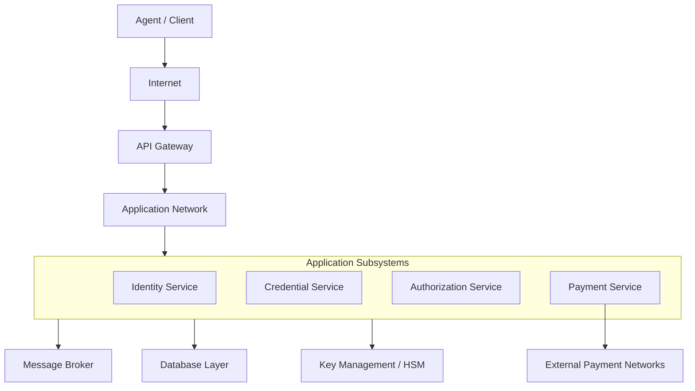
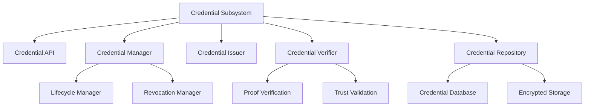
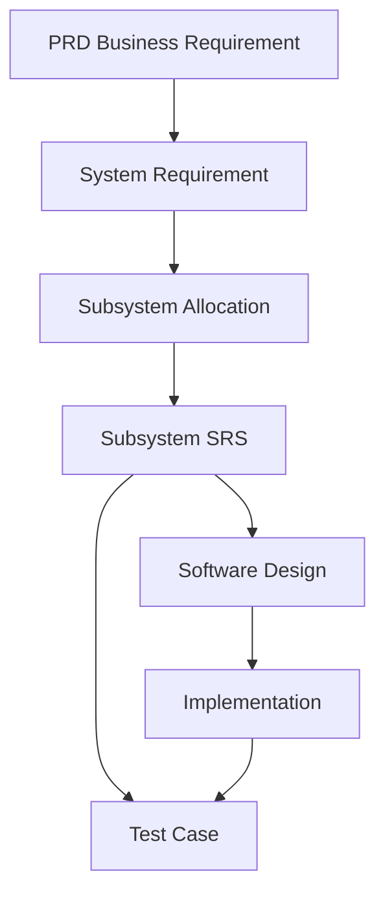

# **一、整体研发流程**

**01. 产品需求层**

# **PRD**

Product Requirements Document

产品目标、业务场景、用户角色、业务流程、功能需求、业务规则

**02. 系统分析与总体架构层**

# **System Architecture**

系统架构设计

业务能力分解、系统边界、子系统划分、总体技术架构、架构决策

**03. 部署架构**

## **Deployment**

网络拓扑、基础设施、节点、环境、部署关系

**04. 子系统架构**

## **Subsystem Design**

子系统职责、内部组件、技术选型、数据归属、接口关系

**05. 子系统详细设计与规格定义**

# **SRS / SDS / ICD**

需求规格、软件设计规格、接口规格、数据规格、安全规格

**06. 工程实施**

# **Implementation**

编码、单元测试、集成测试、系统测试、部署、运维

这里有一个重要区别：

**系统架构设计和子系统详细设计是两个不同层次的工作。**

前者解决整个系统如何组织，后者解决每个子系统内部如何实现。

# **二、每个阶段应该产出什么文档？**

我建议建立以下文档体系。

## **1. 产品需求层（Product Requirements）**

以 PRD 为核心。

| 文档                     | 主要内容              |
| ---------------------- | ----------------- |
| PRD                    | 产品目标、用户、业务场景、功能需求 |
| Business Rules         | 业务规则、约束、业务状态      |
| User Journey           | 用户旅程、业务流程         |
| Use Case Specification | 用例及交互场景           |

这一层回答：

- 产品要解决什么问题？
- 谁在使用？
- 有哪些业务场景？
- 系统必须提供哪些能力？
- 业务规则是什么？

注意：PRD 描述的是产品需要什么，而不是具体使用什么技术实现。

## **2. 系统总体架构层（System Architecture）**

这是非常重要的一层。

根据 PRD 中的业务需求，进行业务能力分解、系统边界定义和子系统划分。

建议至少产出以下文档：

| 文档                                    | 主要内容        |
| ------------------------------------- | ----------- |
| System Architecture Specification     | 总体系统架构      |
| System Context Diagram                | 系统上下文及外部参与者 |
| System Decomposition Specification    | 系统分解与子系统划分  |
| System Interaction Specification      | 子系统之间的交互关系  |
| Technology Architecture Specification | 技术架构与技术选型   |
| Architecture Decision Records (ADR)   | 关键架构决策及理由   |

这一阶段重点解决五个问题：

1. 系统有哪些核心业务能力？
2. 系统应该划分为哪些子系统？
3. 每个子系统的职责和边界是什么？
4. 子系统之间如何通信和协作？
5. 系统采用什么技术架构？

例如，一个 Agent Wallet 系统，可以初步分解为：

**Universal Agent Wallet System**

**Identity Subsystem**

身份与主体管理

**Credential Subsystem**

凭证管理

**Authorization Subsystem**

授权与策略

**Payment Subsystem**

支付与交易

**Key Management Subsystem**

密钥管理

**Protocol Gateway**

外部协议接入

**Audit Subsystem**

审计与追踪

**Wallet API Subsystem**

钱包访问接口

这里仅是一个示例划分，最终的子系统边界需要通过业务分析和架构设计确定，而不是简单地把 PRD 功能模块直接变成子系统。

## **3. 网络与部署架构层（Deployment Architecture）**

你提到的网络部署结构，应该作为总体架构的重要设计成果。

建议产出：

| 文档                                    | 主要内容           |
| ------------------------------------- | -------------- |
| Network Architecture Specification    | 网络架构           |
| Deployment Architecture Specification | 部署架构           |
| Infrastructure Specification          | 基础设施规格         |
| Environment Specification             | 开发、测试、预生产、生产环境 |
| Security Zone Specification           | 网络安全区域与访问控制    |

主要需要回答：

- 系统部署在云端、边缘设备还是用户设备？
- 哪些服务部署在公网？
- 哪些服务部署在私有网络？
- 是否需要 API Gateway？
- 子系统之间如何通信？
- 是否使用消息队列？
- 数据库如何部署？
- 如何实现高可用、灾备和扩展？

例如：



需要注意：部署架构不是简单地把子系统画到服务器上，而是要明确网络区域、部署单元、通信路径、信任边界和安全控制。

## **4. 子系统架构设计层（Subsystem Architecture）**

这是你所说的对每个子系统进一步进行系统应用架构设计。

我认为这个步骤非常必要。

例如，Credential Subsystem：



每个子系统需要明确：

- 子系统职责与边界
- 内部模块划分
- 应用架构模式
- 核心业务组件
- 数据模型与数据所有权
- 内部接口
- 外部接口
- 依赖关系
- 安全机制
- 异常处理与可靠性设计

建议产出：

**Subsystem Architecture Specification**

每个子系统单独一份。

# **三、每个子系统内部应该如何开展工作？**

这里涉及你提到的 SRS。

我建议把每个子系统当成一个相对独立的软件工程项目来管理。

但需要注意：SRS 和详细设计文档不是一回事。

- SRS：规定软件必须实现什么。
- SDS：规定软件如何实现。
- ICD：规定软件与其他系统或子系统如何交互。

推荐的文档体系如下：

| 文档                     | 英文名称                                | 解决的问题    |
| ---------------------- | ----------------------------------- | -------- |
| SRS                    | Software Requirements Specification | 软件需求规格   |
| SDS                    | Software Design Specification       | 软件详细设计   |
| API Specification      | API Specification                   | API 接口定义 |
| ICD                    | Interface Control Document          | 子系统接口控制  |
| DDS                    | Database Design Specification       | 数据库设计    |
| Security Specification | Security Specification              | 安全设计     |
| Test Specification     | Software Test Specification         | 测试规格     |

以 Credential Subsystem 为例：

**Credential Subsystem Engineering Workflow**

1. **Subsystem Architecture Specification**

   明确内部架构、组件职责和依赖关系。
2. **Credential SRS**

   定义所有功能需求、非功能需求、业务规则和验收标准。
3. **Credential SDS**

   设计组件、类、服务、状态机、算法和处理流程。
4. **API / ICD Specification**

   定义与其他子系统的通信接口、协议、数据格式。
5. **Database Design Specification**

   定义数据实体、关系、索引、存储与迁移。
6. **Security Specification**

   定义密钥保护、访问控制、凭证完整性和威胁防护。
7. **Test Specification**

   定义单元测试、集成测试、功能测试及安全测试。
8. **Implementation**

   按照设计规格实现软件，并通过测试验证。

并不是所有项目都必须把上述文档拆成独立文件。例如 API、数据库和安全设计可以在 SDS 中形成独立章节。拆分程度取决于项目规模、复杂度和团队协作需求。

# **四、还需要一个非常重要的机制：需求追踪**

这是我认为整个研发流程中不能缺少的一部分。

你不能只完成 PRD、系统架构、SRS，然后就开始编码。

必须确保每个阶段的产出都能够追溯到上一个阶段。

例如：



建议建立 Requirement Traceability Matrix（RTM）。

| PRD ID | 系统需求    | 子系统           | SRS ID     | 测试用例   |
| ------ | ------- | ------------- | ---------- | ------ |
| BR-001 | SYS-001 | Identity      | ID-SRS-001 | TC-001 |
| BR-002 | SYS-002 | Credential    | CR-SRS-001 | TC-002 |
| BR-003 | SYS-003 | Authorization | AU-SRS-001 | TC-003 |
| BR-004 | SYS-004 | Payment       | PM-SRS-001 | TC-004 |

这样可以保证：

- 每个产品需求都有对应的系统实现。
- 每个系统需求都有明确的责任子系统。
- 每个子系统需求都有设计实现。
- 每个需求都有测试验证。
- 需求变更时能够定位影响范围。

# **五、我建议最终建立的完整文档体系**

如果是一个中大型软件系统，我会采用下面这种目录组织方式。

```
Project/
│
├── 01-Product/
│   ├── PRD.md
│   ├── Business-Rules.md
│   ├── User-Journey.md
│   └── Use-Case-Specification.md
│
├── 02-System-Architecture/
│   ├── System-Architecture-Specification.md
│   ├── System-Context.md
│   ├── System-Decomposition.md
│   ├── System-Interaction.md
│   ├── Technology-Architecture.md
│   └── Architecture-Decisions/
│
├── 03-Infrastructure/
│   ├── Network-Architecture.md
│   ├── Deployment-Architecture.md
│   ├── Infrastructure-Specification.md
│   └── Security-Zones.md
│
├── 04-Subsystems/
│   │
│   ├── Identity/
│   │   ├── Architecture.md
│   │   ├── SRS.md
│   │   ├── SDS.md
│   │   ├── API-Specification.md
│   │   ├── Database-Specification.md
│   │   └── Test-Specification.md
│   │
│   ├── Credential/
│   │   ├── Architecture.md
│   │   ├── SRS.md
│   │   ├── SDS.md
│   │   ├── API-Specification.md
│   │   ├── Database-Specification.md
│   │   └── Test-Specification.md
│   │
│   ├── Authorization/
│   ├── Payment/
│   ├── Key-Management/
│   └── Audit/
│
├── 05-Integration/
│   ├── Interface-Control-Document.md
│   ├── Integration-Architecture.md
│   └── Integration-Test-Specification.md
│
├── 06-Quality-Assurance/
│   ├── Requirement-Traceability-Matrix.md
│   ├── System-Test-Specification.md
│   ├── Security-Test-Specification.md
│   └── Acceptance-Test-Specification.md
│
└── 07-Implementation/
    ├── Development-Standards.md
    ├── Coding-Guidelines.md
    ├── CI-CD-Specification.md
    └── Release-Plan.md
```

# **六、还有一个我建议你特别重视的问题：不要把架构设计和业务模块设计混为一谈**

例如：

PRD 中可能有：

- 用户身份管理
- 凭证管理
- 钱包授权
- 支付交易
- 资产管理

这些是业务能力。

但它们未必分别对应五个独立的微服务，也未必分别对应五个子系统。

架构设计必须综合考虑：

1. 业务边界（Business Boundary）
2. 数据所有权（Data Ownership）
3. 业务一致性（Consistency）
4. 安全边界（Security Boundary）
5. 部署与扩展需求（Deployment & Scalability）
6. 子系统之间的耦合程度（Coupling）

例如，Identity 和 Credential 可以属于不同子系统，但也可能在初期部署为同一个应用。

**逻辑架构、应用架构和物理部署架构是三个不同的维度，不能简单地一一对应。**

# **七、我的最终建议**

我建议将这套研发方法正式定义为一个标准化的工程工作流：

# **Product-to-Engineering Workflow**

从产品需求到可交付软件的完整工程体系

1. **Product Engineering**

   PRD → Business Analysis → Use Cases
2. **System Engineering**

   System Requirements → System Architecture → System Decomposition
3. **Infrastructure Engineering**

   Network Architecture → Deployment Architecture → Infrastructure Design
4. **Subsystem Engineering**

   Subsystem Architecture → SRS → SDS → ICD → Database Design
5. **Software Engineering**

   Implementation → Unit Testing → Integration Testing
6. **System Verification**

   System Testing → Acceptance Testing → Release

另外，我想强调三个原则：

**第一，先完成总体架构，再并行推进子系统。**

不能在总体架构尚未确定时，就让多个子系统分别独立设计，否则容易产生接口冲突和职责重叠。

**第二，先定义跨子系统接口，再深入内部实现。**

特别是涉及支付、身份、授权、密钥等核心能力的系统，接口契约非常重要。

**第三，每个阶段必须有明确的交付物和评审标准。**

不要仅仅以文档是否写完作为完成标准，而要检查需求覆盖率、接口一致性、架构可行性和测试可验证性。