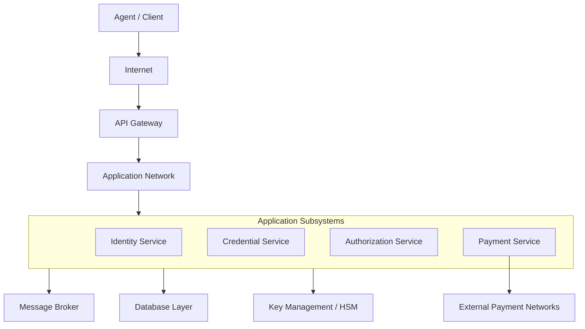
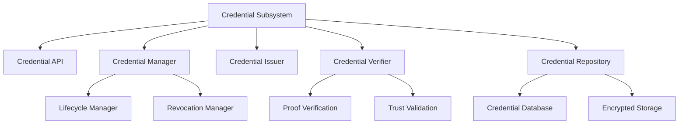
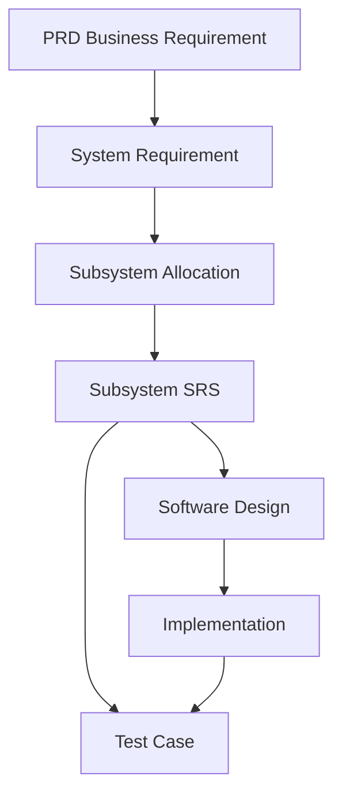

# **I. The Overall Development Process**

**01. Product Requirements Layer**

# **PRD**

Product Requirements Document

Product goals, business scenarios, user roles, business processes, functional requirements, and business rules

**02. System Analysis and Overall Architecture Layer**

# **System Architecture**

System architecture design

Business capability decomposition, system boundaries, subsystem partitioning, overall technical architecture, and architecture decisions

**03. Deployment Architecture**

## **Deployment**

Network topology, infrastructure, nodes, environments, and deployment relationships

**04. Subsystem Architecture**

## **Subsystem Design**

Subsystem responsibilities, internal components, technology choices, data ownership, and interface relationships

**05. Subsystem Detailed Design and Specification**

# **SRS / SDS / ICD**

Requirements specifications, software design specifications, interface specifications, data specifications, and security specifications

**06. Engineering Implementation**

# **Implementation**

Coding, unit testing, integration testing, system testing, deployment, and operations

There is an important distinction here:

**System architecture design and subsystem detailed design are work at two different levels.**

The former decides how the system as a whole is organized. The latter decides how each subsystem is implemented internally.

# **II. What Documents Should Each Stage Produce?**

I recommend establishing the following documentation system.

## **1. Product Requirements Layer**

The PRD is the core of this layer.

| Document                   | Main contents                                      |
| -------------------------- | -------------------------------------------------- |
| PRD                        | Product goals, users, business scenarios, functional requirements |
| Business Rules             | Business rules, constraints, and business states   |
| User Journey               | User journeys and business processes               |
| Use Case Specification     | Use cases and interaction scenarios                |

This layer answers:

- What problem is the product meant to solve?
- Who uses it?
- What business scenarios exist?
- What capabilities must the system provide?
- What are the business rules?

Note: a PRD describes what the product needs, and does not prescribe the specific technology used to implement it.

## **2. System Architecture Layer**

This is a critical layer.

Starting from the business requirements in the PRD, this stage decomposes business capabilities, defines system boundaries, and partitions the system into subsystems.

At a minimum, the following documents should be produced:

| Document                              | Main contents                              |
| ------------------------------------- | ------------------------------------------ |
| System Architecture Specification     | Overall system architecture                |
| System Context Diagram                | System context and external actors         |
| System Decomposition Specification    | System decomposition and subsystem partitioning |
| System Interaction Specification      | Interaction relationships among subsystems |
| Technology Architecture Specification | Technical architecture and technology choices |
| Architecture Decision Records (ADR)   | Key architecture decisions and their rationale |

This stage focuses on five questions:

1. What are the system's core business capabilities?
2. Into which subsystems should the system be partitioned?
3. What are the responsibilities and boundaries of each subsystem?
4. How do the subsystems communicate and collaborate?
5. What technical architecture does the system adopt?

For example, an Agent Wallet system might be decomposed, as a first cut, into:

**Universal Agent Wallet System**

**Identity Subsystem**

Identity and principal management

**Credential Subsystem**

Credential management

**Authorization Subsystem**

Authorization and policy

**Payment Subsystem**

Payments and transactions

**Key Management Subsystem**

Key management

**Protocol Gateway**

External protocol access

**Audit Subsystem**

Audit and traceability

**Wallet API Subsystem**

Wallet access interfaces

This is only an illustrative partitioning. Final subsystem boundaries must be determined through business analysis and architecture design. They are not produced by turning PRD feature modules directly into subsystems.

## **3. Network and Deployment Architecture Layer**

The network deployment structure you mentioned should be treated as an important design outcome of the overall architecture.

Recommended documents:

| Document                              | Main contents                                      |
| ------------------------------------- | -------------------------------------------------- |
| Network Architecture Specification    | Network architecture                               |
| Deployment Architecture Specification | Deployment architecture                            |
| Infrastructure Specification          | Infrastructure specification                       |
| Environment Specification             | Development, test, pre-production, and production environments |
| Security Zone Specification           | Network security zones and access control          |

The main questions to answer are:

- Is the system deployed in the cloud, on edge devices, or on user devices?
- Which services are deployed on the public network?
- Which services are deployed on a private network?
- Is an API gateway required?
- How do subsystems communicate with each other?
- Is a message queue used?
- How are databases deployed?
- How are high availability, disaster recovery, and scaling achieved?

For example:



Deployment architecture is more than drawing subsystems onto servers. It must make network zones, deployment units, communication paths, trust boundaries, and security controls explicit.

## **4. Subsystem Architecture Design Layer**

This is the further application-architecture design of each subsystem that you described.

I consider this step essential.

Take the Credential Subsystem as an example:



Each subsystem needs to make the following explicit:

- Subsystem responsibilities and boundaries
- Internal module partitioning
- Application architecture pattern
- Core business components
- Data model and data ownership
- Internal interfaces
- External interfaces
- Dependencies
- Security mechanisms
- Exception handling and reliability design

Recommended deliverable:

**Subsystem Architecture Specification**

One document per subsystem.

# **III. How Should Work Proceed Inside Each Subsystem?**

This is where the SRS you mentioned comes in.

I recommend managing each subsystem as a relatively independent software engineering project.

SRS and the detailed design document are different things:

- SRS: specifies what the software must do.
- SDS: specifies how the software does it.
- ICD: specifies how the software interacts with other systems or subsystems.

The recommended documentation set is:

| Document               | Full name                           | Question it answers                          |
| ---------------------- | ----------------------------------- | -------------------------------------------- |
| SRS                    | Software Requirements Specification | Software requirements specification          |
| SDS                    | Software Design Specification       | Detailed software design                     |
| API Specification      | API Specification                   | API interface definition                     |
| ICD                    | Interface Control Document          | Subsystem interface control                  |
| DDS                    | Database Design Specification       | Database design                              |
| Security Specification | Security Specification              | Security design                              |
| Test Specification     | Software Test Specification         | Test specification                           |

Using the Credential Subsystem as an example:

**Credential Subsystem Engineering Workflow**

1. **Subsystem Architecture Specification**

   Clarify the internal architecture, component responsibilities, and dependencies.
2. **Credential SRS**

   Define all functional requirements, non-functional requirements, business rules, and acceptance criteria.
3. **Credential SDS**

   Design components, classes, services, state machines, algorithms, and processing flows.
4. **API / ICD Specification**

   Define communication interfaces, protocols, and data formats with other subsystems.
5. **Database Design Specification**

   Define data entities, relationships, indexes, storage, and migration.
6. **Security Specification**

   Define key protection, access control, credential integrity, and threat protection.
7. **Test Specification**

   Define unit tests, integration tests, functional tests, and security tests.
8. **Implementation**

   Implement the software according to the design specifications, and verify it through testing.

Not every project needs to split the documents above into separate files. API, database, and security design, for example, can appear as independent chapters inside the SDS. How far to split them depends on project scale, complexity, and how the team needs to collaborate.

# **IV. A Mechanism That Cannot Be Left Out: Requirements Traceability**

This is a part of the development process I consider indispensable.

You cannot finish the PRD, the system architecture, and the SRS, and then start coding.

Every stage's output must be traceable to the previous stage.

For example:



I recommend establishing a Requirement Traceability Matrix (RTM).

| PRD ID | System requirement | Subsystem     | SRS ID     | Test case |
| ------ | ------------------ | ------------- | ---------- | --------- |
| BR-001 | SYS-001            | Identity      | ID-SRS-001 | TC-001    |
| BR-002 | SYS-002            | Credential    | CR-SRS-001 | TC-002    |
| BR-003 | SYS-003            | Authorization | AU-SRS-001 | TC-003    |
| BR-004 | SYS-004            | Payment       | PM-SRS-001 | TC-004    |

This ensures that:

- Every product requirement has a corresponding system implementation.
- Every system requirement has a clearly responsible subsystem.
- Every subsystem requirement has a design and an implementation.
- Every requirement has test verification.
- When a requirement changes, the impact can be located.

# **V. The Complete Documentation System I Recommend**

For a medium or large software system, I would organize the directory as follows.

```
Project/
│
├── 01-Product/
│   ├── PRD.md
│   ├── Business-Rules.md
│   ├── User-Journey.md
│   └── Use-Case-Specification.md
│
├── 02-System-Architecture/
│   ├── System-Architecture-Specification.md
│   ├── System-Context.md
│   ├── System-Decomposition.md
│   ├── System-Interaction.md
│   ├── Technology-Architecture.md
│   └── Architecture-Decisions/
│
├── 03-Infrastructure/
│   ├── Network-Architecture.md
│   ├── Deployment-Architecture.md
│   ├── Infrastructure-Specification.md
│   └── Security-Zones.md
│
├── 04-Subsystems/
│   │
│   ├── Identity/
│   │   ├── Architecture.md
│   │   ├── SRS.md
│   │   ├── SDS.md
│   │   ├── API-Specification.md
│   │   ├── Database-Specification.md
│   │   └── Test-Specification.md
│   │
│   ├── Credential/
│   │   ├── Architecture.md
│   │   ├── SRS.md
│   │   ├── SDS.md
│   │   ├── API-Specification.md
│   │   ├── Database-Specification.md
│   │   └── Test-Specification.md
│   │
│   ├── Authorization/
│   ├── Payment/
│   ├── Key-Management/
│   └── Audit/
│
├── 05-Integration/
│   ├── Interface-Control-Document.md
│   ├── Integration-Architecture.md
│   └── Integration-Test-Specification.md
│
├── 06-Quality-Assurance/
│   ├── Requirement-Traceability-Matrix.md
│   ├── System-Test-Specification.md
│   ├── Security-Test-Specification.md
│   └── Acceptance-Test-Specification.md
│
└── 07-Implementation/
    ├── Development-Standards.md
    ├── Coding-Guidelines.md
    ├── CI-CD-Specification.md
    └── Release-Plan.md
```

# **VI. Do Not Confuse Architecture Design with Business Module Design**

This is a point I recommend treating with particular care.

For example, a PRD may contain:

- User identity management
- Credential management
- Wallet authorization
- Payment transactions
- Asset management

These are business capabilities.

They do not necessarily map to five independent microservices, and they do not necessarily map to five subsystems.

Architecture design must weigh all of the following together:

1. Business Boundary
2. Data Ownership
3. Consistency
4. Security Boundary
5. Deployment and Scalability
6. Coupling between subsystems

Identity and Credential, for example, can belong to different subsystems, and in an early deployment they can also live in the same application.

**Logical architecture, application architecture, and physical deployment architecture are three different dimensions. They cannot be placed in a simple one-to-one correspondence.**

# **VII. My Final Recommendation**

I recommend defining this development method formally as a standardized engineering workflow:

# **Product-to-Engineering Workflow**

A complete engineering system from product requirements to deliverable software

1. **Product Engineering**

   PRD → Business Analysis → Use Cases
2. **System Engineering**

   System Requirements → System Architecture → System Decomposition
3. **Infrastructure Engineering**

   Network Architecture → Deployment Architecture → Infrastructure Design
4. **Subsystem Engineering**

   Subsystem Architecture → SRS → SDS → ICD → Database Design
5. **Software Engineering**

   Implementation → Unit Testing → Integration Testing
6. **System Verification**

   System Testing → Acceptance Testing → Release

I also want to emphasize three principles:

**First, finish the overall architecture before advancing subsystems in parallel.**

If several subsystems are designed independently before the overall architecture is settled, interface conflicts and overlapping responsibilities are likely.

**Second, define cross-subsystem interfaces before going deep into internal implementation.**

Interface contracts matter especially in systems whose core capabilities include payment, identity, authorization, and keys.

**Third, every stage must have explicit deliverables and review criteria.**

Completion is not judged by whether a document has been written. Review whether requirements coverage, interface consistency, architectural feasibility, and test verifiability hold.
