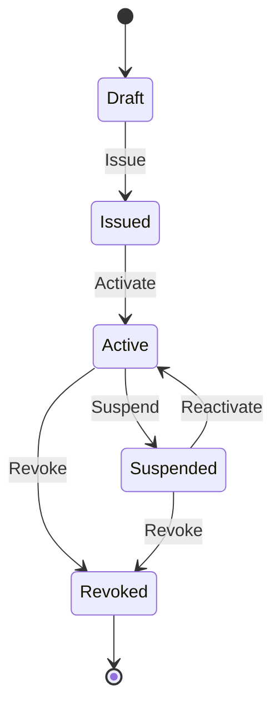
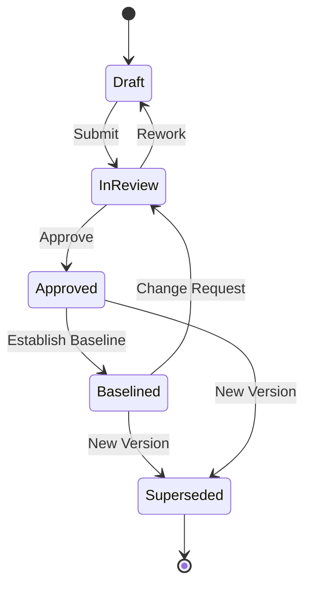
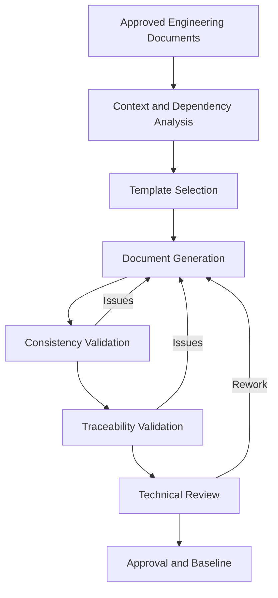
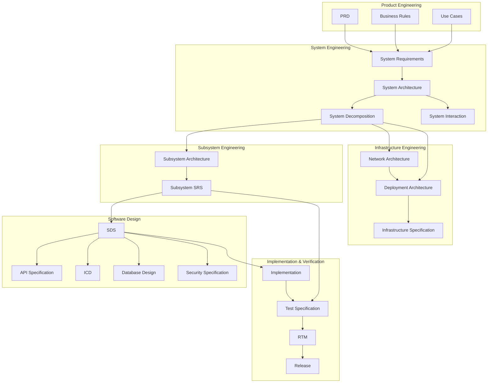

# Engineering Document Templates & Standards

**Document Type:** Engineering Documentation Standard  
**Document ID:** ENG-DOC-STD-001  
**Version:** 1.0.0  
**Status:** Baseline  
**Language:** English (Document Templates)  
**Scope:** Product Engineering, System Engineering, Software Architecture, Subsystem Engineering, Software Design, Implementation and Verification

---

# 1. Introduction

## 1.1 Purpose

This document defines standardized engineering document templates, content requirements, naming conventions, diagram standards, requirement identification rules, and review criteria for software development projects.

It establishes a consistent documentation framework for all engineering activities defined in:

**Product-to-Engineering Development Methodology & Documentation Standard**

The objectives are to:

1. Standardize engineering document structures.
2. Define mandatory and conditional document sections.
3. Establish consistent technical terminology.
4. Standardize architecture diagrams and technical models.
5. Establish requirement identification and traceability rules.
6. Define document quality and review criteria.
7. Enable consistent documentation across different engineering teams and AI-assisted development workflows.

## 1.2 Scope

This standard applies to the following engineering document categories:

| Category | Document |
|---|---|
| Governance | Project Engineering Plan |
| Product | PRD |
| Business | Business Rules Specification |
| Business | Use Case Specification |
| System | System Requirements Specification |
| System | System Architecture Specification |
| System | System Context Specification |
| System | System Decomposition Specification |
| System | System Interaction Specification |
| System | Technology Architecture Specification |
| Infrastructure | Network Architecture Specification |
| Infrastructure | Deployment Architecture Specification |
| Infrastructure | Infrastructure Specification |
| Infrastructure | Environment Specification |
| Subsystem | Subsystem Architecture Specification |
| Subsystem | Subsystem SRS |
| Software Design | Software Design Specification |
| Interface | API Specification |
| Interface | Interface Control Document |
| Data | Database Design Specification |
| Security | Security Specification |
| Testing | Test Specification |
| Quality | Requirement Traceability Matrix |
| Operations | Deployment and Operations Runbook |

## 1.3 Normative Language

The following terms are used throughout this standard.

| Term | Meaning |
|---|---|
| MUST | Mandatory requirement |
| MUST NOT | Prohibited practice |
| SHOULD | Recommended practice |
| SHOULD NOT | Practice that is generally discouraged |
| MAY | Optional practice |

Unless explicitly stated otherwise, MUST requirements are mandatory for documents governed by this standard.

## 1.4 Documentation Principles

### DP-001: Standardization

All formal engineering documents MUST follow their corresponding templates.

### DP-002: Traceability

Requirements and architectural decisions MUST have identifiable references.

### DP-003: Consistency

Related documents MUST use consistent terminology, identifiers, interfaces, and architectural definitions.

### DP-004: Verifiability

Requirements MUST be expressed in a manner that permits objective verification.

### DP-005: Separation of Concerns

Product requirements, system architecture, subsystem requirements, software design, and implementation details MUST remain conceptually distinct.

### DP-006: Maintainability

Documents MUST be maintained alongside the software artifacts they describe.

### DP-007: Single Source of Truth

Each authoritative engineering artifact MUST have one designated ownership location.

Other documents SHOULD reference that artifact instead of duplicating its authoritative content.

---

# 2. Document Classification

## 2.1 Document Categories

Engineering documents are divided into eight categories.

| Category | Purpose |
|---|---|
| Product Documents | Define product objectives and business requirements |
| Business Documents | Define business processes, rules, and use cases |
| System Documents | Define system-level requirements and architecture |
| Infrastructure Documents | Define network and physical deployment |
| Subsystem Documents | Define subsystem architecture and software requirements |
| Software Design Documents | Define implementation-level software design |
| Verification Documents | Define testing and requirement verification |
| Operational Documents | Define deployment, monitoring, and maintenance |

## 2.2 Document Types and Required Sections

| Document | Required Sections |
|---|---|
| PRD | Product Overview, Objectives, Users, Scope, Business Scenarios, Functional Requirements, NFRs, Acceptance Criteria |
| Business Rules | Rule Catalog, Conditions, Constraints, Exceptions, Examples |
| Use Case | Actors, Preconditions, Trigger, Main Flow, Alternative Flows, Postconditions |
| System Requirements | System Context, Functional Requirements, Interfaces, NFRs, Constraints |
| System Architecture | Context, Architecture Drivers, Logical Architecture, Application Architecture, Data Architecture, Security, Integration |
| System Decomposition | Subsystem Inventory, Responsibilities, Boundaries, Allocation, Dependencies |
| System Interaction | Interaction Model, Sequence Diagrams, Communication Contracts, Failure Handling |
| Technology Architecture | Technology Stack, Selection Rationale, Dependencies, Constraints |
| Network Architecture | Network Zones, Topology, Connectivity, Security Controls |
| Deployment Architecture | Deployment Units, Infrastructure Mapping, Runtime Topology, Scaling, Availability |
| Subsystem Architecture | Scope, Responsibilities, Internal Architecture, Data, Interfaces, Security |
| Subsystem SRS | Functional Requirements, NFRs, Interfaces, Business Rules, Acceptance Criteria |
| SDS | Software Structure, Components, Algorithms, State Machines, Data Design, Error Handling |
| API Specification | Endpoints, Methods, Schemas, Authentication, Responses, Errors, Versioning |
| ICD | Interface Ownership, Protocol, Contracts, Events, Errors, Reliability |
| Database Design | Entities, Relationships, Tables, Indexes, Constraints, Migrations |
| Security Specification | Threat Model, Trust Boundaries, Authentication, Authorization, Cryptography, Audit |
| Test Specification | Test Scope, Strategy, Environment, Test Cases, Expected Results |
| RTM | Requirement IDs, Allocation, Design References, Implementation References, Test References |
| Operations Runbook | Deployment, Configuration, Monitoring, Backup, Recovery, Incident Procedures |

---

# 3. Universal Document Template

All formal engineering documents MUST use the following common structure.

## 3.1 Document Header

```markdown
# [Document Title]

**Document ID:** [DOCUMENT-ID]
**Version:** [MAJOR.MINOR.PATCH]
**Status:** Draft
**Owner:** [OWNER]
**Author:** [AUTHOR]
**Reviewers:** [REVIEWERS]
**Created:** [YYYY-MM-DD]
**Last Updated:** [YYYY-MM-DD]

---

## Document Control

| Version | Date | Author | Description |
|---|---|---|---|
| 0.1.0 | YYYY-MM-DD | Name | Initial draft |

## Approval

| Role | Name | Status | Date |
|---|---|---|---|
| Document Owner | | Pending | |
| Technical Reviewer | | Pending | |
| Approver | | Pending | |

## Related Documents

| Document ID | Document Title | Version |
|---|---|---|
| | | |
```

## 3.2 Standard Document Sections

Unless the document type defines a more specific structure, the following sections SHOULD be included.

```markdown
# 1. Introduction

## 1.1 Purpose
## 1.2 Scope
## 1.3 Definitions and Abbreviations
## 1.4 References

# 2. Background and Context

# 3. Main Specification

# 4. Architecture / Design / Requirements

# 5. Interfaces and Dependencies

# 6. Security and Reliability

# 7. Constraints and Assumptions

# 8. Verification and Acceptance Criteria

# 9. Traceability

# 10. Appendix
```

Not every document requires every section. The applicable document template takes precedence over this generic structure.

## 3.3 Writing Rules

Every section MUST contain meaningful content appropriate to its purpose.

The following practices are prohibited:

- Empty sections presented as completed work.
- Requirements without identifiable IDs.
- Unexplained technical abbreviations.
- Undefined architecture components.
- Diagrams without explanatory descriptions.
- Interfaces without request and response definitions.
- Ambiguous references such as "as mentioned above" when a stable reference is available.
- Duplicating authoritative specifications without identifying the source.

When information is not applicable, explicitly state:

`N/A — Not applicable to this document.`

When information is not yet determined, explicitly state:

`TBD — To be determined.`

TBD items MUST include an owner and resolution target when they affect project decisions.

---

# 4. Product Requirements Document (PRD) Template

## 4.1 Document Purpose

The PRD defines product objectives, user requirements, business scenarios, functional capabilities, business constraints, and acceptance criteria.

It describes WHAT the product must achieve, not HOW the software is implemented.

## 4.2 Required Structure

```markdown
# Product Requirements Document

# 1. Product Overview

## 1.1 Product Vision
## 1.2 Product Background
## 1.3 Problem Statement
## 1.4 Product Goals
## 1.5 Success Metrics

# 2. Target Users and Stakeholders

## 2.1 User Roles
## 2.2 User Characteristics
## 2.3 Stakeholder Inventory

# 3. Product Scope

## 3.1 In Scope
## 3.2 Out of Scope
## 3.3 Assumptions
## 3.4 Constraints

# 4. Business Analysis

## 4.1 Business Capabilities
## 4.2 Business Processes
## 4.3 Business Entities
## 4.4 Business Rules
## 4.5 External Dependencies

# 5. Product Functional Requirements

## 5.1 Feature Inventory
## 5.2 Functional Requirements
## 5.3 User Workflows
## 5.4 Business Exceptions

# 6. Non-Functional Requirements

## 6.1 Performance
## 6.2 Availability
## 6.3 Security
## 6.4 Scalability
## 6.5 Usability
## 6.6 Maintainability
## 6.7 Interoperability

# 7. External Integrations

# 8. User Experience Requirements

# 9. Product Acceptance Criteria

# 10. Release Scope and Priorities

# 11. Open Issues
```

## 4.3 Functional Requirement Format

Each functional requirement MUST use a consistent structure.

```markdown
### PRD-FR-001: [Requirement Name]

**Priority:** Must Have
**Status:** Proposed
**Source:** [Business Requirement ID]

**Description:**

The product MUST ...

**Business Rationale:**

Why this capability is necessary.

**Actors:**

- User
- External System

**Preconditions:**

Conditions before execution.

**Main Behavior:**

1. Step one.
2. Step two.
3. Step three.

**Alternative Behavior:**

Describe alternative or exceptional scenarios.

**Postconditions:**

Expected final state.

**Acceptance Criteria:**

- [ ] Criterion 1.
- [ ] Criterion 2.
```

## 4.4 Priority Classification

| Priority | Meaning |
|---|---|
| Must Have | Essential to product operation |
| Should Have | Important but not essential for initial delivery |
| Could Have | Optional enhancement |
| Won't Have | Explicitly excluded from current release |

---

# 5. Business Rules Specification Template

## 5.1 Purpose

Define business constraints and decision rules independently of software implementation.

## 5.2 Required Structure

```markdown
# Business Rules Specification

# 1. Introduction

# 2. Business Domain Overview

# 3. Business Rule Catalog

## BR-001: [Rule Name]

**Category:**
**Description:**
**Conditions:**
**Rule:**
**Exceptions:**
**Examples:**
**Related Requirements:**

# 4. Business State Definitions

# 5. Business Constraints

# 6. Business Decision Tables

# 7. Rule Dependencies

# 8. Change History
```

## 5.3 Business Rule Requirements

A business rule MUST:

- Represent an explicit business constraint or decision.
- Be independent of implementation technology.
- Have a unique identifier.
- Identify the applicable business entities or processes.
- Define relevant exceptions.
- Be traceable to product requirements.

Business rules SHOULD be represented using decision tables when multiple conditions affect the outcome.

---

# 6. Use Case Specification Template

## 6.1 Purpose

Describe interactions between actors and the system to achieve a business objective.

## 6.2 Required Structure

```markdown
# Use Case Specification

## UC-001: [Use Case Name]

**Primary Actor:**
**Supporting Actors:**
**Goal:**
**Priority:**

### Preconditions

### Trigger

### Main Success Scenario

1. Actor performs an action.
2. System responds.
3. Actor continues.
4. System completes the operation.

### Alternative Flows

### Exception Flows

### Postconditions

### Business Rules

### Related Requirements

### Acceptance Criteria
```

## 6.3 Use Case Modeling

Use Case diagrams SHOULD be used when multiple actors and use cases require an overview.

Detailed execution MUST be described using textual scenarios or sequence diagrams where appropriate.

---

# 7. System Requirements Specification (SyRS) Template

## 7.1 Purpose

Define requirements allocated to the complete system.

The System Requirements Specification (SyRS) describes the observable behavior, interfaces, constraints, and quality requirements of the complete system.

It serves as the primary input to system architecture and subsystem allocation.

## 7.2 Required Structure

```markdown
# System Requirements Specification

# 1. Introduction

## 1.1 Purpose
## 1.2 Scope
## 1.3 System Overview
## 1.4 Definitions
## 1.5 References

# 2. System Context

## 2.1 System Boundary
## 2.2 External Actors
## 2.3 External Systems
## 2.4 Context Diagram

# 3. System Functional Requirements

## 3.1 Functional Requirement Inventory
## 3.2 System Behaviors
## 3.3 Business Workflows
## 3.4 State Transitions
## 3.5 Exception Handling

# 4. System Interface Requirements

## 4.1 User Interfaces
## 4.2 External System Interfaces
## 4.3 Communication Interfaces
## 4.4 Protocol Requirements

# 5. System Non-Functional Requirements

## 5.1 Performance
## 5.2 Availability
## 5.3 Reliability
## 5.4 Security
## 5.5 Scalability
## 5.6 Privacy
## 5.7 Observability

# 6. System Constraints

# 7. System Operational Requirements

# 8. Verification Requirements

# 9. Requirement Traceability
```

## 7.3 System Requirement Format

```markdown
### SYS-FR-001: [Requirement Name]

**Type:** Functional
**Priority:** Must
**Source:** PRD-FR-001
**Verification Method:** Test

**Requirement:**

The system MUST ...

**Rationale:**

**Preconditions:**

**Expected Behavior:**

**Postconditions:**

**Failure Conditions:**

**Acceptance Criteria:**
```

## 7.4 Requirement Allocation

Every system requirement MUST be assigned to:

- One primary owning subsystem, or
- An explicitly identified cross-subsystem responsibility.

Cross-cutting requirements MAY be allocated to multiple subsystems.

The allocation MUST identify the accountable owner and the supporting subsystems.

---

# 8. System Architecture Specification Template

## 8.1 Purpose

Define the overall logical and technical architecture of the complete system.

The document MUST establish how the system is organized and how its major components cooperate.

## 8.2 Required Structure

```markdown
# System Architecture Specification

# 1. Introduction

## 1.1 Purpose
## 1.2 Scope
## 1.3 Architectural Objectives
## 1.4 References

# 2. Architecture Drivers

## 2.1 Business Drivers
## 2.2 Functional Requirements
## 2.3 Quality Attributes
## 2.4 Technical Constraints
## 2.5 Architecture Risks

# 3. Architecture Overview

## 3.1 Architectural Style
## 3.2 Architecture Principles
## 3.3 System Context
## 3.4 High-Level Architecture Diagram

# 4. Logical Architecture

## 4.1 Logical Components
## 4.2 Responsibilities
## 4.3 Component Relationships
## 4.4 Logical Data Flows

# 5. Application Architecture

## 5.1 Applications
## 5.2 Services
## 5.3 Modules
## 5.4 Communication Model

# 6. Data Architecture

## 6.1 Data Domains
## 6.2 Data Ownership
## 6.3 Data Flows
## 6.4 Persistence Strategy
## 6.5 Consistency Model

# 7. Integration Architecture

## 7.1 Internal Interfaces
## 7.2 External Interfaces
## 7.3 Communication Protocols
## 7.4 Event Architecture

# 8. Security Architecture

## 8.1 Trust Boundaries
## 8.2 Authentication
## 8.3 Authorization
## 8.4 Key Management
## 8.5 Data Protection
## 8.6 Audit

# 9. Reliability and Scalability

# 10. Architecture Decisions

# 11. Architecture Risks and Trade-offs

# 12. Requirements Traceability

# 13. Appendices
```

## 8.3 Architecture Diagram Requirements

At minimum, the document MUST contain:

1. System Context Diagram
2. High-Level Logical Architecture Diagram
3. Application Architecture Diagram
4. Major Data Flow Diagram
5. Major Integration Diagram

Additional diagrams SHOULD be included when necessary.

## 8.4 Architecture Component Definition

Each major component MUST have:

- Component ID
- Component name
- Responsibility
- Inputs
- Outputs
- Dependencies
- Data ownership
- Security boundary
- Related requirements

---

# 9. System Decomposition Specification Template

## 9.1 Purpose

Define the subsystem boundaries and responsibilities derived from the overall system architecture.

This document is the authoritative reference for subsystem allocation.

## 9.2 Required Structure

```markdown
# System Decomposition Specification

# 1. Introduction

# 2. Decomposition Principles

# 3. System Capability Inventory

# 4. Subsystem Inventory

# 5. Subsystem Definitions

## SUB-001: [Subsystem Name]

### Purpose

### Responsibilities

### Scope

### Out of Scope

### Inputs

### Outputs

### Data Ownership

### Dependencies

### Exposed Interfaces

### Quality Requirements

### Related System Requirements

# 6. Subsystem Dependency Matrix

# 7. System Requirement Allocation Matrix

# 8. Cross-Subsystem Responsibilities

# 9. Architecture Constraints

# 10. Decomposition Decisions
```

## 9.3 Subsystem Dependency Matrix

Example:

| Subsystem | Identity | Credential | Authorization | Payment |
|---|---|---|---|---|
| Identity | - | Provider | Provider | Provider |
| Credential | Consumer | - | Consumer | - |
| Authorization | Consumer | Consumer | - | Provider |
| Payment | Consumer | - | Consumer | - |

Legend:

- Provider: Provides capabilities or data through an interface.
- Consumer: Depends on the provider's capabilities.

The actual dependency direction MUST be explicitly defined.

## 9.4 Subsystem Boundary Rules

A subsystem MUST have:

1. A clearly defined responsibility.
2. An identifiable owner.
3. Explicit data ownership.
4. Explicit external interfaces.
5. Documented dependencies.
6. Defined security responsibilities.

Subsystem boundaries MUST NOT be determined solely by UI screens, database tables, or programming language packages.

---

# 10. System Interaction Specification Template

## 10.1 Purpose

Define communication and collaboration among subsystems.

## 10.2 Required Structure

```markdown
# System Interaction Specification

# 1. Introduction

# 2. Interaction Architecture

# 3. Communication Patterns

## 3.1 Synchronous Communication
## 3.2 Asynchronous Communication
## 3.3 Event-Driven Communication

# 4. Interaction Inventory

# 5. Sequence Diagrams

# 6. Message Contracts

# 7. Error Handling

# 8. Retry and Timeout Policies

# 9. Idempotency

# 10. Transaction Boundaries

# 11. Consistency Guarantees

# 12. Security Requirements

# 13. Interface Traceability
```

Each major interaction SHOULD specify:

- Producer
- Consumer
- Trigger
- Input
- Output
- Protocol
- Authentication
- Failure behavior
- Timeout
- Retry policy
- Idempotency behavior

---

# 11. Technology Architecture Specification Template

## 11.1 Purpose

Document technology selections and their architectural rationale.

## 11.2 Required Structure

```markdown
# Technology Architecture Specification

# 1. Introduction

# 2. Technology Selection Principles

# 3. Technology Stack

## 3.1 Programming Languages
## 3.2 Application Frameworks
## 3.3 Databases
## 3.4 Messaging
## 3.5 Infrastructure
## 3.6 Observability
## 3.7 Security Technologies

# 4. Technology Selection Rationale

# 5. Alternatives and Trade-offs

# 6. Compatibility Requirements

# 7. Version Management

# 8. Technical Constraints

# 9. Architecture Decisions
```

Every major technology choice SHOULD document:

- Selected technology
- Intended use
- Version or compatibility range
- Alternatives
- Selection rationale
- Limitations
- Operational implications

---

# 12. Network Architecture Specification Template

## 12.1 Purpose

Define the network topology and communication security boundaries.

## 12.2 Required Structure

```markdown
# Network Architecture Specification

# 1. Introduction

# 2. Network Architecture Overview

# 3. Network Zones

# 4. Network Topology

# 5. Connectivity Architecture

## 5.1 Internet Connectivity
## 5.2 Ingress
## 5.3 Egress
## 5.4 Internal Communication
## 5.5 External Integrations

# 6. Network Security

## 6.1 Firewall Rules
## 6.2 Access Control
## 6.3 Network Segmentation
## 6.4 Encryption in Transit

# 7. DNS and Load Balancing

# 8. Network Availability

# 9. Network Monitoring

# 10. Security and Operational Constraints
```

## 12.3 Network Diagram Requirements

The diagram SHOULD identify:

- Internet
- Public network
- Private network
- VPC
- Subnets
- Firewall
- Load balancers
- API gateways
- Internal services
- Databases
- External services
- Trust boundaries

Network diagrams MUST distinguish logical security zones from physical infrastructure where relevant.

---

# 13. Deployment Architecture Specification Template

## 13.1 Purpose

Define how logical applications and services are deployed onto physical or virtual infrastructure.

## 13.2 Required Structure

```markdown
# Deployment Architecture Specification

# 1. Introduction

# 2. Deployment Overview

# 3. Deployment Units

## 3.1 Frontend
## 3.2 API Gateway
## 3.3 Backend Services
## 3.4 Workers
## 3.5 Databases
## 3.6 Messaging Infrastructure
## 3.7 External Services

# 4. Infrastructure Mapping

# 5. Runtime Architecture

# 6. Deployment Topology

# 7. Scaling Strategy

# 8. Availability and Fault Tolerance

# 9. Configuration Management

# 10. Deployment Strategy

# 11. Disaster Recovery

# 12. Monitoring and Operations
```

## 13.3 Deployment Mapping

Every deployment unit MUST identify:

| Attribute | Description |
|---|---|
| Deployment ID | Unique identifier |
| Logical Component | Associated architecture component |
| Runtime | Container, VM, serverless, device, etc. |
| Infrastructure | Hosting environment |
| Network Zone | Deployment network |
| Dependencies | Required runtime services |
| Scaling | Scaling strategy |
| Availability | Availability requirements |
| Security | Access and protection requirements |

---

# 14. Subsystem Architecture Specification Template

## 14.1 Purpose

Define the internal architecture of an individual subsystem.

This document bridges overall system architecture and subsystem software requirements.

It MUST be written after subsystem responsibilities and boundaries are established.

## 14.2 Required Structure

```markdown
# [Subsystem Name] Architecture Specification

# 1. Introduction

## 1.1 Purpose
## 1.2 Scope
## 1.3 References

# 2. Subsystem Overview

## 2.1 Responsibilities
## 2.2 Functional Capabilities
## 2.3 Boundaries
## 2.4 Dependencies

# 3. Architecture Overview

## 3.1 Architecture Style
## 3.2 Architecture Principles
## 3.3 Architecture Diagram

# 4. Internal Application Architecture

## 4.1 Component Inventory
## 4.2 Component Responsibilities
## 4.3 Component Relationships
## 4.4 Internal Communication

# 5. Business Logic Architecture

## 5.1 Domain Model
## 5.2 Business Services
## 5.3 Workflows
## 5.4 State Machines
## 5.5 Business Invariants

# 6. Data Architecture

## 6.1 Data Ownership
## 6.2 Data Entities
## 6.3 Persistence Strategy
## 6.4 Data Lifecycle

# 7. External Interfaces

## 7.1 Provided Interfaces
## 7.2 Consumed Interfaces
## 7.3 Events
## 7.4 External Integrations

# 8. Security Architecture

# 9. Reliability and Error Handling

# 10. Deployment Mapping

# 11. Architecture Decisions

# 12. Requirements Allocation

# 13. Open Issues
```

## 14.3 Component Inventory

| Component ID | Component | Responsibility | Dependencies |
|---|---|---|---|
| CR-CMP-001 | Credential API | API access | Authentication |
| CR-CMP-002 | Credential Manager | Lifecycle management | Repository |
| CR-CMP-003 | Credential Verifier | Verification | Trust Registry |
| CR-CMP-004 | Credential Repository | Data persistence | Database |

## 14.4 Required Diagrams

Each subsystem SHOULD include:

1. Internal Component Diagram
2. Component Interaction Diagram
3. Domain Model Diagram
4. Critical Workflow Sequence Diagram
5. State Machine Diagram, when applicable
6. Data Flow Diagram

---

# 15. Software Requirements Specification (SRS) Template

## 15.1 Purpose

The SRS defines the complete software requirements of an individual subsystem or software component.

The SRS MUST specify WHAT the software must do.

It MUST NOT replace the architectural design or detailed implementation design.

## 15.2 Required Structure

```markdown
# [Subsystem Name] Software Requirements Specification

# 1. Introduction

## 1.1 Purpose
## 1.2 Scope
## 1.3 Definitions
## 1.4 References

# 2. Software Overview

## 2.1 Product Perspective
## 2.2 Software Functions
## 2.3 User Classes
## 2.4 Operating Environment
## 2.5 Constraints
## 2.6 Assumptions

# 3. Functional Requirements

## 3.1 Functional Requirement Inventory
## 3.2 Detailed Functional Requirements
## 3.3 Business Workflows
## 3.4 State Management
## 3.5 Exception Handling

# 4. External Interface Requirements

## 4.1 User Interfaces
## 4.2 Software Interfaces
## 4.3 Communication Interfaces
## 4.4 Protocol Requirements

# 5. Data Requirements

## 5.1 Input Data
## 5.2 Output Data
## 5.3 Data Validation
## 5.4 Data Integrity
## 5.5 Data Retention

# 6. Non-Functional Requirements

## 6.1 Performance
## 6.2 Availability
## 6.3 Reliability
## 6.4 Security
## 6.5 Privacy
## 6.6 Scalability
## 6.7 Maintainability
## 6.8 Observability

# 7. Business Rules

# 8. Error and Exception Requirements

# 9. Operational Requirements

# 10. Acceptance Criteria

# 11. Requirement Traceability

# 12. Open Issues
```

## 15.3 Functional Requirement Format

```markdown
### [SUBSYSTEM]-SRS-FR-001: [Requirement Name]

**Type:** Functional
**Priority:** Must
**Status:** Approved
**Source System Requirement:** SYS-FR-001
**Related Business Rule:** BR-001
**Verification Method:** Test

**Requirement Statement:**

The software MUST ...

**Description:**

Detailed explanation of expected software behavior.

**Preconditions:**

Conditions required before execution.

**Input:**

Input parameters and data.

**Processing Requirements:**

1. Processing step one.
2. Processing step two.
3. Processing step three.

**Output:**

Expected output and resulting state.

**Postconditions:**

Expected final conditions.

**Failure Conditions:**

- Error condition one.
- Error condition two.

**Acceptance Criteria:**

- [ ] AC-001
- [ ] AC-002

**Related Interfaces:**

- API-001

**Related Components:**

- CMP-001
```

## 15.4 Non-Functional Requirement Format

```markdown
### [SUBSYSTEM]-SRS-NFR-001: [Requirement Name]

**Category:** Performance
**Priority:** Must
**Source:** SYS-NFR-001
**Verification Method:** Performance Test

**Requirement Statement:**

The software MUST ...

**Measurement Method:**

Describe the measurement method.

**Workload Conditions:**

Define the expected workload.

**Acceptance Threshold:**

Define measurable thresholds.

**Verification Environment:**

Define the test environment.
```

## 15.5 SRS Quality Requirements

Every functional requirement MUST:

- Describe one identifiable behavior.
- Have a unique ID.
- Define relevant inputs and outputs.
- Define preconditions and postconditions where applicable.
- Identify error conditions.
- Have verifiable acceptance criteria.
- Reference its source requirement.

Every quantitative NFR MUST define:

- Measurement unit
- Workload or operating conditions
- Measurement method
- Acceptance threshold

---

# 16. Software Design Specification (SDS) Template

## 16.1 Purpose

The SDS defines the detailed technical design of the software.

It transforms approved SRS requirements into implementation-ready components, algorithms, data structures, interfaces, and processing logic.

## 16.2 Required Structure

```markdown
# [Subsystem Name] Software Design Specification

# 1. Introduction

## 1.1 Purpose
## 1.2 Scope
## 1.3 References

# 2. Design Overview

## 2.1 Design Objectives
## 2.2 Design Principles
## 2.3 Architecture Constraints

# 3. Software Structure

## 3.1 Package Structure
## 3.2 Module Structure
## 3.3 Component Structure
## 3.4 Dependency Structure

# 4. Detailed Component Design

## 4.1 Component Inventory
## 4.2 Component Responsibilities
## 4.3 Component Interfaces
## 4.4 Processing Logic

# 5. Domain and Business Logic Design

## 5.1 Domain Model
## 5.2 Entities and Value Objects
## 5.3 Business Services
## 5.4 Business Invariants
## 5.5 State Machines
## 5.6 Algorithms

# 6. Data Design

## 6.1 Logical Data Model
## 6.2 Physical Data Model
## 6.3 Database Schema
## 6.4 Indexes and Constraints
## 6.5 Data Access Strategy

# 7. API and Interface Design

## 7.1 Internal APIs
## 7.2 External APIs
## 7.3 Events
## 7.4 Serialization

# 8. Error Handling

# 9. Security Design

# 10. Concurrency and Transaction Design

# 11. Logging and Observability

# 12. Configuration Management

# 13. Deployment Considerations

# 14. Design Traceability

# 15. Open Issues
```

## 16.3 Component Design Format

```markdown
### CMP-001: [Component Name]

**Purpose:**

**Responsibilities:**

**Inputs:**

**Outputs:**

**Dependencies:**

**Public Interfaces:**

**Internal Processing:**

**Data Access:**

**State Management:**

**Error Handling:**

**Security Considerations:**

**Related SRS Requirements:**

**Related Test Cases:**
```

## 16.4 Algorithm Specification

Complex algorithms MUST be documented sufficiently for implementation and verification.

```markdown
### ALG-001: [Algorithm Name]

**Purpose:**

**Inputs:**

**Outputs:**

**Preconditions:**

**Algorithm:**

1. Step one.
2. Step two.
3. Step three.

**Complexity:**

**Failure Conditions:**

**Security Considerations:**

**Test Requirements:**
```

## 16.5 State Machine Specification

For stateful business entities, the SDS SHOULD define:

- States
- Events
- Transition conditions
- Transition actions
- Invalid transitions
- Terminal states

Example:



The actual state transitions MUST be consistent with the SRS and business rules.

---

# 17. API Specification Template

## 17.1 Purpose

Define machine-readable and human-readable API contracts.

Where appropriate, APIs SHOULD be described using OpenAPI 3.x or a compatible standard.

## 17.2 Required Structure

```markdown
# API Specification

# 1. Introduction

# 2. API Overview

# 3. API Design Principles

# 4. Authentication and Authorization

# 5. API Conventions

## 5.1 Naming
## 5.2 HTTP Methods
## 5.3 Headers
## 5.4 Content Types
## 5.5 Pagination
## 5.6 Idempotency
## 5.7 Versioning

# 6. Endpoint Definitions

## API-001: [Endpoint Name]

### Method
### Path
### Description
### Authentication
### Authorization
### Request Headers
### Path Parameters
### Query Parameters
### Request Body
### Response Body
### Status Codes
### Error Responses
### Examples

# 7. Error Code Catalog

# 8. Rate Limiting

# 9. Security Considerations

# 10. Compatibility and Versioning
```

## 17.3 API Endpoint Definition

```markdown
### API-001: Create Credential

**Method:** POST

**Path:** /v1/credentials

**Authentication:** Required

**Authorization:** credential:create

**Description:**

Creates a new credential.

**Request:**

```json
{
  "type": "ExampleCredential",
  "subject": "subject-id",
  "claims": {}
}
```

**Response:**

```json
{
  "credential_id": "cred_001",
  "status": "issued"
}
```

**Error Responses:**

| Code | Description |
|---|---|
| 400 | Invalid request |
| 401 | Unauthorized |
| 403 | Forbidden |
| 409 | Conflict |
| 500 | Internal error |

**Idempotency:**

Define idempotency behavior.

**Related Requirements:**

- CR-SRS-FR-001
```

The example above is illustrative. Actual contracts MUST be defined by the project.

---

# 18. Interface Control Document (ICD) Template

## 18.1 Purpose

Define authoritative communication contracts between subsystems.

ICD is particularly important when multiple teams or agents develop subsystems independently.

## 18.2 Required Structure

```markdown
# Interface Control Document

# 1. Introduction

# 2. Interface Inventory

# 3. Interface Definitions

## ICD-001: [Interface Name]

### Provider
### Consumer
### Purpose
### Protocol
### Transport
### Communication Pattern

### Request Schema

### Response Schema

### Event Schema

### Authentication

### Authorization

### Error Handling

### Timeout

### Retry Policy

### Idempotency

### Versioning

### Compatibility Requirements

# 4. Sequence Diagrams

# 5. Failure Scenarios

# 6. Security Requirements

# 7. Interface Change Management
```

## 18.3 Interface Contract Rules

Every cross-subsystem interface MUST identify:

- Provider
- Consumer
- Interface owner
- Contract version
- Request and response schema, if applicable
- Error semantics
- Security requirements
- Reliability behavior

A subsystem MUST NOT independently change an interface contract without coordinating with its consumers.

---

# 19. Database Design Specification Template

## 19.1 Purpose

Define the logical and physical data structures owned by a subsystem.

## 19.2 Required Structure

```markdown
# Database Design Specification

# 1. Introduction

# 2. Data Architecture Overview

# 3. Data Ownership

# 4. Logical Data Model

# 5. Entity Definitions

# 6. Physical Database Model

# 7. Table Definitions

# 8. Relationships

# 9. Indexes

# 10. Constraints

# 11. Transaction Design

# 12. Data Consistency

# 13. Data Migration

# 14. Backup and Recovery

# 15. Data Retention

# 16. Security and Privacy

# 17. Performance Considerations
```

## 19.3 Table Definition Format

```markdown
### TABLE-001: credentials

| Column | Type | Nullable | Key | Description |
|---|---|---|---|---|
| id | UUID | No | PK | Credential identifier |
| subject_id | UUID | No | FK | Subject identifier |
| credential_type | VARCHAR | No | | Credential type |
| status | VARCHAR | No | | Current status |
| created_at | TIMESTAMP | No | | Creation timestamp |

**Indexes:**

- idx_credentials_subject

**Constraints:**

- Credential identifier MUST be unique.

**Related Requirements:**

- CR-SRS-FR-001
```

Actual types, keys, and constraints MUST match the selected database technology.

---

# 20. Security Specification Template

## 20.1 Purpose

Define subsystem and system security requirements and controls.

## 20.2 Required Structure

```markdown
# Security Specification

# 1. Introduction

# 2. Security Objectives

# 3. Assets and Security Classification

# 4. Threat Model

## 4.1 Assets
## 4.2 Threat Actors
## 4.3 Attack Surfaces
## 4.4 Trust Boundaries
## 4.5 Threat Scenarios

# 5. Authentication

# 6. Authorization

# 7. Identity and Credential Protection

# 8. Cryptographic Architecture

# 9. Key Management

# 10. Data Protection

# 11. Network Security

# 12. Audit and Logging

# 13. Secure Development Requirements

# 14. Security Testing

# 15. Incident Response

# 16. Residual Risks
```

## 20.3 Security Requirement Format

```markdown
### SEC-001: [Security Requirement Name]

**Asset:**

**Threat:**

**Security Objective:**

**Requirement:**

The system MUST ...

**Security Control:**

Describe the mitigation.

**Verification Method:**

Describe how the control is validated.

**Related Requirements:**
```

Security requirements SHOULD be traceable to identified threats or security objectives.

---

# 21. Test Specification Template

## 21.1 Purpose

Define the verification strategy and test cases for software requirements.

## 21.2 Required Structure

```markdown
# Test Specification

# 1. Introduction

# 2. Test Objectives

# 3. Test Scope

## 3.1 In Scope
## 3.2 Out of Scope

# 4. Test Strategy

## 4.1 Unit Testing
## 4.2 Component Testing
## 4.3 Subsystem Testing
## 4.4 Integration Testing
## 4.5 System Testing
## 4.6 Acceptance Testing

# 5. Test Environment

# 6. Test Data

# 7. Test Cases

# 8. Test Execution Procedures

# 9. Expected Results

# 10. Defect Management

# 11. Test Coverage

# 12. Exit Criteria
```

## 21.3 Test Case Format

```markdown
### TC-001: [Test Case Name]

**Related Requirement:** CR-SRS-FR-001

**Test Type:** Functional

**Priority:** High

**Preconditions:**

**Test Data:**

**Execution Steps:**

1. Step one.
2. Step two.
3. Step three.

**Expected Results:**

**Actual Results:**

**Status:** Not Executed

**Evidence:**

**Notes:**
```

## 21.4 Test Case Status

| Status | Meaning |
|---|---|
| Not Executed | Test has not been executed |
| Passed | Expected behavior verified |
| Failed | Expected behavior not achieved |
| Blocked | Execution cannot proceed |
| Skipped | Test intentionally not executed |

---

# 22. Requirement Traceability Matrix (RTM) Template

## 22.1 Purpose

Provide bidirectional traceability between requirements, architecture, design, implementation, and tests.

## 22.2 Required Structure

```markdown
# Requirement Traceability Matrix

# 1. Introduction

# 2. Traceability Model

# 3. Requirement Mapping

# 4. Implementation Mapping

# 5. Verification Mapping

# 6. Coverage Analysis

# 7. Unallocated Requirements

# 8. Unverified Requirements

# 9. Change Impact Analysis
```

## 22.3 RTM Table

| Product ID | System ID | Subsystem | SRS ID | Design ID | Code Reference | Test ID | Status |
|---|---|---|---|---|---|---|---|
| PRD-FR-001 | SYS-FR-001 | Identity | ID-SRS-FR-001 | ID-CMP-001 | identity/service | ID-TC-001 | Pending |
| PRD-FR-002 | SYS-FR-002 | Credential | CR-SRS-FR-001 | CR-CMP-002 | credential/service | CR-TC-001 | Pending |

## 22.4 Traceability Rules

The project MUST identify:

1. Requirements without subsystem allocation.
2. Subsystem requirements without source requirements.
3. Requirements without design references.
4. Requirements without implementation references.
5. Requirements without verification coverage.
6. Implemented functionality without approved requirements or documented engineering justification.

The RTM MUST be updated when affected baselines change.

---

# 23. Deployment and Operations Runbook Template

## 23.1 Purpose

Define repeatable operational procedures for deploying and maintaining the system.

## 23.2 Required Structure

```markdown
# Deployment and Operations Runbook

# 1. Introduction

# 2. System Overview

# 3. Deployment Prerequisites

# 4. Environment Configuration

# 5. Secrets and Credentials

# 6. Deployment Procedures

# 7. Database Migration Procedures

# 8. Health Verification

# 9. Monitoring and Alerting

# 10. Scaling Procedures

# 11. Backup Procedures

# 12. Recovery Procedures

# 13. Rollback Procedures

# 14. Incident Response

# 15. Troubleshooting

# 16. Operational Contacts
```

All production deployment procedures MUST be reproducible and MUST define validation and recovery steps.

---

# 24. Diagram and Modeling Standards

## 24.1 General Requirements

All engineering diagrams MUST:

1. Have a unique diagram identifier.
2. Have a descriptive title.
3. Identify the scope.
4. Use consistent component names.
5. Show relevant relationships.
6. Be consistent with the corresponding written specification.
7. Be maintainable as source files.

Mermaid SHOULD be used for text-based diagrams stored in Markdown.

SVG MAY be used for complex diagrams requiring precise layout or visual customization.

## 24.2 Standard Diagram Types

| Diagram | Purpose | Recommended Notation |
|---|---|---|
| System Context | System boundary and external actors | C4 Context / Mermaid |
| Container Architecture | Applications and runtime units | C4 Container |
| Component Architecture | Internal component relationships | C4 Component |
| Deployment Architecture | Physical deployment | C4 Deployment / Mermaid |
| Sequence Diagram | Interaction order | Mermaid Sequence |
| State Machine | State transitions | Mermaid State |
| Entity Relationship | Data relationships | Mermaid ER |
| Workflow | Business process | Mermaid Flowchart |
| Data Flow | Data movement | Mermaid Flowchart |
| Use Case | Actor capabilities | UML Use Case |
| Network Topology | Network and trust zones | Mermaid / SVG |

## 24.3 C4 Model

The C4 model SHOULD be used for software architecture documentation.

Recommended levels:

- C1: System Context
- C2: Container
- C3: Component
- C4: Code

The project SHOULD use the levels appropriate to its architecture complexity.

C4 diagrams MUST distinguish logical software boundaries from physical infrastructure boundaries.

## 24.4 Diagram Naming

Recommended naming:

```text
FIG-SYS-001-System-Context
FIG-SYS-002-Logical-Architecture
FIG-SYS-003-Application-Architecture
FIG-SUB-CR-001-Credential-Components
FIG-DEP-001-Deployment-Topology
FIG-SEQ-CR-001-Credential-Issuance
FIG-STATE-CR-001-Credential-Lifecycle
FIG-DATA-CR-001-Credential-ERD
```

## 24.5 Diagram Placement

Every diagram MUST be accompanied by:

- Diagram title
- Purpose
- Description
- Relevant component definitions
- Important assumptions or constraints

Diagrams MUST NOT be used as a replacement for detailed textual requirements or interface contracts.

---

# 25. Naming and Identification Standards

## 25.1 Document IDs

Recommended document ID prefixes:

| Document | Prefix |
|---|---|
| PRD | PRD |
| Business Rules | BR |
| Use Case | UC |
| System Requirements | SYS-REQ |
| System Architecture | SYS-ARCH |
| System Decomposition | SYS-DEC |
| System Interaction | SYS-INT |
| Technology Architecture | SYS-TECH |
| Network Architecture | NET-ARCH |
| Deployment Architecture | DEP-ARCH |
| Subsystem Architecture | SUB-ARCH |
| Subsystem SRS | SUB-SRS |
| SDS | SUB-SDS |
| API | API |
| ICD | ICD |
| Database Design | DB |
| Security | SEC |
| Test Specification | TEST |
| RTM | RTM |
| Operations | OPS |

## 25.2 Requirement IDs

Recommended format:

```text
[OWNER]-[DOCUMENT]-[TYPE]-[SEQUENCE]
```

Examples:

```text
PRD-FR-001
SYS-FR-001
SYS-NFR-001
CR-SRS-FR-001
CR-SRS-NFR-001
ID-SRS-FR-001
PM-SRS-FR-001
```

## 25.3 Component IDs

Recommended format:

```text
[SUBSYSTEM]-CMP-[SEQUENCE]
```

Examples:

```text
CR-CMP-001
CR-CMP-002
ID-CMP-001
PM-CMP-001
```

## 25.4 Interface IDs

```text
ICD-001
API-001
EVT-001
```

## 25.5 Test IDs

```text
UT-001
CT-001
ST-001
IT-001
AT-001
SEC-TC-001
PERF-TC-001
```

## 25.6 Naming Rules

- IDs MUST be unique within their defined namespace.
- IDs SHOULD remain stable across document revisions.
- Deleted IDs MUST NOT be silently reused.
- Renaming a component MUST NOT automatically change unrelated requirement IDs.
- Cross-document references MUST use exact identifiers.
- Document filenames SHOULD use PascalCase or kebab-case consistently.

---

# 26. Documentation Quality and Review Standards

## 26.1 General Quality Criteria

Every formal document MUST be evaluated against the following criteria.

| Criterion | Description |
|---|---|
| Completeness | Required sections and information are present |
| Correctness | Technical statements are accurate |
| Consistency | No contradictions with related documents |
| Traceability | Relevant requirements and dependencies are referenced |
| Verifiability | Requirements can be objectively verified |
| Clarity | Content is unambiguous |
| Maintainability | Document can be updated without excessive duplication |
| Reviewability | Reviewers can identify decisions, assumptions and open issues |

## 26.2 Review Checklist

### Product Documents

- [ ] Product objectives are explicit.
- [ ] Target users are identified.
- [ ] Product scope is defined.
- [ ] Business scenarios are documented.
- [ ] Functional requirements are identifiable.
- [ ] NFRs are measurable where applicable.
- [ ] Acceptance criteria are defined.

### System Architecture

- [ ] System boundary is defined.
- [ ] Architecture drivers are documented.
- [ ] Architectural style is justified.
- [ ] Logical architecture is complete.
- [ ] Subsystem boundaries are explicit.
- [ ] Data ownership is defined.
- [ ] Dependencies are documented.
- [ ] Interfaces are identified.
- [ ] Security boundaries are defined.
- [ ] Architecture decisions are recorded.

### Deployment Architecture

- [ ] All deployment units are identified.
- [ ] Logical-to-physical mapping is complete.
- [ ] Network topology is documented.
- [ ] Communication paths are identified.
- [ ] Environment separation is defined.
- [ ] Security controls are specified.
- [ ] Reliability and recovery are addressed.

### Subsystem SRS

- [ ] All allocated system requirements are addressed.
- [ ] Requirements are uniquely identified.
- [ ] Requirements are unambiguous.
- [ ] Inputs and outputs are defined where applicable.
- [ ] Failure conditions are addressed.
- [ ] Acceptance criteria are testable.
- [ ] Interface requirements are documented.
- [ ] NFRs are measurable where applicable.

### SDS

- [ ] All relevant SRS requirements have design coverage.
- [ ] Components are defined.
- [ ] Dependencies are documented.
- [ ] Data structures are specified.
- [ ] Algorithms are sufficiently defined.
- [ ] State transitions are defined where applicable.
- [ ] Error handling is documented.
- [ ] Security mechanisms are specified.
- [ ] Implementation decisions are consistent with the architecture.

### Verification

- [ ] Test scope is defined.
- [ ] Every testable requirement has verification coverage.
- [ ] Test cases include expected results.
- [ ] Test environments are defined.
- [ ] Test data requirements are defined.
- [ ] Exit criteria are established.

## 26.3 Review Outcomes

A document review MUST produce one of the following outcomes:

| Outcome | Meaning |
|---|---|
| Approved | Meets applicable requirements |
| Approved with Actions | Approved subject to non-blocking actions |
| Rework Required | Material changes required |
| Rejected | Fundamentally unsuitable or incorrect |

All blocking review comments MUST be resolved before approval.

---

# 27. Documentation Lifecycle and Change Management

## 27.1 Document Lifecycle



## 27.2 Change Request

Any material change to an approved document MUST identify:

- Change ID
- Requester
- Change description
- Business rationale
- Affected requirements
- Affected documents
- Affected interfaces
- Implementation impact
- Verification impact
- Approval decision

## 27.3 Change Impact Analysis

A change to a system requirement MUST be evaluated against:

1. Subsystem allocation.
2. Subsystem SRS.
3. Subsystem architecture.
4. Software design.
5. API and ICD contracts.
6. Data models.
7. Implementation.
8. Test cases.
9. Deployment and operations.

## 27.4 Baseline Management

A baseline represents an approved and controlled collection of engineering artifacts.

The project SHOULD establish at least:

- Product Requirements Baseline
- System Architecture Baseline
- Deployment Baseline
- Subsystem Requirements Baseline
- Software Design Baseline
- Release Baseline

A baseline MUST identify the versions of all included documents.

---

# 28. AI-Assisted Engineering Documentation Standards

## 28.1 Purpose

This section establishes additional requirements for engineering documents produced with AI assistance.

AI-generated documentation MUST follow the same quality requirements as human-authored documentation.

AI assistance does not replace engineering review or approval.

## 28.2 AI Documentation Rules

An AI engineering agent MUST:

1. Read the approved upstream documents before generating downstream documents.
2. Use established subsystem boundaries.
3. Reuse existing requirement IDs and interface definitions.
4. Avoid inventing undocumented business rules.
5. Identify assumptions explicitly.
6. Mark unresolved decisions as TBD.
7. Identify conflicts between source documents.
8. Preserve traceability.
9. Avoid changing approved architecture without authorization.
10. Produce documents using the applicable templates.

## 28.3 Context and Dependency Management

Before generating a subsystem SRS, the AI agent SHOULD have access to:

- PRD
- Business Rules Specification
- System Requirements Specification
- System Architecture Specification
- System Decomposition Specification
- Subsystem Architecture Specification
- Relevant Interface Specifications

Before generating an SDS, it SHOULD additionally have access to:

- Approved Subsystem SRS
- API Specifications
- ICDs
- Data Specifications
- Security Specifications

## 28.4 AI Engineering Workflow



## 28.5 AI Output Validation

AI-generated documents MUST be checked for:

- Requirement coverage
- Architectural consistency
- Interface consistency
- Identifier correctness
- Diagram correctness
- Technical feasibility
- Unresolved assumptions
- Duplicate or contradictory requirements

AI agents MUST NOT claim that a document is approved or baselined unless the designated approval process has been completed.

---

# 29. Standard Project Documentation Structure

Every project SHOULD adopt the following directory structure.

```text
Project/
│
├── 00-Governance/
│   ├── Project-Engineering-Plan.md
│   ├── Development-Methodology.md
│   ├── Engineering-Document-Standards.md
│   ├── Requirement-ID-Registry.md
│   └── Architecture-Decisions/
│
├── 01-Product/
│   ├── PRD.md
│   ├── Business-Rules.md
│   ├── Use-Case-Specification.md
│   └── Acceptance-Criteria.md
│
├── 02-System/
│   ├── System-Requirements-Specification.md
│   ├── System-Context.md
│   ├── System-Architecture.md
│   ├── System-Decomposition.md
│   ├── System-Interaction.md
│   └── Technology-Architecture.md
│
├── 03-Infrastructure/
│   ├── Network-Architecture.md
│   ├── Deployment-Architecture.md
│   ├── Infrastructure-Specification.md
│   └── Environment-Specification.md
│
├── 04-Subsystems/
│   ├── Identity/
│   │   ├── Architecture.md
│   │   ├── SRS.md
│   │   ├── SDS.md
│   │   ├── API.md
│   │   ├── ICD.md
│   │   ├── Database.md
│   │   ├── Security.md
│   │   └── Test-Specification.md
│   │
│   ├── Credential/
│   │   └── ...
│   │
│   └── Payment/
│       └── ...
│
├── 05-Integration/
│   ├── Integration-Architecture.md
│   ├── Interface-Control-Document.md
│   └── Integration-Test-Specification.md
│
├── 06-Quality/
│   ├── Requirement-Traceability-Matrix.md
│   ├── System-Test-Specification.md
│   ├── Security-Test-Specification.md
│   └── Acceptance-Test-Specification.md
│
├── 07-Implementation/
│   ├── Development-Standards.md
│   ├── Coding-Guidelines.md
│   └── CI-CD-Specification.md
│
└── 08-Operations/
    ├── Deployment-Runbook.md
    ├── Monitoring-and-Alerting.md
    ├── Backup-and-Recovery.md
    └── Incident-Response.md
```

---

# 30. Final Standardization Requirements

The following requirements constitute the minimum documentation standard.

| ID | Standard Requirement |
|---|---|
| DOC-001 | Every formal document MUST use the universal document header. |
| DOC-002 | Every document MUST have a unique document identifier. |
| DOC-003 | Every approved document MUST have a version. |
| DOC-004 | Requirements MUST have unique identifiers. |
| DOC-005 | Requirements MUST be traceable to their sources. |
| DOC-006 | Architecture diagrams MUST have identifiers and descriptions. |
| DOC-007 | Cross-subsystem interfaces MUST have authoritative contracts. |
| DOC-008 | SRS requirements MUST be verifiable. |
| DOC-009 | SDS design elements MUST reference relevant requirements. |
| DOC-010 | Test specifications MUST identify the requirements being verified. |
| DOC-011 | Approved documents MUST undergo controlled change management. |
| DOC-012 | Architecture decisions MUST be recorded. |
| DOC-013 | AI-generated documents MUST undergo the same review process as other engineering documents. |
| DOC-014 | TBD items MUST be explicitly identified and managed. |
| DOC-015 | Engineering documentation MUST be maintained alongside implementation changes. |

---

# 31. Final Engineering Documentation Model

This standard establishes a unified document architecture.



## 31.1 Core Document Responsibilities

| Document | Fundamental Question |
|---|---|
| PRD | What should the product achieve? |
| Business Rules | What business rules govern the product? |
| Use Case | How do actors achieve business objectives? |
| System Requirements | What must the complete system provide? |
| System Architecture | How is the complete system organized? |
| System Decomposition | What subsystems exist and what do they own? |
| System Interaction | How do subsystems communicate? |
| Network Architecture | How is network connectivity structured? |
| Deployment Architecture | Where and how do components run? |
| Subsystem Architecture | How is each subsystem internally organized? |
| SRS | What must each subsystem implement? |
| SDS | How is the software technically designed? |
| API / ICD | How do software components communicate? |
| Database Design | How is data structured and persisted? |
| Security Specification | How are security requirements enforced? |
| Test Specification | How is requirement compliance verified? |
| RTM | Can every requirement be traced to implementation and verification? |
| Operations Runbook | How is the system deployed and operated? |

## 31.2 Final Standard

The engineering documentation system MUST preserve the following relationship:

**Product Requirements → System Requirements → System Architecture → Subsystem Architecture → Software Requirements → Software Design → Implementation → Verification → Delivery.**

Each document MUST have a clearly defined purpose, scope, ownership, authoritative references, and completion criteria.

No downstream document SHOULD independently redefine decisions that have already been established by an approved upstream baseline.

The purpose of this standard is to establish a repeatable, traceable, technology-independent, and AI-compatible engineering documentation framework for all future software projects.