# Engineering Workflow & AI Agent Orchestration Standard

**Document Type:** Engineering Process & AI Agent Orchestration Standard  
**Document ID:** ENG-WF-STD-001  
**Version:** 1.0.0  
**Status:** Baseline  
**Language:** English  
**Scope:** Product Engineering, System Engineering, Software Architecture, AI-Assisted Software Development, Multi-Agent Engineering, Implementation, Integration, Verification and Delivery

---

# 1. Introduction

## 1.1 Purpose

This document defines a standardized engineering workflow and AI Agent orchestration framework for developing software products.

It establishes how product requirements are transformed into engineering tasks, how engineering work is assigned to specialized AI Agents, how tasks and artifacts are coordinated, and how engineering results are validated and delivered.

The objectives are to:

1. Establish a repeatable end-to-end engineering workflow.
2. Define engineering phases, activities, dependencies, and completion criteria.
3. Define AI Agent roles, responsibilities, capabilities, and permissions.
4. Establish standardized task decomposition and assignment mechanisms.
5. Define artifact management and cross-agent collaboration rules.
6. Establish automated and human-assisted quality gates.
7. Define engineering progress tracking and change management.
8. Enable multiple AI Agents to collaborate on a shared software project.
9. Ensure that engineering activities are traceable to approved product requirements.
10. Enable reliable, incremental, and verifiable software delivery.

## 1.2 Scope

This standard applies to the following activities:

| Domain | Scope |
|---|---|
| Product Engineering | Product requirements analysis |
| Business Engineering | Business processes and business rules |
| System Engineering | System requirements and system architecture |
| Infrastructure Engineering | Network and deployment architecture |
| Subsystem Engineering | Subsystem decomposition and architecture |
| Requirements Engineering | SRS creation and validation |
| Software Design | SDS, API, ICD and database design |
| Software Development | Source code implementation |
| Integration Engineering | Cross-subsystem integration |
| Quality Engineering | Testing and verification |
| Release Engineering | Build, deployment and release |
| AI Orchestration | Multi-Agent task execution and coordination |

## 1.3 Normative Language

| Term | Meaning |
|---|---|
| MUST | Mandatory |
| MUST NOT | Prohibited |
| SHOULD | Recommended |
| SHOULD NOT | Generally discouraged |
| MAY | Optional |

## 1.4 Related Standards

This document MUST be used together with:

| Document ID | Document |
|---|---|
| ENG-METH-STD-001 | Product-to-Engineering Development Methodology & Documentation Standard |
| ENG-DOC-STD-001 | Engineering Document Templates & Standards |
| ENG-WF-STD-001 | Engineering Workflow & AI Agent Orchestration Standard |

The three documents establish a unified engineering framework.

---

# 2. Engineering Orchestration Framework

## 2.1 Core Concept

Engineering orchestration is the coordinated execution of engineering activities, tasks, Agents, and artifacts under a controlled workflow.

The orchestration system MUST manage four fundamental objects:

| Object | Definition |
|---|---|
| Workflow | A defined sequence of engineering phases and activities |
| Task | An independently assignable unit of engineering work |
| Agent | An execution entity responsible for performing assigned tasks |
| Artifact | An engineering deliverable produced or consumed by tasks |

These objects MUST have identifiable relationships.

For example:

- A workflow contains multiple phases.
- A phase contains multiple tasks.
- A task is assigned to one responsible Agent.
- A task consumes one or more input artifacts.
- A task produces one or more output artifacts.
- An artifact is validated against defined acceptance criteria.
- A completed task contributes to phase completion.

## 2.2 Orchestration Architecture

The framework SHOULD use the following logical architecture.

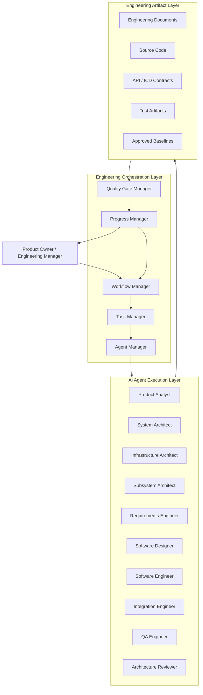

## 2.3 Architecture Responsibilities

### Workflow Manager

Responsible for:

- Managing engineering phases.
- Enforcing phase dependencies.
- Starting eligible workflows.
- Managing phase transitions.
- Evaluating phase completion.
- Handling workflow suspension and resumption.

### Task Manager

Responsible for:

- Creating engineering tasks.
- Managing task dependencies.
- Assigning tasks.
- Tracking task status.
- Managing task execution priorities.
- Detecting blocked tasks.

### Agent Manager

Responsible for:

- Agent registration.
- Agent capability discovery.
- Agent assignment.
- Agent execution context.
- Agent lifecycle management.
- Agent availability and failure handling.

### Progress Manager

Responsible for:

- Tracking engineering progress.
- Aggregating task status.
- Tracking artifact completion.
- Reporting risks and blockers.
- Reporting phase readiness.

### Quality Gate Manager

Responsible for:

- Validating engineering deliverables.
- Running automated checks.
- Collecting review results.
- Enforcing approval requirements.
- Preventing unauthorized phase transitions.

These are logical responsibilities. They MAY be implemented as separate services, modules, or orchestration functions.

---

# 3. Engineering Lifecycle

## 3.1 Lifecycle Overview

The standard engineering lifecycle consists of ten phases.

| Phase | Name | Primary Objective |
|---|---|---|
| P0 | Project Initiation | Establish project scope and governance |
| P1 | Product Requirements | Define product and business requirements |
| P2 | System Requirements | Establish system-level requirements |
| P3 | System Architecture | Design overall system architecture |
| P4 | Infrastructure Architecture | Define network and deployment structure |
| P5 | Subsystem Engineering | Define subsystem boundaries and architectures |
| P6 | Software Requirements | Establish subsystem SRS |
| P7 | Software Design | Produce implementation-ready designs |
| P8 | Implementation & Integration | Develop and integrate software |
| P9 | Verification & Delivery | Verify, release and deliver the system |

## 3.2 Lifecycle Workflow

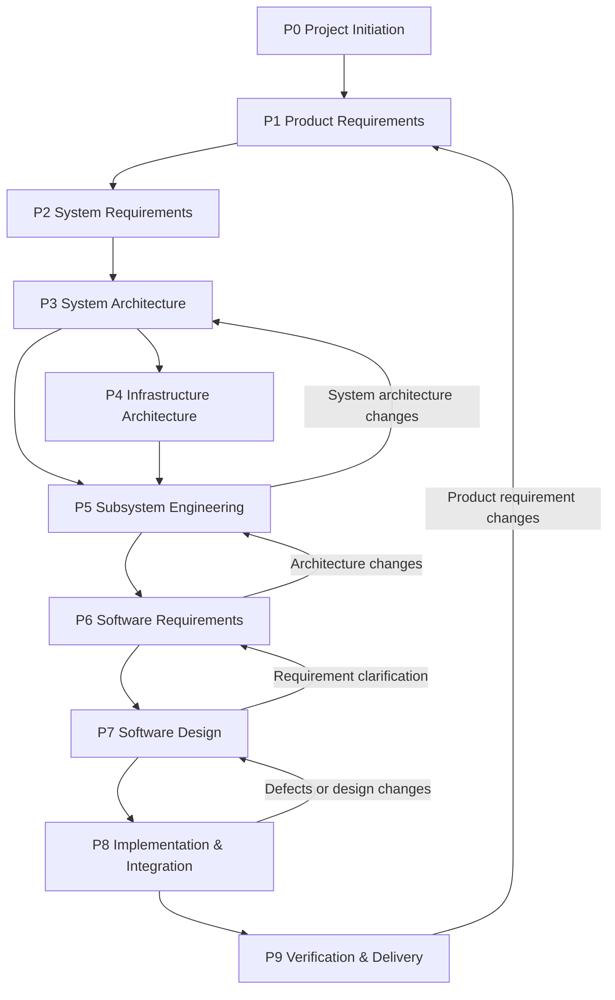

The lifecycle is iterative rather than strictly linear.

Engineering activities MAY overlap when their dependencies are satisfied.

For example:

- Network architecture and subsystem architecture can be developed concurrently after the relevant system architecture decisions are established.
- Multiple subsystem architectures can be designed in parallel.
- Multiple subsystem SRS documents can be developed in parallel.
- Independent software components can be implemented concurrently.
- Integration testing can begin incrementally before all subsystems are complete.

However, parallel execution MUST NOT violate artifact dependencies or approved architectural boundaries.

## 3.3 Alignment with Methodology Baselines

Engineering baselines G1 through G7 are defined by the Product-to-Engineering Development Methodology & Documentation Standard. This standard does not redefine those baselines.

Gate P0 through Gate P9 are execution checkpoints. A checkpoint identifier uses the phase number. It is not a baseline identifier. Several checkpoints can be required to close one baseline.

| Execution checkpoint | Methodology baseline it serves |
|---|---|
| Gate P0 Project Readiness | None. Execution preparation only |
| Gate P1 Product Baseline Approval | G1 Product Baseline |
| Gate P2 System Requirements Approval | G2 System Architecture Baseline |
| Gate P3 System Architecture Approval | G2 System Architecture Baseline |
| Gate P4 Infrastructure Approval | G3 Deployment Baseline |
| Gate P5 Subsystem Architecture Approval | G2 System Architecture Baseline and G4 Subsystem Baseline |
| Gate P6 Subsystem SRS Approval | G4 Subsystem Baseline |
| Gate P7 Software Design Approval | G5 Design Baseline |
| Gate P8 Implementation Readiness | G6 Implementation Baseline |
| Gate P9 Release Approval | G7 Release Baseline |

Document review checklists are in Engineering Document Templates & Standards, §26.2. A checkpoint that reviews documents uses those checklists. The document outcome maps to the checkpoint result as defined in §11.2.

---

# 4. Phase Definitions and Quality Gates

Each phase ends at the execution checkpoint named below. The checkpoint applies the document reviews and baseline rules in §3.3.

## 4.1 P0 — Project Initiation

### Objective

Establish project governance, initial scope, engineering standards, and execution environment.

### Activities

1. Identify project objectives.
2. Establish project stakeholders.
3. Define initial product scope.
4. Identify project constraints.
5. Establish engineering documentation standards.
6. Establish repository structure.
7. Configure engineering workflow.
8. Register required AI Agents.

### Responsible Agents

| Agent | Responsibility |
|---|---|
| Project Manager Agent | Project coordination |
| Product Analyst | Initial scope analysis |
| Engineering Manager Agent | Engineering standards |
| Orchestrator Agent | Workflow initialization |

### Deliverables

- Project Engineering Plan
- Initial Product Brief
- Engineering Document Standards
- Requirement ID Registry
- Project Repository Structure
- Agent Registry
- Initial Risk Register

### Gate P0 — Project Readiness

Gate P0 prepares execution. It does not establish a methodology baseline.

The phase MUST NOT complete until:

- [ ] Project objectives are documented.
- [ ] Initial scope is established.
- [ ] Engineering standards are available.
- [ ] Repository structure is initialized.
- [ ] Project ownership is assigned.
- [ ] Required Agents are registered.

---

## 4.2 P1 — Product Requirements Engineering

### Objective

Transform product ideas and business objectives into structured product requirements.

### Activities

1. Analyze product vision.
2. Identify target users.
3. Identify business capabilities.
4. Define business processes.
5. Define business rules.
6. Define product features.
7. Define functional requirements.
8. Define non-functional requirements.
9. Define product acceptance criteria.
10. Review requirement completeness.

### Responsible Agents

| Agent | Responsibility |
|---|---|
| Product Analyst | Product requirement analysis |
| Business Analyst | Business rules and processes |
| UX Analyst | User workflows and experience requirements |
| Requirements Engineer | Requirement standardization |
| Product Reviewer | Product requirement validation |

### Deliverables

- PRD
- Business Rules Specification
- Use Case Specification
- Product Acceptance Criteria
- Product Requirements Baseline

### Gate P1 — Product Baseline Approval

Gate P1 closes methodology baseline G1.

The Product Documents review in Engineering Document Templates & Standards, §26.2, MUST pass. The Product Owner MUST approve the baseline.

---

## 4.3 P2 — System Requirements Engineering

### Objective

Translate product requirements into complete system-level requirements.

### Activities

1. Analyze approved PRD.
2. Identify system actors.
3. Identify external systems.
4. Define system boundaries.
5. Transform product capabilities into system functions.
6. Define system interface requirements.
7. Define system NFRs.
8. Identify system constraints.
9. Establish requirement traceability.

### Responsible Agents

| Agent | Responsibility |
|---|---|
| System Analyst | System requirement analysis |
| Requirements Engineer | SyRS authoring |
| Integration Analyst | External system analysis |
| Security Analyst | System security requirements |
| Requirements Reviewer | Requirement validation |

### Deliverables

- System Requirements Specification
- System Context Diagram
- System Interface Inventory
- System Requirement Traceability Matrix
- System Requirements Baseline

### Gate P2 — System Requirements Approval

Gate P2 serves methodology baseline G2. It does not close that baseline. Baseline G2 also requires Gate P3 and Gate P5.

The System Requirements review in Engineering Document Templates & Standards, §26.2, MUST pass. The System Engineering Lead MUST approve the system requirements.

---

## 4.4 P3 — System Architecture Engineering

### Objective

Design the overall system architecture based on approved system requirements.

### Activities

1. Identify architecture drivers.
2. Evaluate architecture styles.
3. Define system context.
4. Define logical architecture.
5. Identify major applications and services.
6. Define application architecture.
7. Define data architecture.
8. Define integration architecture.
9. Define security architecture.
10. Identify architectural risks.
11. Record architectural decisions.
12. Validate architecture against system requirements.

### Responsible Agents

| Agent | Responsibility |
|---|---|
| System Architect | Overall architecture |
| Application Architect | Application structure |
| Data Architect | Data architecture |
| Security Architect | Security architecture |
| Integration Architect | Integration architecture |
| Architecture Reviewer | Architecture review |

### Deliverables

- System Architecture Specification
- Logical Architecture Diagram
- Application Architecture Diagram
- Data Architecture Diagram
- Integration Architecture Diagram
- Security Architecture
- Architecture Decision Records
- Initial System Component Inventory

### Gate P3 — System Architecture Approval

Gate P3 serves methodology baseline G2. It does not close that baseline. Baseline G2 also requires Gate P2 and Gate P5.

The System Architecture review in Engineering Document Templates & Standards, §26.2, MUST pass. The Chief Architect or System Architect MUST approve the system architecture.

---

## 4.5 P4 — Infrastructure Architecture Engineering

### Objective

Transform the logical architecture into a network and deployment structure.

### Activities

1. Identify deployment units.
2. Map logical components to runtime environments.
3. Define network zones.
4. Define VPC and subnet architecture where applicable.
5. Define ingress and egress.
6. Define communication paths.
7. Define network security policies.
8. Define compute infrastructure.
9. Define storage infrastructure.
10. Define scaling and availability.
11. Define environment separation.
12. Define deployment topology.

### Responsible Agents

| Agent | Responsibility |
|---|---|
| Infrastructure Architect | Infrastructure design |
| Network Architect | Network topology |
| Cloud Architect | Cloud architecture |
| Security Architect | Infrastructure security |
| DevOps Architect | Deployment strategy |

### Deliverables

- Network Architecture Specification
- Deployment Architecture Specification
- Infrastructure Specification
- Environment Specification
- Infrastructure Cost and Capacity Estimates, where required

### Gate P4 — Infrastructure Approval

Gate P4 closes methodology baseline G3.

The Deployment Architecture review in Engineering Document Templates & Standards, §26.2, MUST pass. The Infrastructure Lead MUST approve the network and deployment architecture.

---

## 4.6 P5 — Subsystem Engineering

### Objective

Decompose the complete system into independently manageable subsystems and define their internal architectures.

### Activities

1. Identify system capabilities.
2. Identify subsystem candidates.
3. Define subsystem boundaries.
4. Allocate system requirements.
5. Define subsystem responsibilities.
6. Define data ownership.
7. Define subsystem dependencies.
8. Define cross-subsystem interactions.
9. Define subsystem architecture.
10. Identify internal components.
11. Establish interface contracts.
12. Review architectural consistency.

### Responsible Agents

| Agent | Responsibility |
|---|---|
| System Architect | System-level consistency |
| Subsystem Architect | Subsystem decomposition |
| Domain Architect | Domain boundaries |
| Data Architect | Data ownership |
| Integration Architect | Cross-subsystem interfaces |
| Architecture Reviewer | Subsystem architecture validation |

### Deliverables

- System Decomposition Specification
- System Interaction Specification
- Subsystem Architecture Specifications
- Subsystem Dependency Matrix
- System Requirement Allocation Matrix
- Interface Inventory
- Initial ICDs

### Gate P5 — Subsystem Architecture Approval

Gate P5 serves methodology baselines G2 and G4. Together with Gate P2 and Gate P3, it closes G2. It does not by itself close G4. Baseline G4 also requires Gate P6.

The Subsystem Architecture review in Engineering Document Templates & Standards, §26.2, MUST pass. The System Architect MUST approve the subsystem architecture.

---

## 4.7 P6 — Subsystem Software Requirements Engineering

### Objective

Transform subsystem architecture and allocated system requirements into detailed software requirements.

### Activities

1. Read approved system requirements.
2. Read subsystem architecture.
3. Read requirement allocation.
4. Analyze subsystem responsibilities.
5. Define subsystem functional requirements.
6. Define subsystem NFRs.
7. Define software interface requirements.
8. Define data requirements.
9. Define error handling requirements.
10. Define acceptance criteria.
11. Validate traceability.

### Responsible Agents

| Agent | Responsibility |
|---|---|
| Requirements Engineer | SRS development |
| Subsystem Architect | Architecture consistency |
| Domain Analyst | Business logic requirements |
| Security Analyst | Security requirements |
| QA Analyst | Testability review |

### Deliverables

For each subsystem:

- Subsystem SRS
- Functional Requirement Inventory
- Non-Functional Requirement Inventory
- Interface Requirements
- Acceptance Criteria
- Subsystem RTM

### Gate P6 — Subsystem SRS Approval

Gate P6 serves methodology baseline G4. Together with Gate P5, it closes G4.

The Subsystem SRS review in Engineering Document Templates & Standards, §26.2, MUST pass. The Requirements Lead or Subsystem Owner MUST approve the SRS.

---

## 4.8 P7 — Software Design Engineering

### Objective

Convert approved software requirements into implementation-ready technical designs.

### Activities

1. Analyze approved SRS.
2. Define software component structure.
3. Define package and module structure.
4. Define domain models.
5. Define algorithms.
6. Define state machines.
7. Define database schema.
8. Define API contracts.
9. Define event contracts.
10. Define transaction boundaries.
11. Define error handling.
12. Define security mechanisms.
13. Define unit and integration testing requirements.

### Responsible Agents

| Agent | Responsibility |
|---|---|
| Software Architect | Detailed software architecture |
| Software Designer | SDS authoring |
| API Designer | API specifications |
| Database Designer | Database design |
| Security Engineer | Security design |
| Test Designer | Test design |

### Deliverables

- Software Design Specification
- API Specification
- ICD
- Database Design Specification
- Security Specification
- Component Design
- Test Specification
- Updated RTM

### Gate P7 — Software Design Approval

Gate P7 closes methodology baseline G5.

The SDS review in Engineering Document Templates & Standards, §26.2, MUST pass. A separate API specification, ICD, database design, security specification, or test specification MUST pass the applicable §26.2 checklist. The Software Architect or Technical Lead MUST approve the design. Interface owners MUST approve API and ICD documents. The Security Lead MUST approve a separate security specification.

---

## 4.9 P8 — Implementation and Integration

### Objective

Implement the approved designs and integrate independently developed subsystems.

### Activities

1. Initialize development environments.
2. Establish coding standards.
3. Create repository and package structures.
4. Implement software components.
5. Implement database migrations.
6. Implement APIs.
7. Implement events and message handlers.
8. Execute unit tests.
9. Conduct code reviews.
10. Integrate subsystem interfaces.
11. Execute integration tests.
12. Update engineering documentation.

### Responsible Agents

| Agent | Responsibility |
|---|---|
| Software Engineer | Feature implementation |
| Backend Engineer | Backend development |
| Frontend Engineer | Frontend development |
| Smart Contract Engineer | On-chain development, where applicable |
| Integration Engineer | Cross-subsystem integration |
| Code Reviewer | Code review |
| DevOps Engineer | Build and CI/CD |

### Deliverables

- Source Code
- Configuration Files
- Database Migrations
- Unit Tests
- Integration Tests
- Build Artifacts
- Updated API and ICD Specifications
- Implementation Traceability

### Gate P8 — Implementation Readiness

Gate P8 closes methodology baseline G6.

The implementation MUST satisfy §8.4 of the methodology standard, including an approved code review. The code review MUST be performed by a reviewer independent of the implementing Agent, as required in §5.4 of this standard.

---

## 4.10 P9 — Verification and Delivery

### Objective

Verify the complete system and deliver a controlled release.

### Activities

1. Execute subsystem testing.
2. Execute system integration testing.
3. Execute system testing.
4. Execute security testing.
5. Execute performance testing.
6. Execute acceptance testing.
7. Validate NFRs.
8. Resolve blocking defects.
9. Validate requirement coverage.
10. Prepare release artifacts.
11. Deploy to target environment.
12. Conduct release verification.

### Responsible Agents

| Agent | Responsibility |
|---|---|
| QA Engineer | Quality verification |
| Integration Engineer | Integration verification |
| Security Tester | Security testing |
| Performance Tester | Performance testing |
| Release Engineer | Release management |
| Product Owner | Acceptance |

### Deliverables

- Test Execution Report
- Test Coverage Report
- Security Test Report
- Performance Test Report
- Defect Report
- Release Notes
- Deployment Runbook
- Release Baseline

### Gate P9 — Release Approval

Gate P9 closes methodology baseline G7.

The release MUST satisfy §9.4 of the methodology standard. Test documentation MUST pass the Verification review in Engineering Document Templates & Standards, §26.2. The QA Lead MUST accept the test results. The Release Authority or Product Owner MUST approve the release.

---

# 5. AI Agent Architecture

## 5.1 Agent Design Principles

AI Agents MUST be designed as specialized engineering execution roles.

Each Agent MUST have:

1. A defined role.
2. A defined scope.
3. A defined set of capabilities.
4. A defined input context.
5. A defined output format.
6. Explicit execution permissions.
7. Explicit validation criteria.
8. A designated accountable owner.

Agents SHOULD be specialized according to engineering responsibilities rather than simply being divided by programming language or technology.

## 5.2 Agent Classification

Agents are classified into five categories.

| Category | Purpose |
|---|---|
| Governance Agents | Project and workflow management |
| Analysis Agents | Product and requirements analysis |
| Architecture Agents | System and software architecture |
| Execution Agents | Software development and integration |
| Quality Agents | Review, testing and verification |

## 5.3 Standard Agent Catalog

### A. Governance Agents

| Agent ID | Agent | Responsibilities |
|---|---|---|
| AG-GOV-001 | Project Manager Agent | Project scope, milestones and coordination |
| AG-GOV-002 | Orchestrator Agent | Workflow and task scheduling |
| AG-GOV-003 | Engineering Manager Agent | Engineering standards and governance |
| AG-GOV-004 | Progress Manager Agent | Progress and blocker tracking |

### B. Analysis Agents

| Agent ID | Agent | Responsibilities |
|---|---|---|
| AG-ANA-001 | Product Analyst | Product requirements |
| AG-ANA-002 | Business Analyst | Business rules and processes |
| AG-ANA-003 | System Analyst | System requirements |
| AG-ANA-004 | Requirements Engineer | Requirement specification and traceability |
| AG-ANA-005 | UX Analyst | User workflows and UX requirements |

### C. Architecture Agents

| Agent ID | Agent | Responsibilities |
|---|---|---|
| AG-ARC-001 | System Architect | Overall system architecture |
| AG-ARC-002 | Infrastructure Architect | Infrastructure and deployment |
| AG-ARC-003 | Network Architect | Network topology |
| AG-ARC-004 | Subsystem Architect | Subsystem decomposition and architecture |
| AG-ARC-005 | Software Architect | Software design architecture |
| AG-ARC-006 | Data Architect | Data architecture |
| AG-ARC-007 | Security Architect | Security architecture |
| AG-ARC-008 | Integration Architect | Integration architecture |

### D. Execution Agents

| Agent ID | Agent | Responsibilities |
|---|---|---|
| AG-DEV-001 | Frontend Engineer | Frontend implementation |
| AG-DEV-002 | Backend Engineer | Backend implementation |
| AG-DEV-003 | Smart Contract Engineer | Blockchain program development |
| AG-DEV-004 | Database Engineer | Database implementation |
| AG-DEV-005 | Integration Engineer | Service integration |
| AG-DEV-006 | DevOps Engineer | Build and deployment |
| AG-DEV-007 | Software Engineer | General software implementation |

### E. Quality Agents

| Agent ID | Agent | Responsibilities |
|---|---|---|
| AG-QA-001 | Architecture Reviewer | Architecture consistency |
| AG-QA-002 | Requirements Reviewer | Requirement quality |
| AG-QA-003 | Code Reviewer | Code quality |
| AG-QA-004 | QA Engineer | Functional testing |
| AG-QA-005 | Security Tester | Security verification |
| AG-QA-006 | Performance Tester | Performance verification |
| AG-QA-007 | Documentation Reviewer | Documentation quality |

## 5.4 Agent Specialization

One Agent MAY perform multiple related roles when the project is small.

However:

- Requirement authoring and approval SHOULD be separated.
- Architecture design and independent architecture review SHOULD be separated.
- Code implementation and independent code review SHOULD be separated.
- Test execution and release approval SHOULD have independent authorization.

The same model instance MUST NOT be treated as an independent reviewer merely because it changes its assigned role.

For critical reviews, an independent Agent or qualified human reviewer SHOULD be used.

---

# 6. Agent Contract Specification

## 6.1 Agent Definition

Every registered Agent MUST have a machine-readable definition.

Recommended structure:

```yaml
agent:
  id: AG-ARC-001
  name: System Architect
  version: 1.0.0

  category: architecture

  purpose: >
    Design and maintain the overall system architecture.

  capabilities:
    - architecture_analysis
    - architecture_design
    - component_decomposition
    - architecture_documentation

  inputs:
    - PRD
    - System_Requirements
    - Business_Rules

  outputs:
    - System_Architecture
    - Architecture_Decisions
    - Component_Inventory

  permissions:
    read:
      - product/*
      - system/*
    write:
      - system/architecture/*
    approve:
      - none

  constraints:
    - MUST NOT modify approved product requirements.
    - MUST NOT independently approve its own architecture.
    - MUST preserve requirement traceability.

  quality_criteria:
    - architecture_completeness
    - requirement_coverage
    - consistency
```

## 6.2 Agent Input Contract

An Agent MUST receive sufficient context before execution.

The input context SHOULD include:

| Input | Description |
|---|---|
| Task ID | Assigned task identifier |
| Task Description | Objective and expected work |
| Project Context | Relevant project background |
| Upstream Artifacts | Approved source documents |
| Constraints | Applicable engineering constraints |
| Dependencies | Required upstream tasks |
| Output Requirements | Expected artifacts |
| Acceptance Criteria | Completion conditions |
| Permissions | Authorized operations |

## 6.3 Agent Output Contract

An Agent MUST return structured execution results.

```yaml
agent_result:
  task_id: TASK-SUB-001

  agent_id: AG-ARC-004

  status: completed

  summary: >
    Completed subsystem architecture design.

  outputs:
    - artifact_id: ART-SUB-ARCH-001
      path: 04-Subsystems/Credential/Architecture.md
      version: 0.1.0

  requirement_coverage:
    - SYS-FR-001
    - SYS-FR-002

  decisions:
    - ADR-001

  assumptions:
    - ASM-001

  unresolved_issues:
    - TBD-001

  validation:
    status: pending_review

  next_actions:
    - Create subsystem SRS
```

An Agent MUST NOT report successful completion if required outputs are missing or acceptance criteria are not satisfied.

---

# 7. Engineering Task Management

## 7.1 Task Model

A task is the smallest independently manageable engineering work unit.

A task MUST have:

- Unique task ID.
- Task name.
- Objective.
- Description.
- Responsible Agent.
- Input artifacts.
- Output artifacts.
- Dependencies.
- Acceptance criteria.
- Priority.
- Status.

## 7.2 Task Specification Template

```yaml
task:
  id: TASK-CR-001
  title: Create Credential Subsystem Architecture

  phase: P5

  type: architecture

  priority: high

  status: ready

  owner:
    agent_id: AG-ARC-004

  objective: >
    Define the internal architecture of the Credential subsystem.

  inputs:
    - ART-SYS-ARCH-001
    - ART-SYS-DEC-001
    - ART-SYS-REQ-001

  dependencies:
    - TASK-SYS-ARCH-001
    - TASK-SYS-DEC-001

  outputs:
    - ART-CR-ARCH-001

  acceptance_criteria:
    - Subsystem responsibilities are explicit.
    - Components are identified.
    - Data ownership is defined.
    - Interfaces are documented.
    - Requirements are traceable.

  constraints:
    - Follow ENG-DOC-STD-001.
    - Do not change approved system boundaries.

  review:
    required: true
    reviewer: AG-QA-001
```

## 7.3 Task Classification

| Type | Description |
|---|---|
| Analysis | Analyze existing information |
| Specification | Produce requirements or specifications |
| Architecture | Design system structures |
| Design | Produce detailed software designs |
| Implementation | Write or modify source code |
| Integration | Integrate components |
| Verification | Execute validation and tests |
| Review | Review engineering artifacts |
| Documentation | Produce or update documentation |
| Operations | Perform deployment and operational work |

## 7.4 Task Dependency Types

| Dependency | Meaning |
|---|---|
| Finish-to-Start | Task B starts after Task A finishes |
| Start-to-Start | Task B can start after Task A starts |
| Finish-to-Finish | Task B finishes after Task A finishes |
| Start-to-Finish | Task B finishes after Task A starts |

Finish-to-Start SHOULD be the default dependency type.

## 7.5 Task Status Lifecycle

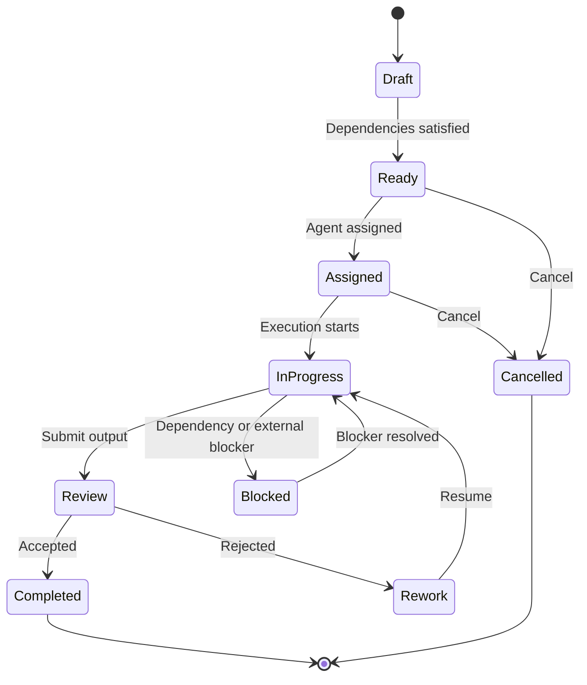

A task MUST NOT enter Completed until all mandatory acceptance criteria are satisfied.

## 7.6 Task Granularity

Tasks SHOULD be decomposed so that:

- Their objectives are independently understandable.
- Their outputs can be validated independently.
- Their dependencies are explicit.
- Their scope is sufficiently bounded.
- Their results can be integrated into the larger project.

Tasks SHOULD NOT combine unrelated engineering activities.

For example, the following is too broad:

`Develop the entire Credential subsystem.`

A better decomposition is:

- Define Credential domain model.
- Define Credential lifecycle.
- Design Credential API.
- Design Credential database.
- Implement Credential issuance.
- Implement Credential verification.
- Implement Credential revocation.
- Write Credential unit tests.
- Execute Credential integration tests.

---

# 8. Workflow Orchestration

## 8.1 Orchestration Responsibilities

The Orchestrator Agent is responsible for coordinating execution, not independently making every engineering decision.

Its responsibilities include:

1. Reading the approved project workflow.
2. Identifying eligible tasks.
3. Checking task dependencies.
4. Selecting suitable Agents.
5. Preparing execution context.
6. Assigning tasks.
7. Monitoring execution.
8. Collecting artifacts.
9. Triggering validation.
10. Handling failures and rework.
11. Updating project progress.
12. Requesting human approval when required.

## 8.2 Task Scheduling

The Orchestrator MUST consider:

- Task dependencies.
- Agent capabilities.
- Agent availability.
- Task priority.
- Required permissions.
- Artifact readiness.
- Review requirements.

The Orchestrator SHOULD schedule independent tasks concurrently.

Example:

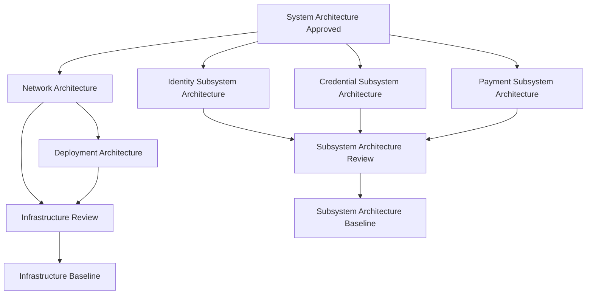

## 8.3 Orchestration Modes

The framework supports four execution modes.

### Mode A: Sequential Execution

Tasks execute in dependency order.

Suitable for:

- Initial requirement analysis.
- Architecture decisions.
- Critical schema changes.
- Security-sensitive workflows.

### Mode B: Parallel Execution

Independent tasks execute concurrently.

Suitable for:

- Multiple subsystem SRS documents.
- Independent component implementation.
- Parallel test development.
- Independent infrastructure modules.

### Mode C: Hierarchical Execution

A parent Agent decomposes a larger task and delegates subtasks to specialized Agents.

Example:

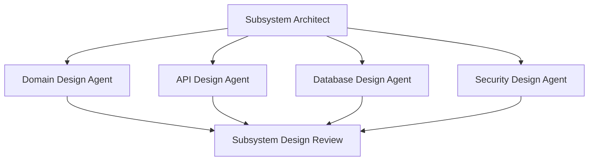

The parent Agent MUST consolidate results and validate their consistency.

### Mode D: Review and Correction

An independent Agent reviews an artifact and returns findings.

Example:

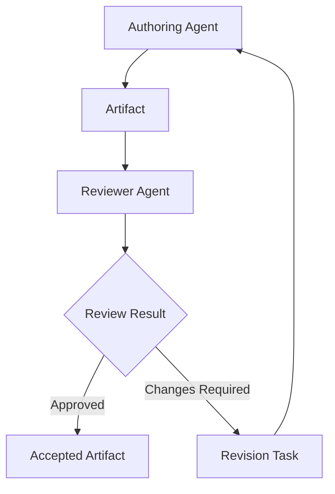

## 8.4 Orchestration Constraints

- An Agent MUST NOT execute tasks whose dependencies are unsatisfied.
- An Agent MUST NOT modify artifacts outside its permissions.
- Concurrent tasks MUST NOT write to the same authoritative artifact without coordination.
- The Orchestrator MUST detect conflicting outputs.
- Failed tasks MUST retain their execution history.
- Rework MUST preserve previous review findings.
- Critical decisions MUST be escalated to the designated human authority.

---

# 9. Artifact Management

## 9.1 Artifact Definition

An artifact is any identifiable engineering output.

Examples include:

- PRD
- SyRS
- Architecture diagrams
- SRS
- SDS
- API contracts
- ICDs
- Database schemas
- Source code
- Test cases
- Test reports
- Deployment configurations
- Release packages

## 9.2 Artifact Classification

| Category | Examples |
|---|---|
| Requirement Artifact | PRD, SyRS, SRS |
| Architecture Artifact | Architecture specifications, diagrams |
| Design Artifact | SDS, API, ICD, database design |
| Implementation Artifact | Source code, scripts |
| Verification Artifact | Test cases, test reports |
| Operational Artifact | Runbooks, deployment manifests |
| Governance Artifact | ADR, RTM, risk register |

## 9.3 Artifact Metadata

Every controlled artifact MUST have metadata.

```yaml
artifact:
  id: ART-CR-SRS-001

  name: Credential Subsystem SRS

  type: specification

  document_id: CR-SRS-001

  version: 1.0.0

  status: approved

  owner: AG-REQ-001

  project: PROJECT-001

  phase: P6

  source_artifacts:
    - ART-SYS-REQ-001
    - ART-CR-ARCH-001

  requirement_ids:
    - CR-SRS-FR-001
    - CR-SRS-FR-002

  created_at: YYYY-MM-DD

  approved_at: YYYY-MM-DD

  checksum: SHA256_VALUE
```

## 9.4 Artifact Lifecycle

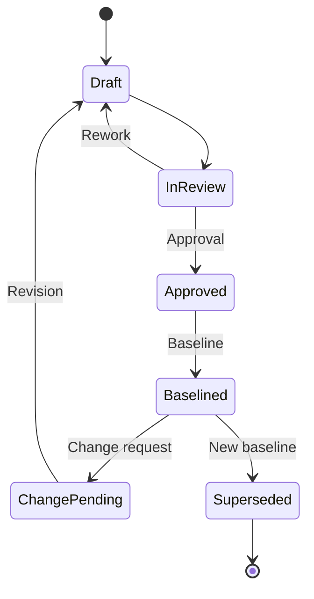

## 9.5 Artifact Ownership

Every artifact MUST have one authoritative owner.

Multiple Agents MAY contribute to the same artifact, but concurrent editing MUST be controlled.

The framework SHOULD use:

- Version control.
- Branch-based collaboration.
- Pull requests.
- Review records.
- Immutable baseline references.
- Change history.

## 9.6 Artifact Dependency Graph

Artifacts MUST maintain upstream and downstream relationships.

Example:

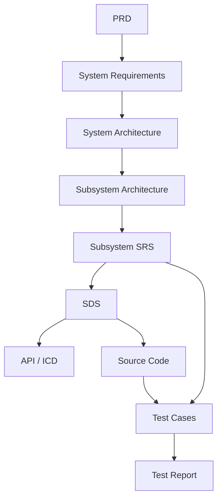

The dependency graph MUST support impact analysis when an upstream artifact changes.

---

# 10. Requirement Traceability and Coverage

## 10.1 Traceability Chain

The framework MUST preserve the relationship:

```text
Product Requirement
    ↓
System Requirement
    ↓
System Architecture Component
    ↓
Subsystem Allocation
    ↓
Subsystem Requirement
    ↓
Software Design Component
    ↓
Implementation
    ↓
Test Case
    ↓
Verification Result
```

## 10.2 Traceability Rules

Every requirement MUST have:

- Unique ID.
- Source reference.
- Owning subsystem or system owner.
- Design reference.
- Verification method.
- Verification status.

Not every requirement maps one-to-one to a design component or test case.

Many-to-many relationships are permitted when documented.

## 10.3 Coverage Metrics

The Orchestrator SHOULD calculate:

**Requirement Allocation Coverage**

\[
C_a=\frac{\text{Allocated System Requirements}}
{\text{Applicable System Requirements}}\times100\%
\]

**Design Coverage**

\[
C_d=\frac{\text{Requirements with Design Coverage}}
{\text{Applicable Requirements}}\times100\%
\]

**Implementation Coverage**

\[
C_i=\frac{\text{Implemented Requirements}}
{\text{Approved Requirements}}\times100\%
\]

**Verification Coverage**

\[
C_v=\frac{\text{Requirements with Verification Cases}}
{\text{Verifiable Requirements}}\times100\%
\]

**Verification Pass Rate**

\[
P_v=\frac{\text{Passed Verification Cases}}
{\text{Executed Verification Cases}}\times100\%
\]

Coverage metrics MUST distinguish between:

- Not started.
- In progress.
- Implemented.
- Verified.
- Accepted.

A requirement being implemented MUST NOT automatically be considered verified.

---

# 11. Quality Gates and Approval Management

## 11.1 Quality Gate Model

Every engineering phase MUST have a quality gate.

A quality gate evaluates:

1. Artifact completeness.
2. Requirement coverage.
3. Technical consistency.
4. Acceptance criteria.
5. Review findings.
6. Outstanding risks.
7. Required approvals.

## 11.2 Gate Evaluation

Each execution checkpoint MUST return one of the following results:

| Result | Meaning |
|---|---|
| PASS | All mandatory criteria satisfied |
| PASS_WITH_ACTIONS | Approved with non-blocking actions |
| FAIL | Mandatory criteria not satisfied |
| BLOCKED | Required inputs or approvals unavailable |

When the checkpoint includes a document review, the document outcome in Engineering Document Templates & Standards, §26.3, determines the checkpoint result.

| Document review outcome | Checkpoint result |
|---|---|
| Approved | PASS |
| Approved with Actions | PASS_WITH_ACTIONS |
| Rework Required | FAIL |
| Rejected | FAIL |

BLOCKED is used only when the checkpoint cannot be evaluated. It is not a document-review outcome. A methodology baseline is established only when every checkpoint required for that baseline has returned PASS or PASS_WITH_ACTIONS.

## 11.3 Gate Execution Workflow

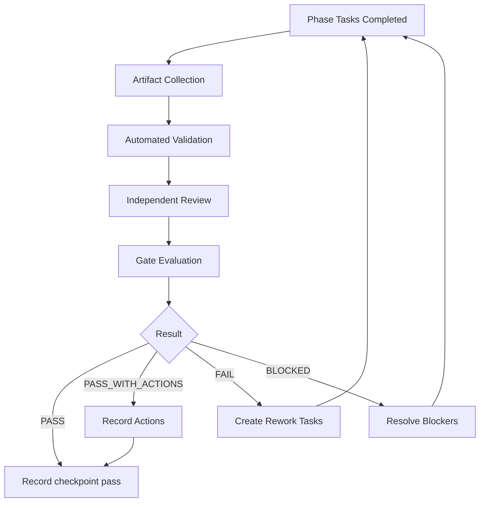

## 11.4 Approval Authority

| Artifact | Approval Authority |
|---|---|
| PRD | Product Owner |
| System Requirements | System Engineering Lead |
| System Architecture | Chief Architect / System Architect |
| Network Architecture | Infrastructure Lead |
| Deployment Architecture | Infrastructure Lead |
| Subsystem Architecture | System Architect |
| Subsystem SRS | Requirements Lead / Subsystem Owner |
| SDS | Software Architect / Technical Lead |
| API / ICD | Interface Owners |
| Security Specification | Security Lead |
| Test Results | QA Lead |
| Production Release | Release Authority / Product Owner |

AI Agents MAY provide recommendations but MUST NOT impersonate designated human approval authorities.

Approval delegation MUST be explicitly configured.

---

# 12. Context Management and Knowledge Sharing

## 12.1 Context Isolation

Each Agent MUST receive relevant project context rather than unrestricted access to all project information by default.

The Orchestrator SHOULD provide the minimum sufficient context required for the task.

This reduces:

- Irrelevant information.
- Context overload.
- Contradictory assumptions.
- Unnecessary token consumption.
- Accidental modification of unrelated artifacts.

## 12.2 Context Categories

| Context | Description |
|---|---|
| Project Context | Project objectives and constraints |
| Product Context | PRD and business requirements |
| System Context | System requirements and architecture |
| Subsystem Context | Subsystem-specific documents |
| Interface Context | API and ICD contracts |
| Implementation Context | Source code and configuration |
| Verification Context | Tests and test reports |
| Governance Context | Standards, decisions and approval records |

## 12.3 Context Resolution

Before task execution, the Orchestrator MUST resolve:

1. Task input artifacts.
2. Required upstream dependencies.
3. Current approved artifact versions.
4. Relevant architecture decisions.
5. Applicable standards.
6. Known unresolved issues.
7. Required execution permissions.

## 12.4 Context Consistency

An Agent MUST NOT silently use an outdated artifact when a newer approved baseline exists.

If conflicting versions are discovered, the Agent MUST report the conflict.

## 12.5 Knowledge Base

The project SHOULD maintain a shared engineering knowledge base containing:

- Approved documents.
- Architecture Decision Records.
- Requirement Registry.
- Interface Registry.
- Domain Glossary.
- Technical Constraints.
- Known Issues.
- Lessons Learned.

The knowledge base SHOULD be version-controlled and searchable.

---

# 13. Engineering Change Management

## 13.1 Change Sources

Changes may originate from:

- Product requirement changes.
- Business rule changes.
- Architecture changes.
- Interface changes.
- Security findings.
- Implementation discoveries.
- Performance issues.
- Test failures.
- External technology changes.

## 13.2 Change Workflow

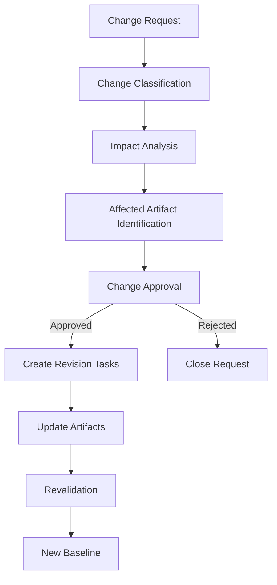

## 13.3 Impact Analysis

The Orchestrator MUST identify affected:

- Requirements.
- Architecture components.
- Subsystems.
- APIs and interfaces.
- Database schemas.
- Source code modules.
- Tests.
- Deployment configurations.
- Operational procedures.

## 13.4 Change Control Rules

- Approved baselines MUST NOT be modified silently.
- Changes MUST have traceable change requests.
- Interface changes MUST notify affected consumers.
- Requirement changes MUST trigger traceability updates.
- Breaking changes MUST undergo explicit impact review.
- Relevant tests MUST be re-executed.
- New baselines MUST reference the previous baseline.

---

# 14. Failure Handling and Recovery

## 14.1 Failure Classification

| Failure Type | Description |
|---|---|
| Agent Failure | Agent cannot complete assigned work |
| Task Failure | Acceptance criteria are not satisfied |
| Dependency Failure | Required input is unavailable |
| Artifact Conflict | Conflicting artifact changes |
| Validation Failure | Automated checks fail |
| Review Failure | Reviewer rejects deliverable |
| Integration Failure | Components cannot integrate |
| Infrastructure Failure | Execution environment unavailable |

## 14.2 Recovery Procedures

### Agent Failure

1. Record failure.
2. Preserve execution history.
3. Identify failure reason.
4. Retry when appropriate.
5. Reassign to another qualified Agent if necessary.

### Task Failure

1. Identify failed acceptance criteria.
2. Record defects.
3. Create rework tasks.
4. Assign responsible Agents.
5. Re-execute validation.

### Artifact Conflict

1. Freeze conflicting modifications.
2. Identify the authoritative baseline.
3. Compare changes.
4. Resolve conflicts.
5. Revalidate the merged artifact.

### Integration Failure

1. Identify the failing interface.
2. Collect request and response evidence.
3. Verify contract compatibility.
4. Identify responsible subsystem.
5. Create correction tasks.
6. Repeat integration tests.

## 14.3 Retry Policy

Retries MUST be bounded.

The Orchestrator SHOULD use:

- Maximum retry count.
- Exponential backoff for transient failures.
- Failure classification.
- Escalation after repeated failure.
- Human intervention for unresolved critical issues.

An Agent MUST NOT indefinitely repeat the same failed task without new information or a changed execution strategy.

---

# 15. Security and Permission Management

## 15.1 Principle of Least Privilege

Every Agent MUST receive only the permissions necessary for its assigned tasks.

## 15.2 Permission Categories

| Permission | Description |
|---|---|
| READ | Read project artifacts |
| WRITE | Create or modify authorized artifacts |
| EXECUTE | Run approved tools or commands |
| REVIEW | Review engineering deliverables |
| APPROVE | Approve controlled deliverables |
| DEPLOY | Deploy to authorized environments |
| ADMIN | Manage workflow and Agent configuration |

## 15.3 Permission Constraints

- Agents MUST NOT access unauthorized secrets.
- Agents MUST NOT modify protected baselines without authorization.
- Agents MUST NOT approve their own critical deliverables.
- Production deployment MUST require explicit authorization.
- Destructive operations MUST require approval.
- External integrations MUST follow project security policies.

## 15.4 Execution Isolation

Implementation Agents SHOULD operate in isolated workspaces or branches.

The framework SHOULD provide:

- Controlled repository access.
- Environment isolation.
- Secret management.
- Tool access restrictions.
- Audit logs.
- Reproducible execution environments.

---

# 16. Implementation Workflow

## 16.1 Implementation Principles

Implementation MUST be based on approved engineering inputs.

The minimum inputs SHOULD include:

- Approved Subsystem SRS.
- Approved SDS.
- API and ICD contracts.
- Database design.
- Applicable security specifications.
- Coding standards.
- Relevant test specifications.

## 16.2 Implementation Task Decomposition

A subsystem implementation SHOULD be decomposed into:

1. Repository and module initialization.
2. Domain model implementation.
3. Data persistence implementation.
4. Business service implementation.
5. API implementation.
6. Event handling implementation.
7. Security mechanism implementation.
8. Unit test implementation.
9. Integration test implementation.
10. Documentation synchronization.

## 16.3 Code Ownership

Each implementation task MUST define:

- Target repository.
- Target branch.
- Target module.
- Related design components.
- Related requirements.
- Required tests.
- Review authority.

## 16.4 Code Integration

The framework SHOULD use a controlled integration workflow:

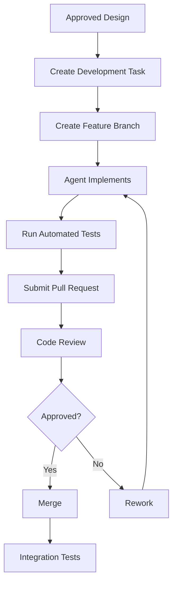

Direct modifications to protected branches MUST be prohibited unless an explicitly authorized exception exists.

---

# 17. Continuous Integration and Continuous Delivery

## 17.1 CI Pipeline

The CI pipeline SHOULD perform:

1. Source formatting.
2. Static analysis.
3. Compilation or build.
4. Unit testing.
5. Component testing.
6. Dependency vulnerability scanning.
7. Secret scanning.
8. Artifact packaging.

## 17.2 CD Pipeline

The CD pipeline SHOULD perform:

1. Artifact verification.
2. Environment configuration validation.
3. Database migration validation.
4. Deployment.
5. Health checks.
6. Smoke testing.
7. Deployment reporting.
8. Rollback when required.

## 17.3 Deployment Approval

Deployment environments SHOULD have separate authorization levels.

| Environment | Authorization |
|---|---|
| Development | Automated or developer approval |
| Testing | Engineering approval |
| Staging | QA and release approval |
| Production | Explicit release authorization |

AI Agents MAY prepare deployment operations, but MUST NOT perform unauthorized production changes.

---

# 18. Engineering Progress Management

## 18.1 Progress Dimensions

Project progress MUST be measured using more than task completion counts.

The framework SHOULD track:

- Phase progress.
- Task progress.
- Artifact completion.
- Requirement coverage.
- Review status.
- Test status.
- Defect status.
- Risk status.

## 18.2 Project Dashboard

The dashboard SHOULD include:

| Metric | Description |
|---|---|
| Phase Status | Current engineering phase |
| Task Completion | Completed / Total Tasks |
| Blocked Tasks | Tasks waiting for dependencies |
| Artifact Completion | Required artifacts completed |
| Review Status | Pending and completed reviews |
| Requirement Coverage | Requirements allocated and implemented |
| Test Pass Rate | Passed / Executed tests |
| Open Defects | Unresolved defects |
| Risk Status | Current engineering risks |

## 18.3 Progress Calculation

Task completion ratio:

\[
P_t=\frac{N_{\text{completed}}}{N_{\text{total}}}\times100\%
\]

Artifact completion ratio:

\[
P_a=\frac{N_{\text{accepted artifacts}}}{N_{\text{required artifacts}}}\times100\%
\]

Phase readiness MUST NOT be determined solely by task completion percentage.

A phase with all tasks marked completed but an unapproved mandatory artifact MUST remain incomplete.

---

# 19. Engineering Records and Audit

## 19.1 Required Records

The orchestration framework MUST maintain:

- Workflow execution records.
- Task assignment records.
- Agent execution records.
- Artifact version history.
- Review findings.
- Approval records.
- Change requests.
- Test execution results.
- Deployment records.

## 19.2 Audit Information

Each execution record SHOULD contain:

```yaml
execution:
  execution_id: EXEC-001
  task_id: TASK-001
  agent_id: AG-DEV-001

  started_at: YYYY-MM-DDTHH:MM:SSZ
  completed_at: YYYY-MM-DDTHH:MM:SSZ

  input_artifacts:
    - ART-001

  output_artifacts:
    - ART-002

  status: completed

  validation_result: passed

  execution_environment: isolated_workspace

  review_reference: REVIEW-001
```

## 19.3 Audit Requirements

The framework MUST support reconstructing:

- What work was performed.
- Which Agent performed it.
- Which inputs were used.
- Which artifacts were produced.
- Which validations were executed.
- Who approved the results.
- Which baseline was affected.

---

# 20. Engineering Workflow Configuration

## 20.1 Workflow Definition

The workflow SHOULD be represented in a machine-readable configuration.

Example:

```yaml
workflow:
  id: WF-SOFTWARE-PRODUCT-001
  name: Standard Software Product Development
  version: 1.0.0

  phases:
    - id: P0
      name: Project Initiation
      gate: P0
      methodology_baseline: none

    - id: P1
      name: Product Requirements
      depends_on: [P0]
      gate: P1
      methodology_baseline: G1

    - id: P2
      name: System Requirements
      depends_on: [P1]
      gate: P2
      methodology_baseline: G2

    - id: P3
      name: System Architecture
      depends_on: [P2]
      gate: P3
      methodology_baseline: G2

    - id: P4
      name: Infrastructure Architecture
      depends_on: [P3]
      gate: P4
      methodology_baseline: G3

    - id: P5
      name: Subsystem Engineering
      depends_on: [P3, P4]
      gate: P5
      methodology_baseline: [G2, G4]

    - id: P6
      name: Software Requirements
      depends_on: [P5]
      gate: P6
      methodology_baseline: G4

    - id: P7
      name: Software Design
      depends_on: [P6]
      gate: P7
      methodology_baseline: G5

    - id: P8
      name: Implementation and Integration
      depends_on: [P7]
      gate: P8
      methodology_baseline: G6

    - id: P9
      name: Verification and Delivery
      depends_on: [P8]
      gate: P9
      methodology_baseline: G7
```

This is an illustrative workflow configuration. Actual projects MAY define more granular phases and parallel dependencies.

## 20.2 Workflow Customization

Projects MAY customize:

- Phase count.
- Agent catalog.
- Task types.
- Approval authorities.
- Quality gates.
- Technology-specific workflows.
- Deployment procedures.

Customization MUST NOT eliminate mandatory traceability, validation, security, and approval requirements.

---

# 21. Standard Project Execution Procedure

## 21.1 Project Initialization

The Orchestrator MUST:

1. Load the project engineering standards.
2. Initialize the project repository.
3. Initialize the document registry.
4. Initialize the requirement registry.
5. Register required Agents.
6. Initialize the workflow.
7. Create initial project tasks.

## 21.2 Phase Execution

For each phase:

1. Evaluate phase dependencies.
2. Collect approved input artifacts.
3. Generate phase task list.
4. Assign responsible Agents.
5. Execute tasks.
6. Collect outputs.
7. Validate outputs.
8. Conduct independent reviews.
9. Evaluate quality gate.
10. Establish the phase baseline.
11. Update project progress.
12. Start the next eligible phase.

## 21.3 Subsystem Parallel Development

Once subsystem boundaries and interfaces are sufficiently stable, multiple subsystems MAY enter independent development workflows.

Example:

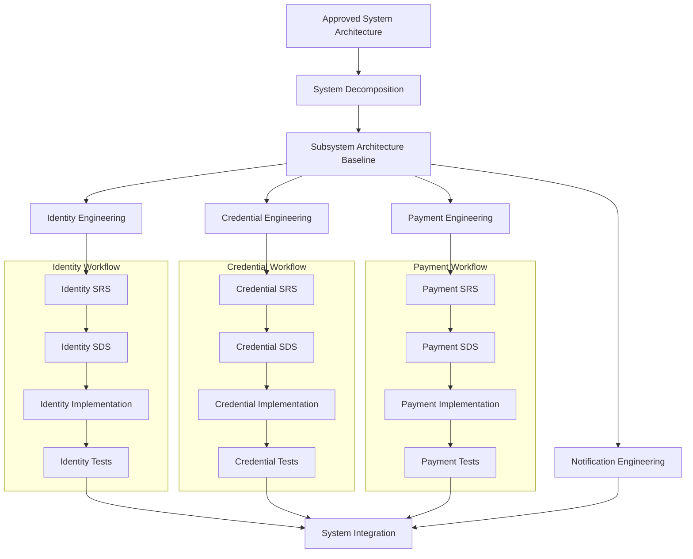

Each subsystem workflow MUST preserve the common system architecture and shared interface contracts.

## 21.4 System Integration

The Integration Agent MUST:

1. Verify subsystem interface compatibility.
2. Verify authentication and authorization integration.
3. Verify data ownership boundaries.
4. Verify cross-subsystem workflows.
5. Verify error propagation.
6. Verify transaction and consistency behavior.
7. Execute integration test cases.
8. Record integration defects.
9. Update integration documentation.

## 21.5 Final Delivery

The Orchestrator MUST ensure that:

- All required engineering baselines exist.
- All release-critical requirements are verified.
- All release-blocking defects are resolved.
- Deployment artifacts are available.
- Operational documentation is complete.
- Release authorization is recorded.

---

# 22. Standard Engineering Templates

This section defines the minimum templates needed to operate the orchestration framework.

## 22.1 Agent Task Assignment

```markdown
# Agent Task Assignment

**Task ID:**
**Workflow ID:**
**Phase:**
**Agent ID:**
**Priority:**

## Objective

## Background

## Required Inputs

## Scope

### In Scope

### Out of Scope

## Execution Instructions

## Constraints

## Expected Outputs

## Acceptance Criteria

## Dependencies

## Review Requirements
```

## 22.2 Agent Execution Report

```markdown
# Agent Execution Report

**Execution ID:**
**Task ID:**
**Agent ID:**
**Execution Status:**

## Summary

## Work Performed

## Artifacts Produced

## Requirements Addressed

## Design Decisions

## Assumptions

## Unresolved Issues

## Validation Results

## Recommendations

## Next Actions
```

## 22.3 Engineering Review Report

```markdown
# Engineering Review Report

**Review ID:**
**Artifact ID:**
**Reviewer:**
**Review Date:**

## Review Scope

## Review Criteria

## Findings

| ID | Severity | Finding | Required Action |
|---|---|---|---|

## Requirement Coverage

## Technical Consistency

## Outstanding Risks

## Review Decision

- Approved
- Approved with Actions
- Rework Required
- Rejected
```

## 22.4 Quality Gate Report

```markdown
# Quality Gate Report

**Gate ID:**
**Phase ID:**
**Workflow ID:**

## Required Artifacts

## Artifact Validation

## Requirement Coverage

## Review Results

## Outstanding Issues

## Risk Assessment

## Gate Decision

- PASS
- PASS_WITH_ACTIONS
- FAIL
- BLOCKED

## Approval

## Next Eligible Phase
```

## 22.5 Change Request

```markdown
# Engineering Change Request

**Change ID:**
**Requester:**
**Date:**
**Priority:**

## Change Description

## Business Rationale

## Affected Requirements

## Affected Architecture

## Affected Subsystems

## Affected Interfaces

## Affected Implementation

## Affected Tests

## Risk Assessment

## Approval Decision

## Implementation Tasks

## Verification Results
```

---

# 23. Standard Repository Structure

The orchestration framework SHOULD use the following repository organization.

```text
Project/
│
├── 00-Governance/
│   ├── Project-Engineering-Plan.md
│   ├── Development-Methodology.md
│   ├── Engineering-Document-Standards.md
│   ├── Engineering-Workflow-Standard.md
│   ├── Agent-Registry.yaml
│   ├── Requirement-ID-Registry.md
│   ├── Artifact-Registry.yaml
│   └── Architecture-Decisions/
│
├── 01-Product/
│   ├── PRD.md
│   ├── Business-Rules.md
│   └── Use-Cases.md
│
├── 02-System/
│   ├── System-Requirements.md
│   ├── System-Architecture.md
│   ├── System-Decomposition.md
│   ├── System-Interaction.md
│   └── Architecture-Decisions/
│
├── 03-Infrastructure/
│   ├── Network-Architecture.md
│   ├── Deployment-Architecture.md
│   └── Infrastructure-Specification.md
│
├── 04-Subsystems/
│   ├── Identity/
│   │   ├── Architecture.md
│   │   ├── SRS.md
│   │   ├── SDS.md
│   │   ├── API.md
│   │   ├── ICD.md
│   │   ├── Database.md
│   │   ├── Security.md
│   │   └── Tests/
│   │
│   ├── Credential/
│   │   └── ...
│   │
│   └── Payment/
│       └── ...
│
├── 05-Implementation/
│   ├── frontend/
│   ├── backend/
│   ├── contracts/
│   ├── database/
│   └── infrastructure/
│
├── 06-Integration/
│   ├── Integration-Architecture.md
│   ├── Interface-Registry.yaml
│   └── Integration-Tests/
│
├── 07-Quality/
│   ├── RTM.md
│   ├── Test-Plan.md
│   ├── Test-Reports/
│   └── Security-Reports/
│
├── 08-Operations/
│   ├── Deployment-Runbook.md
│   ├── Monitoring.md
│   ├── Backup-Recovery.md
│   └── Incident-Response.md
│
└── 09-Orchestration/
    ├── Workflows/
    ├── Tasks/
    ├── Agents/
    ├── Executions/
    ├── Reviews/
    ├── Quality-Gates/
    ├── Change-Requests/
    └── Reports/
```

Execution logs and temporary Agent outputs MAY be stored separately from authoritative engineering artifacts.

The project repository MUST distinguish draft work, reviewed artifacts, and approved baselines.

---

# 24. Engineering Performance and Governance Metrics

## 24.1 Workflow Metrics

| Metric | Purpose |
|---|---|
| Phase Lead Time | Time required to complete a phase |
| Task Lead Time | Time from task creation to acceptance |
| Task Rework Rate | Proportion of tasks requiring rework |
| Blocked Task Ratio | Proportion of blocked tasks |
| Gate Pass Rate | Proportion of gates passed on first review |
| Artifact Approval Time | Time required for artifact approval |

## 24.2 Agent Metrics

| Metric | Purpose |
|---|---|
| Task Completion Rate | Completed tasks / assigned tasks |
| First-Pass Acceptance | Tasks accepted without rework |
| Requirement Coverage | Requirements addressed |
| Defect Introduction Rate | Defects introduced by implementation |
| Review Finding Rate | Issues identified during review |
| Execution Reliability | Successful executions / total executions |

These metrics SHOULD be used to improve workflow quality rather than to reward Agents for producing large amounts of output.

## 24.3 Quality Metrics

The project SHOULD track:

- Requirement completeness.
- Architecture consistency.
- Interface compatibility.
- Design coverage.
- Test coverage.
- Defect density.
- Security findings.
- Release stability.

---

# 25. AI Agent Orchestration Maturity Model

The framework defines four maturity levels.

## Level 1 — Assisted Engineering

Characteristics:

- Humans perform most engineering work.
- AI Agents assist with individual documents and code.
- Task assignments are mostly manual.
- Reviews are primarily human-driven.

## Level 2 — Structured Agent Execution

Characteristics:

- Standard Agent roles are defined.
- Tasks have structured inputs and outputs.
- Engineering templates are standardized.
- Dependencies are tracked.
- Review workflows are established.

## Level 3 — Coordinated Multi-Agent Engineering

Characteristics:

- The Orchestrator manages task scheduling.
- Independent tasks execute in parallel.
- Artifacts are version-controlled.
- Quality gates are partially automated.
- Requirement traceability is maintained.
- Agents can perform iterative correction.

## Level 4 — Controlled Autonomous Engineering

Characteristics:

- Engineering workflows are machine-readable.
- Task decomposition and scheduling are automated.
- Agents collaborate through formal contracts.
- Automated validation is integrated.
- Change impact analysis is automated.
- Continuous engineering progress is tracked.
- Human approvals remain mandatory for designated critical decisions.

Projects SHOULD progress incrementally through these maturity levels.

Autonomy MUST NOT exceed the level of validation, observability, and permission control available to the framework.

---

# 26. Final Standardization Requirements

The following requirements constitute the mandatory baseline.

| ID | Requirement |
|---|---|
| WF-001 | Every project MUST define an engineering workflow. |
| WF-002 | Every engineering phase MUST define objectives and deliverables. |
| WF-003 | Every phase MUST have completion criteria. |
| WF-004 | Every mandatory phase MUST have a quality gate. |
| WF-005 | Every task MUST have a unique identifier. |
| WF-006 | Every task MUST define acceptance criteria. |
| WF-007 | Every task MUST have an accountable owner. |
| WF-008 | Agent capabilities MUST be explicitly defined. |
| WF-009 | Agent permissions MUST follow least privilege. |
| WF-010 | Every controlled artifact MUST have an authoritative owner. |
| WF-011 | Artifacts MUST preserve version history. |
| WF-012 | Requirement traceability MUST be maintained. |
| WF-013 | Cross-subsystem interfaces MUST have authoritative contracts. |
| WF-014 | Concurrent tasks MUST NOT silently overwrite shared artifacts. |
| WF-015 | Critical deliverables MUST undergo independent review. |
| WF-016 | AI Agents MUST NOT independently authorize restricted production operations. |
| WF-017 | Changes to approved baselines MUST be controlled. |
| WF-018 | Task and Agent execution MUST be auditable. |
| WF-019 | Failed tasks MUST preserve execution and validation records. |
| WF-020 | Release MUST require verification and designated authorization. |
| WF-021 | Workflow completion MUST be based on acceptance criteria, not task status alone. |
| WF-022 | AI-generated engineering artifacts MUST meet the same standards as human-generated artifacts. |
| WF-023 | All critical engineering decisions MUST be traceable. |
| WF-024 | The framework MUST support incremental and parallel engineering execution. |
| WF-025 | All project-specific workflow customizations MUST preserve mandatory governance and quality controls. |

---

# 27. Unified Engineering Framework

## 27.1 Three-Document Governance Model

The three engineering standards form a unified governance framework.

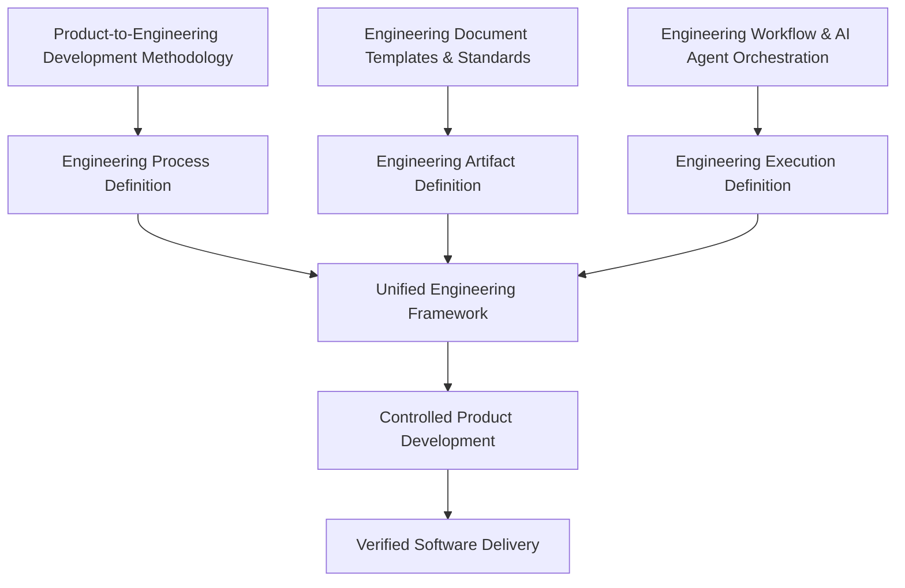

### Standard 1 — Development Methodology

Defines:

- Engineering lifecycle.
- Development phases.
- Engineering baselines G1 through G7.
- Engineering responsibilities.
- Development principles.
- Stage transitions.

Fundamental question:

**What is the correct engineering process?**

### Standard 2 — Document Templates & Standards

Defines:

- Document types.
- Document structures.
- Requirement formats.
- Diagram standards.
- Naming conventions.
- Document review checklists and review outcomes in §26.

Fundamental question:

**What engineering artifacts must be produced, and how should they be documented?**

### Standard 3 — Workflow & Agent Orchestration

Defines:

- Agent responsibilities.
- Task decomposition.
- Task dependencies.
- Artifact coordination.
- Workflow execution.
- Execution checkpoints Gate P0 through Gate P9.
- Validation and approvals.
- Multi-Agent collaboration.

Fundamental question:

**How is engineering work actually executed, coordinated, and controlled?**

## 27.2 End-to-End Engineering Model

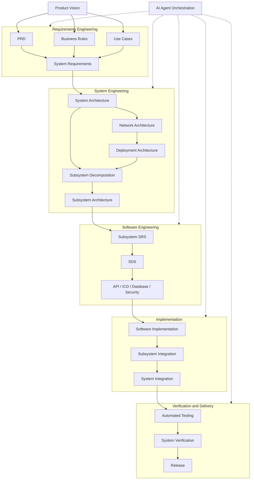

## 27.3 Final Engineering Principle

All engineering activities MUST follow this fundamental relationship:

**Requirements define what must be achieved.**

**Architecture defines how the system is organized.**

**Subsystem engineering defines responsibility boundaries.**

**Software requirements define what each subsystem must implement.**

**Software design defines how the software is constructed.**

**Implementation realizes the design.**

**Verification demonstrates that requirements have been satisfied.**

**AI Agent Orchestration coordinates the entire process and ensures that every engineering activity produces traceable, verifiable, and controlled results.**

No Agent should independently redefine the project architecture, business rules, or approved requirements.

All Agents MUST operate within the shared engineering governance framework.

The final objective is to establish a repeatable, scalable, auditable, and AI-compatible engineering system capable of delivering complete software products through coordinated human and AI collaboration.