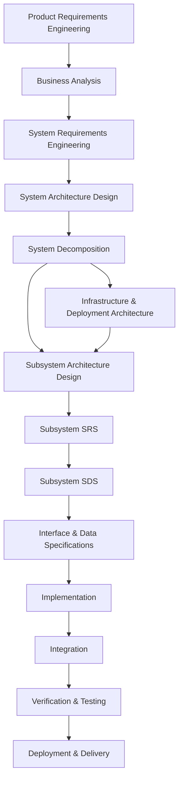
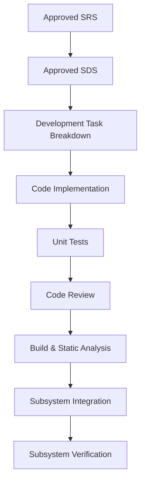
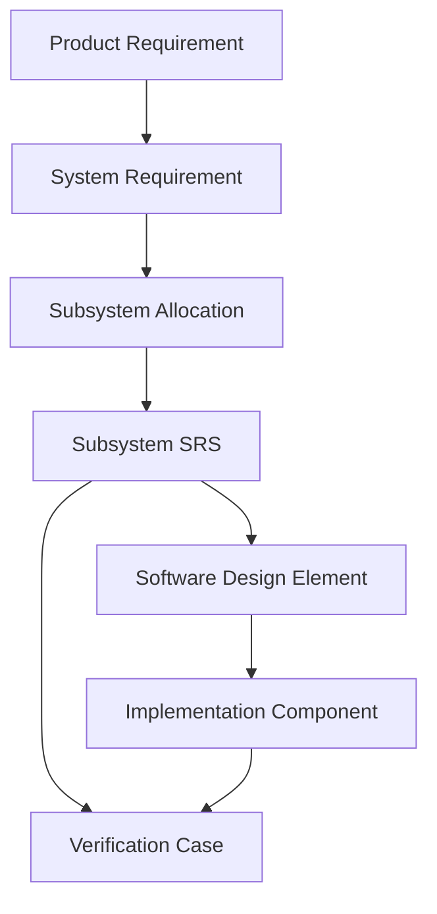

# Product-to-Engineering Development Methodology & Documentation Standard

**Document Type:** Engineering Methodology Standard  
**Version:** 1.0.0  
**Status:** Baseline  
**Language:** English  
**Format:** Markdown  
**Scope:** Product Requirements, System Engineering, Software Architecture, Subsystem Engineering, Implementation, Verification & Delivery

---

# 1. Introduction

## 1.1 Purpose

This document defines a standardized engineering methodology for transforming product requirements into fully designed, implemented, verified, and deployable software systems.

The methodology establishes a structured development process covering:

1. Product Requirements Engineering
2. Business Analysis
3. System Requirements Engineering
4. System Architecture Design
5. System Decomposition and Subsystem Allocation
6. Network and Deployment Architecture
7. Subsystem Architecture Design
8. Software Requirements Specification
9. Software Design Specification
10. Software Implementation
11. Integration and Verification
12. System Deployment and Delivery

The primary objective is to ensure that every software system is developed through a traceable, architecture-driven, and specification-based engineering process.

This standard also defines the required engineering documents, their relationships, development responsibilities, review criteria, and completion criteria.

## 1.2 Scope

This methodology applies to:

- Web and mobile applications
- Backend services and distributed systems
- Cloud-native applications
- AI Agent and multi-agent systems
- Blockchain and Web3 applications
- Financial and payment systems
- Protocol-oriented software
- Enterprise software platforms
- Complex software products involving multiple subsystems

The methodology is technology-independent and can be adapted to monolithic, modular monolithic, microservices, serverless, edge, and hybrid architectures.

## 1.3 Engineering Principles

All projects following this standard SHOULD comply with the following principles.

### P1. Requirements-Driven Development

All architecture and implementation decisions MUST originate from identified product or system requirements, or from explicitly documented engineering constraints.

### P2. Architecture Before Implementation

The overall system architecture and subsystem boundaries MUST be established before independent subsystem implementation begins.

### P3. Separation of Concerns

Product requirements, system requirements, software requirements, architecture, detailed design, and implementation MUST be maintained as distinct engineering concerns.

### P4. Specification-Based Development

Every major subsystem MUST have an approved specification before its implementation is considered ready to begin.

### P5. Interface-First Integration

Cross-subsystem interfaces MUST be defined and reviewed before dependent subsystems begin independent implementation.

### P6. Traceability

Requirements MUST be traceable from their original product objectives through system requirements, subsystem specifications, implementation components, and verification cases.

### P7. Continuous Verification

Verification MUST occur throughout the development lifecycle rather than only after implementation is completed.

### P8. Architecture and Deployment Independence

Logical architecture, application architecture, and physical deployment architecture MUST be modeled independently and then reconciled.

### P9. Incremental Delivery

The methodology supports iterative and incremental development. Architecture and specifications can evolve through controlled revisions.

---

# 2. Overall Engineering Lifecycle

## 2.1 Lifecycle Overview

The standard defines seven engineering phases.

| Phase | Engineering Discipline | Primary Output |
|---|---|---|
| Phase 1 | Product Engineering | PRD and Business Specifications |
| Phase 2 | System Engineering | System Requirements and System Architecture |
| Phase 3 | Infrastructure Engineering | Network and Deployment Architecture |
| Phase 4 | Subsystem Engineering | Subsystem Architecture and SRS |
| Phase 5 | Software Design Engineering | SDS, API, Data and Security Specifications |
| Phase 6 | Software Engineering | Implemented Software and Integration |
| Phase 7 | Verification and Delivery | Test Reports and Release Artifacts |

## 2.2 Lifecycle Process



The lifecycle is a logical engineering sequence, not a requirement for strictly sequential execution.

For example:

- Infrastructure architecture and subsystem architecture may progress in parallel after system decomposition.
- Subsystem SRS documents may be developed concurrently.
- Implementation may begin incrementally after the relevant subsystem specifications and interfaces are approved.
- Verification planning may begin during requirements engineering.

## 2.3 Engineering Phase Gates

Each phase MUST have an explicit completion gate.

| Gate | Name | Exit Criteria |
|---|---|---|
| G1 | Product Baseline | Product requirements reviewed and approved |
| G2 | System Architecture Baseline | System boundaries, architecture and subsystem allocation approved |
| G3 | Deployment Baseline | Network, infrastructure and deployment model approved |
| G4 | Subsystem Baseline | Subsystem architecture and SRS approved |
| G5 | Design Baseline | Detailed design and interface specifications approved |
| G6 | Implementation Baseline | Implementation and integration criteria satisfied |
| G7 | Release Baseline | Verification completed and release approved |

A project MAY tailor the gates according to its scale and risk profile, but MUST preserve the underlying approval and traceability principles.

---

# 3. Phase 1 — Product Requirements Engineering

## 3.1 Objective

Define what the product is expected to achieve from a business and user perspective.

This phase establishes the product's business objectives, user requirements, functional expectations, and operational constraints.

It MUST NOT prematurely prescribe detailed software architecture or implementation technology unless those decisions are explicit product constraints.

## 3.2 Required Activities

### 3.2.1 Product Definition

Identify:

- Product vision
- Product objectives
- Target users
- Stakeholders
- Product scope
- Business value
- Success metrics
- Product constraints

### 3.2.2 Business Analysis

Identify:

- Business capabilities
- Business processes
- Business entities
- Business rules
- Business events
- Business states
- External actors
- External systems
- Business exceptions

### 3.2.3 Functional Requirements

Define the capabilities the product MUST provide.

Each functional requirement MUST have:

- Unique identifier
- Requirement description
- Business rationale
- Preconditions
- Expected behavior
- Postconditions
- Priority
- Acceptance criteria

### 3.2.4 Non-Functional Requirements

Identify relevant quality attributes:

- Performance
- Scalability
- Availability
- Reliability
- Security
- Privacy
- Usability
- Accessibility
- Maintainability
- Portability
- Interoperability
- Observability

Where possible, non-functional requirements SHOULD be measurable.

For example:

```text
NFR-001

The system MUST support at least 1,000 concurrent active sessions.

NFR-002

The API MUST achieve a p95 response latency below 200 ms
under the defined baseline workload.

NFR-003

The system MUST provide an availability target of 99.9%
measured monthly, excluding approved maintenance windows.
```

## 3.3 Required Documents

| Document | Description | Mandatory |
|---|---|---|
| PRD | Product Requirements Document | Yes |
| Business Rules Specification | Business constraints and rules | Yes |
| Use Case Specification | Business and user interaction scenarios | Conditional |
| User Journey Specification | User journeys and workflows | Conditional |
| Product Acceptance Criteria | Product acceptance conditions | Yes |

## 3.4 Phase Exit Criteria

The product requirements baseline MUST:

1. Define the product scope.
2. Identify major stakeholders and user roles.
3. Describe primary business workflows.
4. Identify functional requirements.
5. Identify applicable non-functional requirements.
6. Define business rules and constraints.
7. Provide measurable acceptance criteria.
8. Identify external dependencies and integrations.

---

# 4. Phase 2 — System Engineering and Overall Architecture

## 4.1 Objective

Transform product-level business requirements into an implementable system structure.

This phase establishes the system boundary, system requirements, system architecture, subsystem decomposition, and cross-subsystem relationships.

It is the most important architectural phase because decisions made here affect the entire implementation.

## 4.2 System Requirements Engineering

Product requirements MUST be analyzed and translated into system-level requirements.

System requirements describe what the complete software system MUST provide.

They include:

- System functional requirements
- System interface requirements
- System performance requirements
- System security requirements
- System availability requirements
- System operational requirements
- System constraints

Example:

```text
PRD:
Users must be able to issue and manage digital credentials.

System Requirements:

SYS-CR-001:
The system MUST support credential issuance.

SYS-CR-002:
The system MUST support credential storage and retrieval.

SYS-CR-003:
The system MUST support credential verification.

SYS-CR-004:
The system MUST support credential revocation.
```

System requirements SHOULD be independently identifiable and traceable to their originating product requirements.

## 4.3 System Context Analysis

Define the system's relationship with external actors and systems.

Identify:

- Users
- External applications
- Third-party services
- External protocols
- Infrastructure dependencies
- External data providers
- Trust boundaries

Required artifact:

**System Context Diagram**

## 4.4 System Architecture Design

Define the overall logical organization of the system.

The system architecture MUST address:

### A. Architectural Style

Examples:

- Monolithic Architecture
- Modular Monolithic Architecture
- Microservices Architecture
- Event-Driven Architecture
- Service-Oriented Architecture
- Serverless Architecture
- Hybrid Architecture

The architecture MUST justify the selected style based on requirements and constraints.

### B. Logical Architecture

Identify the major logical components and their responsibilities.

### C. Application Architecture

Identify applications, services, modules, and their interactions.

### D. Data Architecture

Define:

- Major data domains
- Data ownership
- Data flows
- Persistence strategy
- Data consistency requirements
- Data lifecycle

### E. Integration Architecture

Define communication mechanisms:

- Synchronous APIs
- Asynchronous messaging
- Event-driven communication
- Streaming
- RPC
- External protocol adapters

### F. Security Architecture

Define:

- Authentication boundaries
- Authorization boundaries
- Trust domains
- Key management boundaries
- Data protection
- Audit requirements
- Threat model

## 4.5 System Decomposition and Subsystem Allocation

The system MUST be decomposed into manageable subsystems.

Subsystem boundaries SHOULD be determined by:

1. Business capability boundaries
2. Domain responsibility
3. Data ownership
4. Transaction consistency
5. Security boundaries
6. Change independence
7. Integration complexity
8. Scalability requirements
9. Deployment requirements

Each subsystem MUST have a clearly defined responsibility.

A subsystem definition MUST include:

| Attribute | Description |
|---|---|
| Subsystem ID | Unique identifier |
| Name | Subsystem name |
| Purpose | Primary objective |
| Responsibilities | Owned capabilities |
| Scope | Included functions |
| Out of Scope | Excluded functions |
| Inputs | Accepted inputs |
| Outputs | Produced outputs |
| Data Ownership | Data managed by the subsystem |
| Dependencies | Required subsystems and external services |
| Interfaces | Exposed interfaces |
| Quality Requirements | Applicable NFRs |

The decomposition MUST also define which system requirements are allocated to each subsystem.

## 4.6 System Interaction Architecture

Define how subsystems collaborate.

The architecture MUST specify:

- Communication direction
- Communication protocol
- Request and response contracts
- Event contracts
- Error propagation
- Retry behavior
- Timeout behavior
- Idempotency requirements
- Transaction boundaries
- Consistency guarantees

Required artifacts include:

- System Interaction Diagram
- Subsystem Dependency Diagram
- System Sequence Diagrams
- Interface Inventory

## 4.7 Required Documents

| Document | Description | Mandatory |
|---|---|---|
| System Requirements Specification | System-level requirements | Yes |
| System Architecture Specification | Overall system architecture | Yes |
| System Context Specification | System boundary and external actors | Yes |
| System Decomposition Specification | Subsystem allocation | Yes |
| System Interaction Specification | Cross-subsystem interactions | Yes |
| Technology Architecture Specification | Technology selection and rationale | Yes |
| Architecture Decision Records | Important architectural decisions | Yes |

## 4.8 Phase Exit Criteria

The system architecture baseline MUST establish:

1. A complete system boundary.
2. An identifiable set of system requirements.
3. A defined architectural style.
4. A logical system architecture.
5. A defined set of subsystems.
6. Clear subsystem responsibilities.
7. Allocated system requirements.
8. Defined inter-subsystem dependencies.
9. Preliminary interface contracts.
10. Documented architectural decisions.

---

# 5. Phase 3 — Network and Deployment Architecture

## 5.1 Objective

Translate the logical system architecture into a physical and operational deployment model.

This phase defines where software components run, how they communicate, and how the underlying infrastructure is organized.

Deployment architecture MUST NOT be confused with logical architecture.

A logical subsystem may contain several deployment units, and several logical subsystems may initially share a deployment unit.

## 5.2 Network Architecture

Define:

- Public network boundaries
- Private network boundaries
- VPC and subnet structures
- Ingress and egress paths
- DNS architecture
- Load balancing
- Firewall policies
- Network segmentation
- Service-to-service connectivity
- External connectivity

## 5.3 Deployment Architecture

Define the deployment model for each system component.

Examples:

- Web frontend
- API Gateway
- Backend services
- Worker services
- Message brokers
- Databases
- Cache systems
- Object storage
- HSM or KMS
- Blockchain RPC providers
- External integrations

## 5.4 Infrastructure Architecture

Define:

- Compute resources
- Container infrastructure
- Kubernetes or equivalent orchestration
- Storage infrastructure
- Database infrastructure
- Messaging infrastructure
- Monitoring infrastructure
- Logging infrastructure
- Backup infrastructure

## 5.5 Environment Architecture

Define the environments:

- Development
- Testing
- Staging
- Production

For each environment, specify:

- Infrastructure topology
- Configuration management
- Data isolation
- Access permissions
- Deployment procedures
- Secrets management

## 5.6 Reliability and Operations

Define:

- High availability
- Fault tolerance
- Disaster recovery
- Backup and restoration
- Horizontal scaling
- Health checks
- Monitoring
- Alerting
- Logging
- Distributed tracing

## 5.7 Required Documents

| Document | Description | Mandatory |
|---|---|---|
| Network Architecture Specification | Network topology and connectivity | Yes |
| Deployment Architecture Specification | Component deployment model | Yes |
| Infrastructure Specification | Infrastructure requirements | Yes |
| Environment Specification | Environment definitions | Yes |
| Security Zone Specification | Security zones and access policies | Conditional |
| Operations Architecture Specification | Monitoring, reliability and operations | Yes |

## 5.8 Phase Exit Criteria

The deployment baseline MUST:

1. Map logical components to deployment units.
2. Define network boundaries.
3. Define communication paths.
4. Identify infrastructure dependencies.
5. Define environment separation.
6. Define security controls.
7. Address availability and recovery.
8. Establish deployment constraints.

---

# 6. Phase 4 — Subsystem Engineering

## 6.1 Objective

Design each subsystem as an independently understandable and implementable engineering unit.

This phase translates subsystem responsibilities from the system architecture into internal software architecture and detailed subsystem requirements.

Every subsystem MUST have an approved architecture definition and an appropriate software requirements specification before its implementation begins.

## 6.2 Subsystem Architecture Design

Each subsystem MUST have its own architecture specification.

The specification MUST define:

### A. Subsystem Boundary

- Purpose
- Responsibilities
- Scope
- Exclusions
- Dependencies
- Ownership

### B. Internal Application Architecture

Identify:

- Applications
- Services
- Modules
- Components
- Controllers
- Domain services
- Repositories
- Adapters
- Workers
- Internal interfaces

The selected application architecture SHOULD reflect the subsystem's responsibilities and complexity.

### C. Internal Interaction

Define:

- Component communication
- Internal processing flows
- State transitions
- Event handling
- Exception handling

### D. Internal Data Architecture

Define:

- Data ownership
- Entities
- Aggregates
- Persistence boundaries
- Data relationships
- Data lifecycle

### E. Internal Security Architecture

Define:

- Authentication requirements
- Authorization requirements
- Sensitive data handling
- Secret management
- Key protection
- Audit mechanisms

### F. External Interface Architecture

Define how the subsystem communicates with other subsystems and external systems.

## 6.3 Subsystem Requirements Engineering

After establishing the subsystem architecture, develop its Software Requirements Specification (SRS).

The SRS MUST define the software behavior required to fulfill the subsystem's allocated system requirements.

Each requirement MUST have:

- Unique ID
- Requirement statement
- Source requirement
- Priority
- Preconditions
- Expected behavior
- Postconditions
- Error conditions
- Acceptance criteria

Requirements MUST be testable and unambiguous.

### Functional Requirements

Examples:

```text
CR-SRS-FR-001

The Credential Subsystem MUST allow authorized clients
to issue a credential.

CR-SRS-FR-002

The Credential Subsystem MUST validate the structural
integrity of a credential before accepting it.

CR-SRS-FR-003

The Credential Subsystem MUST support credential
revocation according to the configured revocation policy.
```

### Non-Functional Requirements

Examples:

```text
CR-SRS-NFR-001

Credential verification MUST meet the specified
performance target under the defined workload.

CR-SRS-NFR-002

Credential records MUST be protected against
unauthorized modification.

CR-SRS-NFR-003

Credential lifecycle operations MUST produce
auditable records.
```

## 6.4 Subsystem Engineering Documents

Each subsystem SHOULD maintain the following documents.

| Document | Description | Requirement |
|---|---|---|
| Subsystem Architecture Specification | Internal architecture | Mandatory |
| Subsystem SRS | Software requirements | Mandatory |
| Subsystem SDS | Detailed software design | Mandatory |
| API Specification | Exposed API contracts | Conditional |
| ICD | Cross-subsystem interface contract | Conditional |
| Data Design Specification | Database and storage design | Conditional |
| Security Specification | Security design | Conditional |
| Test Specification | Subsystem verification | Mandatory |

Conditional documents MAY be integrated into the SDS when separation is unnecessary.

## 6.5 Subsystem Completion Criteria

A subsystem is considered design-complete when:

1. Its responsibility and boundary are approved.
2. Its internal architecture is documented.
3. Its SRS is complete.
4. Its requirements are traceable to system requirements.
5. Its external interfaces are defined.
6. Its data ownership is established.
7. Its security requirements are addressed.
8. Its test strategy is defined.
9. Its dependencies are documented.

---

# 7. Phase 5 — Software Design Engineering

## 7.1 Objective

Transform approved software requirements into implementation-ready technical designs.

The design MUST explain how the software will satisfy the requirements defined in the SRS.

## 7.2 Software Design Specification (SDS)

The SDS MUST define the internal technical implementation model.

Recommended contents:

### 7.2.1 Software Structure

- Package structure
- Module structure
- Component structure
- Class structure
- Dependency relationships

### 7.2.2 Component Design

For each major component:

- Component responsibility
- Input and output
- Internal behavior
- Dependencies
- Error handling
- State management

### 7.2.3 Business Logic Design

Define:

- Business workflows
- Algorithms
- State machines
- Validation logic
- Transaction processing
- Business invariants

### 7.2.4 Data Design

Define:

- Entities
- Database schemas
- Tables and collections
- Indexes
- Constraints
- Relationships
- Migrations
- Data retention

### 7.2.5 Interface Design

Define:

- API endpoints
- Request and response schemas
- Authentication
- Authorization
- Error codes
- Versioning
- Idempotency
- Pagination

### 7.2.6 Security Design

Define:

- Threat mitigation
- Access control
- Cryptographic mechanisms
- Secret handling
- Key lifecycle
- Data encryption
- Security logging

### 7.2.7 Operational Design

Define:

- Configuration
- Logging
- Metrics
- Tracing
- Health checks
- Failure recovery
- Resource management

## 7.3 Interface Control Document (ICD)

ICD is particularly important when multiple subsystems are developed independently.

An ICD MUST establish the authoritative interface contract between communicating components.

It SHOULD define:

- Provider and consumer
- Interface identifier
- Protocol
- Transport
- Request schema
- Response schema
- Event schema
- Error semantics
- Authentication
- Authorization
- Timeout
- Retry
- Idempotency
- Version compatibility

Interface changes MUST be managed through controlled revisions.

## 7.4 Design Review

Before implementation begins, the design MUST be reviewed against:

- SRS completeness
- Architecture consistency
- Interface compatibility
- Data ownership
- Security requirements
- Failure handling
- Testability
- Operational feasibility

---

# 8. Phase 6 — Software Implementation Engineering

## 8.1 Objective

Implement the software according to the approved requirements and design specifications.

Implementation MUST maintain traceability to the approved engineering baseline.

## 8.2 Development Standards

Each project MUST establish:

- Programming language standards
- Coding conventions
- Repository structure
- Branching strategy
- Dependency management
- Configuration management
- Secrets management
- Error handling standards
- Logging standards
- Testing standards
- Documentation standards

## 8.3 Implementation Workflow



## 8.4 Definition of Done

A software task is complete only when:

1. Implementation satisfies its assigned requirements.
2. Unit tests pass.
3. Code review is approved.
4. Static analysis passes according to project policy.
5. Security requirements are addressed.
6. API and documentation changes are synchronized.
7. Relevant integration tests pass.
8. No unresolved critical defects remain.

## 8.5 Configuration and Version Management

All implementation artifacts MUST be version-controlled.

This includes:

- Source code
- Configuration templates
- Database migrations
- API definitions
- Infrastructure definitions
- Test code
- Engineering documentation

---

# 9. Phase 7 — Verification, Validation and Delivery

## 9.1 Objective

Establish that the implemented software conforms to its requirements and fulfills the intended product objectives.

Verification and validation MUST be treated as distinct activities.

- Verification: Are we building the system correctly?
- Validation: Are we building the correct system?

## 9.2 Verification Levels

### Unit Testing

Validate individual functions, modules, and components.

### Component Testing

Validate internal subsystem components and their interactions.

### Subsystem Testing

Validate complete subsystem behavior against its SRS.

### Integration Testing

Validate interactions between subsystems and external systems.

### System Testing

Validate complete system behavior against system requirements.

### Acceptance Testing

Validate product behavior against business and user acceptance criteria.

### Non-Functional Testing

Where applicable:

- Performance testing
- Load testing
- Stress testing
- Security testing
- Penetration testing
- Reliability testing
- Recovery testing
- Compatibility testing

## 9.3 Requirements Verification Matrix

Every testable requirement MUST be associated with at least one verification method.

| Requirement ID | Verification Method | Test ID | Result |
|---|---|---|---|
| SYS-001 | Functional Test | ST-001 | Pending |
| CR-SRS-001 | Subsystem Test | CR-TC-001 | Pending |
| PM-SRS-001 | Integration Test | IT-001 | Pending |

## 9.4 Release Criteria

A release MUST satisfy:

1. Required system tests pass.
2. Critical security issues are resolved.
3. Acceptance criteria are met.
4. Deployment procedures are validated.
5. Database migrations are reviewed.
6. Monitoring and alerting are operational.
7. Rollback or recovery procedures are established.
8. Release documentation is complete.

---

# 10. Requirements Traceability Management

## 10.1 Objective

Maintain bidirectional traceability throughout the engineering lifecycle.

The traceability model MUST connect:

Product Requirements → System Requirements → Subsystem Requirements → Design Elements → Implementation → Test Cases.

## 10.2 Traceability Structure



## 10.3 Requirement Traceability Matrix

The project MUST maintain an RTM.

Recommended fields:

| Field | Description |
|---|---|
| Requirement ID | Unique identifier |
| Source ID | Parent requirement |
| Requirement Description | Requirement summary |
| Subsystem | Allocated subsystem |
| SRS ID | Software requirement |
| Design Reference | SDS section or component |
| Implementation Reference | Code module or repository reference |
| Test Case ID | Verification reference |
| Status | Current lifecycle status |

## 10.4 Change Impact Analysis

When a requirement changes, the project MUST identify its impact on:

- Product requirements
- System requirements
- Subsystem responsibilities
- Architecture
- Interfaces
- Data models
- Software specifications
- Implementation
- Test cases
- Deployment

Changes MUST be reviewed before affected baselines are updated.

---

# 11. Engineering Document Standards

## 11.1 Document Identification

Every formal engineering document MUST include:

```text
Document Title:
Document ID:
Version:
Status:
Owner:
Author:
Reviewers:
Approval Date:
Last Updated:
Related Documents:
```

## 11.2 Document Versioning

Recommended version format:

```text
MAJOR.MINOR.PATCH
```

Examples:

- 1.0.0 — Initial approved baseline
- 1.1.0 — Compatible additions or clarifications
- 1.1.1 — Editorial corrections
- 2.0.0 — Major architectural or contractual revision

Versioning MUST reflect the project's change management policy.

## 11.3 Document Status

Recommended statuses:

| Status | Meaning |
|---|---|
| Draft | Under development |
| In Review | Submitted for review |
| Approved | Formally approved |
| Baselined | Established as a controlled baseline |
| Superseded | Replaced by a newer version |
| Deprecated | No longer recommended for use |

## 11.4 Requirement Identification

Recommended ID conventions:

| Requirement Type | Prefix | Example |
|---|---|---|
| Business Requirement | BR | BR-001 |
| Product Requirement | PRD | PRD-FR-001 |
| System Requirement | SYS | SYS-FR-001 |
| Identity Requirement | ID | ID-SRS-FR-001 |
| Credential Requirement | CR | CR-SRS-FR-001 |
| Payment Requirement | PM | PM-SRS-FR-001 |
| Non-Functional Requirement | NFR | SYS-NFR-001 |
| Test Case | TC | TC-001 |
| Interface | ICD | ICD-001 |
| Architecture Decision | ADR | ADR-001 |

Projects MAY introduce additional identifiers while maintaining global uniqueness within the project.

## 11.5 Requirement Writing Rules

Requirements SHOULD use the following language:

- MUST: Mandatory requirement.
- SHOULD: Recommended requirement.
- MAY: Optional capability.

Every normative requirement MUST be:

- Clear
- Unambiguous
- Atomic where practical
- Verifiable
- Traceable
- Feasible

Avoid vague expressions such as:

- Fast
- Secure
- User-friendly
- Highly scalable
- Robust

Replace them with measurable or explicitly testable criteria.

---

# 12. Architecture Governance and Design Reviews

## 12.1 Architecture Review

The system architecture MUST undergo a formal review before its baseline is approved.

The review SHOULD cover:

- Requirements coverage
- Subsystem decomposition
- Architecture consistency
- Dependency management
- Data ownership
- Interface design
- Security boundaries
- Scalability
- Reliability
- Deployment feasibility
- Operational complexity

## 12.2 Subsystem Design Review

Each subsystem MUST undergo a design review.

Review items:

1. Responsibility and scope
2. SRS completeness
3. Internal component design
4. API and ICD consistency
5. Data model correctness
6. Security controls
7. Error handling
8. Testability
9. Dependency constraints

## 12.3 Architecture Decision Records

Important architectural decisions MUST be recorded.

An ADR SHOULD include:

```text
ADR ID:
Title:
Status:
Date:

Context:
What problem or architectural question needs to be addressed?

Decision:
What decision has been made?

Alternatives:
What alternatives were considered?

Rationale:
Why was this decision selected?

Consequences:
What are the positive and negative consequences?

Related Requirements:
Related Architecture Documents:
```

## 12.4 Architecture Change Control

Architecture changes MUST be evaluated for their impact on:

- System requirements
- Subsystem boundaries
- Interface contracts
- Data ownership
- Deployment topology
- Security architecture
- Existing implementations

Approved changes MUST be reflected in all affected specifications.

---

# 13. Engineering Team Responsibilities

The methodology defines engineering responsibilities independently of organizational structure.

| Role | Primary Responsibility |
|---|---|
| Product Manager | Product scope and business requirements |
| Business Analyst | Business analysis and use cases |
| System Architect | System architecture and decomposition |
| Infrastructure Architect | Network and deployment architecture |
| Software Architect | Application and subsystem architecture |
| Subsystem Owner | Subsystem requirements and design |
| API / Integration Engineer | Interface contracts and integration |
| Database Engineer | Data architecture and database design |
| Security Engineer | Security architecture and validation |
| Software Engineer | Implementation |
| QA Engineer | Verification and testing |
| DevOps / SRE | Deployment and operations |

One individual MAY perform multiple roles in smaller projects.

However, the responsibilities and approval requirements MUST remain identifiable.

---

# 14. Project Documentation Repository Structure

The following repository structure is the recommended default.

```text
Project/
│
├── 00-Governance/
│   ├── Project-Engineering-Plan.md
│   ├── Development-Methodology.md
│   ├── Document-Control-Standard.md
│   ├── Requirement-ID-Registry.md
│   └── Architecture-Decisions/
│
├── 01-Product/
│   ├── PRD.md
│   ├── Business-Rules.md
│   ├── Use-Case-Specification.md
│   ├── User-Journey.md
│   └── Acceptance-Criteria.md
│
├── 02-System-Engineering/
│   ├── System-Requirements-Specification.md
│   ├── System-Context.md
│   ├── System-Architecture-Specification.md
│   ├── System-Decomposition.md
│   ├── System-Interaction-Specification.md
│   ├── Technology-Architecture.md
│   └── Requirement-Allocation-Matrix.md
│
├── 03-Infrastructure/
│   ├── Network-Architecture.md
│   ├── Deployment-Architecture.md
│   ├── Infrastructure-Specification.md
│   ├── Environment-Specification.md
│   └── Operations-Architecture.md
│
├── 04-Subsystems/
│   │
│   ├── Subsystem-A/
│   │   ├── Architecture.md
│   │   ├── SRS.md
│   │   ├── SDS.md
│   │   ├── API-Specification.md
│   │   ├── ICD.md
│   │   ├── Database-Design.md
│   │   ├── Security-Specification.md
│   │   └── Test-Specification.md
│   │
│   ├── Subsystem-B/
│   │   └── ...
│   │
│   └── Subsystem-N/
│       └── ...
│
├── 05-Integration/
│   ├── Integration-Architecture.md
│   ├── Interface-Control-Document.md
│   └── Integration-Test-Specification.md
│
├── 06-Quality-Assurance/
│   ├── Requirement-Traceability-Matrix.md
│   ├── System-Test-Specification.md
│   ├── Security-Test-Specification.md
│   ├── Performance-Test-Specification.md
│   └── Acceptance-Test-Specification.md
│
├── 07-Implementation/
│   ├── Development-Standards.md
│   ├── Coding-Guidelines.md
│   ├── Repository-Structure.md
│   ├── CI-CD-Specification.md
│   └── Release-Management.md
│
└── 08-Operations/
    ├── Deployment-Runbook.md
    ├── Monitoring-and-Alerting.md
    ├── Backup-and-Recovery.md
    └── Incident-Response.md
```

This structure MAY be simplified or expanded depending on project size.

---

# 15. Standard Engineering Workflow for Future Projects

Every new project SHOULD follow this execution sequence.

## Step 1 — Understand the Product

Input:

- Product concept
- Business objectives
- Product requirements

Activities:

- Analyze business scenarios.
- Identify user roles.
- Define product capabilities.
- Establish business rules.
- Write PRD.

Output:

- Approved PRD baseline.

## Step 2 — Analyze and Decompose the System

Input:

- Approved PRD.

Activities:

- Derive system requirements.
- Establish system boundaries.
- Design system context.
- Identify system capabilities.
- Define architectural style.
- Decompose the system into subsystems.
- Allocate system requirements.
- Define cross-subsystem interactions.

Output:

- System Requirements Specification.
- System Architecture Specification.
- System Decomposition Specification.
- System Interaction Specification.

## Step 3 — Design Network and Deployment Architecture

Input:

- Approved system architecture.

Activities:

- Define network topology.
- Define deployment units.
- Map logical components to physical infrastructure.
- Define infrastructure dependencies.
- Define environments.
- Establish operational and security boundaries.

Output:

- Network Architecture.
- Deployment Architecture.
- Infrastructure Specification.

## Step 4 — Design Each Subsystem

Input:

- Approved system architecture.
- Subsystem allocation.
- System requirements.

Activities:

- Define subsystem responsibilities.
- Design internal application architecture.
- Define internal components.
- Define data ownership.
- Define subsystem interfaces.
- Develop subsystem SRS.
- Review and approve the subsystem baseline.

Output:

- Subsystem Architecture.
- Subsystem SRS.

## Step 5 — Complete Detailed Software Design

Input:

- Approved subsystem architecture.
- Approved subsystem SRS.

Activities:

- Design components.
- Design business logic.
- Define data models.
- Define API contracts.
- Define cross-subsystem ICDs.
- Define security controls.
- Define test specifications.

Output:

- SDS.
- API Specification.
- ICD.
- Database Design.
- Security Specification.
- Test Specification.

## Step 6 — Implement Subsystems

Input:

- Approved engineering specifications.

Activities:

- Establish development repositories.
- Break down engineering tasks.
- Implement components.
- Develop unit tests.
- Conduct code reviews.
- Perform subsystem integration.
- Validate subsystem requirements.

Output:

- Working subsystem implementations.
- Subsystem test reports.

## Step 7 — Integrate and Deliver the System

Input:

- Verified subsystem implementations.

Activities:

- Integrate subsystems.
- Execute integration tests.
- Execute system tests.
- Perform acceptance testing.
- Deploy to target environments.
- Validate production readiness.

Output:

- Integrated software system.
- Verification reports.
- Deployment artifacts.
- Release documentation.

---

# 16. Methodology Compliance Requirements

Projects adopting this methodology MUST comply with the following baseline requirements.

| ID | Requirement |
|---|---|
| METH-001 | Every project MUST have an approved PRD or equivalent product requirements baseline. |
| METH-002 | Every project MUST establish system requirements before finalizing system architecture. |
| METH-003 | Every project MUST define system boundaries and subsystem responsibilities. |
| METH-004 | Every project MUST document its overall system architecture. |
| METH-005 | Every project MUST define its deployment architecture before production deployment. |
| METH-006 | Every major subsystem MUST have a documented internal architecture. |
| METH-007 | Every major subsystem MUST have an approved SRS or equivalent requirements specification. |
| METH-008 | Every implementation MUST be based on identifiable requirements and design decisions. |
| METH-009 | Cross-subsystem interfaces MUST be documented and version-controlled. |
| METH-010 | Requirements MUST be traceable to verification activities. |
| METH-011 | Architecture and specification changes MUST undergo impact analysis. |
| METH-012 | Every production release MUST satisfy its defined verification and acceptance criteria. |

Projects MAY tailor document granularity, but MUST NOT eliminate the underlying engineering controls.

---

# 17. Final Engineering Model

This methodology establishes a complete transformation model:

```text
PRODUCT
   |
   | Product Requirements Engineering
   v
PRD
   |
   | System Requirements Engineering
   v
SYSTEM REQUIREMENTS
   |
   | System Architecture Design
   v
SYSTEM ARCHITECTURE
   |
   +-----------------------------+
   |                             |
   v                             v
SUBSYSTEM DECOMPOSITION     DEPLOYMENT ARCHITECTURE
   |                             |
   |                             |
   +--------------+--------------+
                  |
                  v
          SUBSYSTEM ARCHITECTURE
                  |
                  v
              SUBSYSTEM SRS
                  |
                  v
              SUBSYSTEM SDS
                  |
          +-------+-------+
          |       |       |
          v       v       v
         API    DATA   SECURITY
          |       |       |
          +-------+-------+
                  |
                  v
            IMPLEMENTATION
                  |
                  v
              INTEGRATION
                  |
                  v
             VERIFICATION
                  |
                  v
             DEPLOYMENT
                  |
                  v
               RELEASE
```

The central engineering principle is:

**Product requirements define WHAT the product must achieve.**

**System architecture defines HOW the complete system is organized.**

**Deployment architecture defines WHERE and HOW the system operates.**

**Subsystem architecture defines HOW each subsystem is internally structured.**

**SRS defines WHAT each subsystem must implement.**

**SDS defines HOW the subsystem software is designed and implemented.**

**Verification establishes WHETHER the implementation satisfies the requirements.**

Together, these disciplines form a traceable Product-to-Engineering development methodology, suitable for repeatable software development across multiple products and technology domains.