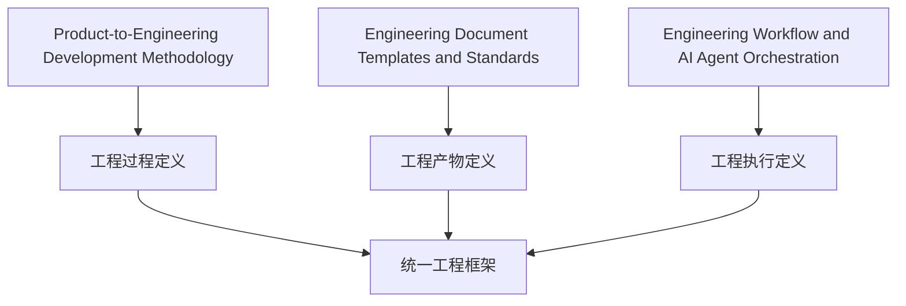
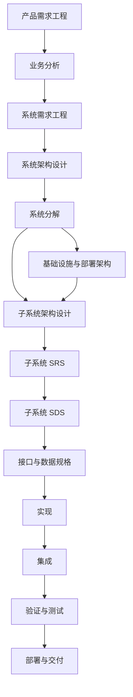

# Product-to-Engineering 开发方法

本仓库保存一套可追溯、架构驱动、以规格为基础的工程过程基线。这套过程把产品需求转化为经过完整设计、实现、验证、可以部署的软件系统。

规范性定义是：

**[Product-to-Engineering Development Methodology & Documentation Standard](<Product-to-Engineering Development Methodology & Documentation Standard.md>)**

| 字段 | 取值 |
|---|---|
| 文档类型 | Engineering Methodology Standard |
| 版本 | 1.0.0 |
| 状态 | Baseline |
| 语言 | English |
| 范围 | Product Requirements, System Engineering, Software Architecture, Subsystem Engineering, Implementation, Verification & Delivery |

在三份标准组成的框架中，这份文档的编号是 `ENG-METH-STD-001`。该编号是相关标准之间的交叉引用。方法论文件本身是过程、必备文档及其关系、职责、评审准则和完成准则的受控基线。

这套方法不绑定具体技术。它适用于 Web 与移动应用、后端服务与分布式系统、云原生应用、AI Agent 与多智能体系统、区块链与 Web3 应用、金融与支付系统、协议型软件、企业软件平台，以及包含多个子系统的复杂产品。它可以适配单体、模块化单体、微服务、无服务器、边缘和混合架构。

在这些标准中，**MUST** 表示强制，**SHOULD** 表示建议，**SHOULD NOT** 表示通常不采用，**MAY** 表示可选。术语定义见模板标准与工作流标准。

## 仓库

三份标准组成一套治理框架。两篇讨论记录阶段模型的形成过程，属于背景材料。方法论标准是基线。

| 文档 | 编号 | 作用 |
|---|---|---|
| [Product-to-Engineering Development Methodology & Documentation Standard](<Product-to-Engineering Development Methodology & Documentation Standard.md>) | ENG-METH-STD-001 | 正确的工程过程是什么？ |
| [Engineering Document Templates & Standards](<Engineering Document Templates & Standards.md>) | ENG-DOC-STD-001 | 必须产出哪些工程产物，文档应当如何编写？ |
| [Engineering Workflow & AI Agent Orchestration Standard](<Engineering Workflow & AI Agent Orchestration Standard.md>) | ENG-WF-STD-001 | 工程工作如何执行、协调和控制？ |
| [A Brief Discussion of System Development Methodology-zh](<A Brief Discussion of System Development Methodology-zh.md>) | — | 阶段模型讨论，中文 |
| [A Brief Discussion of System Development Methodology](<A Brief Discussion of System Development Methodology.md>) | — | 上述讨论的英文译文 |

## 工程模型

方法论标准第 17 节对这一模型的表述是：

**产品需求定义产品必须达成什么。**

**系统架构定义整个系统如何组织。**

**部署架构定义系统在何处、以何种方式运行。**

**子系统架构定义每个子系统内部如何构成。**

**SRS 定义每个子系统必须实现什么。**

**SDS 定义子系统软件如何设计与实现。**

**验证确立实现是否满足需求。**

逻辑架构、应用架构和物理部署架构分开建模，再对齐到一起。PRD 中的一项业务能力要成为子系统，需要经过架构设计。设计要权衡业务边界、数据所有权、一致性、安全边界、部署与扩展，以及耦合程度。

## 生命周期

标准定义七个阶段和七个出口门。这是逻辑顺序。系统分解之后，基础设施架构与子系统架构可以并行。各子系统的 SRS 可以同时编写。相关子系统的规格和接口获准之后，实现可以增量开始。验证策划可以从需求工程阶段开始。

| 阶段 | 学科 | 主要产出 | 出口门 | 出口准则 |
|---|---|---|---|---|
| 1 | 产品工程 | PRD 与业务规格 | G1 产品基线 | 产品需求已经评审并批准 |
| 2 | 系统工程 | 系统需求与系统架构 | G2 系统架构基线 | 系统边界、架构和子系统分配已经批准 |
| 3 | 基础设施工程 | 网络与部署架构 | G3 部署基线 | 网络、基础设施和部署模型已经批准 |
| 4 | 子系统工程 | 子系统架构与 SRS | G4 子系统基线 | 子系统架构和 SRS 已经批准 |
| 5 | 软件设计工程 | SDS、API、数据与安全规格 | G5 设计基线 | 详细设计和接口规格已经批准 |
| 6 | 软件工程 | 已实现软件与集成 | G6 实现基线 | 实现和集成准则已经满足 |
| 7 | 验证与交付 | 测试报告与发布产物 | G7 发布基线 | 验证已经完成，发布已经批准 |

项目可以按规模和风险裁剪出口门。批准和追溯保持不变。各阶段的活动、必备文档和出口准则见[第 3 至第 9 节](<Product-to-Engineering Development Methodology & Documentation Standard.md#3-phase-1--product-requirements-engineering>)。

## 原则

遵循本标准的项目遵守这些原则。规范性条文见 [§1.3](<Product-to-Engineering Development Methodology & Documentation Standard.md#13-engineering-principles>)。

| 编号 | 原则 |
|---|---|
| P1 | 需求驱动开发（Requirements-Driven Development） |
| P2 | 先架构后实现（Architecture Before Implementation） |
| P3 | 关注点分离（Separation of Concerns） |
| P4 | 基于规格的开发（Specification-Based Development） |
| P5 | 接口先行的集成（Interface-First Integration） |
| P6 | 可追溯（Traceability） |
| P7 | 持续验证（Continuous Verification） |
| P8 | 架构与部署相互独立（Architecture and Deployment Independence） |
| P9 | 增量交付（Incremental Delivery） |

## 核心标准

按以下顺序阅读方法论标准。

| 章节 | 内容 |
|---|---|
| [1. 引言](<Product-to-Engineering Development Methodology & Documentation Standard.md#1-introduction>) | 目的、范围与原则 |
| [2. 总体工程生命周期](<Product-to-Engineering Development Methodology & Documentation Standard.md#2-overall-engineering-lifecycle>) | 阶段、过程与出口门 |
| [3. 阶段 1 — 产品需求工程](<Product-to-Engineering Development Methodology & Documentation Standard.md#3-phase-1--product-requirements-engineering>) | 产品定义、业务分析、功能需求与非功能需求 |
| [4. 阶段 2 — 系统工程与总体架构](<Product-to-Engineering Development Methodology & Documentation Standard.md#4-phase-2--system-engineering-and-overall-architecture>) | 系统需求、上下文、架构、分解与交互 |
| [5. 阶段 3 — 网络与部署架构](<Product-to-Engineering Development Methodology & Documentation Standard.md#5-phase-3--network-and-deployment-architecture>) | 网络、部署、基础设施、环境、可靠性与运维 |
| [6. 阶段 4 — 子系统工程](<Product-to-Engineering Development Methodology & Documentation Standard.md#6-phase-4--subsystem-engineering>) | 子系统架构与子系统 SRS |
| [7. 阶段 5 — 软件设计工程](<Product-to-Engineering Development Methodology & Documentation Standard.md#7-phase-5--software-design-engineering>) | SDS、ICD 与设计评审 |
| [8. 阶段 6 — 软件实现工程](<Product-to-Engineering Development Methodology & Documentation Standard.md#8-phase-6--software-implementation-engineering>) | 开发标准、实现流程与完成定义 |
| [9. 阶段 7 — 验证、确认与交付](<Product-to-Engineering Development Methodology & Documentation Standard.md#9-phase-7--verification-validation-and-delivery>) | 验证层级、需求验证与发布准则 |
| [10. 需求追溯管理](<Product-to-Engineering Development Methodology & Documentation Standard.md#10-requirements-traceability-management>) | 追溯链、矩阵与变更影响 |
| [11. 工程文档标准](<Product-to-Engineering Development Methodology & Documentation Standard.md#11-engineering-document-standards>) | 标识、版本、状态、需求编号与书写规则 |
| [12. 架构治理与设计评审](<Product-to-Engineering Development Methodology & Documentation Standard.md#12-architecture-governance-and-design-reviews>) | 架构评审、子系统设计评审、ADR 与变更控制 |
| [13. 工程团队职责](<Product-to-Engineering Development Methodology & Documentation Standard.md#13-engineering-team-responsibilities>) | 角色，独立于组织结构 |
| [14. 项目文档仓库结构](<Product-to-Engineering Development Methodology & Documentation Standard.md#14-project-documentation-repository-structure>) | 默认项目目录，从 `00-Governance` 到 `08-Operations` |
| [15. 未来项目的标准工程工作流](<Product-to-Engineering Development Methodology & Documentation Standard.md#15-standard-engineering-workflow-for-future-projects>) | 新项目的七步执行顺序 |
| [16. 方法论合规要求](<Product-to-Engineering Development Methodology & Documentation Standard.md#16-methodology-compliance-requirements>) | 基线控制项 `METH-001` 至 `METH-012` |
| [17. 最终工程模型](<Product-to-Engineering Development Methodology & Documentation Standard.md#17-final-engineering-model>) | 从产品到发布的转化 |

## 接下来读哪里

| 任务 | 打开 |
|---|---|
| 判断是否采用这套过程 | [§1](<Product-to-Engineering Development Methodology & Documentation Standard.md#1-introduction>)、[§2](<Product-to-Engineering Development Methodology & Documentation Standard.md#2-overall-engineering-lifecycle>)、[§17](<Product-to-Engineering Development Methodology & Documentation Standard.md#17-final-engineering-model>) |
| 了解阶段和文档为什么这样划分 | [中文讨论](<A Brief Discussion of System Development Methodology-zh.md>)或[英文译文](<A Brief Discussion of System Development Methodology.md>) |
| 启动一个项目 | 先读 [§15](<Product-to-Engineering Development Methodology & Documentation Standard.md#15-standard-engineering-workflow-for-future-projects>)，再读 [§16](<Product-to-Engineering Development Methodology & Documentation Standard.md#16-methodology-compliance-requirements>) |
| 编写 PRD、SRS、SDS、ICD 或架构规格 | [Engineering Document Templates & Standards](<Engineering Document Templates & Standards.md>) |
| 排列产品文档仓库 | [§14](<Product-to-Engineering Development Methodology & Documentation Standard.md#14-project-documentation-repository-structure>) |
| 由人、AI Agent 或两者一起执行 | [Engineering Workflow & AI Agent Orchestration Standard](<Engineering Workflow & AI Agent Orchestration Standard.md>) |

第 15 节是项目执行顺序：理解产品，分析并分解系统，设计网络与部署架构，设计每个子系统，完成详细软件设计，实现子系统，然后集成并交付系统。

第 16 节是采用基线，即 `METH-001` 至 `METH-012`。文档粒度可以裁剪。工程控制项保留。

AI Agent 参与时，在已批准的需求、业务规则和项目架构之内工作。方法论基线仍是 G1 至 G7。工作流标准以 Gate P0 至 Gate P9 执行这些基线。文档评审清单在模板标准 §26。
