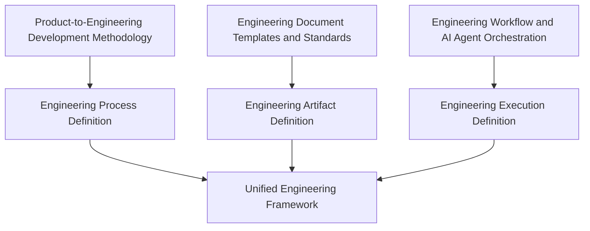
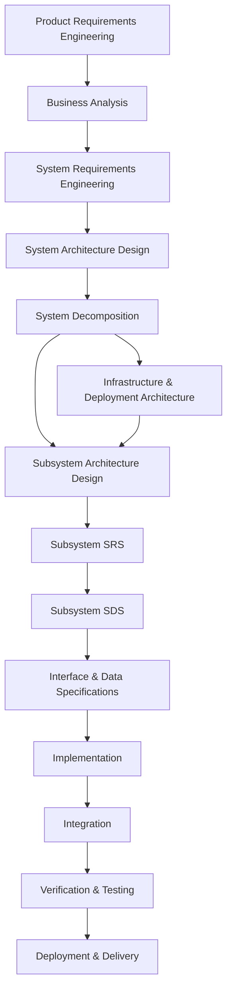

# Product-to-Engineering Development Methodology

This repository holds the baseline for a traceable, architecture-driven, specification-based engineering process. The process transforms product requirements into fully designed, implemented, verified, and deployable software systems.

The normative definition is:

**[Product-to-Engineering Development Methodology & Documentation Standard](<Product-to-Engineering Development Methodology & Documentation Standard.md>)**

| Field | Value |
|---|---|
| Document type | Engineering Methodology Standard |
| Version | 1.0.0 |
| Status | Baseline |
| Language | English |
| Scope | Product Requirements, System Engineering, Software Architecture, Subsystem Engineering, Implementation, Verification & Delivery |

Within the three-standard framework, this document is `ENG-METH-STD-001`. That identifier is the cross-reference used by the related standards. The methodology file itself is the controlled baseline for the process, the required documents, their relationships, responsibilities, review criteria, and completion criteria.

The methodology is technology-independent. It applies to web and mobile applications, backend services and distributed systems, cloud-native applications, AI Agent and multi-agent systems, blockchain and Web3 applications, financial and payment systems, protocol-oriented software, enterprise software platforms, and complex products with multiple subsystems. It can be adapted to monolithic, modular monolithic, microservices, serverless, edge, and hybrid architectures.

In these standards, **MUST** is mandatory, **SHOULD** is recommended, **SHOULD NOT** is generally discouraged, and **MAY** is optional. The term definitions are in the templates standard and the workflow standard.

## Repository

Three standards form one governance framework. Two discussions record how the phase model was reasoned out. The discussions are background. The methodology standard is the baseline.

| Document | ID | Role |
|---|---|---|
| [Product-to-Engineering Development Methodology & Documentation Standard](<Product-to-Engineering Development Methodology & Documentation Standard.md>) | ENG-METH-STD-001 | What is the correct engineering process? |
| [Engineering Document Templates & Standards](<Engineering Document Templates & Standards.md>) | ENG-DOC-STD-001 | What engineering artifacts must be produced, and how should they be documented? |
| [Engineering Workflow & AI Agent Orchestration Standard](<Engineering Workflow & AI Agent Orchestration Standard.md>) | ENG-WF-STD-001 | How is engineering work executed, coordinated, and controlled? |
| [A Brief Discussion of System Development Methodology-zh](<A Brief Discussion of System Development Methodology-zh.md>) | — | Discussion of the phase model, in Chinese |
| [A Brief Discussion of System Development Methodology](<A Brief Discussion of System Development Methodology.md>) | — | English translation of that discussion |

## Engineering model

Section 17 of the methodology standard states the model:

**Product requirements define WHAT the product must achieve.**

**System architecture defines HOW the complete system is organized.**

**Deployment architecture defines WHERE and HOW the system operates.**

**Subsystem architecture defines HOW each subsystem is internally structured.**

**SRS defines WHAT each subsystem must implement.**

**SDS defines HOW the subsystem software is designed and implemented.**

**Verification establishes WHETHER the implementation satisfies the requirements.**

Logical architecture, application architecture, and physical deployment architecture are modeled independently and then reconciled. A business capability in the PRD becomes a subsystem only through architecture design. The design weighs business boundary, data ownership, consistency, security boundary, deployment and scalability, and coupling.

## Lifecycle

The standard defines seven phases and seven gates. The sequence is logical. After system decomposition, infrastructure architecture and subsystem architecture may proceed in parallel. Subsystem SRS documents may be developed concurrently. Implementation may begin incrementally after the relevant subsystem specifications and interfaces are approved. Verification planning may begin during requirements engineering.

| Phase | Discipline | Primary output | Gate | Exit criteria |
|---|---|---|---|---|
| 1 | Product Engineering | PRD and Business Specifications | G1 Product Baseline | Product requirements reviewed and approved |
| 2 | System Engineering | System Requirements and System Architecture | G2 System Architecture Baseline | System boundaries, architecture and subsystem allocation approved |
| 3 | Infrastructure Engineering | Network and Deployment Architecture | G3 Deployment Baseline | Network, infrastructure and deployment model approved |
| 4 | Subsystem Engineering | Subsystem Architecture and SRS | G4 Subsystem Baseline | Subsystem architecture and SRS approved |
| 5 | Software Design Engineering | SDS, API, Data and Security Specifications | G5 Design Baseline | Detailed design and interface specifications approved |
| 6 | Software Engineering | Implemented Software and Integration | G6 Implementation Baseline | Implementation and integration criteria satisfied |
| 7 | Verification and Delivery | Test Reports and Release Artifacts | G7 Release Baseline | Verification completed and release approved |

A project may tailor the gates to its scale and risk profile. Approval and traceability remain. Phase activities, required documents, and exit criteria are in [sections 3 through 9](<Product-to-Engineering Development Methodology & Documentation Standard.md#3-phase-1--product-requirements-engineering>).

## Principles

Projects that follow the standard comply with these principles. The normative text is [§1.3](<Product-to-Engineering Development Methodology & Documentation Standard.md#13-engineering-principles>).

| ID | Principle |
|---|---|
| P1 | Requirements-Driven Development |
| P2 | Architecture Before Implementation |
| P3 | Separation of Concerns |
| P4 | Specification-Based Development |
| P5 | Interface-First Integration |
| P6 | Traceability |
| P7 | Continuous Verification |
| P8 | Architecture and Deployment Independence |
| P9 | Incremental Delivery |

## Core standard

Read the methodology standard in this order.

| Section | Contents |
|---|---|
| [1. Introduction](<Product-to-Engineering Development Methodology & Documentation Standard.md#1-introduction>) | Purpose, scope, and principles |
| [2. Overall Engineering Lifecycle](<Product-to-Engineering Development Methodology & Documentation Standard.md#2-overall-engineering-lifecycle>) | Phases, process, and gates |
| [3. Phase 1 — Product Requirements Engineering](<Product-to-Engineering Development Methodology & Documentation Standard.md#3-phase-1--product-requirements-engineering>) | Product definition, business analysis, functional and non-functional requirements |
| [4. Phase 2 — System Engineering and Overall Architecture](<Product-to-Engineering Development Methodology & Documentation Standard.md#4-phase-2--system-engineering-and-overall-architecture>) | System requirements, context, architecture, decomposition, and interaction |
| [5. Phase 3 — Network and Deployment Architecture](<Product-to-Engineering Development Methodology & Documentation Standard.md#5-phase-3--network-and-deployment-architecture>) | Network, deployment, infrastructure, environments, reliability, and operations |
| [6. Phase 4 — Subsystem Engineering](<Product-to-Engineering Development Methodology & Documentation Standard.md#6-phase-4--subsystem-engineering>) | Subsystem architecture and subsystem SRS |
| [7. Phase 5 — Software Design Engineering](<Product-to-Engineering Development Methodology & Documentation Standard.md#7-phase-5--software-design-engineering>) | SDS, ICD, and design review |
| [8. Phase 6 — Software Implementation Engineering](<Product-to-Engineering Development Methodology & Documentation Standard.md#8-phase-6--software-implementation-engineering>) | Development standards, implementation workflow, and definition of done |
| [9. Phase 7 — Verification, Validation and Delivery](<Product-to-Engineering Development Methodology & Documentation Standard.md#9-phase-7--verification-validation-and-delivery>) | Verification levels, requirements verification, and release criteria |
| [10. Requirements Traceability Management](<Product-to-Engineering Development Methodology & Documentation Standard.md#10-requirements-traceability-management>) | Traceability chain, matrix, and change impact |
| [11. Engineering Document Standards](<Product-to-Engineering Development Methodology & Documentation Standard.md#11-engineering-document-standards>) | Identification, versioning, status, requirement IDs, and writing rules |
| [12. Architecture Governance and Design Reviews](<Product-to-Engineering Development Methodology & Documentation Standard.md#12-architecture-governance-and-design-reviews>) | Architecture review, subsystem design review, ADRs, and change control |
| [13. Engineering Team Responsibilities](<Product-to-Engineering Development Methodology & Documentation Standard.md#13-engineering-team-responsibilities>) | Roles, independent of organizational structure |
| [14. Project Documentation Repository Structure](<Product-to-Engineering Development Methodology & Documentation Standard.md#14-project-documentation-repository-structure>) | Default project tree, from `00-Governance` through `08-Operations` |
| [15. Standard Engineering Workflow for Future Projects](<Product-to-Engineering Development Methodology & Documentation Standard.md#15-standard-engineering-workflow-for-future-projects>) | Seven-step execution sequence for a new project |
| [16. Methodology Compliance Requirements](<Product-to-Engineering Development Methodology & Documentation Standard.md#16-methodology-compliance-requirements>) | Baseline controls `METH-001` through `METH-012` |
| [17. Final Engineering Model](<Product-to-Engineering Development Methodology & Documentation Standard.md#17-final-engineering-model>) | Transformation from product to release |

## Where to go next

| Task | Open |
|---|---|
| Decide whether to adopt the process | [§1](<Product-to-Engineering Development Methodology & Documentation Standard.md#1-introduction>), [§2](<Product-to-Engineering Development Methodology & Documentation Standard.md#2-overall-engineering-lifecycle>), [§17](<Product-to-Engineering Development Methodology & Documentation Standard.md#17-final-engineering-model>) |
| See why the phases and documents are separated | [Chinese discussion](<A Brief Discussion of System Development Methodology-zh.md>) or the [English translation](<A Brief Discussion of System Development Methodology.md>) |
| Start a project | [§15](<Product-to-Engineering Development Methodology & Documentation Standard.md#15-standard-engineering-workflow-for-future-projects>), then [§16](<Product-to-Engineering Development Methodology & Documentation Standard.md#16-methodology-compliance-requirements>) |
| Write a PRD, SRS, SDS, ICD, or architecture specification | [Engineering Document Templates & Standards](<Engineering Document Templates & Standards.md>) |
| Lay out the product document repository | [§14](<Product-to-Engineering Development Methodology & Documentation Standard.md#14-project-documentation-repository-structure>) |
| Run the work with people, AI agents, or both | [Engineering Workflow & AI Agent Orchestration Standard](<Engineering Workflow & AI Agent Orchestration Standard.md>) |

Section 15 is the project sequence: understand the product, analyze and decompose the system, design network and deployment architecture, design each subsystem, complete detailed software design, implement subsystems, then integrate and deliver the system.

Section 16 is the adoption baseline, `METH-001` through `METH-012`. Document granularity may be tailored. The engineering controls remain.

When AI agents take part, they use the same gates, artifacts, and traceability rules, and they work inside the approved requirements, business rules, and project architecture. That execution model is the workflow standard.
