# AI Engineering Orchestration Platform
# System Architecture Specification

| Document Attribute | Value |
|---|---|
| Document ID | AI-ENG-ARCH-001 |
| Document Title | AI Engineering Orchestration Platform — System Architecture Specification |
| Version | 1.0.0 |
| Status | Baseline |
| Document Type | System Architecture Specification |
| Language | English |
| Classification | Engineering Standard |
| Related Standard | Product-to-Engineering Development Methodology & Documentation Standard |
| Related Standard | Engineering Document Templates & Standards |
| Related Standard | Engineering Workflow & AI Agent Orchestration Standard |

---

# 1. Introduction

## 1.1 Purpose

This document defines the system architecture of the AI Engineering Orchestration Platform.

The platform provides an integrated execution environment for coordinating AI Agents throughout the software engineering lifecycle.

It transforms engineering methodologies, documentation standards, workflow definitions, and agent execution contracts into an executable engineering system.

The platform is responsible for:

- Managing engineering projects and workflows.
- Decomposing engineering objectives into executable tasks.
- Assigning tasks to qualified AI Agents.
- Managing Agent lifecycle and execution environments.
- Scheduling dependent and parallel tasks.
- Managing engineering artifacts and their versions.
- Coordinating reviews, approvals, and quality gates.
- Maintaining requirement-to-artifact traceability.
- Integrating with source code repositories and CI/CD systems.
- Recording execution history and audit events.
- Providing visibility into engineering progress and delivery quality.

The platform must support both AI-driven autonomous execution and human-supervised engineering workflows.

## 1.2 Architectural Objectives

The architecture is designed around the following objectives.

| ID | Objective | Description |
|---|---|---|
| AO-001 | Workflow Automation | Automate repeatable engineering processes. |
| AO-002 | Multi-Agent Collaboration | Enable specialized Agents to collaborate on engineering tasks. |
| AO-003 | Engineering Governance | Enforce engineering standards, approval policies, and quality gates. |
| AO-004 | Artifact Traceability | Maintain relationships between requirements, designs, code, tests, and releases. |
| AO-005 | Execution Reliability | Support retries, recovery, timeout handling, and execution isolation. |
| AO-006 | Extensibility | Support new Agent types, tools, workflow templates, and integrations. |
| AO-007 | Human Oversight | Require human authorization for controlled engineering operations. |
| AO-008 | Auditability | Preserve execution records and decision history. |
| AO-009 | Scalability | Support multiple projects and concurrent Agent executions. |
| AO-010 | Model Independence | Avoid coupling the platform to a specific LLM provider or Agent framework. |

## 1.3 Scope

The platform includes the following capabilities:

1. Project and workspace management.
2. Engineering workflow definition and execution.
3. Task decomposition and dependency management.
4. Agent registration, discovery, and lifecycle management.
5. Agent runtime and execution isolation.
6. Context and knowledge management.
7. Artifact and version management.
8. Review and approval management.
9. Requirement traceability.
10. Quality gate evaluation.
11. Repository and CI/CD integration.
12. Execution monitoring and audit.
13. Engineering dashboard and reporting.

## 1.4 Out of Scope

The following capabilities are not directly implemented by the platform's core architecture:

- Training or fine-tuning foundation models.
- Developing a proprietary LLM.
- Replacing Git as the underlying source-control system.
- Replacing existing CI/CD platforms.
- Automatically granting legal or business approval.
- Guaranteeing the correctness of AI-generated engineering artifacts.
- Replacing human responsibility for production-critical decisions.
- Implementing every engineering methodology as a hardcoded workflow.

These capabilities may be provided through external integrations or future extensions.

## 1.5 Normative Terminology

The keywords MUST, MUST NOT, SHOULD, SHOULD NOT, and MAY are used as normative requirements.

- MUST: Mandatory requirement.
- MUST NOT: Prohibited behavior.
- SHOULD: Recommended behavior unless a justified exception exists.
- SHOULD NOT: Discouraged behavior.
- MAY: Optional capability.

---

# 2. System Context

## 2.1 System Overview

The AI Engineering Orchestration Platform acts as the control plane for AI-assisted engineering execution.

It does not require all Agents to run inside the same process or infrastructure.

Instead, the platform manages Agent execution through standardized task contracts, runtime interfaces, and artifact exchange protocols.

The architecture separates:

- Control Plane: Manages projects, workflows, tasks, scheduling, policies, and approvals.
- Execution Plane: Runs AI Agents and their associated tools.
- Data Plane: Stores artifacts, execution records, project data, and knowledge.
- Integration Plane: Connects external engineering systems.

## 2.2 System Context Diagram

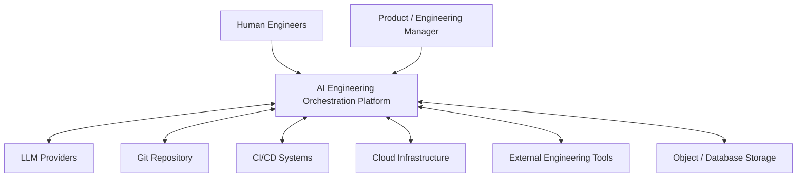

## 2.3 External Actors

| Actor | Responsibility |
|---|---|
| Product Manager | Defines product objectives and requirements. |
| System Architect | Defines system architecture and engineering constraints. |
| Software Engineer | Reviews and modifies engineering outputs. |
| QA Engineer | Reviews test specifications and validation results. |
| Project Administrator | Manages project configuration and access control. |
| AI Agent | Executes assigned engineering tasks. |
| LLM Provider | Provides language-model inference services. |
| Git Provider | Stores source code and version-controlled artifacts. |
| CI/CD Provider | Executes automated build, test, and deployment pipelines. |

## 2.4 System Boundary

The platform owns the orchestration lifecycle, but does not necessarily own every execution resource.

For example:

- An Agent can run in a platform-managed container.
- An Agent can run on an external execution service.
- A coding Agent can operate against a Git repository.
- A testing Agent can invoke an external CI/CD pipeline.
- An architecture Agent can use an external LLM service.

All such interactions MUST pass through defined platform interfaces or explicitly authorized integrations.

---

# 3. Architectural Principles

## 3.1 Separation of Control and Execution

The orchestration control plane MUST be logically separated from Agent execution environments.

The control plane manages:

- Task state.
- Workflow state.
- Scheduling decisions.
- Agent assignment.
- Authorization.
- Approval.
- Artifact references.

The execution plane performs:

- LLM inference.
- Tool invocation.
- Code generation.
- Document generation.
- Testing.
- Analysis.
- Artifact submission.

An Agent execution failure MUST NOT cause the loss of authoritative workflow state.

## 3.2 Contract-First Architecture

All major platform interactions MUST use explicit contracts.

The following contracts MUST be defined:

- Agent Contract.
- Task Contract.
- Workflow Contract.
- Artifact Contract.
- Review Contract.
- Approval Contract.
- Execution Event Contract.
- Tool Invocation Contract.

Agents MUST NOT directly modify authoritative platform state without going through the corresponding platform interface.

## 3.3 Artifact-Centric Engineering

Engineering artifacts are the primary outputs of engineering tasks.

Examples include:

- PRD.
- System Requirements Specification.
- System Architecture Specification.
- Software Requirements Specification.
- Software Design Specification.
- API Specification.
- Interface Control Document.
- Source Code.
- Test Specification.
- Test Report.
- Deployment Specification.
- Release Record.

The platform MUST treat artifacts as versioned, identifiable, traceable engineering objects.

## 3.4 Event-Driven Execution

The platform SHOULD use event-driven communication for asynchronous workflow execution.

Examples:

- TaskCreated.
- TaskAssigned.
- TaskStarted.
- TaskCompleted.
- ArtifactSubmitted.
- ReviewRequested.
- ReviewCompleted.
- ApprovalGranted.
- QualityGatePassed.
- WorkflowCompleted.

The event system MUST support durable delivery and idempotent event processing.

## 3.5 Human-in-the-Loop Governance

AI-generated output MUST NOT automatically be treated as approved engineering output.

Approval requirements MUST be defined by artifact classification, operation type, project policy, and workflow configuration.

The platform MUST support mandatory human authorization for sensitive operations.

Examples:

- Approving architecture baselines.
- Approving production deployments.
- Approving security-sensitive changes.
- Granting privileged execution permissions.
- Modifying critical project policies.

## 3.6 Replaceable Execution Components

The platform MUST avoid hard dependencies on:

- A specific LLM vendor.
- A specific Agent framework.
- A specific container runtime.
- A specific Git provider.
- A specific CI/CD provider.

Provider-specific implementations MUST be encapsulated behind adapters.

---

# 4. High-Level System Architecture

## 4.1 Logical Architecture

The platform consists of six logical layers.

1. User Interaction Layer.
2. API and Access Layer.
3. Orchestration Control Layer.
4. Agent Execution Layer.
5. Engineering Data Layer.
6. External Integration Layer.

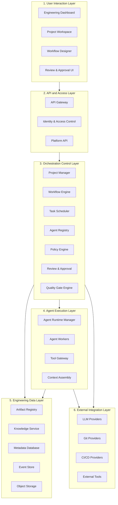

## 4.2 Architectural Responsibilities

| Layer | Main Responsibility |
|---|---|
| User Interaction | Project configuration, workflow management, monitoring, and approval. |
| API and Access | Authentication, authorization, request routing, and API exposure. |
| Orchestration Control | Workflow execution, scheduling, governance, and state management. |
| Agent Execution | Agent lifecycle, task execution, context assembly, and tool access. |
| Engineering Data | Artifact storage, metadata, knowledge, and execution history. |
| External Integration | LLM, Git, CI/CD, and external engineering tool integration. |

## 4.3 Control Plane vs Execution Plane

The distinction between control and execution is fundamental.

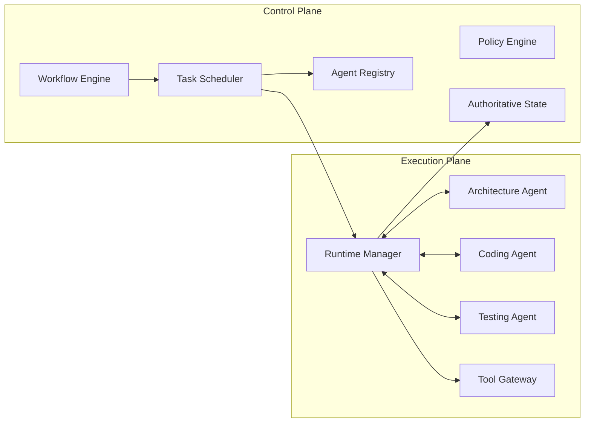

The execution plane reports results to the control plane through the Agent Runtime Manager. Agents do not write workflow, task, or approval state directly.

Tool invocations from an Agent are protocol messages to the Agent Runtime Manager. The Runtime Manager calls the Tool Gateway. Agents do not call the Tool Gateway directly.

The control plane remains the authoritative source of task, workflow, and approval state.

---

# 5. Core Subsystem Architecture

The platform is decomposed into the following major subsystems.

| ID | Subsystem | Primary Responsibility |
|---|---|---|
| SYS-001 | Identity and Access Management | Authentication and authorization. |
| SYS-002 | Project Management | Project lifecycle and workspace management. |
| SYS-003 | Workflow Management | Workflow definition, workflow runs, phases, and task lifecycle. Task records are owned here, not by a separate task service. |
| SYS-004 | Task Management | Logical task-decomposition capability inside Workflow Management. It is not an independent data owner. |
| SYS-005 | Task Scheduler | Dependency resolution, Agent selection, and execution assignment. |
| SYS-006 | Agent Registry | Agent registration, discovery, and capability management. |
| SYS-007 | Agent Runtime Manager | Agent execution lifecycle and resource management. |
| SYS-008 | Context Management | Context retrieval and task context assembly. |
| SYS-009 | Tool Gateway | Controlled access to external tools. |
| SYS-010 | Artifact Registry | Artifact storage, versioning, and lifecycle. |
| SYS-011 | Knowledge Management | Engineering knowledge retrieval and indexing. |
| SYS-012 | Review and Approval | Human and automated review processes. |
| SYS-013 | Quality Gate Engine | Engineering quality validation. |
| SYS-014 | Traceability Service | Requirement-to-artifact relationship management. |
| SYS-015 | Integration Service | Git, CI/CD, LLM, and external system integration. |
| SYS-016 | Event and Audit Service | Event processing and execution audit. |
| SYS-017 | Monitoring and Reporting | Operational and engineering observability. |
| SYS-018 | Policy Engine | Authoritative authorization decisions for users, services, Agents, and tool invocations. |
| SYS-019 | Credential Broker | Long-lived secret storage and issuance of execution-scoped credential references. |

## 5.1 Identity and Access Management

### Responsibilities

- User authentication.
- Service authentication.
- Agent identity.
- Role-based access control.
- Project-level permissions.
- Resource-level permissions.
- Session management.

Identity and Access Management authenticates identities. It MUST NOT store tool-provider secrets. Long-lived secrets are owned by the Credential Broker. Authorization decisions are owned by the Policy Engine.

### Design Requirements

Each user, service, and Agent MUST have a unique identity.

Agent identity MUST be separate from the identity of the human user who initiated the workflow.

The platform MUST support:

- RBAC.
- Resource-scoped permissions.
- Service-to-service authentication.
- Short-lived execution credentials.
- Credential rotation.
- Revocation.

An Agent MUST NOT inherit unrestricted permissions from its initiating user.

## 5.2 Project Management

### Responsibilities

- Project creation.
- Project configuration.
- Workspace management.
- Project membership.
- Engineering standards configuration.
- Project-level Agent policies.
- Project lifecycle management.

### Project Structure

```text
Project
 ├── Project Metadata
 ├── Project Configuration
 ├── Engineering Standards
 ├── Workflow Definitions
 ├── Agent Policies
 ├── Requirements
 ├── Architecture
 ├── Subsystems
 ├── Artifacts
 ├── Tasks
 ├── Reviews
 ├── Quality Gates
 └── Releases
```

Each project MUST have an isolated logical namespace.

## 5.3 Workflow Management

### Responsibilities

- Workflow definition.
- Workflow instantiation.
- Workflow execution state.
- Phase management.
- Task dependency graph.
- Workflow branching.
- Conditional execution.
- Workflow cancellation.
- Workflow recovery.

The Workflow Engine MUST support Directed Acyclic Graphs (DAGs) as the primary task dependency model.

It SHOULD additionally support:

- Conditional branches.
- Human approval checkpoints.
- Review-and-correction loops.
- Bounded iterative refinement.
- Parallel execution.
- Sub-workflows.

### Workflow Model

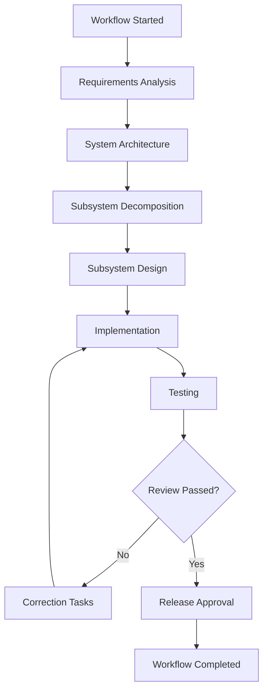

A correction loop MUST have an explicit retry or iteration limit.

The platform MUST prevent infinite workflow loops.

## 5.4 Task Management

### Responsibilities

- Task creation.
- Task decomposition.
- Task assignment.
- Task state management.
- Task dependency management.
- Task cancellation.
- Task retry.
- Task result submission.

### Task Classification

| Category | Examples |
|---|---|
| Analysis | Requirement analysis, feasibility analysis. |
| Design | Architecture design, API design. |
| Documentation | PRD, SRS, SDS generation. |
| Development | Code generation, refactoring. |
| Testing | Unit testing, integration testing. |
| Review | Design review, code review. |
| Integration | Repository integration, API integration. |
| Deployment | Build, release, deployment preparation. |

### Task Lifecycle

Workflow Management owns task state. The authoritative task states are:

`DRAFT`, `PENDING`, `READY`, `SCHEDULED`, `IN_PROGRESS`, `RESULT_PENDING`, `UNDER_REVIEW`, `REWORK_REQUIRED`, `ACCEPTED`, `BLOCKED`, `FAILED`, `CANCELLED`, `SKIPPED`, `SUPERSEDED`.

The Workflow Engine & Task Scheduler SRS defines the transitions.

Task state, scheduling state, Agent execution state, review state, approval state, and quality-gate state MUST be separate domains. An Agent execution completion MUST NOT by itself transition a task to `ACCEPTED`.

## 5.5 Task Scheduler

### Responsibilities

- Dependency resolution.
- Task readiness evaluation.
- Agent capability matching.
- Resource-aware scheduling.
- Priority management.
- Concurrency control.
- Retry scheduling.
- Timeout management.

### Scheduling Process

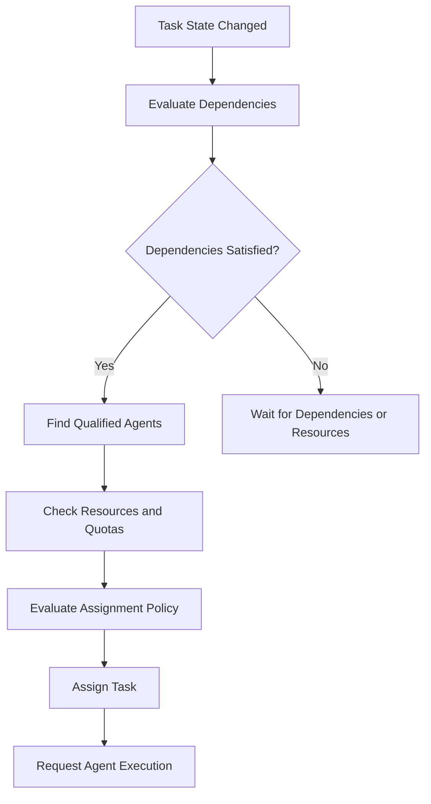

### Scheduling Constraints

The scheduler MUST evaluate:

- Agent capability.
- Agent availability.
- Task priority.
- Task dependencies.
- Project policy.
- Resource availability.
- Execution limits.
- Required tools.
- Data access permissions.

The scheduler MUST NOT assign a task solely based on Agent availability.

## 5.6 Agent Registry

### Responsibilities

- Agent registration.
- Agent discovery.
- Agent capability catalog.
- Agent version management.
- Agent health information.
- Agent policy metadata.
- Agent lifecycle metadata.

### Agent Definition

An Agent definition SHOULD include:

```yaml
agent:
  id: architecture-agent
  name: Architecture Agent
  version: 1.0.0

  role: system_architect

  capabilities:
    - system_analysis
    - architecture_design
    - mermaid_diagrams
    - technical_documentation

  accepted_task_types:
    - architecture_design
    - system_analysis

  execution:
    runtime_type: container
    max_concurrency: 3
    timeout_seconds: 1800

  requirements:
    tools:
      - artifact.read
      - artifact.write
      - knowledge.search

  constraints:
    network_access: restricted
    production_access: false
```

This definition describes Agent capabilities and execution requirements.

It does not itself grant permissions. Effective permissions MUST be determined by the Policy Engine.

## 5.7 Agent Runtime Manager

### Responsibilities

- Agent execution initialization.
- Runtime allocation.
- Execution isolation.
- Context injection.
- Task delivery.
- Tool access provisioning.
- Execution monitoring.
- Timeout enforcement.
- Cancellation.
- Result collection.
- Runtime cleanup.

### Worker Provisioning Lifecycle

This lifecycle describes allocation of a worker that hosts an Agent. It is not the Agent execution state machine. Agent execution states are defined by the Agent Runtime Manager SRS and the Agent Execution Protocol. A worker reaching `Stopped` MUST NOT be recorded as the execution outcome.

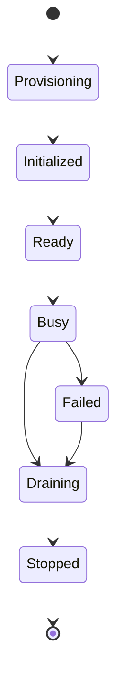

### Runtime Isolation

Each execution MUST operate within an isolated security context.

Depending on deployment requirements, the runtime MAY use:

- Containers.
- Sandboxed processes.
- Virtual machines.
- External Agent execution services.

The platform MUST support resource limits and execution timeouts.

Agent processes MUST NOT have unrestricted access to host resources.

## 5.8 Context Management

### Responsibilities

- Task context assembly.
- Artifact retrieval.
- Requirement retrieval.
- Engineering standard retrieval.
- Project knowledge retrieval.
- Context prioritization.
- Context size management.
- Context version tracking.

### Context Sources

| Source | Example |
|---|---|
| Project Context | Project objectives and configuration. |
| Task Context | Task description and acceptance criteria. |
| Dependency Context | Outputs from prerequisite tasks. |
| Artifact Context | Existing PRD, SRS, SDS, and source files. |
| Knowledge Context | Engineering standards and reference materials. |
| Execution Context | Runtime state and previous execution information. |

### Context Assembly Flow

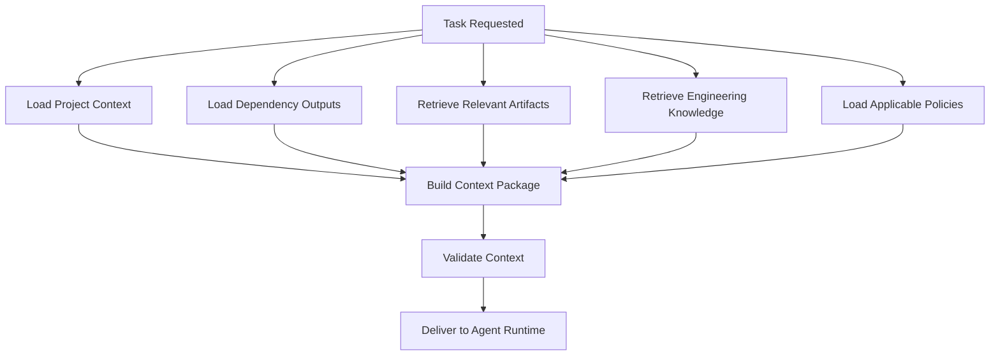

The Context Manager SHOULD provide only task-relevant information.

It MUST preserve source references for retrieved engineering information.

Context Management assembles the package. The Agent Runtime Manager retrieves it, validates it, and delivers it. An Agent MUST NOT call Context Management directly.

## 5.9 Tool Gateway

### Responsibilities

- Tool registration.
- Tool discovery.
- Tool invocation.
- Permission enforcement.
- Input validation.
- Output normalization.
- Timeout management.
- Invocation audit.

Agents reach external tool operations by sending `tool.request` to the Agent Runtime Manager. The Runtime Manager calls the Tool Gateway. An Agent MUST NOT call the Tool Gateway directly.

Examples:

- Git operations.
- File operations.
- Shell execution.
- Database access.
- Browser automation.
- CI/CD execution.
- Cloud infrastructure operations.

The Tool Gateway MUST obtain the authoritative authorization decision from the Policy Engine. The Agent Runtime Manager passes an unforgeable execution context and MUST NOT issue that decision.

Operation class and risk level are independent attributes. Operation classes are `read`, `write`, `modify`, `approve`, `deploy`, and `destroy`. Risk levels are `low`, `medium`, `high`, and `critical`. The Policy Engine decides the control from both attributes. Subsystem documents MUST NOT define a second approval table.

The Tool Gateway records a separate retry attribute, `execution_classification`. That attribute is not an operation class. Policy evaluation MUST use the operation classes in this section.

## 5.10 Artifact Registry

### Responsibilities

- Artifact registration.
- Artifact storage.
- Artifact versioning.
- Artifact metadata.
- Artifact classification.
- Artifact lifecycle.
- Artifact relationships.
- Artifact baseline management.
- Artifact retrieval.

### Artifact Types

- Documents.
- Source code.
- Configuration files.
- API definitions.
- Architecture diagrams.
- Test specifications.
- Test reports.
- Deployment manifests.
- Release packages.

### Artifact Model

```yaml
artifact:
  artifact_id: ART-ARCH-001
  project_id: PROJ-001

  name: System Architecture Specification
  type: architecture_specification
  format: markdown

  current_version_id: ARV-001

  lifecycle_status: active

  source:
    repository: engineering-docs
    path: architecture/system-architecture.md
    commit: "<git-commit-sha>"

  version:
    version_id: ARV-001
    version_number: 1.0.0
    publication_status: published
    provenance:
      tenant_id: TENANT-001
      project_id: PROJ-001
      workflow_run_id: WFR-001
      task_id: TASK-001
      agent_id: architecture-agent
      agent_version: "1.2.0"
      agent_execution_id: AEX-001
      runtime_version: "1.0.0"
      context_package_id: CTX-001
      tool_execution_ids: []

  review:
    status: pending

  approval:
    status: not_requested

  baseline:
    status: not_baselined
```

`artifact_id` and `version_id` are the cross-service names defined in section 6.6. This model does not introduce another identifier for the same objects. Provenance is stored once, on the version. `runtime_version` is assigned by the Runtime Manager on the execution record and copied into that provenance. The artifact does not carry a second provenance record.

### Artifact Versioning

The Artifact Registry MUST distinguish:

1. Artifact identity.
2. Artifact version.
3. Artifact content.
4. Stored approval decision reference. Review and Approval owns the decision record.
5. Artifact baseline status.

An artifact version MUST be immutable after publication.

Corrections MUST create a new version.

### Artifact Baseline

A baseline may be created as a draft. Once approved, it is an immutable controlled snapshot of engineering artifacts.

A baseline MUST identify:

- Baseline ID.
- Included artifact IDs.
- Exact artifact versions.
- Approval records.
- Creation timestamp.
- Responsible authority.

A baseline MUST NOT be modified in place.

## 5.11 Knowledge Management

### Responsibilities

- Knowledge ingestion.
- Document indexing.
- Semantic retrieval.
- Keyword retrieval.
- Metadata filtering.
- Knowledge version tracking.
- Source attribution.

The Knowledge Service may use:

- Relational database metadata.
- Full-text search.
- Vector search.
- Graph-based relationships.

Knowledge retrieval MUST distinguish authoritative engineering artifacts from unverified reference materials.

Retrieved content MUST NOT automatically be treated as executable instructions.

## 5.12 Review and Approval

### Responsibilities

- Review request creation.
- Reviewer assignment.
- Review criteria management.
- Review result submission.
- Approval management.
- Rejection and correction.
- Approval history.

### Review Workflow

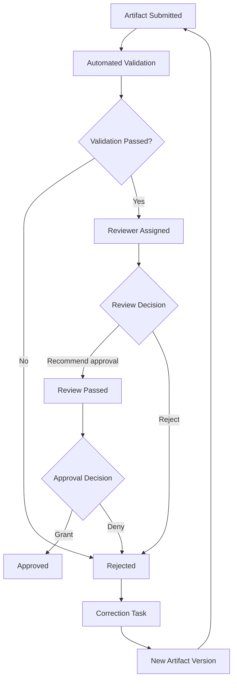

Review and approval MUST be separate concepts. A review decision that recommends approval records review state `PASSED` only. Approval state becomes `APPROVED` only when a separate authorized approval decision is recorded.

A review can recommend approval, but a controlled approval action MUST be authorized according to the applicable policy.

## 5.13 Quality Gate Engine

### Responsibilities

- Quality gate definition.
- Quality rule evaluation.
- Evidence collection.
- Gate result generation.
- Gate failure reporting.
- Gate execution history.

### Quality Gate Examples

| Gate | Validation |
|---|---|
| Requirements Gate | Requirement completeness and traceability. |
| Architecture Gate | Architecture consistency and interface coverage. |
| Design Gate | SRS and SDS completeness. |
| Code Gate | Static analysis and coding standards. |
| Test Gate | Test coverage and test execution results. |
| Security Gate | Security analysis and policy compliance. |
| Release Gate | Required approvals and deployment readiness. |

The Quality Gate Engine owns gate definitions, evaluations, and QualityResult records. The Workflow Engine stores references to those results and MUST NOT keep a second authoritative result.

A quality gate MUST produce a structured result containing:

- Gate ID.
- Evaluation status.
- Evaluated artifact versions.
- Rules executed.
- Evidence references.
- Failure details.
- Timestamp.
- Evaluator identity.

## 5.14 Traceability Service

### Responsibilities

- Requirement registration.
- Requirement decomposition.
- Requirement trace-link management.
- Traceability validation.
- Coverage calculation.
- Change impact analysis.

### Traceability Relationships

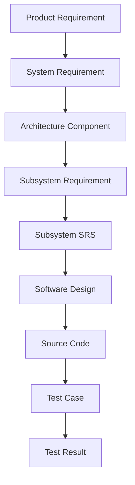

Requirement, design, implementation, and verification links are owned by the Traceability Service. Content relationships between artifact versions are owned by the Artifact Registry. Each store may keep the other's identifiers as references and MUST NOT keep a second authoritative copy of the other's edges. Impact analysis is authoritative only when produced by the Traceability Service.

The platform SHOULD support bidirectional traceability.

A requirement change SHOULD trigger impact analysis against all dependent artifacts and tasks.

## 5.15 Integration Service

### Responsibilities

- LLM provider integration.
- Git provider integration.
- CI/CD integration.
- External engineering tool integration.
- Webhook handling.
- Integration credential management.
- Integration health monitoring.

Integrations MUST be implemented through provider adapters.

The core platform MUST NOT depend on provider-specific APIs directly.

The Integration Service owns provider connection configuration. The Tool Gateway owns tool definitions and each governed invocation. The Integration Service MUST NOT execute a governed tool call outside the Tool Gateway. Model inference that is subject to tool governance MUST be registered as a tool.

## 5.16 Event and Audit Service

### Responsibilities

- Domain event publication.
- Event consumption.
- Event persistence.
- Execution audit.
- Security event recording.
- Event replay where supported.
- Operational history.

The platform SHOULD use a durable message broker or equivalent event infrastructure.

The system MUST provide idempotent event handling.

Audit records SHOULD be append-only and protected against unauthorized modification.

## 5.17 Monitoring and Reporting

### Responsibilities

- Platform health.
- Workflow monitoring.
- Task monitoring.
- Agent execution monitoring.
- Resource utilization.
- Error reporting.
- Engineering progress reporting.
- Quality metrics.

The platform SHOULD expose:

- Logs.
- Metrics.
- Distributed traces.
- Workflow execution history.
- Agent execution history.
- Quality gate results.

---

# 6. Core Data Architecture

## 6.1 Data Domains

The platform data model is organized into the following domains.

| Domain | Main Entities |
|---|---|
| Identity | User, Role, Permission, ServiceIdentity |
| Project | Project, Workspace, ProjectMember, ProjectPolicy |
| Workflow | WorkflowDefinition, WorkflowRun, WorkflowPhase |
| Task | Task, TaskDependency, TaskAssignment |
| Agent | AgentDefinition, AgentVersion, AgentCapability |
| Execution | Execution, RuntimeInstance, ToolInvocation |
| Artifact | Artifact, ArtifactVersion, ArtifactRelationship |
| Knowledge | KnowledgeSource, KnowledgeDocument, KnowledgeChunk |
| Review | Review, ReviewDecision, Approval |
| Quality | QualityGate, QualityRule, QualityResult |
| Traceability | Requirement, TraceLink, ImpactRecord |
| Integration | Integration, ProviderConfiguration, Webhook |
| Audit | DomainEvent, AuditRecord |

## 6.2 Core Entity Relationships

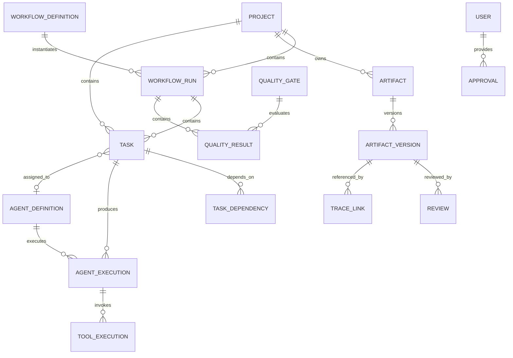

## 6.3 Entity Ownership

Each subsystem MUST have a clearly defined ownership boundary.

| Entity | Owning Subsystem |
|---|---|
| Project | Project Management |
| WorkflowDefinition | Workflow Management |
| WorkflowRun | Workflow Management |
| Task | Workflow Management |
| TaskDependency | Workflow Management |
| ExecutionAssignment | Task Scheduler |
| AgentDefinition | Agent Registry |
| AgentExecution | Agent Runtime Manager |
| ExecutionSession | Agent Runtime Manager |
| ToolDefinition | Tool Gateway |
| ToolExecution | Tool Gateway |
| Artifact | Artifact Registry |
| ArtifactVersion | Artifact Registry |
| ArtifactRelationship | Artifact Registry |
| Review | Review and Approval |
| Approval | Review and Approval |
| QualityResult | Quality Gate Engine |
| TraceLink | Traceability Service |
| PolicyDecision | Policy Engine |
| Credential | Credential Broker |
| AuditRecord | Event and Audit Service |

Other subsystems MUST access authoritative entity data through the owning subsystem's API or an explicitly defined data contract.

## 6.4 Data Storage Strategy

The platform SHOULD use a polyglot persistence architecture.

| Storage Type | Purpose |
|---|---|
| Relational Database | Authoritative transactional metadata. |
| Object Storage | Artifact files and execution outputs. |
| Message Broker | Asynchronous events and task dispatch. |
| Vector Database | Semantic knowledge retrieval. |
| Search Engine | Full-text search and filtering. |
| Cache | Short-lived data and execution coordination. |
| Git Repository | Version-controlled source code and engineering documents. |

The platform MUST NOT use a vector database as the authoritative store for project, task, approval, or artifact lifecycle state.

## 6.5 Transactional Consistency

A distributed transaction across all subsystems SHOULD NOT be required for ordinary workflow execution.

The platform SHOULD use:

- Local database transactions.
- Transactional outbox.
- Idempotent event consumers.
- Saga-style process coordination.
- Compensating operations where applicable.

Critical state transitions MUST be durable.

## 6.6 Platform Identifier Model

Cross-service payloads MUST use the names in this table. An unqualified `workflow_id` or `execution_id` MUST NOT appear in those payloads.

| Identifier | Meaning | Issued by |
|---|---|---|
| tenant_id | Isolation boundary above a project | Identity and Access Management |
| project_id | Engineering project | Project Management |
| workflow_definition_id | Versioned workflow definition | Workflow Management |
| workflow_run_id | One run of a workflow definition | Workflow Management |
| phase_id | Phase instance inside a run. The Workflow Engine stores this same value as `phase_instance_id`. `phase_definition_id` identifies the definition, not the instance. | Workflow Management |
| task_id | Logical engineering task | Workflow Management |
| assignment_id | Scheduler decision to offer a task to one Agent | Task Scheduler |
| attempt_id | One scheduling attempt of a task | Task Scheduler |
| attempt_number | Ordinal of that task attempt | Task Scheduler |
| agent_id | Stable Agent identity. The Agent Registry assigns it, or confirms a name proposed at registration. A proposed name is not an identifier until that confirmation. | Agent Registry |
| registration_id | One Agent registration record. It is not `agent_id`. | Agent Registry |
| agent_execution_id | One Agent execution attempt | Agent Runtime Manager |
| parent_agent_execution_id | Parent Agent execution, when work is delegated | Agent Runtime Manager |
| session_id | Communication session for one Agent execution | Agent Runtime Manager |
| arm_instance_id | Process instance of the Agent Runtime Manager | Agent Runtime Manager |
| agent_endpoint_id | Protocol endpoint of an Agent | Agent Registry |
| worker_id | Worker hosting that execution. The Runtime Manager assigns it and places it on the execution command. The Agent echoes it. | Agent Runtime Manager |
| context_package_id | Assembled context package | Context Management |
| invocation_id | One tool invocation request | Agent Runtime Manager, accepted by the Tool Gateway |
| tool_execution_id | One tool execution | Tool Gateway |
| tool_attempt | Ordinal retry inside one tool execution | Tool Gateway |
| tool_id | Registered tool definition | Tool Gateway |
| artifact_id | Logical artifact | Artifact Registry |
| version_id | Immutable artifact version | Artifact Registry |
| baseline_id | Exact-version snapshot. May be created as draft. Immutable after approval | Artifact Registry |
| submission_id | One accepted `artifact.submit`. Registration retries reuse it. It is not an artifact or version identity. | Agent Runtime Manager |
| authorization_decision_id | Policy decision | Policy Engine |
| correlation_id | End-to-end operation correlation | Originating subsystem |

`session_id` and `agent_execution_id` are distinct. One execution attempt has one session.

A task retry is decided by the Workflow Engine. The Task Scheduler issues a new `attempt_id` and submits a new assignment. The Runtime Manager creates a new `agent_execution_id` and a new `session_id` only after it accepts that assignment. The Runtime Manager MUST NOT create a task retry on its own. The `task_id` stays the same.

`tool_attempt` counts only inside one tool execution. A tool retry MUST NOT create `attempt_id`, `agent_execution_id`, or `session_id`, and MUST NOT be reused as the task attempt number.

The first submission of an attempt does not contain `agent_execution_id` or `session_id`. The Runtime Manager creates both, then sends the Agent Execution Protocol command. A later submission of the same `attempt_id`, including redelivery after `released` or `unknown`, MUST carry those existing identifiers. The Runtime Manager matches on `attempt_id`, reuses them, and moves `released` back to `dispatching`. A new `assignment_id` or `idempotency_key` MUST NOT allocate another execution or session.

A dispatch acknowledgement uses `accepted`, `rejected`, `unavailable`, `unconfirmed`, or `invalid`. The corresponding execution states for the first four are `accepted`, `rejected`, `released`, and `unknown`. `invalid` means the Runtime Manager rejected the assignment before creating an execution. It carries no `agent_execution_id` and has no execution state. `rejected` always includes `agent_execution_id` and `session_id`. `rejected` and `released` are not execution results. `unavailable` and `unconfirmed` reuse the `attempt_id`, `agent_execution_id`, and `session_id` already created for that dispatch. Selecting a different Agent requires a new `attempt_id` authorized by the Workflow Engine. The execution deadline on the assignment and on the command is `deadline`. `timeout_seconds` is the duration the Workflow Engine uses when it writes that instant. Both are required. Expiry is evaluated only against `deadline`. The Runtime Manager copies both onto the command and MUST NOT invent either value or start a second clock from `timeout_seconds`. Assignment-offer expiration is `expires_at` and is a different clock.

External artifact references MUST use `artifact_id` and `version_id`. A version number is a display attribute, not the primary key.

Example values in this specification set are illustrative. They MUST NOT be read as the identifier syntax. Identifiers are opaque strings, unique in the scope defined by the issuing subsystem. `tenant_id` is issued by Identity and Access Management and MUST be present on cross-service commands and events. Workflow runs, artifacts, and execution records MUST persist it. Artifact access MUST isolate by `tenant_id` and `project_id`. An Agent-originated message MAY omit `tenant_id`. The Runtime Manager copies it from the execution record.

## 6.7 Platform Error Contract

Cross-service errors MUST use this object:

```json
{
  "error": {
    "code": "ARM_EXECUTION_TIMEOUT",
    "category": "timeout",
    "message": "The execution exceeded its deadline.",
    "retryable": false,
    "details": {},
    "correlation_id": "cor_001"
  }
}
```

`code` is owned by the emitting service and MUST carry that service's prefix, such as `AEP_`, `ARM_`, `TG_`, `WE_`, or `ARTIFACT_`. `category` is one of `protocol`, `authentication`, `authorization`, `capability`, `dispatch`, `runtime`, `execution`, `context`, `tool`, `artifact`, `timeout`, `cancellation`, `approval`, `credential`, `provider`, `resource`, or `internal`. A service MUST NOT add a category outside this list. `protocol` means an invalid message or schema. A provider failure whose message is valid uses `provider`. `tool` means a tool definition or tool state error and is not automatically retried. A valid-message tool invocation failure uses `provider`. `approval` means an approval was rejected. A pending approval is not this category. `cancellation` means the operation was cancelled. A failure of the cancellation operation itself uses `runtime` and MUST NOT set status to `cancelled`. For an Agent execution, that failure enters `FAILED` from `CANCELLING` and publishes `execution.agent.failed` once. It MUST NOT remain `unknown`. `execution` means an execution-environment failure. A missing required artifact uses `artifact`. Lost contact from `RUNNING` or `COMPLETING` before `deadline` remains `unknown` and MUST NOT be recorded as `failed` or retried until reconciliation. Reaching `deadline` while the execution is still in `RUNNING` or `COMPLETING` enters `TIMED_OUT` whether or not a heartbeat is still arriving, and publishes `execution.agent.timed_out` once. Heartbeat timeout from `INITIALIZING` or `READY`, and initialization timeout, enter `TIMED_OUT` with category `timeout` and publish `execution.agent.timed_out` once. `failed` requires evidence that the execution environment failed. `CONNECTION_FAILURE` applies only when the connection cannot be established before heartbeat rules apply. An in-session heartbeat miss MUST NOT use category `runtime`. A review rejection is not category `approval`.

---

# 7. Agent Architecture

## 7.1 Agent as an Execution Unit

An Agent is a specialized execution unit that receives a task, operates under a defined contract, and returns a structured result.

An Agent is not the authoritative owner of workflow state.

The Agent MUST NOT independently determine that a workflow or quality gate is approved.

## 7.2 Agent Role Categories

| Agent Category | Responsibility |
|---|---|
| Product Agent | Product requirements and PRD. |
| Business Analyst Agent | Business rules and system requirements. |
| System Architect Agent | System architecture and decomposition. |
| Infrastructure Agent | Infrastructure and deployment architecture. |
| Subsystem Architect Agent | Subsystem-level architecture. |
| Software Design Agent | SRS, SDS, and interface design. |
| Coding Agent | Source code implementation. |
| Testing Agent | Test planning and execution. |
| Security Agent | Security analysis and review. |
| Documentation Agent | Engineering documentation. |
| Reviewer Agent | Independent artifact review. |
| Release Agent | Release preparation and deployment coordination. |

Agent categories describe responsibilities, not necessarily separate software products.

Multiple Agent definitions MAY use the same underlying model or runtime.

## 7.3 Agent Contract

Every Agent MUST implement a standardized execution contract.

### Input

This input is a logical view of the information in an execution command. It is not the wire message. The wire message is Agent Execution Protocol `execution.command`. Identity fields travel on that protocol envelope. `status` is not part of the command.

```json
{
  "task_id": "TASK-001",
  "agent_execution_id": "AEX-001",
  "workflow_run_id": "WFR-001",
  "project_id": "PROJ-001",
  "tenant_id": "TEN-001",

  "task": {
    "type": "architecture_design",
    "title": "Design the system architecture",
    "description": "Design the system architecture",
    "acceptance_criteria": [
      "Define system boundaries",
      "Define subsystem responsibilities",
      "Provide architecture diagrams"
    ],
    "priority": "high"
  },

  "execution": {
    "attempt_id": "ATT-001",
    "attempt_number": 1,
    "worker_id": "WORKER-001",
    "session_id": "SES-001",
    "deadline": "2026-11-25T12:00:00Z",
    "timeout_seconds": 3600
  },

  "context": {
    "context_package_id": "CTX-001",
    "created_at": "2026-11-25T11:55:00Z",
    "context_version": "1.0.0",
    "artifacts": [],
    "engineering_standards": [],
    "dependencies": [],
    "policies": {
      "policy_versions": ["POL-001"]
    }
  },

  "constraints": {
    "allowed_tools": [
      "artifact.read",
      "artifact.write",
      "knowledge.search"
    ],
    "network_access": "restricted"
  },

  "output_contract": {
    "required_artifacts": [
      {
        "type": "system_architecture_specification",
        "format": "markdown",
        "required": true
      }
    ],
    "result_schema": "aep.execution-result.v1"
  }
}
```

`deadline` is the execution deadline instant. `timeout_seconds` is the duration used to write that instant. Expiry is evaluated only against `deadline`.

### Output

```json
{
  "task_id": "TASK-001",
  "agent_execution_id": "AEX-001",
  "workflow_run_id": "WFR-001",

  "status": "completed",

  "summary": "System architecture specification generated.",

  "artifacts": [
    {
      "type": "system_architecture_specification",
      "artifact_id": "ART-ARCH-001",
      "version_id": "ARV-001",
      "version_number": "1.0.0"
    }
  ],

  "evidence": [],
  "warnings": [],
  "errors": [],

  "metrics": {
    "duration_seconds": 420,
    "input_tokens": 12000,
    "output_tokens": 8000
  }
}
```

This output is a logical view of an execution result. It is not the wire message. The wire message is Agent Execution Protocol `execution.result`, and `status` travels in `payload`. An artifact object uses `type` for its class. An accepted result MUST reference each engineering artifact with `artifact_id` and `version_id`. A `temporary_location` MAY name execution-local storage before `artifact.submit`. It MUST NOT be the artifact reference in an accepted result.

The Runtime Manager MUST validate Agent output against the execution contract before accepting the result.

## 7.4 Agent Execution Protocol

The following interaction is required.

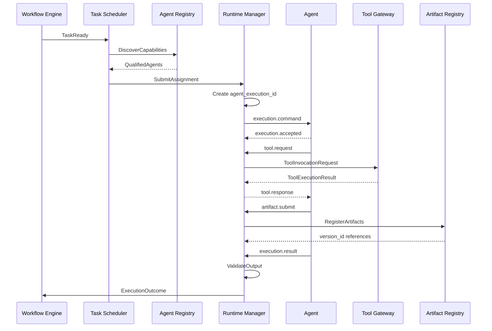

## 7.5 Agent Communication Rules

Agents SHOULD communicate through task and artifact contracts rather than unrestricted direct messaging.

Direct Agent-to-Agent communication MAY be supported for specialized collaboration.

However:

- Every collaboration MUST be associated with a workflow or task.
- Every generated output MUST have provenance.
- Shared information MUST be traceable.
- Agents MUST NOT bypass project policies.
- Agents MUST NOT directly grant permissions to other Agents.

## 7.6 Agent Collaboration Patterns

The platform SHOULD support four patterns.

### Sequential Collaboration

Agent B consumes Agent A's accepted output.

### Parallel Collaboration

Multiple Agents execute independent tasks concurrently.

### Hierarchical Collaboration

A coordinating Agent decomposes work and delegates subtasks.

The coordinating Agent does not bypass platform scheduling or authorization. The Workflow Engine creates each child task and its assignment. The Runtime Manager creates the child execution only after accepting that assignment and records `parent_agent_execution_id`. Cancellation and completion follow that task relationship.

### Review and Correction

A Reviewer Agent evaluates submitted artifacts and generates correction tasks.

Human approval requirements remain controlled by the Review and Approval subsystem.

---

# 8. Workflow Execution Architecture

## 8.1 Workflow Definition

A workflow definition describes the intended execution graph.

It MUST be separate from a workflow run.

- WorkflowDefinition: Reusable workflow template.
- WorkflowRun: A specific execution instance.

### Example

```yaml
workflow:
  id: software-engineering-lifecycle
  version: 1.0.0

  name: Software Engineering Lifecycle

  phases:
    - id: requirements
      tasks:
        - id: analyze-requirements
          agent_role: business_analyst
          type: requirements_analysis

    - id: architecture
      depends_on:
        - requirements
      tasks:
        - id: design-system
          agent_role: system_architect
          type: architecture_design

    - id: implementation
      depends_on:
        - architecture
      tasks:
        - id: implement-subsystem
          agent_role: coding
          type: implementation

    - id: testing
      depends_on:
        - implementation
      tasks:
        - id: execute-tests
          agent_role: testing
          type: test_execution
```

The workflow definition MUST be validated before execution.

## 8.2 Workflow Execution Engine

The Workflow Engine is responsible for:

1. Loading a workflow definition.
2. Creating a workflow run.
3. Instantiating tasks.
4. Evaluating task dependencies.
5. Coordinating task state transitions.
6. Processing execution events.
7. Evaluating conditional branches.
8. Coordinating quality gates.
9. Handling workflow cancellation.
10. Completing or failing the workflow.

## 8.3 Task Dependency Model

The platform MUST support:

- Finish-to-start dependencies.
- Multiple prerequisites.
- Parallel branches.
- Conditional dependencies.
- Explicit blocking conditions.

The platform MUST reject invalid cyclic dependency graphs unless a bounded iteration construct is explicitly defined.

## 8.4 Workflow State

A workflow definition and a workflow run have separate state machines. The Workflow Engine & Task Scheduler SRS owns both machines and their transitions. This section does not define a third set of names.

Definition lifecycle:

| State | Description |
|---|---|
| DRAFT | Definition is being authored. |
| VALIDATED | Definition passed validation. |
| PUBLISHED | Definition may be used to create a run. |
| DEPRECATED | Definition remains readable but should not be selected for new runs. |
| RETIRED | Definition can no longer be selected for new runs. |

Run lifecycle:

| State | Description | Terminal |
|---|---|---|
| CREATED | Run record has been created. | No |
| INITIALIZING | Run initialization is in progress. | No |
| READY | Run is initialized and ready to progress. | No |
| RUNNING | Run is actively progressing. | No |
| SUSPENDING | Suspension is being coordinated. | No |
| SUSPENDED | Run progression is suspended. | No |
| RESUMING | Resumption is in progress. | No |
| BLOCKED | Run cannot progress because a condition is unresolved. | No |
| COMPLETING | Completion conditions are being evaluated. | No |
| COMPLETED | Required completion conditions are satisfied. | Yes |
| CANCELLING | Cancellation is being coordinated. | No |
| CANCELLED | Cancellation is complete. | Yes |
| FAILED | Run has reached an unrecoverable failure. | Yes |

`BLOCKED` is the state for a run that is waiting on dependencies, review, approval, or another unresolved condition. `SUSPENDED` is the state for an explicit suspension. A run in `BLOCKED` may return to `RUNNING` after the condition is resolved. `COMPLETED` is terminal for that `workflow_run_id`. A later change creates a new run and does not move the completed run out of `COMPLETED`.

## 8.5 Workflow Recovery

The Workflow Engine MUST support recovery after service restart.

Recovery MUST reconstruct execution state from durable records and events.

The system SHOULD support:

- Resume from the last consistent checkpoint.
- Reconciliation of uncertain Agent executions.
- Retry of retryable tasks.
- Manual intervention for non-recoverable failures.

---

# 9. API and Interface Architecture

## 9.1 Interface Principles

All major subsystems MUST expose versioned interfaces.

The platform SHOULD use:

- REST APIs for synchronous resource management.
- Event-driven messaging for asynchronous execution.
- WebSocket or Server-Sent Events for real-time monitoring.
- Internal RPC where appropriate.

The platform MUST NOT expose internal database tables as public APIs.

## 9.2 API Domains

| API Domain | Example Operations |
|---|---|
| Project API | CreateProject, GetProject, UpdateProject |
| Workflow API | CreateWorkflow, StartWorkflow, SuspendWorkflow, ResumeWorkflow |
| Task API | CreateTask, AssignTask, GetTask |
| Agent API | RegisterAgent, DiscoverAgents, GetAgent |
| Execution API | StartExecution, CancelExecution, GetExecution |
| Artifact API | RegisterArtifact, GetArtifact, CreateVersion |
| Review API | SubmitReview, ApproveArtifact, RejectArtifact |
| Quality API | EvaluateGate, GetGateResult |
| Traceability API | CreateTraceLink, AnalyzeImpact |
| Integration API | RegisterIntegration, TriggerWebhook |

## 9.3 Core REST API Examples

### Create Project

```http
POST /api/v1/projects
Content-Type: application/json
```

### Start Workflow

```http
POST /api/v1/projects/{project_id}/workflow-definitions/{workflow_definition_id}/runs
Content-Type: application/json
```

### Get Task

```http
GET /api/v1/tasks/{task_id}
```

### Submit Agent Result

```http
POST /api/v1/agent-executions/{agent_execution_id}/result
Content-Type: application/json
```

This path is an illustrative example. It is not the interoperability contract. The Agent submits an `execution.result` message to the Runtime Manager. HTTP paths remain recommendations until the Platform Internal API specification defines them.

### Submit Artifact

```http
POST /api/v1/projects/{project_id}/artifacts
Content-Type: application/json
```

### Record Approval

The Review and Approval subsystem records an approval decision against an exact `version_id` or `baseline_id`. The Artifact Registry stores the returned decision reference. It MUST NOT expose an endpoint that changes approval state, including `POST /api/v1/artifacts/{artifact_id}/versions/{version_id}/approvals`.

Approval operations MUST enforce authorization and approval policies.

## 9.4 Event Contract

Events MUST contain a standard envelope.

```json
{
  "event_id": "EVT-001",
  "event_type": "execution.agent.completed",
  "event_version": "1.0.0",
  "occurred_at": "2026-01-01T10:00:00Z",
  "source": "agent-runtime-manager",
  "tenant_id": "TEN-001",
  "correlation_id": "CORR-001",
  "causation_id": "EVT-000",
  "subject": {
    "project_id": "PROJ-001",
    "workflow_definition_id": "WFD-001",
    "workflow_run_id": "WFR-001",
    "phase_id": "PH-001",
    "task_id": "TASK-001",
    "agent_execution_id": "AEX-001"
  },
  "sequence": 12,
  "payload": {
    "status": "completed"
  }
}
```

`event_type` MUST use lowercase `domain.aggregate.action`. `event_version` MUST be a semantic version. `source` MUST be a service identifier string. Time MUST be carried in `occurred_at` as UTC. Identifiers that name the subject MUST sit in `subject`, not as a competing set of top-level aliases. Every event MUST include `event_id`, `correlation_id`, and `tenant_id`. `causation_id` and `sequence` MUST be present when the event was caused by another event or belongs to an ordered aggregate.

A terminal `execution.agent.*` event carries `payload.status`. The values are `completed`, `failed`, `partially_completed`, `cancelled`, and `timed_out`. The field name is `status`. `execution.agent.timed_out` also carries `payload.timeout_reason`. The values are `initialization_timeout`, `heartbeat_timeout`, `deadline`, and `result_submission_timeout`. `deadline` means `deadline` was reached while the execution was still in `RUNNING` or `COMPLETING`, whether or not a heartbeat was still arriving. The Runtime Manager publishes this event with error code `ARM_EXECUTION_TIMEOUT`. Acceptance-window expiry is not `timed_out`. `initialization_timeout` and `heartbeat_timeout` may receive a new `attempt_id` only when workflow policy authorizes it. `deadline` and `result_submission_timeout` are not retryable and MUST NOT receive a new `attempt_id`.

Subsystem documents MUST use this envelope for platform events. They MUST NOT define a second platform-event envelope. Payload schemas remain subsystem-specific.

Agent Execution Protocol messages use that protocol's own envelope and `message_type` values. They are not platform events. The Runtime Manager publishes the corresponding `execution.agent.*` events. The mapping is defined by the Agent Execution Protocol.

Events MUST include unique identifiers.

Consumers MUST handle duplicate event delivery safely.

## 9.5 API Versioning

Public APIs MUST use explicit versioning.

Breaking changes MUST introduce a new major API version or an equivalent compatibility boundary.

The platform SHOULD support a documented deprecation process.

---

# 10. Repository and Artifact Collaboration Architecture

## 10.1 Repository Integration

The platform SHOULD support multiple repository providers.

Examples:

- GitHub.
- GitLab.
- Bitbucket.
- Self-hosted Git servers.

The repository remains the authoritative version-control system for committed source code.

The Artifact Registry maintains engineering metadata, version references, version provenance, and baseline relationships. It stores approval decision references returned by Review and Approval. Review and Approval owns the approval record. The registry MUST NOT change approval state.

## 10.2 Multi-Agent Repository Collaboration

Multiple Agents MUST NOT concurrently modify the same working directory without coordination.

Recommended isolation strategy:

- One execution workspace per task or Agent execution.
- Dedicated Git branch per task or change set.
- Explicit commit ownership.
- Automated conflict detection.
- Controlled merge operations.

### Collaboration Flow

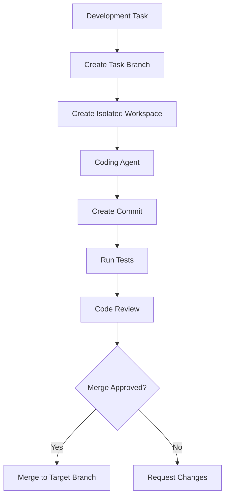

## 10.3 Artifact and Git Synchronization

The platform MUST maintain explicit mappings between:

- Artifact ID.
- Artifact version.
- Repository ID.
- Branch.
- Commit SHA.
- File path.
- Review status.
- Baseline ID.

A Git commit MUST NOT automatically imply engineering approval.

Similarly, an artifact approval MUST NOT automatically imply that the corresponding Git branch has been merged.

These are separate state transitions.

---

# 11. Security Architecture

## 11.1 Security Objectives

The platform MUST protect:

- User identities.
- Agent identities.
- Project data.
- Engineering artifacts.
- Source code.
- API credentials.
- Execution environments.
- External integrations.
- Production infrastructure.

## 11.2 Security Domains

Security MUST be enforced across the following domains:

1. Identity security.
2. Authorization.
3. Agent isolation.
4. Tool access.
5. Data protection.
6. Network security.
7. Secrets management.
8. Audit and compliance.
9. Supply-chain security.

## 11.3 Least Privilege

Every Agent MUST operate with the minimum permissions required for its assigned task.

Permissions MUST be scoped by:

- Project.
- Task.
- Execution.
- Tool.
- Resource.
- Operation.

Permissions MUST NOT be implicitly inherited across unrelated projects.

## 11.4 Credential Management

Long-lived secrets MUST be stored by the Credential Broker. The Credential Broker is the only component that reads or issues those secrets.

The Agent Runtime Manager MAY hold execution-scoped credential references. It MUST NOT receive provider credential secrets or tool credential secrets of any lifetime.

The Tool Gateway resolves a short-lived credential for an adapter only after the Policy Engine allows the invocation. That credential is injected only into the tool adapter. It MUST NOT be returned to the Agent or placed in the Agent process.

Secrets MUST NOT be embedded in:

- Agent prompts.
- Task descriptions.
- Artifact metadata.
- Git repositories.
- Execution logs.
- LLM request history.

The platform SHOULD use short-lived credentials where supported.

## 11.5 Prompt Injection and Untrusted Data

Artifacts, external documents, repository files, web content, and tool outputs MUST be treated as potentially untrusted inputs.

The platform MUST distinguish:

- Platform instructions.
- Project policies.
- Task instructions.
- Retrieved reference content.
- External tool output.

Retrieved content MUST NOT override system-level security policies.

The Tool Gateway MUST independently enforce permissions rather than relying on the Agent to follow instructions.

## 11.6 Execution Isolation

Agent execution environments MUST have:

- Resource limits.
- Execution timeouts.
- Controlled filesystem access.
- Controlled network access.
- Explicit tool permissions.
- Execution termination capability.

Production infrastructure access MUST be disabled by default.

## 11.7 Approval Controls

The following operations SHOULD require explicit human authorization:

- Production deployment.
- Protected branch merge.
- Destructive infrastructure changes.
- Security policy modification.
- Privileged credential access.
- Approval of designated critical baselines.

The platform MUST record the authorizing identity and decision.

---

# 12. Deployment Architecture

## 12.1 Deployment Principles

The logical subsystem architecture MUST be independent of the initial physical deployment topology.

The first implementation MAY use a modular monolith for selected control-plane services, provided subsystem boundaries and interfaces remain explicit.

Agent execution SHOULD be deployed independently from the control plane.

This allows execution capacity to scale independently.

## 12.2 Recommended Deployment Topology

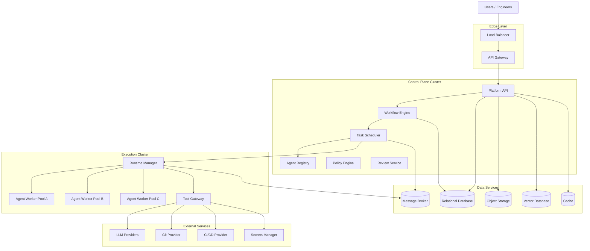

## 12.3 Deployment Components

| Component | Deployment Recommendation |
|---|---|
| API Gateway | Horizontally scalable service. |
| Platform API | Stateless service instances. |
| Workflow Engine | Durable orchestration service. |
| Task Scheduler | Scalable worker service. |
| Agent Registry | Control-plane service. |
| Runtime Manager | Execution-control service. |
| Agent Workers | Isolated and horizontally scalable workers. |
| Tool Gateway | Policy-controlled service. |
| Relational Database | Managed or highly available database. |
| Message Broker | Durable messaging infrastructure. |
| Object Storage | Durable artifact storage. |
| Vector Database | Optional scalable retrieval service. |
| Monitoring | Centralized observability infrastructure. |

## 12.4 Network Segmentation

The deployment SHOULD separate:

- Public access network.
- Control-plane network.
- Agent execution network.
- Data services network.
- External integration network.

Agent Workers MUST NOT receive unrestricted access to the internal control-plane network.

Communication SHOULD be mediated through authenticated service interfaces.

## 12.5 Scalability Model

The architecture SHOULD support independent scaling of:

- API instances.
- Workflow workers.
- Scheduler workers.
- Agent runtime workers.
- Tool Gateway instances.
- Knowledge retrieval workers.

The number of Agent executions MUST NOT be limited by the number of control-plane service instances.

---

# 13. Reliability and Fault Tolerance

## 13.1 Reliability Requirements

The platform MUST support:

- Durable task state.
- Durable workflow state.
- Execution timeout.
- Retry policy.
- Idempotent event handling.
- Runtime failure detection.
- Execution cancellation.
- Workflow recovery.
- Artifact persistence.

## 13.2 Failure Categories

| Failure | Recommended Handling |
|---|---|
| LLM timeout | Retry only as a `tool_attempt` inside the same tool execution, while the tool retry rules allow it. Do not end the Agent execution. Reaching the Agent `deadline` cancels the in-flight tool call and does not start another `tool_attempt`. |
| Agent crash | Lost contact from `RUNNING` or `COMPLETING` before `deadline` stays `unknown`. Do not publish a task result and do not create a new `attempt_id`. Record `failed` only with evidence that the execution environment failed. Reaching `deadline` while the execution is still in `RUNNING` or `COMPLETING` publishes `execution.agent.timed_out` once whether or not a heartbeat is still arriving. Heartbeat timeout from `INITIALIZING` or `READY`, and initialization timeout, enter `TIMED_OUT` and publish `execution.agent.timed_out` once. |
| Tool failure | Return structured error to Agent. |
| Message duplication | Idempotent processing. |
| Database failure | Retry and recover from durable state. |
| Artifact upload failure | Preserve execution output and retry registration with the same `submission_id`. A version conflict is not retried. Content equality does not make it the same artifact. |
| Workflow Engine restart | Recover from persisted state. |
| External provider outage | Circuit breaker and delayed retry. |
| Invalid Agent output | Reject the result with category `artifact` and leave the execution in `COMPLETING`. Do not create a new `attempt_id`. |

## 13.3 Retry Policy

Retries MUST be bounded.

A retry policy SHOULD include:

- Maximum attempts.
- Retryable error categories.
- Backoff strategy.
- Maximum elapsed time.
- Manual escalation condition.

Non-idempotent operations MUST NOT be blindly retried.

## 13.4 Execution Recovery

An execution may enter an uncertain state if the Runtime Manager loses contact with an Agent.

The platform MUST distinguish:

- Confirmed failure.
- Confirmed completion.
- Unknown execution outcome.

An unknown outcome MUST NOT automatically trigger duplicate execution of non-idempotent operations.

The platform SHOULD reconcile the execution using runtime identity, execution heartbeat, and result records.

---

# 14. Observability and Auditability

## 14.1 Observability Model

The platform MUST support three primary observability signals.

### Logs

Record operational events and errors.

### Metrics

Measure performance, resource usage, and workflow behavior.

### Traces

Track requests and execution paths across subsystems.

## 14.2 Engineering Metrics

The platform SHOULD expose:

| Metric | Description |
|---|---|
| Workflow Completion Rate | Percentage of successfully completed workflows. |
| Task Success Rate | Percentage of successfully executed tasks. |
| Agent Failure Rate | Percentage of failed Agent executions. |
| Average Task Duration | Average execution time per task category. |
| Review Rejection Rate | Percentage of rejected artifact submissions. |
| Quality Gate Pass Rate | Percentage of passed quality gates. |
| Requirement Traceability Coverage | Percentage of requirements with required downstream links. |
| Artifact Baseline Coverage | Percentage of required artifacts included in approved baselines. |
| Retry Rate | Percentage of tasks requiring retry. |
| Human Intervention Rate | Percentage of workflows requiring manual intervention. |

## 14.3 Audit Requirements

The platform MUST record:

- Workflow creation and modification.
- Task creation and assignment.
- Agent execution start and completion.
- Tool invocation.
- Artifact submission.
- Artifact version changes.
- Review decisions.
- Approval decisions.
- Quality gate results.
- Permission changes.
- Deployment operations.

Audit records SHOULD contain actor identity, resource identity, timestamp, operation, result, and correlation identifiers.

---

# 15. Non-Functional Requirements

## 15.1 Performance

The initial implementation SHOULD target the following objectives.

| ID | Requirement | Target |
|---|---|---|
| NFR-PER-001 | Standard API response latency | P95 ≤ 500 ms |
| NFR-PER-002 | Task scheduling latency | P95 ≤ 5 seconds |
| NFR-PER-003 | Event delivery latency | P95 ≤ 2 seconds under normal load |
| NFR-PER-004 | Workflow state query | P95 ≤ 500 ms |
| NFR-PER-005 | Concurrent Agent executions | Configurable and horizontally scalable |

These targets exclude external LLM inference time and long-running engineering operations.

## 15.2 Availability

The initial production target SHOULD be:

| Component | Availability Target |
|---|---|
| Platform API | 99.9% |
| Workflow Control Plane | 99.9% |
| Artifact Metadata Service | 99.9% |
| Agent Execution Workers | Best-effort with automatic recovery |
| External LLM Providers | Governed by provider availability |

## 15.3 Durability

The platform MUST persist authoritative workflow and task state.

Artifact durability SHOULD follow the retention and backup policies of the deployment environment.

## 15.4 Scalability

The system MUST support horizontal scaling of stateless services and execution workers.

## 15.5 Maintainability

Each subsystem MUST have:

- Defined ownership.
- Defined API contracts.
- Defined data ownership.
- Defined operational metrics.
- Defined failure handling.
- Defined test requirements.

## 15.6 Portability

The platform SHOULD support deployment in:

- Public cloud.
- Private cloud.
- Hybrid environments.
- Self-hosted infrastructure.

## 15.7 Interoperability

The platform MUST support integration through documented APIs and event contracts.

---

# 16. Engineering Governance Integration

## 16.1 Integration with Engineering Standards

The platform operationalizes the three foundational engineering standards.

| Standard | Platform Implementation |
|---|---|
| Product-to-Engineering Development Methodology | Workflow templates and phase definitions. |
| Engineering Document Templates & Standards | Artifact schemas, templates, and validation rules. |
| Engineering Workflow & AI Agent Orchestration Standard | Agent contracts, task models, orchestration policies, and execution lifecycle. |

## 16.2 Engineering Lifecycle Mapping

| Engineering Phase | Platform Capabilities | Typical Agents |
|---|---|---|
| P0 — Project Initiation | Project Management | Product Agent |
| P1 — Product Requirements | Workflow and Artifact Management | Product Agent |
| P2 — System Requirements | Task and Artifact Management | Business Analyst Agent |
| P3 — System Architecture | Workflow and Review | System Architect Agent |
| P4 — System Decomposition | Traceability and Task Management | System Architect Agent |
| P5 — Subsystem Design | Artifact and Review Management | Subsystem Architect Agent |
| P6 — Implementation | Runtime and Git Integration | Coding Agent |
| P7 — Verification | Quality Gate and CI/CD Integration | Testing Agent |
| P8 — Release | Approval and Deployment Integration | Release Agent |
| P9 — Maintenance | Change and Impact Analysis | Maintenance Agent |

## 16.3 Engineering Artifact Lifecycle

Artifact lifecycle, version publication, review, approval, and baseline membership MUST be separate dimensions. The Artifact Registry SRS defines those state machines. They MUST NOT be collapsed into one status field.

A document being technically complete does not mean it has been approved or included in an approved baseline.

## 16.4 Change Management

A change request MUST be able to identify:

- Originating requirement.
- Affected system components.
- Affected subsystem requirements.
- Affected artifacts.
- Affected source code.
- Affected test cases.
- Required review and approval.
- Required regression testing.

The platform SHOULD generate impact-analysis tasks automatically when a controlled requirement or baseline changes.

---

# 17. Implementation Architecture and Delivery Strategy

## 17.1 Implementation Strategy

The platform SHOULD be implemented incrementally.

A fully distributed microservice architecture is not mandatory for the first release.

The implementation MUST preserve logical subsystem boundaries even if several subsystems initially share a deployment unit.

## 17.2 Recommended Implementation Phases

### Phase 1 — Core Engineering Workspace

Implement:

- User and project management.
- Project workspace.
- Artifact Registry.
- Basic Agent Registry.
- Basic task management.
- Git integration.

Deliverable: A usable engineering workspace with controlled artifact management.

### Phase 2 — Agent Execution Platform

Implement:

- Agent Contract.
- Agent Runtime Manager.
- Execution isolation.
- Tool Gateway.
- LLM provider adapters.
- Execution monitoring.

Deliverable: Agents can receive and execute engineering tasks.

### Phase 3 — Workflow Orchestration

Implement:

- Workflow definitions.
- Workflow Engine.
- Task DAG.
- Task Scheduler.
- Event infrastructure.
- Workflow recovery.

Deliverable: Multi-Agent engineering workflows can run automatically.

### Phase 4 — Engineering Governance

Implement:

- Review and Approval.
- Quality Gate Engine.
- Traceability Service.
- Artifact baselines, stored by the Artifact Registry.
- Engineering policy enforcement.

Deliverable: Controlled engineering lifecycle execution.

### Phase 5 — Advanced Collaboration

Implement:

- Knowledge Management.
- Advanced Agent collaboration.
- Change impact analysis.
- CI/CD integration.
- Engineering dashboard.
- Advanced reporting.

Deliverable: An integrated AI Engineering Orchestration Platform.

## 17.3 Initial Deployment Recommendation

The first production-capable implementation SHOULD use:

- A modular control-plane application.
- A separate Agent Runtime service.
- A relational database.
- A durable message broker.
- Object storage.
- A Tool Gateway.
- A Git provider integration.
- An LLM provider abstraction.

This minimizes early operational complexity without compromising future subsystem separation.

---

# 18. Architecture Decisions

The following decisions establish the initial architectural baseline.

| ID | Decision | Rationale |
|---|---|---|
| ADR-001 | Separate Control Plane and Execution Plane | Prevent Agent execution failures from affecting orchestration state. |
| ADR-002 | Use Task DAG as the primary dependency model | Support parallel and dependent engineering tasks. |
| ADR-003 | Use contract-first Agent execution | Enable different Agent frameworks and runtimes. |
| ADR-004 | Use Artifact Registry as engineering metadata authority | Provide consistent artifact identity and traceability. |
| ADR-005 | Keep Git as source-control authority | Avoid replacing mature version-control systems. |
| ADR-006 | Use event-driven asynchronous execution | Improve scalability and fault isolation. |
| ADR-007 | Enforce human approval for critical operations | Prevent unauthorized autonomous changes. |
| ADR-008 | Separate execution status from acceptance status | Distinguish successful execution from accepted engineering output. |
| ADR-009 | Use modular deployment initially | Reduce implementation and operational complexity. |
| ADR-010 | Use provider adapters | Avoid vendor lock-in. |

## 18.1 Architectural Constraints

The implementation MUST preserve the following constraints:

1. Workflow state MUST have a durable authoritative owner.
2. Agent execution MUST be isolated from the control plane.
3. Agent permissions MUST be explicitly evaluated.
4. Artifacts MUST be versioned and traceable.
5. Approval MUST be independent of Agent execution completion.
6. Task scheduling MUST respect dependency and policy constraints.
7. External integrations MUST use defined adapters.
8. Critical actions MUST be auditable.
9. Workflow recovery MUST not depend exclusively on in-memory state.
10. Engineering baselines MUST be immutable.

---

# 19. Architecture Validation

## 19.1 Validation Objectives

The architecture MUST be validated against:

- Functional completeness.
- Subsystem boundary clarity.
- Data ownership.
- Interface consistency.
- Security requirements.
- Reliability requirements.
- Scalability requirements.
- Engineering governance requirements.
- Operational feasibility.

## 19.2 Required Architecture Reviews

The following reviews SHOULD be conducted before implementation baseline approval.

| Review | Purpose |
|---|---|
| System Boundary Review | Verify platform scope and external dependencies. |
| Subsystem Decomposition Review | Verify subsystem responsibilities and ownership. |
| Data Architecture Review | Verify entities, relationships, and persistence strategy. |
| Interface Review | Verify API and event contracts. |
| Security Architecture Review | Verify trust boundaries and permission enforcement. |
| Deployment Review | Verify infrastructure and network architecture. |
| Reliability Review | Verify recovery and failure handling. |
| Operational Review | Verify observability and maintenance requirements. |

## 19.3 Architecture Acceptance Criteria

The architecture may be accepted when:

- All major subsystems have defined responsibilities.
- All authoritative entities have designated owners.
- All critical interfaces are identified.
- Agent execution boundaries are explicit.
- Workflow and task lifecycle models are defined.
- Artifact versioning and baseline management are defined.
- Human approval requirements are specified.
- Security boundaries are documented.
- Deployment topology is feasible.
- Non-functional requirements are measurable.
- No unresolved critical architectural issue remains.

---

# 20. Derived Engineering Specifications

This document defines the system-level architecture.

It does not replace subsystem-level requirements and detailed design documents.

The following specifications MUST be derived from this architecture.

| ID | Specification | Primary Subsystem |
|---|---|---|
| SPEC-001 | Identity & Access Management SRS | Identity and Access Management |
| SPEC-002 | Project Management SRS | Project Management |
| SPEC-003 | Workflow Engine SRS | Workflow Management |
| SPEC-004 | Workflow Engine & Task Scheduler SRS | Workflow Management and Task Scheduler |
| SPEC-005 | Agent Registry SRS | Agent Registry |
| SPEC-006 | Agent Runtime Manager SRS | Agent Runtime Manager |
| SPEC-007 | Agent Execution Protocol Specification | Agent Runtime Manager |
| SPEC-008 | Context Management SRS | Context Management |
| SPEC-009 | Tool Gateway & Tool Execution Protocol Specification | Tool Gateway |
| SPEC-010 | Artifact Registry SRS | Artifact Registry |
| SPEC-011 | Artifact & Versioning Protocol Specification | Artifact Registry |
| SPEC-012 | Knowledge Management SRS | Knowledge Management |
| SPEC-013 | Review & Approval SRS | Review and Approval |
| SPEC-014 | Quality Gate Engine SRS | Quality Gate Engine |
| SPEC-015 | Requirement Traceability SRS | Traceability Service |
| SPEC-016 | Integration Service SRS | Integration Service |
| SPEC-017 | Event & Audit Service SRS | Event and Audit Service |
| SPEC-018 | Monitoring & Reporting SRS | Monitoring and Reporting |
| SPEC-019 | Security Architecture & Threat Model | Cross-System |
| SPEC-020 | Infrastructure & Deployment Specification | Cross-System |
| SPEC-021 | Policy Engine SRS | Policy Engine |
| SPEC-022 | Credential Broker SRS | Credential Broker |

Each subsystem SRS MUST define:

- Functional requirements.
- Non-functional requirements.
- Input and output contracts.
- Data entities.
- State transitions.
- API interfaces.
- Events.
- Error handling.
- Security requirements.
- Acceptance criteria.
- Verification requirements.

The detailed design documents MUST then define implementation-level components, algorithms, schemas, deployment parameters, and operational procedures.

---

# 21. Architecture Governance

## 21.1 Architecture Ownership

The System Architecture Specification is maintained by the designated System Architect or Architecture Owner.

Subsystem owners are responsible for maintaining their subsystem specifications.

## 21.2 Change Control

Any change affecting the following MUST trigger architecture impact analysis:

- System boundary.
- Subsystem responsibility.
- Data ownership.
- Public API contracts.
- Event contracts.
- Security boundaries.
- Deployment topology.
- Critical non-functional requirements.

## 21.3 Architecture Baseline

The approved architecture version MUST be registered as an engineering baseline in the Artifact Registry. There is no separate Baseline Management subsystem.

All derived subsystem specifications MUST identify the architecture baseline against which they were developed.

## 21.4 Compliance

Subsystem implementations MUST conform to this architecture unless an approved architecture change or documented exception exists.

---

# 22. Final Architectural Position

The AI Engineering Orchestration Platform is designed as an engineering control and execution system rather than a simple collection of AI Agents.

Its core architecture is based on the following principles:

1. The Workflow Engine coordinates engineering processes.
2. The Task Scheduler coordinates task execution.
3. The Agent Registry identifies qualified execution units.
4. The Agent Runtime Manager controls Agent execution.
5. The Context Manager provides task-specific engineering context.
6. The Tool Gateway controls external operations.
7. The Artifact Registry manages engineering outputs and versions.
8. The Review and Approval subsystem enforces engineering governance.
9. The Quality Gate Engine validates engineering quality.
10. The Traceability Service connects requirements to implementation and verification.
11. The Event and Audit Service preserves execution history and accountability.

The platform's fundamental execution model is:

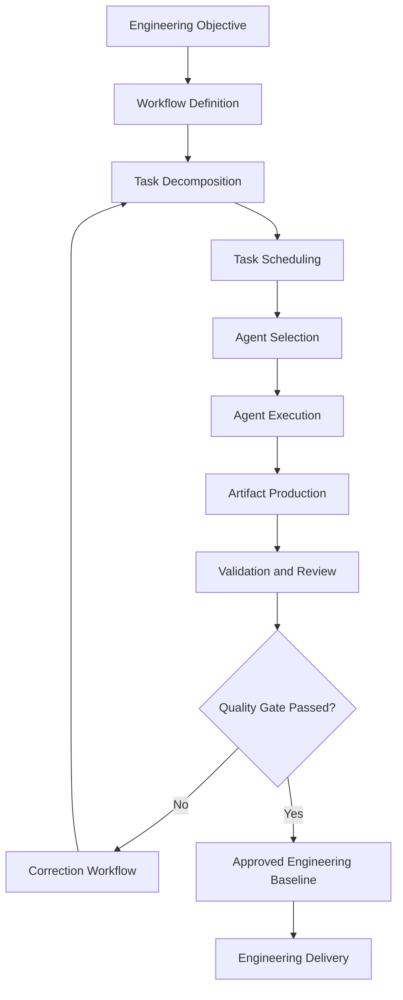

The platform MUST ensure that every engineering task is traceable, every execution is controlled, every artifact is versioned, every critical decision is auditable, and every required approval is explicitly authorized.

This architecture establishes the system-level foundation for implementing a governed, scalable, and extensible AI Engineering Orchestration Platform.