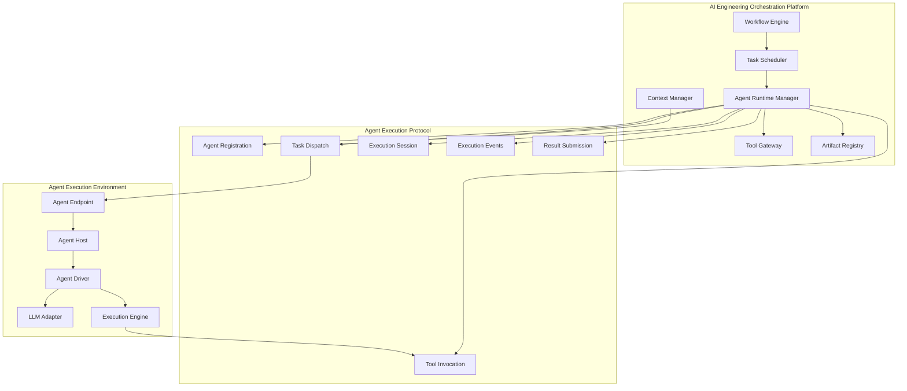
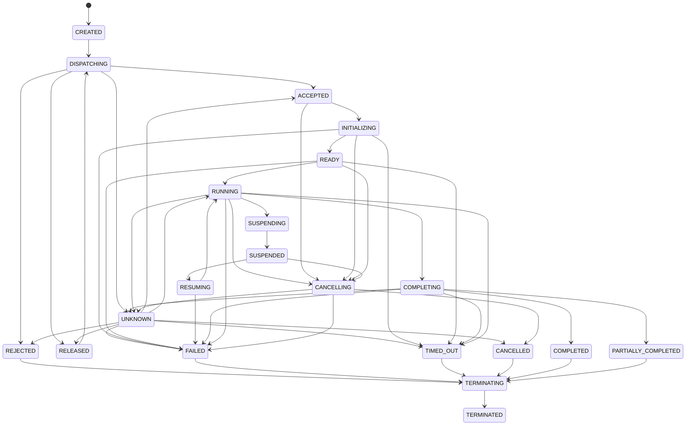
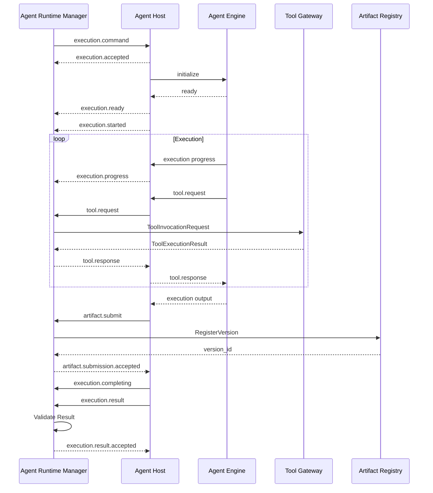
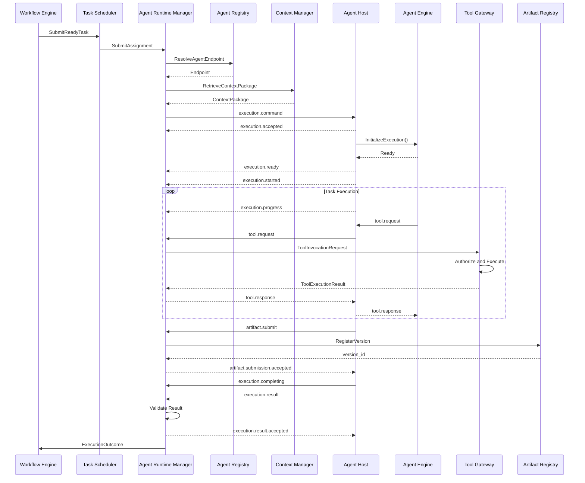
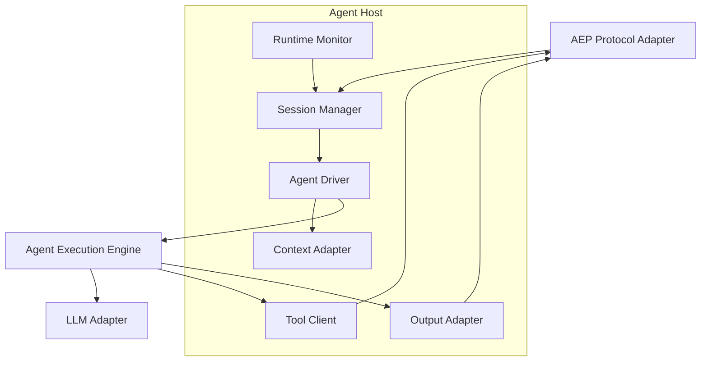

# Agent Execution Protocol Specification

| Document Attribute | Value |
|---|---|
| Document ID | AI-ENG-PROTO-001 |
| Document Title | Agent Execution Protocol Specification |
| Version | 1.0.0 |
| Status | Baseline |
| Document Type | Protocol Specification |
| Language | English |
| Parent Document | AI Engineering Orchestration Platform — System Architecture Specification |
| Related Standard | Engineering Workflow & AI Agent Orchestration Standard |
| Protocol Scope | Agent Registration, Task Dispatch, Execution, Tool Invocation, Artifact Submission, and Lifecycle Management |

---

# 1. Introduction

## 1.1 Purpose

This document defines the Agent Execution Protocol (AEP).

AEP specifies the communication contract between the AI Engineering Orchestration Platform and AI Agent execution environments.

The protocol enables the platform to:

- Discover and select qualified Agents.
- Dispatch engineering tasks.
- Establish execution sessions.
- Deliver task context and constraints.
- Monitor Agent execution.
- Receive progress updates.
- Authorize tool invocations.
- Receive execution results.
- Register generated artifacts.
- Handle execution failures.
- Cancel or suspend execution.
- Recover interrupted executions.

AEP provides a standardized interface independent of the underlying Agent framework, LLM provider, or execution infrastructure.

## 1.2 Design Goals

| ID | Goal | Description |
|---|---|---|
| AEP-G-001 | Runtime Independence | Support different Agent runtime implementations. |
| AEP-G-002 | Execution Standardization | Define a consistent Agent execution lifecycle. |
| AEP-G-003 | Interoperability | Enable platform-managed and remote Agents to interoperate. |
| AEP-G-004 | Execution Observability | Provide progress, status, logs, and execution events. |
| AEP-G-005 | Tool Governance | Control Agent access to external tools. |
| AEP-G-006 | Artifact Management | Standardize engineering output submission. |
| AEP-G-007 | Fault Tolerance | Support timeouts, retries, cancellation, and recovery. |
| AEP-G-008 | Security | Enforce identity, authorization, and execution isolation. |
| AEP-G-009 | Extensibility | Support new Agent capabilities and message types. |
| AEP-G-010 | Traceability | Preserve task, execution, and artifact provenance. |

## 1.3 Scope

AEP defines:

1. Agent endpoint and capability representation.
2. Agent identity and authentication.
3. Task dispatch.
4. Execution session management.
5. Execution lifecycle.
6. Context delivery.
7. Progress reporting.
8. Tool invocation.
9. Artifact submission.
10. Execution result submission.
11. Cancellation and suspension.
12. Retry and recovery.
13. Error handling.
14. Event and message formats.
15. Security and authorization.
16. Transport bindings.
17. Protocol conformance requirements.

## 1.4 Out of Scope

AEP does not define:

- LLM model architecture.
- Prompt engineering methodology.
- Internal Agent reasoning algorithms.
- Agent training and fine-tuning.
- Detailed workflow DAG execution.
- Task dependency scheduling algorithms.
- Artifact storage implementation.
- Knowledge retrieval algorithms.
- Specific tool implementation details.

These are defined by other platform specifications.

## 1.5 Normative Language

The keywords MUST, MUST NOT, SHOULD, SHOULD NOT, and MAY are normative.

An implementation claiming AEP 1.0 conformance MUST implement all mandatory requirements applicable to its declared capabilities.

---

# 2. Protocol Architecture

## 2.1 Architectural Position

AEP operates between the Agent Runtime Manager and an Agent execution endpoint.

The Agent Runtime Manager is the protocol coordinator.

The Agent is the execution participant.

The protocol does not require the Agent to be implemented using any particular framework.



## 2.2 Protocol Participants

| Participant | Responsibility |
|---|---|
| Agent Runtime Manager (ARM) | Creates and manages Agent executions. |
| Agent Endpoint | Exposes the Agent execution interface. |
| Agent Host | Manages the Agent process and runtime environment. |
| Agent Driver | Adapts protocol messages to the Agent implementation. |
| Agent Execution Engine | Executes the assigned engineering task. |
| Tool Gateway | Authorizes and executes external tool operations. |
| Context Manager | Provides task-specific context. |
| Artifact Registry | Stores and versions submitted artifacts. |
| Workflow Engine | Consumes execution status and results. |

## 2.3 Agent Execution Endpoint

An Agent MUST expose a logical execution endpoint.

The endpoint MAY be implemented through:

- An in-process interface.
- A local RPC interface.
- A container service.
- An HTTP service.
- A remote Agent provider API.

AEP defines the logical operations, not a mandatory deployment topology.

The platform MUST use an adapter when the underlying Agent runtime does not natively support AEP.

## 2.4 Control and Execution Separation

The Agent Runtime Manager owns authoritative execution state.

The Agent reports its observed execution state but MUST NOT directly modify authoritative workflow state.

For example:

- The Agent can report that task execution has completed.
- The Runtime Manager validates the submitted result.
- The Workflow Engine determines the next workflow transition.
- The Review subsystem determines whether an artifact is accepted.
- The Approval subsystem determines whether an artifact is approved.

These responsibilities MUST remain separate.

## 2.5 Agent Deployment Models

AEP supports four deployment models.

### Model A — Embedded Agent

The Agent runs inside the same application process as the Agent Host.

```text
Platform
  └── Agent Runtime Manager
        └── Agent Host
              └── Embedded Agent
```

Suitable for lightweight Agents and development environments.

### Model B — Local Worker Agent

The Runtime Manager starts an isolated local process or container.

```text
Platform
  └── Agent Runtime Manager
        └── Container Runtime
              └── Agent Worker
                    └── Agent
```

Suitable for production execution with controlled resource allocation.

### Model C — Remote Agent Service

The Agent is deployed as an independently managed service.

```text
Platform
  └── Agent Runtime Manager
        └── HTTPS / RPC
              └── Remote Agent Service
```

Suitable for independently scalable Agent services.

### Model D — External Agent Provider

The Agent is hosted by an external provider.

```text
Platform
  └── Provider Adapter
        └── External Agent API
              └── Hosted Agent
```

Suitable for third-party Agent services.

All four models MUST expose equivalent logical execution semantics.

---

# 3. Protocol Communication Model

## 3.1 Communication Channels

AEP defines five logical communication channels.

| Channel | Direction | Purpose |
|---|---|---|
| Registration Channel | Agent → Platform | Register capabilities and endpoint metadata. |
| Command Channel | Platform → Agent | Dispatch, cancel, suspend, and resume execution. |
| Event Channel | Agent → Platform | Report status, progress, and execution events. |
| Tool Channel | Agent ↔ Platform | Request authorized tool operations. |
| Result Channel | Agent → Platform | Submit execution results and artifact references. |

These channels may share one transport connection or use separate transport connections.

## 3.2 Communication Patterns

AEP supports:

- Request/response.
- Asynchronous event delivery.
- Long-running execution sessions.
- Streaming progress updates.
- Callback-based command delivery.
- Polling-based command delivery.

The selected transport MUST preserve the protocol's logical semantics.

## 3.3 Execution Session

An execution session is the communication and lifecycle context for one Agent execution attempt.

The session and the execution attempt have different identifiers. `session_id` identifies the session. `agent_execution_id` identifies the attempt. A session MUST NOT be reused for another attempt.

The following identifiers MUST be distinguished:

| Identifier | Meaning |
|---|---|
| tenant_id | Tenant isolation boundary. |
| project_id | Engineering project. |
| workflow_definition_id | Workflow definition. |
| workflow_run_id | Workflow run. |
| task_id | Logical engineering task. |
| attempt_id | Scheduling attempt created by the Task Scheduler. |
| agent_execution_id | Agent execution attempt created by the Runtime Manager. |
| session_id | Communication session for that attempt. |
| agent_id | Stable Agent identity assigned or confirmed by the Agent Registry. |
| registration_id | Registration record returned by the Agent Registry. It is not `agent_id`. |
| agent_endpoint_id | Agent protocol endpoint. |
| worker_id | Worker hosting this attempt. The Runtime Manager assigns it on the execution command. The Agent echoes that value and MUST NOT substitute another identifier. It is not an Agent Runtime Manager process. |
| correlation_id | End-to-end operation correlation. |
| parent_agent_execution_id | Optional parent Agent execution for delegated work. |

A task MAY have multiple Agent executions because of a task retry or correction.

A task retry is a new assignment authorized by the Workflow Engine. The Task Scheduler issues a new `attempt_id` for that assignment. The Runtime Manager creates a new `agent_execution_id` and a new `session_id` only after it accepts the assignment.

Redelivery of the same execution command keeps the existing `attempt_id`, `agent_execution_id`, and `session_id`. A tool retry is a `tool_attempt` inside the same `tool_execution_id` and MUST NOT receive those three identifiers.

The `task_id` remains unchanged unless the platform creates a new logical task.

Cross-service messages MUST NOT use an unqualified `execution_id`. Within this protocol, the execution attempt is always `agent_execution_id`.

## 3.4 Protocol Envelope

All AEP messages MUST use a standard envelope.

```json
{
  "protocol": "AEP",
  "protocol_version": "1.0",

  "message_id": "msg_01JXYZ",
  "message_type": "execution.command",

  "timestamp": "2026-11-24T04:00:00Z",

  "sender": {
    "type": "platform",
    "id": "agent-runtime-manager"
  },

  "recipient": {
    "type": "agent",
    "id": "architecture-agent"
  },

  "tenant_id": "ten_001",
  "project_id": "proj_001",
  "workflow_definition_id": "wfd_001",
  "workflow_run_id": "wfr_001",
  "task_id": "task_001",
  "agent_execution_id": "exec_001",

  "correlation_id": "corr_001",
  "causation_id": null,

  "payload": {}
}
```

### Envelope Requirements

- `protocol` MUST identify the protocol.
- `protocol_version` MUST identify the protocol version.
- `message_id` MUST be unique.
- `message_type` MUST identify the message semantics.
- `timestamp` MUST use ISO 8601 UTC.
- `sender` MUST identify the message origin.
- `recipient` MUST identify the intended destination.
- `payload` MUST conform to the message-specific schema.
- `tenant_id` MUST be present on a platform-originated message. An Agent-originated message MAY omit it. The Runtime Manager copies `tenant_id` from the execution record onto cross-service commands and events and MUST NOT accept a different value from the Agent.

Fields that are not applicable MAY be omitted where permitted by the message schema.

## 3.5 Message Delivery Semantics

AEP uses at-least-once delivery for asynchronous protocol messages.

Therefore:

- Receivers MUST tolerate duplicate delivery.
- Messages MUST have unique message identifiers.
- State-changing operations MUST be idempotent or protected by deduplication.
- Receivers MUST reject invalid or expired commands.
- Messages MUST be associated with the appropriate execution context.

Exactly-once execution across distributed systems MUST NOT be assumed.

---

# 4. Agent Identity and Registration Protocol

## 4.1 Agent Identity

Each Agent MUST have a stable identity.

Example:

```text
agent://engineering/architecture-agent
```

An Agent identity MUST be independent of:

- Runtime instance.
- Container identifier.
- LLM provider.
- Model identifier.
- User identity.
- Execution identifier.

An Agent MAY have multiple runtime instances.

## 4.2 Agent Registration

An Agent MUST register its identity and capabilities before receiving platform-assigned tasks.

Registration may be:

- Static registration by an administrator.
- Dynamic registration by an Agent Host.
- Provider registration through an integration adapter.

## 4.3 Registration Message

```json
{
  "protocol": "AEP",
  "protocol_version": "1.0",
  "message_id": "msg_register_001",
  "message_type": "agent.register",

  "timestamp": "2026-11-24T04:00:00Z",

  "sender": {
    "type": "agent_host",
    "id": "host_001"
  },

  "recipient": {
    "type": "platform",
    "id": "agent-registry"
  },

  "payload": {
    "agent": {
      "proposed_name": "architecture-agent",
      "name": "Architecture Agent",
      "version": "1.0.0",

      "description": "System architecture design Agent",

      "capabilities": [
        "system_analysis",
        "architecture_design",
        "technical_documentation"
      ],

      "accepted_task_types": [
        "architecture_design",
        "system_analysis"
      ],

      "supported_features": [
        "progress_reporting",
        "artifact_submission",
        "tool_invocation",
        "cancellation"
      ],

      "runtime": {
        "runtime_type": "container",
        "max_concurrency": 3
      },

      "endpoint": {
        "transport": "https",
        "address": "https://agent.example.com/aep/v1"
      }
    }
  }
}
```

## 4.4 Registration Response

```json
{
  "protocol": "AEP",
  "protocol_version": "1.0",
  "message_id": "msg_register_response_001",
  "message_type": "agent.registered",

  "payload": {
    "agent_id": "architecture-agent",
    "registration_id": "areg_001",
    "status": "registered",

    "effective_capabilities": [
      "system_analysis",
      "architecture_design",
      "technical_documentation"
    ],

    "platform_policy": {
      "max_concurrency": 2,
      "heartbeat_interval_seconds": 30
    }
  }
}
```

The Agent Registry assigns `agent_id`, or confirms `proposed_name` and returns that confirmed value as `agent_id`. A host MUST NOT use `proposed_name` as `agent_id` before `agent.registered`. `registration_id` identifies the registration record and MUST NOT be used as `agent_id`.

The effective capabilities and limits returned by the platform are authoritative for platform scheduling.

## 4.5 Capability Declaration

Capabilities MUST use stable machine-readable identifiers.

An Agent SHOULD declare:

- Capability identifier.
- Capability version.
- Accepted task types.
- Required tools.
- Input constraints.
- Output constraints.
- Maximum concurrency.
- Supported execution features.

Example:

```json
{
  "capability_id": "architecture_design",
  "version": "1.0.0",

  "input": {
    "required": [
      "system_requirements",
      "architecture_constraints"
    ]
  },

  "output": {
    "required": [
      "architecture_document"
    ],
    "formats": [
      "markdown"
    ]
  }
}
```

Capability declaration does not grant access to tools or project resources.

Effective authorization MUST be determined separately.

## 4.6 Agent Health and Availability

An Agent Host SHOULD report:

- Ready.
- Busy.
- Degraded.
- Unavailable.
- Draining.

An Agent MUST NOT receive new work when its effective state is unavailable or draining.

The Runtime Manager MUST be able to detect stale Agent registrations.

---

# 5. Task Dispatch Protocol

## 5.1 Task Dispatch

The Agent Runtime Manager dispatches an execution request to a selected Agent.

Dispatch MUST include:

- Task identity.
- Execution identity.
- Task description.
- Acceptance criteria.
- Context references.
- Execution constraints, including `constraints.allowed_tools`.
- Output contract.
- Deadline and timeout information. Both `deadline` and `timeout_seconds` are required on `execution.command`. Expiry is evaluated only against `deadline`. `timeout_seconds` is the duration used to write that instant and MUST NOT start a second clock.

`required_capabilities` names Agent capabilities. It MUST NOT be copied into `constraints.allowed_tools`. `allowed_tools` is an array of `tool_name` values taken from the task definition. When that array is empty, the Runtime Manager rejects every `tool.request`.

The Agent MUST validate the dispatch request before accepting execution.

## 5.2 Execution Command

Message type:

```text
execution.command
```

Example:

```json
{
  "protocol": "AEP",
  "protocol_version": "1.0",

  "message_id": "msg_exec_001",
  "message_type": "execution.command",

  "timestamp": "2026-11-24T04:00:00Z",

  "sender": {
    "type": "platform",
    "id": "agent-runtime-manager"
  },

  "recipient": {
    "type": "agent",
    "id": "architecture-agent"
  },

  "tenant_id": "ten_001",
  "project_id": "proj_001",
  "workflow_definition_id": "wfd_001",
  "workflow_run_id": "wfr_001",
  "task_id": "task_001",
  "agent_execution_id": "exec_001",

  "correlation_id": "corr_001",
  "causation_id": null,

  "payload": {
    "task": {
      "type": "architecture_design",

      "title": "Design Platform Architecture",

      "description": "Produce a system architecture specification.",

      "acceptance_criteria": [
        "Define system boundaries",
        "Define subsystem responsibilities",
        "Define deployment architecture",
        "Define interface architecture"
      ],

      "priority": "high"
    },

    "execution": {
      "attempt_id": "attempt_001",
      "attempt_number": 1,
      "worker_id": "worker_001",
      "session_id": "session_001",

      "created_at": "2026-11-24T04:00:00Z",

      "deadline": "2026-11-24T05:00:00Z",

      "timeout_seconds": 3600,

      "heartbeat_interval_seconds": 30
    },

    "context": {
      "context_package_id": "ctx_001",
      "created_at": "2026-11-24T03:55:00Z",
      "context_version": "1.0.0",

      "artifacts": [
        {
          "artifact_id": "ART-REQ-001",
          "version_id": "ARV-001",
          "version_number": "1.0.0"
        }
      ],

      "engineering_standards": [],

      "dependencies": [],

      "policies": {
        "policy_versions": ["pol_001"]
      }
    },

    "constraints": {
      "network_access": "restricted",

      "allowed_tools": [
        "artifact.read",
        "artifact.write",
        "knowledge.search"
      ],

      "forbidden_operations": [
        "production.deploy"
      ]
    },

    "output_contract": {
      "required_artifacts": [
        {
          "type": "system_architecture_specification",
          "format": "markdown",
          "required": true
        }
      ],

      "result_schema": "aep.execution-result.v1"
    }
  }
}
```

`session_id` in this command is the session created for the attempt. The Agent echoes that value. `deadline` is the execution deadline instant. `timeout_seconds` is the duration the Workflow Engine uses when it writes that instant. Expiry is evaluated only against `deadline`. The Runtime Manager MUST NOT start a second clock from `timeout_seconds`. Assignment-offer expiration uses `expires_at` and MUST NOT be copied into `deadline`. `constraints` on this command is the only execution constraint. The Agent applies `allowed_tools` and `network_access` from it. A context package MUST NOT override those values.

## 5.3 Dispatch Acceptance

The Agent MUST respond with exactly one of these messages. The wire `status` values are `accepted`, `rejected`, and `unavailable`.

| Message | status | Meaning |
|---|---|---|
| execution.accepted | accepted | The Agent accepted the command. |
| execution.rejected | rejected | The Agent refused the command. |
| execution.unavailable | unavailable | The Agent cannot accept the command now. The same attempt returns to the scheduler queue. |

`unavailable` moves that execution to `released` and returns the same `attempt_id`, `agent_execution_id`, and `session_id` to the scheduler queue. Redelivery reuses them. The Runtime Manager reports `unconfirmed` to the Task Scheduler when no Agent response arrives and moves the execution to `unknown`. `unconfirmed` is not an Agent message. Reconciliation reuses the same identifiers. `rejected` moves the execution to `rejected` and is not an execution result.

`worker_id` in `execution.accepted` MUST equal the value on `execution.command`. The Agent MUST NOT submit a different worker identifier.

Example:

```json
{
  "message_type": "execution.accepted",

  "task_id": "task_001",
  "agent_execution_id": "exec_001",

  "payload": {
    "status": "accepted",
    "agent_id": "architecture-agent",
    "worker_id": "worker_001",
    "accepted_at": "2026-11-24T04:00:02Z"
  }
}
```

A dispatch rejection MUST use the platform error object. `code` MUST use the `AEP_` prefix. `reason_code` MUST NOT appear on the wire.

Example:

```json
{
  "message_type": "execution.rejected",

  "payload": {
    "status": "rejected",
    "error": {
      "code": "AEP_CAPABILITY_NOT_SUPPORTED",
      "category": "capability",
      "message": "The Agent does not support this task type.",
      "retryable": false,
      "details": {},
      "correlation_id": "corr_001"
    }
  }
}
```

Temporary unavailability:

```json
{
  "message_type": "execution.unavailable",

  "task_id": "task_001",
  "agent_execution_id": "exec_001",

  "payload": {
    "status": "unavailable"
  }
}
```

## 5.4 Acceptance Timeout

Acceptance Timeout is the time allowed for the Agent to accept a command after the Runtime Manager has created the execution. It is the same clock as the Agent Runtime Manager Acceptance Timeout. It is not the Runtime Manager Dispatch Timeout. Dispatch Timeout measures only delivery of the assignment to the Runtime Manager before an execution record exists. An explicit rejection on that hop is `invalid`. Command delivery happens after `agent_execution_id` and `session_id` exist. Failure to deliver the command is `unavailable` with execution state `released`, or this Acceptance Timeout with dispatch-origin `UNKNOWN`. It is not `invalid`.

If the Agent does not acknowledge the command within the Acceptance Timeout, the Runtime Manager MUST classify the dispatch as unconfirmed. The execution stays in dispatch-origin `UNKNOWN`. The `attempt_id` does not change. This outcome MUST NOT be reported as `TIMED_OUT` and MUST NOT move the assignment to `EXPIRED`.

It MAY:

- Retry delivery to the same Agent.
- Query execution status.
- Return the assignment to the Task Scheduler as unconfirmed.

It MUST NOT select a different Agent. Agent selection and creation of a new attempt belong to the Task Scheduler. A different Agent requires a new `attempt_id` authorized by the Workflow Engine.

The platform MUST NOT create concurrent executions of the same logical attempt unless the execution policy explicitly allows speculative execution.

---

# 6. Execution Session Protocol

## 6.1 Session Definition

An execution session is a logical communication and lifecycle context associated with one execution attempt.

The session binds:

- Agent identity.
- Runtime identity.
- Task identity.
- Execution identity.
- Authorization context.
- Execution deadline.
- Event sequence.
- Result submission.

An execution session MUST NOT be reused for a different task.

## 6.2 Session Initialization

After accepting a dispatch, the Agent Host MUST initialize the execution environment.

Initialization SHOULD include:

1. Runtime allocation.
2. Task contract validation.
3. Receipt of the context package delivered by the Runtime Manager.
4. Permission initialization.
5. Tool configuration.
6. Execution state initialization.
7. Agent engine initialization.

The Agent MUST NOT retrieve the context package from Context Management. The Runtime Manager validates the package before delivery.

The Agent MUST report readiness before entering active execution.

## 6.3 Session and Execution States

`session_id` identifies the communication session. The execution state below is the Agent execution state. Session connection state MUST NOT be used as the execution outcome.

The authoritative execution states and transitions are:



`UNKNOWN` means the outcome is not yet reconciled. It is not evidence that the Agent has stopped. The Runtime Manager records whether `UNKNOWN` began during dispatch or after the execution was accepted. That origin selects the legal exit. The diagram lists every exit; an exit that does not match the origin is illegal.

A dispatch-origin `UNKNOWN` MAY move to `ACCEPTED`, `RUNNING`, or `FAILED` when reconciliation shows that outcome. A transition to `FAILED` requires evidence that the execution was accepted. An unconfirmed dispatch that was never accepted reconciles to `REJECTED` or `RELEASED`, or remains `UNKNOWN`. It MUST NOT enter `FAILED`, `CANCELLED`, or `TIMED_OUT`.

A post-acceptance `UNKNOWN` MAY move to `RUNNING`, `FAILED`, `CANCELLED`, or `TIMED_OUT` when reconciliation shows that outcome. It MUST NOT enter `REJECTED` or `RELEASED`. `UNKNOWN` MUST NOT transition directly to `TERMINATED`.

`INITIALIZING` or `READY` enters `FAILED` when initialization fails and publishes `execution.agent.failed` once, and enters `TIMED_OUT` when the initialization timeout or a heartbeat timeout expires. Entering `FAILED` publishes that event once whether or not an `execution.result` exists. Heartbeat loss from `RUNNING` or `COMPLETING` before `deadline` enters post-acceptance `UNKNOWN`. Reaching `deadline` while the execution is still in `RUNNING` or `COMPLETING` enters `TIMED_OUT` whether or not a heartbeat is still arriving, and publishes `execution.agent.timed_out` once. A result-submission timeout enters `TIMED_OUT` from `COMPLETING`. It is not `FAILED`. A resume that cannot be completed safely transitions `RESUMING` to `FAILED`, publishes `execution.agent.failed` once, and then enters `TERMINATING`. That transition MUST NOT return to `RUNNING`.

`REJECTED` records an explicit Agent refusal. `RELEASED` records that the Agent cannot accept the command now. Neither state is an execution result, and neither publishes `execution.agent.failed`. `CANCELLED` publishes `execution.agent.cancelled` once. `TIMED_OUT` publishes `execution.agent.timed_out` once. `TIMED_OUT` is an execution outcome.

An accepted execution MUST NOT enter `TERMINATING` from `RUNNING`. It enters `TERMINATING` only from `FAILED`, `TIMED_OUT`, `CANCELLED`, `COMPLETED`, or `PARTIALLY_COMPLETED`. A forced stop after a non-recoverable failure records `FAILED` and publishes `execution.agent.failed` once before cleanup. `CANCELLED` is used only after a confirmed cancellation request. `TERMINATED` records runtime cleanup and MUST NOT erase the preceding outcome. Cleanup passes through `TERMINATING`. `REJECTED` MAY enter `TERMINATING` because refusal is not a task result.

`RELEASED` keeps the same `attempt_id`, `agent_execution_id`, and `session_id`. Redelivery of that attempt carries those identifiers, returns the execution from `RELEASED` to `DISPATCHING`, and reuses them. The join key is `attempt_id`. A new `assignment_id` or `idempotency_key` does not allocate another execution or session. A dispatch-origin `UNKNOWN` is the unconfirmed dispatch. Reconciliation reuses the same identifiers. Selecting a different Agent requires a new `attempt_id` authorized by the Workflow Engine.

This diagram is the same state machine required by the Agent Runtime Manager SRS. Neither document may define a divergent execution state machine.

Diagram labels use uppercase logical names. The wire values are the lowercase `ExecutionStatus` tokens in section 17.1, including `dispatching`, `rejected`, `released`, `unknown`, `partially_completed`, `suspending`, `resuming`, and `terminating`. Dispatch acknowledgement `unavailable` corresponds to execution state `released`. Dispatch acknowledgement `rejected` corresponds to execution state `rejected`. Dispatch acknowledgement `unconfirmed` corresponds to execution state `unknown`. Dispatch acknowledgement `invalid` is not an Agent message and is not an `ExecutionStatus` value. It means the Runtime Manager rejected the assignment before creating an execution.

## 6.4 Session State Ownership

The Agent reports its observed runtime state.

The Runtime Manager owns the authoritative execution state.

A state transition MUST be validated by the Runtime Manager.

The platform MUST reject invalid state transitions.

## 6.5 Session Identifiers

Every session MUST contain:

```json
{
  "agent_execution_id": "exec_001",
  "worker_id": "worker_001",
  "session_id": "session_001",
  "agent_id": "architecture-agent",
  "task_id": "task_001"
}
```

The session_id MUST be unique for the lifetime of the execution session.

---

# 7. Execution Lifecycle Protocol

## 7.1 Lifecycle Overview



## 7.2 Execution Started

Message type:

```text
execution.started
```

The Agent MUST report execution start after initialization succeeds.

## 7.3 Progress Reporting

Message type:

```text
execution.progress
```

Progress reports SHOULD include:

- Current execution stage.
- Human-readable status.
- Progress percentage, if meaningful.
- Current operation.
- Current subtask.
- Warning information.

Example:

```json
{
  "message_type": "execution.progress",

  "payload": {
    "stage": "architecture_design",

    "status": "Designing subsystem boundaries.",

    "progress": {
      "percentage": 45,
      "unit": "percent"
    },

    "current_operation": "Define subsystem interfaces"
  }
}
```

Progress MUST NOT be interpreted as proof of completion or correctness.

The Agent SHOULD avoid reporting artificial or misleading progress percentages.

## 7.4 Execution Checkpoint

An Agent MAY submit checkpoints during long-running tasks.

A checkpoint SHOULD contain:

- Execution identifier.
- Checkpoint identifier.
- Current execution stage.
- Completed work summary.
- Intermediate artifact references.
- Recovery metadata.

Example:

```json
{
  "message_type": "execution.checkpoint",

  "payload": {
    "checkpoint_id": "chk_001",

    "stage": "requirements_analysis",

    "summary": "Requirements decomposition completed.",

    "artifacts": [],

    "recoverable": true
  }
}
```

A checkpoint MUST NOT automatically imply artifact approval.

The Runtime Manager MAY persist checkpoint information for recovery.

## 7.5 Execution Completion

Completion MUST be a controlled protocol operation.

The Agent MUST first indicate that execution is ready for result submission.

Message:

```text
execution.completing
```

The Runtime Manager MUST then validate the final result.

The Agent MUST NOT assume completion has been accepted until it receives an explicit acknowledgment.

---

# 8. Context Delivery Protocol

## 8.1 Context Model

The platform delivers task-specific context through a Context Package.

A Context Package contains references to the relevant engineering information required by an Agent.

It MAY contain:

- Inline metadata.
- Inline small text content.
- Artifact references.
- Knowledge references.
- Dependency outputs.
- Project policies.
- References to the task constraints. Those references MUST NOT override `constraints` on `execution.command`, including `allowed_tools` and `network_access`.

Large artifacts SHOULD be delivered by reference rather than embedded directly in the dispatch message.

## 8.2 Context Package

An artifact reference in a context package MUST use `artifact_id` and `version_id`. `version_number` MAY appear beside them as a display attribute. A URI that addresses a version MUST contain `version_id`.

```json
{
  "context_package_id": "ctx_001",
  "created_at": "2026-11-24T03:55:00Z",
  "context_version": "1.0.0",

  "project": {
    "project_id": "proj_001",
    "name": "AI Engineering Platform"
  },

  "task": {
    "task_id": "task_001"
  },

  "engineering_standards": [
    {
      "artifact_id": "STD-001",
      "version_id": "ARV-010",
      "version_number": "1.0.0"
    }
  ],

  "artifacts": [
    {
      "artifact_id": "ART-REQ-001",
      "version_id": "ARV-001",
      "version_number": "1.0.0",
      "access_uri": "platform://artifacts/ART-REQ-001/versions/ARV-001"
    }
  ],

  "dependencies": [],

  "policies": {
    "policy_versions": ["pol_001"],
    "document_format": "markdown",
    "language": "English"
  }
}
```

## 8.3 Context Retrieval

The Agent MAY retrieve additional context during execution.

Additional context MUST be obtained through an authorized `tool.request` sent to the Runtime Manager, or from a reference the Runtime Manager has already validated and delivered. The Agent MUST NOT call Context Management directly.

All retrieval MUST be subject to the execution's authorization scope.

The Agent MUST NOT access arbitrary project resources merely because it knows their identifiers.

## 8.4 Context Provenance

Every context package MUST identify:

- `context_package_id`.
- `created_at`.
- `context_version`.
- Source artifact `artifact_id` and `version_id` values.
- Applicable policy versions.

Acceptance criteria remain on the task. Execution constraints remain on `execution.command.constraints`. The package MUST NOT override those constraints.

An Agent SHOULD include relevant source references in its output when required by the task contract.

## 8.5 Context Integrity

The platform SHOULD provide content hashes for immutable context artifacts.

If an artifact changes during execution, the execution MUST continue to reference the version originally supplied unless an explicit context refresh operation is authorized.

This prevents an Agent from silently mixing incompatible artifact versions.

---

# 9. Tool Invocation Protocol

## 9.1 General Model

Agents request external operations through the Agent Runtime Manager. The Runtime Manager submits the canonical invocation to the Tool Gateway. The Agent MUST NOT call the Tool Gateway directly.

The Runtime Manager passes the execution context. The Tool Gateway obtains the authorization decision from the Policy Engine and, only after that decision allows the call, resolves a short-lived credential for the adapter. The Runtime Manager MUST NOT treat an Agent statement as that decision and MUST NOT receive the provider credential.

Field mapping from `tool.request` to the Tool Gateway invocation:

| AEP `tool.request` | Tool Gateway request |
|---|---|
| agent_execution_id | execution_context.agent_execution_id |
| task_id | execution_context.task_id |
| workflow_run_id | execution_context.workflow_run_id |
| project_id | execution_context.project_id |
| tenant_id | execution_context.tenant_id. Copied by the Runtime Manager from the execution record. The Agent does not send it on `tool.request`. |
| workflow_definition_id | execution_context.workflow_definition_id. Copied by the Runtime Manager from the execution record. The Agent does not send it on `tool.request`. |
| agent_id | execution_context.agent_id. Copied by the Runtime Manager from the execution record. The Agent does not send it on `tool.request`. |
| context_package_id | execution_context.context_package_id. Copied by the Runtime Manager from the execution record. The Agent does not send it on `tool.request`. |
| tool.name | The registry field `tool_name`. The Runtime Manager resolves that string to `tool.tool_id` before the Gateway request. The Gateway accepts `tool_id`. The name is not the primary key. |
| tool.version | tool.version. When the Agent omits it, the Runtime Manager copies the version of the tool definition it resolved. The Gateway MUST NOT select a version. |
| mode | execution_options.mode, only when `tool.request` narrows the mode. Otherwise the Runtime Manager sets the tool definition's `default_invocation_mode`. The value MUST be one of that definition's `supported_invocation_modes`. The Gateway rejects any other mode. |
| operation | Preserved by the Runtime Manager on its invocation record. The Gateway receives the operation as a required argument only when the tool definition declares it. |
| arguments | arguments |
| timeout_ms | execution_options.timeout_ms. The Runtime Manager copies this value unchanged and MUST NOT convert it from the execution `timeout_seconds` |
| correlation_id | correlation_id. `trace_context` carries only `trace_id` and `span_id`. The Gateway copies this `correlation_id` onto `tool.execution.*` events. |
| idempotency_key | idempotency_key. The Agent MUST supply it when the invocation can cause a side effect. The Runtime Manager forwards that value unchanged and MUST NOT derive it from `invocation_id`. If the Agent omits it on a side-effecting call, the Runtime Manager rejects the `tool.request`. |

The Gateway returns `tool_execution_id`. That identifier is not `agent_execution_id`.

The Runtime Manager assigns a new `invocation_id` when it accepts each `tool.request`. The Agent MUST NOT supply `invocation_id`. A new task attempt does not allocate this identifier. A Gateway retry of that invocation adds `tool_attempt` on the same `tool_execution_id` and MUST NOT receive another `invocation_id`. `tool.response` returns the identifier assigned by the Runtime Manager together with `tool_execution_id`. The Gateway reuses the original `idempotency_key` on that retry.

When a tool argument refers to an engineering artifact, that reference uses `artifact_id` and `version_id`. `version_number` MAY appear as a display attribute. A content URI addresses the version by `version_id`. An artifact reference on `tool.response` sits in `artifacts` beside `result` and MUST include `artifact_id`, `version_id`, and `type`. It MUST NOT be nested inside `result`.

When the execution policy requires mediated access, the Agent reaches the tool only by `tool.request`. The Runtime Manager submits that request to the Tool Gateway.

## 9.2 Tool Request

Message type:

```text
tool.request
```

Example:

```json
{
  "message_type": "tool.request",

  "project_id": "proj_001",
  "task_id": "task_001",
  "agent_execution_id": "exec_001",

  "payload": {
    "tool": {
      "name": "artifact.read",
      "version": "1.0.0"
    },

    "operation": "get_artifact",

    "arguments": {
      "artifact_id": "ART-REQ-001",
      "version_id": "ARV-001"
    },

    "timeout_ms": 30000,
    "idempotency_key": "idem_001"
  }
}
```

## 9.3 Tool Response

```json
{
  "message_type": "tool.response",

  "payload": {
    "invocation_id": "toolinv_001",
    "tool_execution_id": "TEX-001",

    "status": "succeeded",

    "result": {},

    "artifacts": [
      {
        "artifact_id": "ART-REQ-001",
        "version_id": "ARV-001",
        "type": "software_requirements_specification",
        "version_number": "1.0.0"
      }
    ]
  }
}
```

`result` is the tool return value returned by the Tool Gateway under the same field name. `artifacts`, when present, stay beside `result`.

## 9.4 Tool Authorization

Every tool invocation MUST be evaluated against:

- Agent identity.
- Project identity.
- Task identity.
- Execution identity.
- Tool identity.
- Requested operation.
- Resource scope.
- Applicable policy.

The Tool Gateway MUST enforce authorization independently of Agent behavior.

## 9.5 Tool Operation Class

The values below are operation classes, not risk levels. Risk level is a separate attribute. The Policy Engine decides the control. This table MUST NOT be implemented as an authorization policy.

| Operation class | Example | Illustrative control |
|---|---|---|
| read | Read engineering document | Scoped permission |
| write | Create artifact or Git branch | Scoped permission and audit |
| modify | Modify source code | Isolated workspace and audit |
| approve | Approve engineering baseline | Authorized reviewer |
| deploy | Deploy production software | Explicit human authorization |
| destroy | Delete critical infrastructure | Explicit human authorization and additional safeguards |

## 9.6 Asynchronous Tool Operations

The asynchronous operation identifier returned for a long-running tool is `tool_execution_id`.

The Agent MUST receive an operation status reference.

The platform MUST support subsequent status retrieval or event notification.

## 9.7 Tool Idempotency

A tool request that does not cause a side effect SHOULD contain an idempotency key. A side-effecting request MUST contain one. If the Agent omits it, the Runtime Manager rejects the `tool.request`, as required in section 9.1.

Non-idempotent operations MUST be protected against accidental duplicate execution.

---

# 10. Artifact Submission Protocol

## 10.1 Artifact Submission Model

An Agent submits artifacts that the execution produced without a tool writing them. A tool-produced engineering artifact is registered by the Tool Gateway. The Agent references the returned `artifact_id` and `version_id` and MUST NOT send `artifact.submit` for that same output.

The Agent MUST NOT directly declare an artifact as approved or baselined.

The Artifact Registry owns artifact registration and version management.

## 10.2 Artifact Submission

Message type:

```text
artifact.submit
```

Example:

```json
{
  "message_type": "artifact.submit",

  "project_id": "proj_001",
  "task_id": "task_001",
  "agent_execution_id": "exec_001",

  "payload": {
    "artifacts": [
      {
        "name": "system-architecture.md",

        "type": "system_architecture_specification",

        "format": "markdown",

        "content": {
          "delivery_type": "object_reference",
          "uri": "execution://exec_001/output/system-architecture.md",
          "content_digest": "<sha256-hex>"
        },

        "metadata": {
          "title": "System Architecture Specification",
          "language": "English"
        }
      }
    ]
  }
}
```

The `execution://` URI is a logical protocol reference, not a publicly accessible URL. Its resolution MUST be controlled by the Runtime Manager.

The Runtime Manager assigns `submission_id` when it accepts `artifact.submit` and returns that identifier on `artifact.submission.accepted`. The Agent MUST NOT supply `submission_id`. A registration retry of that submission MUST reuse the same `submission_id`. The Artifact Registry deduplicates on it. A version conflict is not retried. Content equality alone MUST NOT make the submission the same artifact. `submission_id` is not `artifact_id` or `version_id`.

## 10.3 Supported Delivery Types

AEP supports:

- Inline content.
- Platform-managed upload.
- Object reference.
- Repository reference.

### Inline Content

Suitable for small artifacts.

### Platform-Managed Upload

Suitable for larger files transferred through a platform-controlled upload operation.

### Object Reference

Suitable for artifacts stored in an authorized execution output store.

### Repository Reference

Suitable for Git-managed artifacts.

The Runtime Manager translates `content` into the Artifact Registry version-creation request. `content_digest` is the SHA-256 digest on every delivery type. The registry stores that same field name.

When `artifact.submit` omits `artifact_id`, the Runtime Manager creates the artifact first. The create request uses `tenant_id` copied from the execution record, plus `name`, `type`, and `format`. The caller MUST NOT omit `tenant_id`. `owner` is `{ "type": "agent", "id": "<agent_id>" }` using the executing `agent_id`. The first version omits `expected_parent_version_id`. A later submission for the same artifact includes `artifact_id` and sets `expected_parent_version_id` to the current version. `type` belongs to the artifact and is not stored on the version. The acknowledgement returns both `artifact_id` and `version_id`. The Tool Gateway uses this same owner and parent rule when it registers a tool-produced engineering artifact. Neither caller opens a branch.

| delivery_type | Version-creation content |
|---|---|
| inline | `inline` and `content_digest` |
| platform_managed_upload | `upload_reference` and `content_digest` |
| object_reference | `uri` and `content_digest` |
| repository_reference | `repository_ref` and `content_digest` |

## 10.4 Artifact Validation

The platform MUST validate:

- Artifact type.
- Artifact format.
- Content integrity.
- Content accessibility.
- Execution ownership.
- Output contract compliance.
- File size constraints.
- Security scanning requirements where applicable.

## 10.5 Submission Acknowledgment

```json
{
  "message_type": "artifact.submission.accepted",

  "payload": {
    "submission_id": "sub_001",

    "artifacts": [
      {
        "artifact_id": "ART-ARCH-001",
        "version_id": "ARV-002",
        "version_number": "1.0.0",
        "submission_status": "accepted",
        "publication_status": "draft"
      }
    ]
  }
}
```

A submission acknowledgment means that the platform accepted the submission for artifact registration. `submission_status` is `accepted` for that acknowledgement. `publication_status` is the registry version state and uses the lowercase values defined by the Artifact Registry. This acknowledgement does not mean the artifact has passed review or been approved.

---

# 11. Execution Result Protocol

## 11.1 Result Structure

An Agent MUST submit a structured execution result.

The result MUST contain:

- Task identity.
- Execution identity.
- Final execution status.
- Execution summary.
- Artifact references.
- Warnings.
- Errors.
- Evidence.
- Execution metrics.

## 11.2 Execution Result

```json
{
  "message_type": "execution.result",

  "project_id": "proj_001",
  "workflow_run_id": "wfr_001",
  "task_id": "task_001",
  "agent_execution_id": "exec_001",

  "payload": {
    "status": "completed",

    "summary": "System architecture specification generated.",

    "artifacts": [
      {
        "type": "system_architecture_specification",
        "artifact_id": "ART-ARCH-001",
        "version_id": "ARV-001",
        "version_number": "1.0.0"
      }
    ],

    "evidence": [
      {
        "type": "validation",
        "reference": "validation://exec_001/report"
      }
    ],

    "warnings": [],

    "errors": [],

    "metrics": {
      "duration_seconds": 420,
      "input_tokens": 12000,
      "output_tokens": 8000
    }
  }
}
```

An artifact reference in `execution.result` carries `type`, `artifact_id`, `version_id`, and `version_number`. It MUST NOT carry `relationship_type`. `generated_from` is an Artifact Registry relationship. Its source is the new version and its target is the input version. When no input version is known, that relationship is not written.

## 11.3 Execution Result Status

The Agent MAY report:

| Status | Meaning |
|---|---|
| completed | Execution finished and the output contract was satisfied. |
| failed | Execution failed. |
| partially_completed | Some work completed but the output contract was not fully satisfied. |
| cancelled | Execution stopped because of cancellation. |

The Agent MUST NOT report `timed_out`. The Runtime Manager publishes `execution.agent.timed_out` with `payload.status` `timed_out` and `payload.timeout_reason` for initialization timeout, heartbeat timeout from `INITIALIZING` or `READY`, reaching `deadline` while still in `RUNNING` or `COMPLETING` whether or not a heartbeat is still arriving, and result-submission timeout for the first `execution.result`. The error code is `ARM_EXECUTION_TIMEOUT`. Acceptance-window expiry MUST NOT be published as `timed_out`. The Agent MUST NOT report `approved` as an execution result status.

`status` on `execution.result` is the authoritative result. `failed` publishes `execution.agent.failed`. `cancelled` publishes `execution.agent.cancelled`. `execution.failed` is an alias of `execution.result` with `status` `failed`. `execution.cancelled` is an alias of `execution.result` with `status` `cancelled`. The Runtime Manager publishes each of those events once for the result.

Approval is a separate platform operation.

## 11.4 Result Validation

The Runtime Manager MUST validate:

1. Execution identity.
2. Agent identity.
3. Execution state.
4. Result schema.
5. Required artifact references.
6. Artifact submission status.
7. Required evidence.
8. Output contract compliance.
9. Deadline compliance.
10. Security policy compliance.

## 11.5 Result Acceptance

The platform MUST return one of:

- `execution.result.accepted`
- `execution.result.rejected`

A rejected result MUST use the platform error object. `code` MUST use the `AEP_` prefix. `reason_code` MUST NOT appear on the wire.

Example:

```json
{
  "message_type": "execution.result.rejected",

  "payload": {
    "error": {
      "code": "AEP_MISSING_REQUIRED_ARTIFACT",
      "category": "artifact",
      "message": "Required system architecture artifact was not submitted.",
      "retryable": false,
      "details": {
        "field": "artifacts"
      },
      "correlation_id": "corr_001"
    }
  }
}
```

The Runtime Manager MUST NOT mark the execution successfully completed until result validation succeeds. It MUST NOT rewrite the `status` reported by the Agent. A reported `completed` result is accepted only after every mandatory artifact is registered, and that acceptance publishes `execution.agent.completed` once. Otherwise the Runtime Manager returns `execution.result.rejected` with `category` `artifact` and leaves the execution in `COMPLETING`. A reported `partially_completed` result is accepted only when the output contract allows a partial result and every artifact referenced by that result is registered. That acceptance publishes `execution.agent.partially_completed` once. Missing mandatory artifacts MUST NOT be rewritten as `failed` or `partially_completed`. The Runtime Manager MUST NOT publish a terminal execution event for that rejection and MUST NOT create a new `attempt_id`. The same execution remains in `COMPLETING` so the Agent can submit the missing artifact.

---

# 12. Execution Control Protocol

## 12.1 Supported Commands

The platform MUST support the following execution-control operations where the Agent declares the corresponding capability.

| Operation | Purpose |
|---|---|
| Cancel | Stop execution permanently. |
| Suspend | Temporarily pause execution. |
| Resume | Resume a suspended execution. |
| Status Query | Retrieve current execution status. |
| Heartbeat | Verify runtime liveness. |

## 12.2 Cancellation

Message:

```text
execution.cancel
```

The Agent MUST acknowledge a cancellation request by submitting `execution.result` with `status` `cancelled`. `execution.cancelled` is an alias of that result. The Runtime Manager publishes `execution.agent.cancelled` once. That acceptance happens in `CANCELLING` and does not pass through `COMPLETING`. A failure of the cancellation operation, including cancellation timeout, leaves `CANCELLING` for `FAILED` with category `runtime` and publishes `execution.agent.failed` once. It MUST NOT enter `CANCELLED` and MUST NOT remain `UNKNOWN`.

The Agent Host SHOULD terminate active work promptly and revoke temporary execution credentials.

Cancellation MUST be distinguished from execution failure.

The platform MUST record whether cancellation was requested by:

- A user.
- A project policy.
- The Workflow Engine.
- An administrator.

A timeout is not a cancellation request. The timeouts in section 13.4 that enter `TIMED_OUT` publish `execution.agent.timed_out` and MUST NOT be recorded as `cancelled`.

Cancellation does not guarantee that an already-started external side effect has been reversed.

## 12.3 Suspension

Suspension MAY be supported when the runtime can safely preserve execution state.

An Agent MUST NOT claim to be suspended until active execution has reached a safe suspension point.

The Agent confirms suspension with `execution.suspended`. The Runtime Manager then publishes `execution.agent.suspended`. That event does not change the task result.

## 12.4 Resume

Resume MUST use the existing `agent_execution_id` and `session_id` when continuing the same execution attempt.

The Agent confirms resumption with `execution.resumed`. The Runtime Manager then publishes `execution.agent.resumed`. That event does not change the task result.

If the execution cannot be safely resumed, the Runtime Manager takes `RESUMING` to `FAILED`, publishes `execution.agent.failed` once, and then enters `TERMINATING`. It MUST NOT return to `RUNNING`, MUST NOT record that failure as `CANCELLED`, and MUST NOT create a new `attempt_id`, `agent_execution_id`, or `session_id`. A subsequent attempt exists only after the Workflow Engine authorizes a retry and the Task Scheduler submits a new assignment.

## 12.5 Heartbeat

The Agent Host SHOULD periodically send heartbeats.

Example:

```json
{
  "message_type": "execution.heartbeat",

  "payload": {
    "worker_id": "worker_001",
    "session_id": "session_001",

    "execution_state": "running",

    "sequence": 12,

    "timestamp": "2026-11-24T04:05:00Z"
  }
}
```

The heartbeat interval MUST be configured by the platform.

The Runtime Manager MUST detect heartbeat expiration.

Heartbeat success proves communication liveness, not task correctness.

---

# 13. Failure and Error Handling

## 13.1 Error Model

AEP errors MUST use the platform error contract.

```json
{
  "error": {
    "code": "AEP_PROVIDER_FAILURE",
    "category": "provider",
    "message": "The requested Git operation failed.",
    "retryable": false,
    "details": {
      "tool": "git.commit"
    },
    "correlation_id": "corr_001"
  }
}
```

## 13.2 Error Categories

| Category | Description |
|---|---|
| protocol | Invalid protocol message or schema. |
| authentication | Authentication failed. |
| authorization | Operation not authorized. |
| capability | Required Agent capability unavailable. |
| dispatch | Task dispatch failed. |
| runtime | Agent runtime failure. |
| execution | Execution environment failure. |
| context | Context retrieval or validation failed. |
| tool | Tool definition or tool state error. Not automatically retried. A valid-message invocation failure uses `provider`. |
| artifact | Artifact submission or registration failed. |
| timeout | Execution or operation timed out. |
| cancellation | The operation was cancelled. A failure of the cancellation operation itself uses `runtime` and MUST NOT set the execution status to `cancelled`. |
| approval | A required approval was rejected. A pending wait is not this category. A review rejection is not this category. |
| credential | Credential retrieval or validity failed. |
| provider | An external provider failed, and the message was valid. A response that cannot be parsed is `protocol`. |
| resource | A resource quota or capacity limit was exceeded. |
| internal | Internal platform failure. |

## 13.3 Retryability

Every error SHOULD specify whether it is retryable.

The Runtime Manager reports the execution outcome to the Workflow Engine. The Workflow Engine applies the task retry policy. The Task Scheduler issues a new `attempt_id` when that policy authorizes a retry. The Runtime Manager creates a new `agent_execution_id` and a new `session_id` only after it accepts the new assignment.

The Runtime Manager MUST NOT create a task retry on its own.

The Agent MUST NOT independently create another execution attempt.

A failed tool invocation is retried by the Tool Gateway as a `tool_attempt` inside the same `tool_execution_id` and the same `invocation_id`, while the tool state stays `running` or returns to `queued`, and only when cancellation has not been accepted. That retry MUST NOT create a task attempt. After cancellation has been accepted, the tool execution MUST NOT return to `running` or `queued`.

## 13.4 Timeout Types

AEP distinguishes:

| Timeout | Meaning |
|---|---|
| Dispatch Timeout | Time allowed for the assignment request to reach the Runtime Manager before an execution record exists. It is not command delivery to the Agent. An explicit rejection on this hop is `invalid`. |
| Acceptance Timeout | Time allowed for Agent acceptance after the Runtime Manager has created the execution. |
| Initialization Timeout | Time allowed for runtime initialization. |
| Execution Timeout | The `deadline` instant. `timeout_seconds` is only the duration used to write that instant. Expiry is evaluated only against `deadline`. |
| Tool Timeout | Maximum duration for one tool invocation. It is the minimum of the tool-definition maximum, the invocation `timeout_ms`, and the platform limit. It MUST NOT use the Agent `deadline`. |
| Heartbeat Timeout | Maximum time without a valid heartbeat. |
| Result Submission Timeout | Maximum time allowed for final result submission. |

Each timeout MUST have an explicit policy. Initialization timeout, heartbeat timeout from `INITIALIZING` or `READY`, reaching `deadline` while still in `RUNNING` or `COMPLETING` whether or not a heartbeat is still arriving, and result-submission timeout for the first `execution.result` each enter `TIMED_OUT` and publish `execution.agent.timed_out` once with `payload.status` `timed_out` and `payload.timeout_reason`. Heartbeat loss from `RUNNING` or `COMPLETING` before `deadline` enters post-acceptance `UNKNOWN`. After the first `execution.result` arrives, the result-submission clock stops. Acceptance Timeout enters dispatch-origin `UNKNOWN` and MUST NOT be reported as `TIMED_OUT`. Tool timeout is a tool-execution concern and MUST NOT by itself change the Agent execution state. The tool clock MUST NOT use the Agent `deadline`. When that deadline is reached, an in-flight tool execution enters `cancelling`. It MUST NOT be marked `timed_out` because of the deadline, and the Gateway MUST NOT start another `tool_attempt`.

## 13.5 Failure Recovery

The Runtime Manager MUST distinguish:

- Known failure.
- Unknown execution outcome.
- Recoverable failure.
- Non-recoverable failure.

An unknown outcome MUST be reconciled before retrying potentially non-idempotent work.

---

# 14. Transport Bindings

## 14.1 Transport Independence

AEP defines logical protocol semantics independently of transport.

Implementations MAY use different transports as long as they preserve message semantics and security requirements.

## 14.2 HTTP Binding

The HTTP binding SHOULD be the default interoperability mechanism for remote Agent services.

Recommended endpoint structure:

```text
POST /aep/v1/agents/register
POST /aep/v1/executions
GET  /aep/v1/executions/{agent_execution_id}
POST /aep/v1/executions/{agent_execution_id}/events
POST /aep/v1/executions/{agent_execution_id}/results
POST /aep/v1/executions/{agent_execution_id}/cancel
POST /aep/v1/executions/{agent_execution_id}/suspend
POST /aep/v1/executions/{agent_execution_id}/resume
POST /aep/v1/tool-invocations
```

These are logical endpoint recommendations. They are not the interoperability contract. The normative tool operation is the `tool.request` message and the Tool Gateway invocation fields. `POST /aep/v1/tool-invocations` and `POST /api/v1/tool-executions` MUST NOT be read as competing endpoints. The normative result operation is the `execution.result` message. An example path in another specification, including `POST /api/v1/agent-executions/{agent_execution_id}/result`, MUST NOT be read as a competing endpoint.

An implementation MAY combine endpoints where the semantics remain unambiguous.

## 14.3 Streaming Binding

Server-Sent Events or WebSocket MAY be used for:

- Progress streaming.
- Execution events.
- Runtime status.
- Command notifications.

Streaming connections MUST support reconnection or an equivalent recovery mechanism.

## 14.4 Message Queue Binding

A durable message broker MAY be used for asynchronous execution.

Recommended logical topics:

```text
aep.agent.registration
aep.execution.commands
aep.execution.events
aep.tool.requests
aep.tool.responses
aep.artifact.submissions
aep.execution.results
```

Message broker implementations MUST provide appropriate access isolation and delivery guarantees.

## 14.5 Local Runtime Binding

For embedded and local worker Agents, the protocol MAY be implemented using local function interfaces or IPC.

The logical AEP message contract MUST remain consistent.

---

# 15. Security Requirements

## 15.1 Agent Authentication

Every Agent execution endpoint MUST authenticate its platform counterpart.

The platform MUST authenticate Agent event and result submissions.

Remote implementations SHOULD use mutual TLS or an equivalent strong service authentication mechanism.

## 15.2 Execution Authorization Context

Each execution MUST have a scoped authorization context.

The context SHOULD specify:

- Project scope.
- Task scope.
- Execution scope.
- Allowed tools.
- Allowed resources.
- Permitted operations.
- Expiration.
- Policy version.

## 15.3 Short-Lived Credentials

Execution credentials SHOULD be short-lived.

The Runtime Manager MUST be able to request revocation of those credentials through the Credential Broker when:

- Execution is cancelled.
- Execution terminates.
- Authorization is revoked.
- Runtime is compromised.
- Execution deadline expires.

## 15.4 Message Integrity

Messages MUST be protected against unauthorized modification.

Secure transport MUST be used for remote communication.

Where messages cross untrusted intermediaries, implementations SHOULD provide message-level integrity protection.

## 15.5 Replay Protection

The protocol MUST protect state-changing operations against replay.

Implementations MUST validate:

- Message identity.
- Execution identity.
- Timestamp or expiration.
- Authorization scope.
- Command validity.
- Idempotency key where applicable.

## 15.6 Untrusted Agent Outputs

Agent outputs MUST be treated as untrusted until validated.

The platform MUST NOT execute arbitrary submitted code merely because it was returned by an authenticated Agent.

Submitted artifacts MUST pass applicable validation and security controls.

## 15.7 Sensitive Data

The Agent MUST NOT persist or disclose secrets outside its authorized execution scope.

Execution logs MUST avoid exposing credentials and other sensitive data.

---

# 16. Observability and Provenance

## 16.1 Execution Event Types

AEP messages and platform events are different contracts.

An AEP message uses the protocol envelope in section 3.4 and a `message_type` from section 17.2. A platform event uses the event envelope in the System Architecture Specification. The Runtime Manager publishes a platform event after it accepts the corresponding AEP message. PascalCase names are not event types.

| AEP message_type | Platform event_type | Meaning |
|---|---|---|
| execution.accepted | execution.agent.accepted | Agent accepted the command. |
| execution.started | execution.agent.started | Execution started. |
| execution.progress | execution.agent.progress | Progress update accepted. |
| execution.checkpoint | execution.agent.checkpointed | Checkpoint recorded. |
| execution.completing | execution.agent.completing | Agent reported completion intent. |
| execution.result, status completed | execution.agent.completed | Result accepted as completed. |
| execution.result, status partially_completed | execution.agent.partially_completed | Result accepted as partial. |
| execution.result, status failed, or any transition into `FAILED` | execution.agent.failed | Failure accepted. `execution.failed` is an alias of `execution.result` with `status` `failed`. The Runtime Manager publishes the event once whether or not an `execution.result` exists. |
| execution.result, status cancelled | execution.agent.cancelled | Result accepted as cancelled. `execution.cancelled` is an alias of this result. The Runtime Manager publishes the event once. |
| execution.suspended | execution.agent.suspended | Suspension confirmed. This event does not change the task result. |
| execution.resumed | execution.agent.resumed | Resumption confirmed. This event does not change the task result. |
| — | execution.agent.timed_out | Runtime Manager observed a timeout. `payload.timeout_reason` is `initialization_timeout`, `heartbeat_timeout`, `deadline`, or `result_submission_timeout`. The error code is `ARM_EXECUTION_TIMEOUT`. |
| — | execution.agent.terminated | Runtime cleanup confirmed. An accepted execution reaches this event only after `FAILED`, `TIMED_OUT`, `CANCELLED`, `COMPLETED`, or `PARTIALLY_COMPLETED`. This event does not replace that outcome. |

`tool.request` and `tool.response` stay on the AEP channel. The Tool Gateway publishes `tool.execution.*` for the tool lifecycle. `artifact.submit` stays on the AEP channel. The Artifact Registry publishes `artifact.version.created` and `artifact.version.published` after registration. Agent registration messages are not execution events.

## 16.2 Event Ordering

Each execution SHOULD have a monotonically increasing event sequence.

Consumers MUST detect duplicate events.

Consumers SHOULD detect missing sequence numbers and request reconciliation when supported.

Events from independent executions MUST NOT be assumed to have a global causal order.

## 16.3 Provenance

Every artifact version generated by an Agent MUST be traceable through one provenance record stored on that `version_id`. The fields are `tenant_id`, `project_id`, `workflow_run_id`, `task_id`, `agent_execution_id`, `agent_id`, `agent_version`, `runtime_version`, and `context_package_id`. When a tool wrote the version, provenance also includes `tool_execution_ids`. Source artifact versions remain traceable. The Runtime Manager assigns `runtime_version` on the execution record and copies it into this provenance. There is no second provenance record on the artifact.

The platform SHOULD also record model provider and model version where available and permitted.

---

# 17. Protocol Data Schemas

## 17.1 Common Types

### Identifier

```text
Identifier = string
```

Identifiers MUST be unique within their defined namespace.

### Timestamp

```text
Timestamp = RFC3339 UTC timestamp
```

### Execution Status

Wire values are lowercase. They are the same states as the uppercase names in section 6.3 and in the Agent Runtime Manager state table. A consumer MUST accept every value below. `terminated` records runtime cleanup and does not replace the preceding outcome.

```text
ExecutionStatus =
    created
  | dispatching
  | accepted
  | rejected
  | released
  | unknown
  | initializing
  | ready
  | running
  | suspending
  | suspended
  | resuming
  | completing
  | completed
  | partially_completed
  | failed
  | timed_out
  | cancelling
  | cancelled
  | terminating
  | terminated
```

### Agent Availability

```text
AgentAvailability =
    ready
  | busy
  | degraded
  | unavailable
  | draining
```

### Result Status

```text
ResultStatus =
    completed
  | failed
  | partially_completed
  | cancelled
```

## 17.2 Message Type Registry

| Message Type | Direction | Purpose |
|---|---|---|
| agent.register | Agent → Platform | Register Agent. |
| agent.registered | Platform → Agent | Registration acknowledgment. |
| agent.heartbeat | Agent → Platform | Report Agent availability. |
| execution.command | Platform → Agent | Dispatch execution. |
| execution.accepted | Agent → Platform | Accept execution. |
| execution.rejected | Agent → Platform | Reject execution. |
| execution.unavailable | Agent → Platform | Report that the Agent cannot accept the command now. |
| execution.ready | Agent → Platform | Report initialization complete. |
| execution.started | Agent → Platform | Report execution start. |
| execution.progress | Agent → Platform | Report progress. |
| execution.checkpoint | Agent → Platform | Submit checkpoint. |
| execution.heartbeat | Agent → Platform | Report execution liveness. |
| execution.completing | Agent → Platform | Signal completion intent. |
| execution.result | Agent → Platform | Submit execution result. |
| execution.result.accepted | Platform → Agent | Accept result. |
| execution.result.rejected | Platform → Agent | Reject result. |
| execution.cancel | Platform → Agent | Request cancellation. |
| execution.cancelled | Agent → Platform | Alias of `execution.result` with `status` `cancelled`. The Runtime Manager publishes `execution.agent.cancelled` once. |
| execution.suspend | Platform → Agent | Request suspension. |
| execution.suspended | Agent → Platform | Confirm suspension. |
| execution.resume | Platform → Agent | Resume execution. |
| execution.resumed | Agent → Platform | Confirm resumption. |
| execution.failed | Agent → Platform | Alias of `execution.result` with `status` `failed`. The Runtime Manager publishes `execution.agent.failed` once. |
| tool.request | Agent → Platform | Request tool execution. |
| tool.response | Platform → Agent | Return tool result. |
| artifact.submit | Agent → Platform | Submit artifact. |
| artifact.submission.accepted | Platform → Agent | Acknowledge artifact submission. |
| protocol.error | Either | Report protocol error. |

The registry is extensible.

New message types MUST define their direction, payload schema, state-transition effects, and compatibility rules.

---

# 18. Protocol Versioning and Compatibility

## 18.1 Version Format

AEP uses semantic versioning:

```text
MAJOR.MINOR.PATCH
```

- MAJOR: Breaking protocol changes.
- MINOR: Backward-compatible capabilities.
- PATCH: Clarifications and non-breaking corrections.

## 18.2 Version Negotiation

The Agent MUST declare supported protocol versions during registration.

The platform MUST select a mutually supported version.

If no compatible version exists, registration MUST fail.

## 18.3 Capability Negotiation

The platform and Agent MUST negotiate optional features.

Examples:

- Progress streaming.
- Checkpoint support.
- Suspension.
- Resume.
- Delegated execution.
- Asynchronous tools.
- Artifact streaming.

An Agent MUST NOT receive commands for unsupported features.

## 18.4 Backward Compatibility

A minor version SHOULD preserve compatibility with implementations of the previous compatible minor version.

Unknown optional fields SHOULD be ignored.

Unknown mandatory features MUST cause an explicit protocol error.

---

# 19. Protocol Conformance

## 19.1 Conformance Levels

AEP defines three conformance levels.

### Level 1 — Basic Execution

Required:

- Agent registration.
- Task dispatch.
- Dispatch acknowledgment.
- Execution lifecycle.
- Final result submission.
- Basic error handling.
- Authentication.

### Level 2 — Managed Execution

Includes Level 1, plus:

- Progress reporting.
- Heartbeat.
- Tool invocation.
- Artifact submission.
- Cancellation.
- Execution timeout.
- Provenance reporting.

### Level 3 — Advanced Execution

Includes Level 2, plus:

- Checkpointing.
- Suspension and resume.
- Asynchronous tool operations.
- Streaming events.
- Advanced recovery.
- Delegated execution.

An implementation MUST declare its conformance level and supported optional capabilities.

## 19.2 Conformance Tests

An AEP implementation MUST pass applicable tests for:

1. Registration validation.
2. Capability negotiation.
3. Dispatch acceptance.
4. Dispatch rejection.
5. Execution state transitions.
6. Progress reporting.
7. Heartbeat handling.
8. Tool authorization.
9. Tool result handling.
10. Artifact submission.
11. Result validation.
12. Duplicate message handling.
13. Cancellation.
14. Timeout handling.
15. Authentication failure.
16. Authorization failure.
17. Protocol version mismatch.
18. Recovery after connection interruption.

## 19.3 Conformance Requirements

An implementation MUST NOT claim full AEP conformance if it does not implement the mandatory requirements of its declared conformance level.

---

# 20. Reference Execution Sequence

This section defines the complete reference execution sequence.



---

# 21. Implementation Guidelines

## 21.1 Recommended Internal Architecture

The Agent Runtime Manager SHOULD be divided into the following components:

| Component | Responsibility |
|---|---|
| Agent Connector | Establishes communication with Agent endpoints. |
| Protocol Adapter | Converts transport-specific messages into AEP messages. |
| Session Manager | Manages execution sessions. |
| Execution Controller | Controls lifecycle transitions. |
| Command Dispatcher | Delivers execution commands. |
| Event Receiver | Receives Agent events. |
| Result Validator | Validates final results. |
| Tool Client | Connects to Tool Gateway. |
| Credential Client | Requests and revokes execution-scoped credential references through the independent Credential Broker. It does not issue provider credentials or store long-lived secrets. |
| Runtime Monitor | Monitors runtime health. |

## 21.2 Recommended Agent Host Architecture



The Tool Client sends `tool.request` through the AEP adapter to the Agent Runtime Manager. It MUST NOT open a connection to the Tool Gateway. The Runtime Manager is the component that calls the Gateway.

The Agent Host adapts a concrete Agent implementation to the AEP contract.

This allows different Agent frameworks to operate under the same platform protocol.

## 21.3 Recommended Implementation Order

1. Define canonical message schemas.
2. Implement Agent registration.
3. Implement task dispatch.
4. Implement execution session management.
5. Implement lifecycle state transitions.
6. Implement progress and heartbeat.
7. Implement artifact submission.
8. Implement result submission. Result acceptance requires mandatory artifacts to be registered first.
9. Implement Tool Gateway integration.
10. Implement cancellation and timeout.
11. Implement authentication and authorization.
12. Implement conformance tests.
13. Add advanced checkpoint and recovery features.

---

# 22. Relationship to Other Platform Specifications

AEP defines Agent-to-platform execution communication.

It does not replace the other platform specifications.

| Specification | Responsibility |
|---|---|
| System Architecture Specification | Defines overall platform architecture. |
| Agent Execution Protocol Specification | Defines Agent execution communication. |
| Workflow Engine & Task Scheduler SRS | Defines task orchestration and scheduling. |
| Agent Runtime Manager SRS | Defines execution lifecycle management. |
| Tool Gateway Specification | Defines external tool access. |
| Context Management SRS | Defines context assembly and retrieval. |
| Artifact Registry SRS | Defines artifact persistence and versioning. |
| Review & Approval SRS | Defines review and approval lifecycle. |

## 22.1 Responsibility Boundary

The most important responsibility boundaries are:

| Operation | Owner |
|---|---|
| Decide what task should execute next | Workflow Engine / Task Scheduler |
| Select an eligible Agent | Task Scheduler |
| Create and manage an execution session | Agent Runtime Manager |
| Execute engineering work | Agent |
| Authorize external operations | Policy Engine decides. The Tool Gateway requests and enforces that decision. The Runtime Manager does not request it. |
| Execute external operations | Tool Gateway |
| Register and version artifacts | Artifact Registry |
| Validate execution result | Agent Runtime Manager |
| Accept engineering output | Review and Approval |
| Approve engineering baseline | Authorized approver, recorded by Review and Approval |
| Determine workflow progression | Workflow Engine |

This separation prevents the Agent from becoming an uncontrolled orchestration authority.

---

# 23. Normative Requirements Summary

The following requirements are mandatory for AEP 1.0.

| ID | Requirement |
|---|---|
| AEP-REQ-001 | Every Agent MUST have a stable identity. |
| AEP-REQ-002 | Every execution attempt MUST have a unique execution ID. |
| AEP-REQ-003 | Every task dispatch MUST include a defined output contract. |
| AEP-REQ-004 | Every Agent MUST acknowledge or reject a dispatch. |
| AEP-REQ-005 | Every execution MUST follow a valid lifecycle. |
| AEP-REQ-006 | The Runtime Manager MUST own authoritative execution state. |
| AEP-REQ-007 | Agents MUST NOT directly modify authoritative workflow state. |
| AEP-REQ-008 | Every state-changing message MUST be validated and deduplicated. |
| AEP-REQ-009 | Every tool invocation MUST be authorized. |
| AEP-REQ-010 | Every artifact submission MUST include provenance. |
| AEP-REQ-011 | Every execution result MUST conform to its result schema. |
| AEP-REQ-012 | Result acceptance MUST be explicitly acknowledged. |
| AEP-REQ-013 | Execution completion MUST NOT imply engineering approval. |
| AEP-REQ-014 | The Agent's own platform credential MUST be scoped to the execution. Provider and tool credentials MUST NOT be delivered to the Agent. |
| AEP-REQ-015 | Remote communication MUST use secure transport. |
| AEP-REQ-016 | Duplicate event delivery MUST be handled safely. |
| AEP-REQ-017 | Execution timeouts MUST be explicitly enforced. |
| AEP-REQ-018 | The platform MUST support execution cancellation. |
| AEP-REQ-019 | The platform MUST distinguish failure from unknown execution outcome. |
| AEP-REQ-020 | Every generated artifact MUST be traceable to its originating execution. |
| AEP-REQ-021 | Protocol versions MUST be negotiated. |
| AEP-REQ-022 | Optional capabilities MUST be explicitly declared. |
| AEP-REQ-023 | Agent output MUST be treated as untrusted until validated. |
| AEP-REQ-024 | Non-idempotent operations MUST be protected against duplicate execution. |
| AEP-REQ-025 | The platform MUST maintain an auditable execution history. |

---

# 24. Final Protocol Definition

The Agent Execution Protocol establishes a standardized execution interface between the AI Engineering Orchestration Platform and heterogeneous Agent implementations.

The protocol is based on the following execution model:

1. The Agent Registry identifies available Agents and their capabilities.
2. The Task Scheduler selects a qualified Agent.
3. The Context Manager assembles the required engineering context.
4. The Agent Runtime Manager creates an execution session.
5. The Agent Host accepts and initializes the execution.
6. The Agent executes the assigned engineering task.
7. The Agent requests external operations by sending `tool.request` to the Agent Runtime Manager. The Runtime Manager calls the Tool Gateway.
8. The Agent reports progress and execution events.
9. The Agent submits engineering artifacts that no tool wrote. A tool-produced engineering artifact is already registered by the Tool Gateway; the Agent only references its `artifact_id` and `version_id`.
10. The Agent submits a structured execution result.
11. The Runtime Manager validates and acknowledges the result.
12. The Workflow Engine determines the next workflow transition.
13. The Review and Approval subsystem determines engineering acceptance and approval.

The central architectural rule is:

**The Agent executes engineering work; the platform controls execution, authorization, state transitions, and engineering governance.**

AEP therefore provides the interoperability foundation required for a multi-Agent engineering execution platform, without coupling the platform to a particular Agent framework, LLM provider, or deployment model.