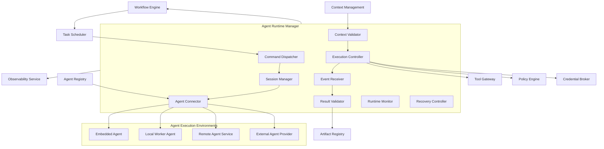
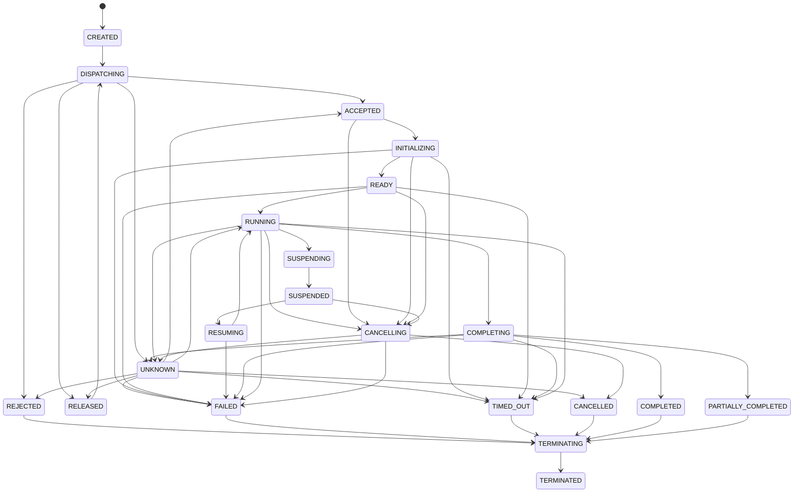

# Agent Runtime Manager — Software Requirements Specification (SRS)

| Field | Value |
|---|---|
| Document ID | AI-ENG-SRS-ARM-001 |
| Document Title | Agent Runtime Manager — Software Requirements Specification |
| Version | 1.0.0 |
| Status | Baseline |
| Document Type | Software Requirements Specification |
| Language | English |
| Parent Document | AI Engineering Orchestration Platform — System Architecture Specification |
| Related Protocol | Agent Execution Protocol Specification (`AI-ENG-PROTO-001`) |
| Related Standard | Engineering Workflow & AI Agent Orchestration Standard (`ENG-WF-STD-001`) |
| System | AI Engineering Orchestration Platform |
| Subsystem | Agent Runtime Manager |

---

# 1. Introduction

## 1.1 Purpose

This document specifies the software requirements for the Agent Runtime Manager (ARM), a core subsystem of the AI Engineering Orchestration Platform.

The Agent Runtime Manager is responsible for managing the execution of AI Agents within the platform.

It provides the runtime control capabilities required to:

- Connect and communicate with Agents.
- Receive and process execution commands.
- Establish and manage execution sessions.
- Deliver execution context.
- Control Agent execution lifecycles.
- Receive execution events and progress updates.
- Manage tool invocation authorization workflows through the designated platform interfaces.
- Receive and validate execution results.
- Coordinate artifact submission.
- Monitor execution health.
- Handle execution interruptions, failures, timeouts, and recovery.
- Maintain execution records and provenance.

The purpose of this SRS is to define verifiable software requirements for implementing the Agent Runtime Manager.

## 1.2 Scope

The Agent Runtime Manager operates between the Workflow Orchestration subsystem and Agent execution environments.

It provides a unified runtime abstraction across different Agent deployment models.

Supported Agent execution models include:

1. Embedded Agent
2. Local Worker Agent
3. Remote Agent Service
4. External Agent Provider

The Agent Runtime Manager shall provide consistent execution lifecycle management regardless of the underlying Agent deployment model.

The subsystem shall not assume that every Agent runs as a local process or as an independently deployed network service.

## 1.3 System Context

The Agent Runtime Manager interacts with the following platform subsystems:

| Subsystem | Responsibility | ARM Interaction |
|---|---|---|
| Workflow Engine | Workflow execution and progression | Receives execution requests and reports execution outcomes |
| Task Scheduler | Task scheduling and Agent selection | Receives assigned tasks and selected Agent identities |
| Agent Registry | Agent identity, capabilities, and endpoint registration | Resolves Agent registration and connection information |
| Context Management | Context assembly and delivery | Retrieves execution context packages |
| Policy Engine | Policy evaluation and authorization decisions | Requests authorization decisions where required |
| Tool Gateway | Controlled execution of external tools | Coordinates Agent tool invocation requests |
| Artifact Registry | Artifact registration and version management | Submits artifact references and validates registration results |
| Review and Approval | Engineering output review and approval | Provides execution artifacts for subsequent review |
| Credential Broker | Credential provisioning and lifecycle management | Requests execution-scoped credentials |
| Observability Service | Logging, metrics, and tracing | Publishes runtime telemetry and execution events |

The Agent Runtime Manager is responsible for execution control, not engineering workflow governance.

## 1.4 Normative Language

The keywords MUST, MUST NOT, REQUIRED, SHALL, SHALL NOT, SHOULD, SHOULD NOT, and MAY are used as normative requirement terms.

- MUST / SHALL: Mandatory requirement.
- SHOULD: Recommended requirement.
- MAY: Optional capability.

Each mandatory requirement shall be independently testable or verifiable.

## 1.5 Definitions and Terminology

| Term | Definition |
|---|---|
| Agent | An autonomous or semi-autonomous execution entity capable of performing assigned tasks |
| Agent Runtime | The execution environment in which an Agent operates |
| Agent Endpoint | A logical communication endpoint exposed by an Agent or its execution adapter |
| Agent Connector | A component responsible for establishing communication with an Agent |
| Execution | A single attempt to execute an assigned task |
| Execution Session | A managed runtime session associated with an execution |
| Execution ID | A globally unique identifier for one Agent execution attempt. The cross-service name is `agent_execution_id`. |
| Session ID | A globally unique identifier for the communication session of that attempt. It is not the execution identifier. |
| Runtime Instance | A running process of the Agent Runtime Manager, identified by `arm_instance_id` |
| Worker | The process or container hosting an Agent for one execution, identified by `worker_id` |
| Agent Endpoint | The protocol endpoint of an Agent, identified by `agent_endpoint_id` |
| Context Package | A versioned collection of information supplied to an Agent for execution |
| Execution Event | An event describing an execution lifecycle transition or runtime activity |
| Execution Result | A structured report describing the outcome of an execution |
| Artifact Reference | A reference to an artifact managed by the Artifact Registry |
| Tool Invocation | A request to execute an external tool through the platform Tool Gateway |
| Recovery | The process of restoring execution management after an interruption or failure |
| Idempotency Key | A key used to identify logically identical operations and prevent duplicate effects |

---

# 2. Overall Description

## 2.1 Product Perspective

The Agent Runtime Manager is a platform-level execution management subsystem.

It implements the runtime management responsibilities defined by the platform architecture and the Agent Execution Protocol.

Its logical position is:



The diagram describes logical responsibilities and interactions, not mandatory deployment topology.

## 2.2 Design Principles

The implementation shall follow these principles.

### 2.2.1 Protocol-First Design

All Agent communication shall conform to the Agent Execution Protocol.

The Agent Runtime Manager shall not introduce incompatible execution semantics for individual Agent deployment models.

### 2.2.2 Runtime Abstraction

The subsystem shall abstract differences between local, embedded, remote, and externally hosted Agents.

### 2.2.3 Platform-Controlled Execution

Agents perform assigned engineering work.

The platform retains control over:

- Execution authorization.
- Session lifecycle.
- Runtime state.
- Tool access.
- Execution termination.
- Result acceptance.
- Provenance recording.

### 2.2.4 Execution Isolation

Each execution shall have an isolated logical execution context.

Execution-specific credentials, context, tool permissions, and outputs shall not be implicitly shared across unrelated executions.

### 2.2.5 Recoverability

The subsystem shall maintain sufficient execution state to recover management operations after process failures, network interruptions, and temporary Agent unavailability.

Recovery shall not automatically imply that the underlying Agent computation can be resumed from the exact previous instruction.

### 2.2.6 Traceability

Every execution shall be traceable to its originating project, workflow, task, Agent, execution session, context package, and resulting artifacts.

## 2.3 Deployment Models

The Agent Runtime Manager shall support the following logical Agent deployment models.

| Deployment Model | Description | Runtime Responsibility |
|---|---|---|
| Embedded Agent | Agent executes within the host application or runtime process | Invoke and manage the embedded Agent adapter |
| Local Worker Agent | Agent executes as a local worker process or container | Provision, start, monitor, and terminate the worker through its adapter |
| Remote Agent Service | Agent executes through a remote service endpoint | Establish and maintain protocol communication |
| External Agent Provider | Agent execution is provided by an external platform | Communicate through a provider-specific protocol adapter |

The Runtime Manager shall use a common execution abstraction while allowing deployment-specific adapters.

## 2.4 User Classes and External Actors

| Actor | Description |
|---|---|
| Workflow Engine | Initiates and tracks engineering workflow execution |
| Task Scheduler | Assigns a task to an eligible Agent |
| Agent | Performs the assigned execution |
| Platform Administrator | Configures and manages runtime infrastructure |
| Security Administrator | Configures runtime security and execution permissions |
| Monitoring System | Consumes runtime health and telemetry |
| Review Authority | Reviews submitted engineering results |

## 2.5 Operating Environment

The subsystem shall support execution in an environment capable of providing:

- Persistent storage.
- Network communication.
- Secure credential access.
- Configurable runtime resource limits.
- Centralized logging and metrics.
- Agent adapter execution.
- Distributed deployment where required.

The implementation shall not require all Agent execution environments to share the same host, network, or process.

---

# 3. Functional Architecture

## 3.1 Logical Components

The Agent Runtime Manager shall consist of the following logical components.

| Component | Primary Responsibility |
|---|---|
| Agent Connector | Establishes and manages Agent communication |
| Protocol Adapter | Translates transport-specific communication into protocol-level messages |
| Command Dispatcher | Receives and dispatches execution commands |
| Session Manager | Creates, tracks, and terminates execution sessions |
| Execution Controller | Controls execution lifecycle and state transitions |
| Context Manager Adapter | Retrieves and validates execution context |
| Event Receiver | Receives Agent events, progress reports, and lifecycle updates |
| Tool Access Coordinator | Coordinates execution-scoped tool authorization and Tool Gateway communication |
| Credential Coordinator | Obtains and manages execution-scoped credentials |
| Result Validator | Validates execution completion and result contracts |
| Artifact Submission Coordinator | Coordinates artifact submission to the Artifact Registry |
| Runtime Monitor | Monitors Agent and execution health |
| Recovery Controller | Handles interrupted and failed execution management |
| Persistence Manager | Stores runtime state and execution records |
| Telemetry Publisher | Publishes logs, metrics, traces, and audit events |

These are logical components. The implementation MAY deploy multiple components within one process or distribute them across multiple services, provided the specified interfaces and responsibilities remain intact.

## 3.2 Component Responsibility Boundaries

The Agent Runtime Manager MUST NOT assume responsibilities assigned to other platform subsystems.

| Responsibility | Responsible Subsystem |
|---|---|
| Determine the next workflow task | Workflow Engine |
| Select the appropriate Agent for a task | Task Scheduler |
| Maintain Agent capability definitions | Agent Registry |
| Assemble authoritative engineering context | Context Management |
| Control execution sessions | Agent Runtime Manager |
| Execute Agent reasoning and task logic | Agent |
| Evaluate authorization policies | Policy Engine |
| Execute external tools | Tool Gateway |
| Manage credential issuance | Credential Broker |
| Manage artifact identity and versioning | Artifact Registry |
| Review engineering outputs | Review and Approval |
| Approve engineering baselines | Authorized approver, recorded by Review and Approval |
| Determine workflow progression | Workflow Engine |

The Agent Runtime Manager MAY enforce decisions received from other subsystems but MUST NOT silently replace their authoritative decisions.

---

# 4. External Interface Requirements

## 4.1 General Interface Requirements

**ARM-IF-001**

The Agent Runtime Manager MUST expose a platform-facing interface for receiving execution commands.

**ARM-IF-002**

The Agent Runtime Manager MUST expose an interface for querying execution status.

**ARM-IF-003**

The Agent Runtime Manager MUST expose an interface for execution control operations, including cancellation and suspension where supported.

**ARM-IF-004**

The Agent Runtime Manager MUST support communication with Agent endpoints through protocol-compliant adapters.

**ARM-IF-005**

All external interfaces MUST use authenticated communication.

**ARM-IF-006**

All execution-related interfaces MUST carry sufficient correlation information to associate requests, responses, and events with the correct execution.

**ARM-IF-007**

The subsystem MUST validate incoming messages against the applicable protocol version and message schema.

## 4.2 Workflow Engine Interface

The Runtime Manager shall provide an interface for workflow execution coordination.

Supported operations:

| Operation | Description |
|---|---|
| Submit Execution | Submit a task execution request |
| Query Execution | Retrieve execution status |
| Cancel Execution | Request execution cancellation |
| Suspend Execution | Request execution suspension |
| Resume Execution | Request execution resumption |
| Retrieve Result | Retrieve an accepted execution result |

The interface MUST return an explicit dispatch acknowledgement. `status` is `accepted`, `rejected`, `unavailable`, `unconfirmed`, or `invalid`. Every acknowledgement that follows creation of the execution includes `agent_execution_id` and `session_id`. `invalid` is returned before an execution exists, omits those identifiers, and has no execution state. `unavailable` returns the same attempt to the scheduler queue and reuses those identifiers. `unconfirmed` means no Agent response was received and MUST be reconciled before another assignment is created for that attempt. Neither status creates a replacement `attempt_id`. `rejected` records an explicit Agent refusal, includes `agent_execution_id` and `session_id`, and is not an execution result.

## 4.3 Task Scheduler Interface

The Task Scheduler provides an assigned task and selected Agent identity.

The assignment shall contain, at minimum:

- Tenant ID.
- Project ID.
- Workflow definition ID.
- Workflow run ID.
- Phase ID.
- Task ID.
- Attempt ID and attempt number.
- Assignment ID.
- Assigned Agent ID.
- Task definition or reference.
- Required capabilities.
- Acceptance criteria.
- Context package ID.
- Output contract, carried as `output_contract`. The Runtime Manager copies it onto the execution command and MUST NOT invent a contract.
- Execution constraints, carried as `constraints`. The Runtime Manager copies them onto the execution command and MUST NOT invent constraints. Those copied constraints are the only execution constraints. The context package MUST NOT override them.
- Priority.
- Deadline, carried cross-service as `deadline`. Required on every assignment. The Runtime Manager copies it onto the execution command and MUST NOT invent it. `expires_at` is the assignment-offer expiration and is a different clock.
- Timeout budget, carried cross-service as `timeout_seconds`. It is the duration the Workflow Engine used to write `deadline`. The Runtime Manager copies it onto the execution command and MUST NOT invent a different budget or start a second clock from it. Expiry is evaluated only against `deadline`.
- Correlation ID.
- Idempotency key.

The first submission of an attempt MUST NOT include `agent_execution_id` or `session_id`. The Runtime Manager creates both when it accepts that submission. A later submission of the same `attempt_id` MUST include the existing `agent_execution_id` and `session_id`. The Runtime Manager matches that submission on `attempt_id` and MUST NOT allocate replacements because the `assignment_id` or `idempotency_key` is new. Redelivery of a `released` execution returns it to `dispatching`.

The Runtime Manager MUST validate that the assigned Agent is registered and eligible for the requested execution.

The Runtime Manager MUST NOT select a different Agent. A failed or unconfirmed dispatch is returned to the Task Scheduler.

## 4.4 Agent Registry Interface

The Runtime Manager shall retrieve Agent registration information, including:

- Agent ID.
- Agent version.
- Agent type.
- Deployment model.
- Endpoint information.
- Protocol versions.
- Supported capabilities.
- Authentication configuration.
- Availability information.
- Runtime constraints.

The Runtime Manager MUST reject execution assignments referencing unknown or invalid Agent registrations.

The Runtime Manager SHOULD cache registration information, subject to configurable expiration and invalidation rules.

## 4.5 Context Management Interface

The Runtime Manager shall request an execution context package using the identifiers and references provided by the execution command.

The context package shall include:

- `context_package_id`.
- `created_at`.
- `context_version`.
- Source artifact references, each with `artifact_id` and `version_id`.
- Applicable policy versions.

Acceptance criteria remain on the task. Execution constraints remain on `execution.command.constraints`. The package MUST NOT override those constraints.

The Runtime Manager MUST validate the context package identity and integrity before delivery.

The Runtime Manager MUST preserve the context package reference and version in the execution record.

## 4.6 Policy Engine Interface

The Runtime Manager shall request policy decisions for operations requiring platform authorization.

Examples include:

- Agent execution authorization.
- Access to protected resources.
- Sensitive artifact access.

Tool invocation authorization is requested by the Tool Gateway from the Policy Engine. The Runtime Manager forwards the unforgeable execution context and MUST NOT request or attach a new `authorization_decision_id` for that call. Provider credentials are resolved by the Tool Gateway for the adapter. The Runtime Manager MUST NOT request those credentials.

The Runtime Manager MUST NOT treat an Agent-generated statement of authorization as an authoritative policy decision.

## 4.7 Tool Gateway Interface

Agents MUST access platform-controlled external tools through the designated Tool Gateway when platform-managed tool execution is required.

The Runtime Manager shall support:

- Associating tool invocations with an execution.
- Forwarding the unforgeable execution context without a new `authorization_decision_id`.
- Tracking invocation identifiers.
- Receiving invocation results.
- Recording invocation outcomes.

The Tool Gateway remains responsible for actual tool execution.

The Runtime Manager MUST NOT directly bypass Tool Gateway controls for operations designated as platform-managed tools.

## 4.8 Credential Broker Interface

The Runtime Manager shall request credentials scoped to the execution and authorized operations.

The interface shall support:

- Credential acquisition.
- Credential renewal where supported.
- Credential expiration handling.
- Credential revocation.
- Credential access audit events.

The Runtime Manager MUST NOT persist plaintext secrets in ordinary execution records, logs, or telemetry.

## 4.9 Artifact Registry Interface

The Runtime Manager shall coordinate artifact submission and registration.

It shall support:

- Inline artifact payloads.
- Platform-managed upload references.
- Object storage references.
- Repository references.

The Runtime Manager MUST verify that submitted artifact references are successfully registered or otherwise accepted by the Artifact Registry before reporting them as registered artifacts.

The Artifact Registry remains authoritative for artifact identity, storage, and version management.

## 4.10 Agent Endpoint Interface

Agent communication shall conform to `AI-ENG-PROTO-001`.

The Runtime Manager shall support protocol operations covering:

- Agent registration resolution.
- Execution command delivery.
- Execution acceptance or rejection.
- Session initialization.
- Context delivery.
- Execution progress reporting.
- Tool invocation requests.
- Artifact submission.
- Execution completion.
- Execution failure.
- Execution cancellation.
- Execution suspension and resumption where supported.
- Heartbeat and health reporting.

The protocol adapter shall isolate transport-specific details from execution lifecycle management.

## 4.11 Transport Requirements

The subsystem SHOULD support the following transport bindings:

| Transport | Intended Usage |
|---|---|
| HTTP/REST | Request-response operations |
| Server-Sent Events | Server-to-client event delivery |
| WebSocket | Bidirectional communication |
| Message Queue | Asynchronous distributed execution |
| Local IPC | Local worker communication |
| In-process Adapter | Embedded Agent communication |

The supported transport set MAY vary by deployment profile.

Transport selection MUST NOT alter the normative execution semantics.

---

# 5. Functional Requirements

## 5.1 Agent Connection Management

### 5.1.1 Agent Resolution

**ARM-FR-001**

The Runtime Manager MUST resolve an assigned Agent ID through the Agent Registry or an authoritative registration cache.

**ARM-FR-002**

The Runtime Manager MUST verify the Agent registration status before initiating an execution.

**ARM-FR-003**

The Runtime Manager MUST verify that the Agent supports the required protocol version.

**ARM-FR-004**

The Runtime Manager MUST verify that the Agent supports the capabilities required by the assigned task.

**ARM-FR-005**

The Runtime Manager MUST verify that the selected deployment adapter supports the Agent's deployment model.

### 5.1.2 Connection Establishment

**ARM-FR-006**

The Runtime Manager MUST establish an authenticated communication channel with the selected Agent endpoint.

**ARM-FR-007**

The Runtime Manager MUST support configurable connection timeouts.

**ARM-FR-008**

The Runtime Manager MUST distinguish connection failures from Agent execution failures.

**ARM-FR-009**

The Runtime Manager MUST maintain connection metadata for active execution sessions.

**ARM-FR-010**

The Runtime Manager SHOULD support connection pooling where applicable.

### 5.1.3 Connection Health

**ARM-FR-011**

The Runtime Manager MUST monitor the health of active Agent connections.

**ARM-FR-012**

The Runtime Manager MUST detect connection loss using transport errors, heartbeat expiration, or equivalent health signals. Heartbeat expiration on an established session follows section 5.4.3. It is not by itself `CONNECTION_FAILURE`.

**ARM-FR-013**

The Runtime Manager MUST associate connection health events with the affected execution sessions.

**ARM-FR-014**

The Runtime Manager MUST NOT automatically interpret a lost connection as proof that the Agent execution has stopped. `CONNECTION_FAILURE` applies only when the endpoint cannot be reached before an execution heartbeat policy applies. An in-session heartbeat miss MUST NOT use category `runtime`. Heartbeat timeout from `INITIALIZING` or `READY` enters `TIMED_OUT` with category `timeout`. Heartbeat loss from `RUNNING` or `COMPLETING` before `deadline` stays `unknown` and emits no error category. Reaching `deadline` while the execution is still in `RUNNING` or `COMPLETING` enters `TIMED_OUT` whether or not a heartbeat is still arriving.

## 5.2 Execution Command Dispatch

### 5.2.1 Command Reception

**ARM-FR-015**

The Runtime Manager MUST receive execution commands from authorized platform components.

**ARM-FR-016**

The Runtime Manager MUST validate the structure and mandatory fields of each execution command.

**ARM-FR-017**

The Runtime Manager MUST validate the command's project, workflow, task, Agent, and execution identifiers.

**ARM-FR-018**

The Runtime Manager MUST reject commands with invalid or inconsistent identifiers.

**ARM-FR-019**

The Runtime Manager MUST validate execution constraints and output contracts before dispatch.

### 5.2.2 Dispatch

**ARM-FR-020**

The Runtime Manager MUST create an execution record before dispatching the execution command.

**ARM-FR-021**

The Runtime Manager MUST associate each execution attempt with a unique Execution ID.

**ARM-FR-022**

The Runtime Manager MUST deliver the execution command through the appropriate Agent Connector.

**ARM-FR-023**

The Runtime Manager MUST record the dispatch timestamp and dispatch outcome.

**ARM-FR-024**

The Runtime Manager MUST process Agent acceptance and rejection responses.

**ARM-FR-025**

The Runtime Manager MUST distinguish an explicit Agent rejection from an uncertain dispatch outcome.

**ARM-FR-026**

The Runtime Manager MUST support dispatch idempotency using an idempotency key or equivalent protocol mechanism.

**ARM-FR-027**

The Runtime Manager MUST NOT create duplicate logical executions when the same dispatch request is retried with the same idempotency identity. A new idempotency key for the same `attempt_id` MUST NOT create another execution or session. Idempotency deduplicates retries of one dispatch request. Reuse of a `released` or `unknown` attempt is keyed by `attempt_id`.

### 5.2.3 Dispatch Response

The Runtime Manager reports one of the following dispatch statuses to the Task Scheduler. The wire values are lowercase.

| status | Description |
|---|---|
| accepted | Agent accepted the execution command |
| rejected | Agent explicitly rejected the command. The acknowledgement includes `agent_execution_id` and `session_id` |
| unavailable | Agent cannot currently accept the command. The same attempt returns to the scheduler queue |
| unconfirmed | No Agent response was received, or the response cannot be confirmed |
| invalid | The Runtime Manager rejected the assignment before creating an execution. The acknowledgement omits `agent_execution_id` and `session_id` and has no execution state |

`unconfirmed` MUST NOT be treated as `rejected`. The Runtime Manager creates `agent_execution_id` and `session_id` before sending the command. `unavailable` moves that execution to `released`. `unconfirmed` moves it to `unknown`. `rejected` moves it to `rejected`. `released` and `unknown` reuse those identifiers and MUST NOT create a replacement `attempt_id`, `agent_execution_id`, or `session_id`. A later submission of an attempt in `released` or `unknown` carries those identifiers and is matched by `attempt_id`. A new `assignment_id` or `idempotency_key` MUST NOT create replacements. Redelivery moves `released` to `dispatching`. `invalid` is not an execution state. `rejected` and `released` are not execution results.

## 5.3 Execution Session Management

### 5.3.1 Session Creation

**ARM-FR-028**

The Runtime Manager MUST create a unique Execution Session for each execution attempt.

**ARM-FR-029**

The Runtime Manager MUST associate the session with the following identifiers:

- Project ID.
- Workflow Run ID.
- Task ID.
- Execution ID.
- Agent ID.
- Runtime ID.
- Session ID.
- Correlation ID.
- Parent Execution ID, where applicable.

**ARM-FR-030**

The Runtime Manager MUST persist the session metadata before transitioning the execution into an active state.

**ARM-FR-031**

The Runtime Manager MUST enforce session ownership and execution isolation.

### 5.3.2 Session Lifecycle

**ARM-FR-032**

The Runtime Manager MUST manage the lifecycle of each execution session.

**ARM-FR-033**

The Runtime Manager MUST validate lifecycle transitions against the protocol-defined state model.

**ARM-FR-034**

The Runtime Manager MUST reject invalid state transitions.

**ARM-FR-035**

The Runtime Manager MUST persist state transitions and their timestamps.

**ARM-FR-036**

The Runtime Manager MUST maintain the distinction between execution state and engineering approval state.

### 5.3.3 Session Termination

**ARM-FR-037**

The Runtime Manager MUST release session-scoped runtime resources after terminal execution outcomes.

**ARM-FR-038**

The Runtime Manager MUST revoke or expire execution-scoped credentials when their authorized lifetime ends.

**ARM-FR-039**

The Runtime Manager MUST preserve execution history after session termination.

**ARM-FR-040**

The Runtime Manager MUST support cleanup of abandoned sessions according to configurable retention and recovery policies.

## 5.4 Execution Lifecycle Control

### 5.4.1 State Model

The Runtime Manager shall implement the execution states below. These states and their transitions are the same state machine required by the Agent Execution Protocol. `UNKNOWN` is a reconciliation condition, not an execution outcome.

The uppercase names in this section are logical names. On the wire, `execution_state` uses the lowercase `ExecutionStatus` values defined by the Agent Execution Protocol. The two sets name the same states.

| State | Description |
|---|---|
| CREATED | Execution record has been created |
| DISPATCHING | Execution command is being delivered |
| REJECTED | Agent refused the command. This is not an execution result |
| RELEASED | Agent cannot accept the command now. The same attempt, execution, and session return to the scheduler queue. This is not an execution result |
| ACCEPTED | Agent has accepted the command |
| INITIALIZING | Agent is preparing the execution environment |
| READY | Agent is ready to begin execution |
| RUNNING | Agent is actively executing |
| SUSPENDING | Suspension has been requested |
| SUSPENDED | Execution has been confirmed suspended |
| RESUMING | Resumption has been requested |
| COMPLETING | Agent has reported that execution is completing |
| COMPLETED | Execution completed successfully and its result was accepted by the Runtime Manager |
| PARTIALLY_COMPLETED | Execution produced a valid partial outcome but did not satisfy the full completion contract |
| FAILED | Execution failed |
| TIMED_OUT | A timeout clock for the current state expired. Reaching `deadline` while still in `RUNNING` or `COMPLETING` is this state whether or not a heartbeat is still arriving |
| CANCELLING | Cancellation has been requested |
| CANCELLED | Execution cancellation has been confirmed |
| TERMINATING | Runtime termination is in progress |
| TERMINATED | Runtime termination has been confirmed |
| UNKNOWN | Execution outcome cannot currently be determined. The record states whether it began during dispatch or after acceptance, and that origin selects the legal exit |

`UNKNOWN` represents an uncertain observation or reconciliation condition. It is not evidence that the Agent has stopped.

### 5.4.2 State Transition Requirements

**ARM-FR-041**

The Runtime Manager MUST implement an explicit state transition mechanism.

**ARM-FR-042**

The Runtime Manager MUST validate every state transition.

**ARM-FR-043**

The Runtime Manager MUST record the actor, timestamp, previous state, new state, and transition reason.

**ARM-FR-044**

The Runtime Manager MUST support asynchronous state updates.

**ARM-FR-045**

The Runtime Manager MUST tolerate duplicate delivery of an already processed lifecycle event.

**ARM-FR-046**

The Runtime Manager MUST reject or quarantine conflicting state updates that cannot be reconciled.

**ARM-FR-047**

The Runtime Manager MUST ensure that terminal execution states are not silently overwritten by late events.

**ARM-FR-048**

The Runtime Manager MUST support execution status reconciliation after communication interruption.

### 5.4.3 Lifecycle Transition Model



The state model is a logical model. Implementations may introduce additional internal states, provided externally observable states remain protocol-compatible.

`UNKNOWN` means the outcome is not yet reconciled. The Runtime Manager records whether it began during dispatch or after the execution was accepted. That origin selects the legal exit. The diagram lists every exit; an exit that does not match the origin is illegal.

A dispatch-origin `UNKNOWN` MAY move to `ACCEPTED`, `RUNNING`, or `FAILED` when reconciliation shows that outcome. A transition to `FAILED` requires evidence that the execution was accepted. An unconfirmed dispatch that was never accepted reconciles to `REJECTED` or `RELEASED`, or remains `UNKNOWN`. It MUST NOT enter `FAILED`, `CANCELLED`, or `TIMED_OUT`.

A post-acceptance `UNKNOWN` MAY move to `RUNNING`, `FAILED`, `CANCELLED`, or `TIMED_OUT` when reconciliation shows that outcome. It MUST NOT enter `REJECTED` or `RELEASED`. `UNKNOWN` MUST NOT transition directly to `TERMINATED`.

`INITIALIZING` or `READY` enters `FAILED` when initialization fails and publishes `execution.agent.failed` once, and enters `TIMED_OUT` when the initialization timeout or a heartbeat timeout expires. Entering `FAILED` publishes that event once whether or not an `execution.result` exists. Heartbeat loss from `RUNNING` or `COMPLETING` before `deadline` enters post-acceptance `UNKNOWN`. Reaching `deadline` while the execution is still in `RUNNING` or `COMPLETING` enters `TIMED_OUT` whether or not a heartbeat is still arriving, and publishes `execution.agent.timed_out` once. A result-submission timeout enters `TIMED_OUT` from `COMPLETING`. It is not `FAILED`. A resume that cannot be completed safely transitions `RESUMING` to `FAILED`, publishes `execution.agent.failed` once, and then enters `TERMINATING`. That transition MUST NOT return to `RUNNING`.

`REJECTED` and `RELEASED` are not execution results and MUST NOT be published as `execution.agent.failed`. `CANCELLED` publishes `execution.agent.cancelled` once. `TIMED_OUT` publishes `execution.agent.timed_out` once. `RELEASED` reuses the existing `attempt_id`, `agent_execution_id`, and `session_id` when the same attempt is dispatched again. That redelivery carries those identifiers and is matched on `attempt_id`. A new `assignment_id` or `idempotency_key` MUST NOT allocate replacements. Redelivery moves `RELEASED` back to `DISPATCHING`. A dispatch-origin `UNKNOWN` reuses those identifiers until reconciliation completes. Selecting a different Agent requires a new `attempt_id` authorized by the Workflow Engine.

An accepted execution MUST NOT enter `TERMINATING` from `RUNNING`. It enters `TERMINATING` only from `FAILED`, `TIMED_OUT`, `CANCELLED`, `COMPLETED`, or `PARTIALLY_COMPLETED`. A forced stop after a non-recoverable failure records `FAILED` and publishes `execution.agent.failed` once before cleanup. `CANCELLED` is used only after a confirmed cancellation request. A transition to `TERMINATED` describes runtime cleanup and termination confirmation. It passes through `TERMINATING` and does not erase the preceding execution outcome. `REJECTED` MAY enter `TERMINATING` because refusal is not a task result.

The Runtime Manager MUST retain the final execution outcome separately from runtime cleanup status.

## 5.5 Context Delivery

**ARM-FR-049**

The Runtime Manager MUST retrieve the context package associated with an execution command.

**ARM-FR-050**

The Runtime Manager MUST validate the context package identity and version.

**ARM-FR-051**

The Runtime Manager MUST verify that all mandatory context references are resolvable.

**ARM-FR-052**

The Runtime Manager MUST deliver the validated context package to the assigned Agent.

**ARM-FR-053**

The Runtime Manager MUST record the context package ID and version associated with the execution.

**ARM-FR-054**

The Runtime Manager MUST prevent unauthorized cross-execution context access.

**ARM-FR-055**

The Runtime Manager SHOULD support context package size limits and configurable delivery timeouts.

**ARM-FR-056**

The Runtime Manager SHOULD support context delivery by reference when the Agent environment can securely retrieve the referenced data.

The Runtime Manager is responsible for context delivery and validation. Context Management remains responsible for authoritative context assembly.

## 5.6 Execution Event Reception

### 5.6.1 Event Types

The Runtime Manager shall support the reception of the following event categories:

| Event Category | Examples |
|---|---|
| Lifecycle | Accepted, started, completed, failed |
| Progress | Progress update, current step |
| Health | Heartbeat, degraded, unavailable |
| Tool | Tool invocation requested, tool result received |
| Artifact | Artifact submitted, artifact upload completed |
| Control | Suspension acknowledged, cancellation acknowledged |
| Error | Execution error, protocol error, runtime error |

### 5.6.2 Event Processing

**ARM-FR-057**

The Runtime Manager MUST authenticate the source of each incoming event.

**ARM-FR-058**

The Runtime Manager MUST validate the event schema.

**ARM-FR-059**

The Runtime Manager MUST verify that the referenced execution and session exist.

**ARM-FR-060**

The Runtime Manager MUST verify that the event is associated with the expected Agent identity.

**ARM-FR-061**

The Runtime Manager MUST support event deduplication.

**ARM-FR-062**

The Runtime Manager MUST preserve event ordering information when provided by the protocol.

**ARM-FR-063**

The Runtime Manager MUST detect and handle out-of-order events.

**ARM-FR-064**

The Runtime Manager MUST persist critical lifecycle events before acknowledging successful processing.

**ARM-FR-065**

The Runtime Manager MUST publish accepted execution events to the relevant platform event interface.

### 5.6.3 Event Reliability

The Runtime Manager SHOULD support at-least-once event delivery between distributed components.

Where at-least-once delivery is used, event processing MUST be idempotent.

The subsystem MUST NOT assume exactly-once delivery across independent network services.

## 5.7 Tool Access Coordination

**ARM-FR-066**

The Runtime Manager MUST associate each Agent tool invocation request with an active execution session.

**ARM-FR-067**

The Runtime Manager MUST verify that the invocation is bound to an active execution and that the requested `tool.name` is present in that execution's `constraints.allowed_tools`. `tool.name` is the registry `tool_name`. This check is not an authorization decision. An empty `allowed_tools` array rejects every `tool.request`. `required_capabilities` MUST NOT be used as this list.

**ARM-FR-068**

The Runtime Manager MUST forward the unforgeable execution context to the Tool Gateway with the invocation. It MUST NOT present that context, or any Agent statement, as an authorization decision.

**ARM-FR-069**

The Runtime Manager MUST translate an accepted AEP `tool.request` into the Tool Gateway invocation and submit that invocation itself. The Agent MUST NOT be given a direct route to the Tool Gateway. Tool discovery is also called by the Runtime Manager. The Agent receives only the filtered tool list included in the execution command.

**ARM-FR-070**

The Runtime Manager MUST assign a new `invocation_id` to each accepted `tool.request` and MUST record the `tool_execution_id` returned by the Tool Gateway. A Gateway retry keeps both identifiers. The Runtime Manager forwards the Agent's `idempotency_key` unchanged and MUST NOT derive one from `invocation_id`.

**ARM-FR-071**

The Runtime Manager MUST record the tool invocation outcome.

**ARM-FR-072**

The Runtime Manager MUST prevent tool invocation results from being attributed to a different execution session.

**ARM-FR-073**

The Runtime Manager MUST handle tool invocation timeouts and failures without incorrectly marking the entire execution as completed.

**ARM-FR-074**

The Runtime Manager MUST NOT independently authorize operations that require an authoritative Policy Engine decision.

## 5.8 Credential Coordination

**ARM-FR-075**

The Runtime Manager MUST request execution-scoped credential references through the Credential Broker when execution requires platform-managed credentials. It MAY hold those references. It MUST NOT request or store provider credential secrets or tool credential secrets of any lifetime. Those secrets are resolved by the Tool Gateway for the adapter after authorization.

**ARM-FR-076**

Credential requests MUST be scoped to the relevant execution and authorized resource.

**ARM-FR-077**

The Runtime Manager MUST NOT deliver provider credentials or tool credentials to an Agent process. Those credentials are injected only into the tool adapter by the Tool Gateway. The Agent's own platform credential remains scoped to the execution.

**ARM-FR-078**

The Runtime Manager MUST support credential expiration and revocation handling.

**ARM-FR-079**

The Runtime Manager MUST prevent plaintext credential values from being written to ordinary logs or execution records.

**ARM-FR-080**

The Runtime Manager SHOULD minimize the duration and scope of credential availability.

## 5.9 Artifact Submission Coordination

### 5.9.1 Artifact Reception

**ARM-FR-081**

The Runtime Manager MUST accept artifact submission events from authenticated Agent sessions.

**ARM-FR-082**

The Runtime Manager MUST validate artifact metadata against the execution output contract.

**ARM-FR-083**

The Runtime Manager MUST associate each submitted artifact with its originating execution.

**ARM-FR-084**

The Runtime Manager MUST support the artifact submission methods defined in the Agent Execution Protocol.

**ARM-FR-085**

The Runtime Manager MUST reject artifact submissions from unauthorized or unrelated sessions.

### 5.9.2 Artifact Registration

**ARM-FR-086**

The Runtime Manager MUST coordinate artifact registration with the Artifact Registry. When `artifact.submit` names an `artifact_id` and `version_id` already registered by the Tool Gateway, the Runtime Manager records that reference and MUST NOT create another artifact or version. When `artifact.submit` omits `artifact_id` for an output no tool wrote, the Runtime Manager creates the artifact before creating the version. The create request uses `tenant_id` from the execution record, plus `name`, `type`, and `format`. `owner` is `{ "type": "agent", "id": "<agent_id>" }` using the executing `agent_id`. The first version omits `expected_parent_version_id`. A later submission for the same artifact includes `artifact_id` and sets `expected_parent_version_id` to the current version. The Runtime Manager MUST NOT open a branch. `type` is stored on the artifact, not on the version. The Runtime Manager assigns `submission_id` when it accepts `artifact.submit`. A retry of that registration sends the same `submission_id`. A version conflict is not retried.

**ARM-FR-087**

The Runtime Manager MUST retain the Artifact Registry response and registered artifact references.

**ARM-FR-088**

The Runtime Manager MUST distinguish an artifact submission request from successful artifact registration.

**ARM-FR-089**

The Runtime Manager MUST validate that mandatory output artifacts are available before accepting a successful execution result.

**ARM-FR-090**

The Runtime Manager MUST preserve artifact provenance.

The Artifact Registry remains responsible for artifact storage, identity, versioning, and authoritative metadata.

## 5.10 Execution Result Validation

### 5.10.1 Result Reception

**ARM-FR-091**

The Runtime Manager MUST accept execution results only from the Agent or execution adapter associated with the relevant session.

**ARM-FR-092**

The Runtime Manager MUST validate execution result structure and protocol version.

**ARM-FR-093**

The Runtime Manager MUST verify that the result's `agent_execution_id` matches the session the Runtime Manager already owns. The Agent does not send `session_id` on `execution.result`. The Runtime Manager binds the stored result to that session.

**ARM-FR-094**

The Runtime Manager MUST validate the reported outcome against the current execution state.

### 5.10.2 Result Contract Validation

**ARM-FR-095**

The Runtime Manager MUST validate that all mandatory result fields are present.

**ARM-FR-096**

The Runtime Manager MUST validate that required artifacts have been submitted and registered.

**ARM-FR-097**

The Runtime Manager MUST validate that required evidence references are resolvable where evidence is mandatory.

**ARM-FR-098**

The Runtime Manager MUST validate reported warnings and errors.

**ARM-FR-099**

The Runtime Manager MUST distinguish successful completion from partial completion.

**ARM-FR-100**

The Runtime Manager MUST distinguish an execution result that is structurally valid from an engineering result that has been approved.

### 5.10.3 Result Acceptance

**ARM-FR-101**

The Runtime Manager MUST explicitly accept or reject a submitted execution result.

**ARM-FR-102**

The Runtime Manager MUST persist an accepted execution result before acknowledging successful acceptance.

**ARM-FR-103**

The Runtime Manager MUST return a result acceptance acknowledgment to the Agent.

**ARM-FR-104**

The Runtime Manager MUST report the accepted execution outcome to the Workflow Engine.

**ARM-FR-105**

The Runtime Manager MUST NOT mark an execution as successfully completed if mandatory result validation fails. It MUST NOT rewrite the Agent-reported `status`. A reported `completed` result is accepted only after every mandatory artifact is registered. Otherwise the Runtime Manager returns `execution.result.rejected` with `category` `artifact` and leaves the execution in `COMPLETING`. A reported `partially_completed` result is accepted only when the output contract allows a partial result and every artifact referenced by that result is registered. Missing mandatory artifacts MUST NOT be rewritten as `failed` or `partially_completed`. The Runtime Manager MUST NOT publish a terminal execution event for that rejection and MUST NOT create a new `attempt_id`. The same execution remains in `COMPLETING` so the Agent can submit the missing artifact.

**ARM-FR-106**

The Runtime Manager MUST NOT treat execution completion as engineering approval.

**ARM-FR-107**

The Runtime Manager MUST NOT independently approve engineering artifacts or establish engineering baselines.

## 5.11 Execution Control

### 5.11.1 Cancellation

**ARM-FR-108**

The Runtime Manager MUST support execution cancellation requests from authorized platform components.

**ARM-FR-109**

The Runtime Manager MUST validate cancellation requests against the current execution state.

**ARM-FR-110**

The Runtime Manager MUST forward valid cancellation requests to the assigned Agent or deployment adapter.

**ARM-FR-111**

The Runtime Manager MUST distinguish a cancellation request from confirmed cancellation.

**ARM-FR-112**

The Runtime Manager MUST record the cancellation request and confirmation timestamps.

**ARM-FR-113**

The Runtime Manager MUST support cancellation timeout handling.

**ARM-FR-114**

The Runtime Manager MUST NOT report `CANCELLED` solely because a cancellation request was sent.

### 5.11.2 Suspension and Resumption

**ARM-FR-115**

The Runtime Manager MUST support suspension requests for Agents and execution environments that declare suspension capability.

**ARM-FR-116**

The Runtime Manager MUST report whether suspension is supported by the selected Agent deployment model.

**ARM-FR-117**

The Runtime Manager MUST distinguish suspension requested from suspension confirmed.

**ARM-FR-118**

The Runtime Manager MUST support resumption requests for confirmed suspended executions where the Agent supports resumption.

**ARM-FR-119**

The Runtime Manager MUST validate that the session and required execution state remain available before resumption.

**ARM-FR-120**

The Runtime Manager MUST NOT claim that an execution can resume from its exact previous computation position unless the underlying Agent runtime provides that guarantee.

Confirmed suspension arrives as `execution.suspended` and is published as `execution.agent.suspended`. Confirmed resumption arrives as `execution.resumed` and is published as `execution.agent.resumed`. Neither event changes the task result. If the execution cannot be resumed, the Runtime Manager takes `RESUMING` to `FAILED`, publishes `execution.agent.failed` once, and then enters `TERMINATING`. It does not return to `RUNNING`, does not record that failure as `CANCELLED`, and does not create a new `attempt_id`.

### 5.11.3 Termination

**ARM-FR-121**

The Runtime Manager MUST support explicit termination of managed Agent runtime resources.

**ARM-FR-122**

For Local Worker Agents, the Runtime Manager MUST invoke the deployment adapter to terminate the managed worker process or container.

**ARM-FR-123**

For remote and external Agents, the Runtime Manager MUST use the supported termination mechanism, if one is provided.

**ARM-FR-124**

The Runtime Manager MUST distinguish termination requested from termination confirmed.

**ARM-FR-125**

The Runtime Manager MUST preserve the execution outcome when performing runtime cleanup. An accepted execution MUST be in `FAILED`, `TIMED_OUT`, `CANCELLED`, `COMPLETED`, or `PARTIALLY_COMPLETED` before it enters `TERMINATING`.

## 5.12 Runtime Monitoring

**ARM-FR-126**

The Runtime Manager MUST monitor active execution sessions.

**ARM-FR-127**

The Runtime Manager MUST track execution start time, elapsed time, last activity time, and applicable deadlines.

**ARM-FR-128**

The Runtime Manager MUST detect execution heartbeat expiration.

**ARM-FR-129**

The Runtime Manager MUST detect execution timeouts.

**ARM-FR-130**

The Runtime Manager MUST distinguish Agent unavailability from execution failure.

**ARM-FR-131**

The Runtime Manager MUST expose execution health and status information to authorized platform components.

**ARM-FR-132**

The Runtime Manager SHOULD support configurable warning thresholds for long-running executions.

**ARM-FR-133**

The Runtime Manager SHOULD support configurable concurrency and resource monitoring for locally managed workers.

## 5.13 Failure Handling and Recovery

### 5.13.1 Failure Classification

The Runtime Manager MUST classify failures into distinguishable local classes.

These local classes are not values of `error.category`. A cross-service error uses the platform category in the mapping column. A cell of `not emitted` is not a platform category. `error.code` uses the `ARM_` prefix.

| Local class | Platform category | Description |
|---|---|---|
| CONNECTION_FAILURE | runtime | Agent endpoint cannot be reached before an execution heartbeat policy applies. An in-session heartbeat miss follows section 5.4.3 and MUST NOT use this class |
| AUTHENTICATION_FAILURE | authentication | Agent authentication failed |
| AUTHORIZATION_FAILURE | authorization | Execution or operation is not authorized |
| PROTOCOL_FAILURE | protocol | Invalid or incompatible protocol message |
| DISPATCH_FAILURE | dispatch | Execution command could not be dispatched |
| CONTEXT_FAILURE | context | Execution context could not be retrieved or delivered |
| AGENT_FAILURE | execution | The execution environment failed while the Agent was running |
| TOOL_STATE | tool | Tool definition or tool state error. Not automatically retried |
| TOOL_FAILURE | provider | Tool invocation failed and the message was valid |
| ARTIFACT_FAILURE | artifact | Artifact submission or registration failed |
| RESULT_VALIDATION_FAILURE | artifact | Mandatory artifacts are missing or the result does not satisfy the output contract |
| RESOURCE_EXHAUSTION | resource | Runtime resource constraints were exceeded |
| EXECUTION_TIMEOUT | timeout | `deadline` was reached while the execution was still in `RUNNING` or `COMPLETING`, whether or not a heartbeat was still arriving, or initialization timeout or heartbeat timeout from `INITIALIZING` or `READY` expired. Heartbeat loss from `RUNNING` or `COMPLETING` before `deadline` is `UNKNOWN_OUTCOME` |
| RUNTIME_FAILURE | runtime | Runtime infrastructure failed |
| UNKNOWN_OUTCOME | not emitted | Execution outcome cannot be determined. While the execution state remains `unknown`, the Runtime Manager MUST NOT emit `error.category` `execution`. After reconciliation shows an execution-environment failure, the category is `execution` |

### 5.13.2 Retry Management

Retry in this section applies to Runtime Manager operations: command delivery, event processing, and reconnect. It does not authorize a new task attempt.

A task retry is decided by the Workflow Engine. The Task Scheduler issues a new `attempt_id` and submits a new assignment. The Runtime Manager creates a new `agent_execution_id` and `session_id` only after accepting that assignment. It MUST NOT create a task retry by itself.

A tool retry is a `tool_attempt` owned by the Tool Gateway. The Runtime Manager records that outcome. It MUST NOT record a tool retry as a task attempt.

**ARM-FR-134**

The Runtime Manager MUST classify retryable and non-retryable failures.

**ARM-FR-135**

The Runtime Manager MUST support configurable retry policies for command delivery, event processing, and reconnect. Task retry policy remains with the Workflow Engine.

**ARM-FR-136**

The Runtime Manager MUST apply a bounded retry count to the operations named in ARM-FR-135.

**ARM-FR-137**

The Runtime Manager MUST support configurable retry delays and backoff strategies.

**ARM-FR-138**

The Runtime Manager MUST preserve idempotency when retrying command delivery and event processing.

**ARM-FR-139**

The Runtime Manager MUST NOT automatically repeat an uncertain Agent execution when duplicate execution could cause conflicting or irreversible effects.

**ARM-FR-140**

When the Runtime Manager accepts a new assignment for a task retry, it MUST assign a new `agent_execution_id` and a new `session_id`. It MUST NOT assign those identifiers merely to repeat a failed execution.

**ARM-FR-141**

The Runtime Manager MUST preserve the relationship between an original execution and subsequent retry attempts.

### 5.13.3 Recovery

**ARM-FR-142**

The Runtime Manager MUST recover persisted execution management state after a Runtime Manager process restart.

**ARM-FR-143**

The Runtime Manager MUST identify executions that were active before the interruption.

**ARM-FR-144**

The Runtime Manager MUST reconcile uncertain execution outcomes with the Agent or authoritative execution adapter.

**ARM-FR-145**

The Runtime Manager MUST distinguish recoverable management state from recoverable Agent computation state.

**ARM-FR-146**

The Runtime Manager MUST NOT assume that a restarted Agent can continue an interrupted execution from the exact previous reasoning or instruction position.

**ARM-FR-147**

The Runtime Manager MUST support configurable recovery actions, including:

- Reconnect to the existing Agent session.
- Query execution status.
- Resume a supported suspended execution.
- Mark execution outcome as unknown.
- Request explicit termination.
- Escalate the execution for platform-level retry or manual intervention.

**ARM-FR-148**

The Runtime Manager MUST record recovery actions and outcomes.

**ARM-FR-149**

The Runtime Manager MUST prevent recovery procedures from silently creating duplicate active executions for the same execution attempt.

### 5.13.4 Recovery Sequence

```mermaid
sequenceDiagram
    participant ARM as Agent Runtime Manager
    participant DB as Runtime Persistence
    participant Agent as Agent Endpoint
    participant WE as Workflow Engine

    ARM->>DB: Load non-terminal executions
    DB-->>ARM: Execution records

    loop For each interrupted execution
        ARM->>Agent: Query execution status
        alt Agent confirms active
            Agent-->>ARM: Active session status
            ARM->>DB: Restore session tracking
        else Agent confirms completed
            Agent-->>ARM: Execution result
            ARM->>ARM: Validate and reconcile result
        else Agent confirms failed or terminated
            Agent-->>ARM: Terminal status
            ARM->>DB: Persist reconciled outcome
        else Agent unreachable or outcome unknown
            Agent--xARM: No authoritative response
            ARM->>DB: Mark UNKNOWN
            ARM->>WE: Report uncertain outcome
        end
    end
```



## 5.14 Execution Persistence

**ARM-FR-150**

The Runtime Manager MUST persist execution metadata.

**ARM-FR-151**

The Runtime Manager MUST persist execution state transitions.

**ARM-FR-152**

The Runtime Manager MUST persist critical execution events.

**ARM-FR-153**

The Runtime Manager MUST persist accepted execution results.

**ARM-FR-154**

The Runtime Manager MUST persist references to context packages and submitted artifacts.

**ARM-FR-155**

The Runtime Manager MUST persist retry and recovery relationships.

**ARM-FR-156**

The Runtime Manager MUST support querying executions by relevant identifiers.

**ARM-FR-157**

The Runtime Manager MUST support configurable retention policies for execution records.

**ARM-FR-158**

The Runtime Manager MUST ensure that persisted execution state is sufficient to reconcile active and uncertain executions after a service restart.

## 5.15 Execution Provenance and Audit

**ARM-FR-159**

The Runtime Manager MUST maintain execution provenance.

**ARM-FR-160**

Each execution record MUST include:

- Tenant ID.
- Project ID.
- Workflow Run ID.
- Task ID.
- Execution ID.
- Session ID.
- Agent ID.
- Agent version, where available.
- Runtime ID.
- Protocol version.
- Context Package ID and version.
- Execution start and completion timestamps.
- Final execution outcome.
- Artifact references.
- Tool invocation references.
- Retry and recovery relationships.
- Relevant error information.

**ARM-FR-161**

The Runtime Manager MUST submit an audit event to the Event and Audit Service for each security-sensitive runtime operation. It MUST NOT keep a second authoritative audit record.

**ARM-FR-162**

Each submitted audit event MUST identify the initiating principal or system component.

**ARM-FR-163**

The Event and Audit Service protects stored audit records against unauthorized modification. The Runtime Manager MUST NOT expose a local audit store as authoritative.

**ARM-FR-164**

The Runtime Manager MUST support correlation of execution records with platform-wide tracing identifiers.

## 5.16 Multi-Agent and Nested Execution Support

**ARM-FR-165**

The Runtime Manager SHOULD support multiple concurrent executions assigned to different Agents.

**ARM-FR-166**

The Runtime Manager SHOULD support concurrent execution sessions for the same Agent when the Agent registration permits the configured concurrency.

**ARM-FR-167**

The Runtime Manager MUST enforce the concurrency limits declared by the Agent registration or deployment adapter.

**ARM-FR-168**

The Runtime Manager MUST support parent-child execution relationships where nested or delegated execution is enabled. The Workflow Engine creates the child task and its assignment. The Runtime Manager creates the child execution only after it accepts that assignment, and it records `parent_agent_execution_id`. It MUST NOT create a child execution that has no task.

**ARM-FR-169**

A child execution MUST have its own `agent_execution_id` and `session_id`.

**ARM-FR-170**

The Runtime Manager MUST preserve the parent execution relationship for nested executions.

**ARM-FR-171**

The Runtime Manager MUST NOT assume that a child execution inherits all parent permissions or credentials.

**ARM-FR-172**

Child execution authorization MUST be evaluated according to platform policy.

---

# 6. Data Requirements

## 6.1 Data Model Overview

The Runtime Manager shall maintain the following logical entities:

- AgentConnection
- Execution
- ExecutionSession
- ExecutionEvent
- ExecutionContext
- ToolInvocationRecord
- ArtifactSubmissionRecord
- ExecutionResult
- RecoveryRecord
- RuntimeInstance
- ExecutionCredentialReference

## 6.2 Execution Entity

The Execution entity represents one attempt to execute an assigned task.

| Field | Type | Required | Description |
|---|---|---|---|
| agent_execution_id | UUID or equivalent | Yes | Unique execution identifier |
| tenant_id | String | Yes | Tenant identifier |
| project_id | String/UUID | Yes | Project identifier |
| workflow_definition_id | String | Yes | Workflow definition identifier |
| workflow_run_id | String/UUID | Yes | Workflow run identifier |
| phase_id | String | Yes | Phase instance identifier |
| task_id | String/UUID | Yes | Assigned task identifier |
| assignment_id | String | Yes | Scheduler assignment identifier |
| attempt_id | String | Yes | Scheduler attempt identifier |
| agent_id | String | Yes | Assigned Agent identifier |
| agent_version | String | Conditional | Agent version |
| runtime_version | String | Yes | Runtime version assigned by the Runtime Manager and copied into version provenance |
| worker_id | String | Yes | Worker hosting this execution |
| arm_instance_id | String | Yes | Agent Runtime Manager process |
| agent_endpoint_id | String | Yes | Agent protocol endpoint |
| session_id | UUID or equivalent | Yes | Execution session identifier |
| correlation_id | String | Yes | Distributed correlation identifier |
| parent_agent_execution_id | UUID or null | No | Parent execution identifier |
| execution_state | Enum | Yes | Current execution state |
| status | Enum or null | No | Final result status. Null until a result exists. The wire name is `status`. |
| protocol_version | String | Yes | Negotiated protocol version |
| context_package_id | String | Conditional | Context package identifier |
| idempotency_key | String | Yes | Dispatch idempotency key |
| attempt_number | Integer | Yes | Attempt number |
| created_at | Timestamp | Yes | Creation time |
| started_at | Timestamp | No | Execution start time |
| completed_at | Timestamp | No | Execution completion time |
| deadline | Timestamp | Yes | Same instant as the wire field `deadline`. Required on the assignment and the command. Assignment `expires_at` is not this field |
| updated_at | Timestamp | Yes | Last update time |

## 6.3 Execution Session Entity

| Field | Type | Required | Description |
|---|---|---|---|
| session_id | UUID or equivalent | Yes | Session identifier |
| agent_execution_id | UUID or equivalent | Yes | Associated execution |
| agent_id | String | Yes | Associated Agent |
| worker_id | String | Yes | Worker hosting the session |
| agent_endpoint_id | String | Yes | Agent protocol endpoint |
| transport_type | Enum | Yes | Communication transport |
| connection_state | Enum | Yes | Connection state |
| session_state | Enum | Yes | Session lifecycle state |
| created_at | Timestamp | Yes | Session creation time |
| last_activity_at | Timestamp | No | Last observed activity |
| terminated_at | Timestamp | No | Session termination time |

## 6.4 Execution Event Entity

| Field | Type | Required | Description |
|---|---|---|---|
| event_id | UUID or equivalent | Yes | Unique event identifier |
| agent_execution_id | UUID | Yes | Associated execution |
| session_id | UUID | Yes | Associated session |
| event_type | String/Enum | Yes | Event category |
| event_sequence | Integer or null | No | Source event sequence |
| event_timestamp | Timestamp | Yes | Source event timestamp |
| received_at | Timestamp | Yes | Runtime reception timestamp |
| source_agent_id | String | Yes | Event source |
| payload_reference | String or JSON | Conditional | Event payload or reference |
| processing_status | Enum | Yes | Processing status |

## 6.5 Execution Result Entity

| Field | Type | Required | Description |
|---|---|---|---|
| result_id | UUID | Yes | Unique result identifier |
| agent_execution_id | UUID | Yes | Associated execution |
| session_id | UUID | Yes | Associated session |
| reported_status | Enum | Yes | Agent-reported result status. The wire name on `execution.result` is `status`. |
| accepted_status | Enum or null | No | Runtime-accepted result status. The wire name on the acceptance response is `status`. |
| summary | Text | Yes | Execution summary |
| artifact_refs | Array | No | Registered artifact references |
| evidence_refs | Array | No | Evidence references |
| warnings | Array | No | Execution warnings |
| errors | Array | No | Execution errors |
| metrics | Object | No | Execution metrics |
| submitted_at | Timestamp | Yes | Result submission time |
| accepted_at | Timestamp | No | Result acceptance time |
| validation_status | Enum | Yes | Result validation status |

## 6.6 Tool Invocation Record

| Field | Type | Required | Description |
|---|---|---|---|
| invocation_id | UUID | Yes | Tool invocation identifier |
| agent_execution_id | UUID | Yes | Associated execution |
| session_id | UUID | Yes | Associated session |
| tool_id | String | Yes | Tool identifier |
| operation | String | Conditional | Requested operation. Present only when the tool definition declares one |
| authorization_decision_id | String | Conditional | Policy decision identifier issued by the Policy Engine |
| tool_execution_id | String | Conditional | Tool execution identifier returned by the Tool Gateway |
| invocation_state | Enum | Yes | Tool Gateway wire status. One of `accepted`, `validating`, `authorizing`, `awaiting_approval`, `queued`, `running`, `awaiting_input`, `cancelling`, `succeeded`, `failed`, `timed_out`, `cancelled`, `rejected`, `interrupted` |
| requested_at | Timestamp | Yes | Request timestamp |
| completed_at | Timestamp | No | Completion timestamp |

## 6.7 Recovery Record

| Field | Type | Required | Description |
|---|---|---|---|
| recovery_id | UUID | Yes | Recovery operation identifier |
| agent_execution_id | UUID | Yes | Associated execution |
| recovery_type | Enum | Yes | Recovery operation type |
| previous_state | Enum | Yes | State before recovery |
| recovery_state | Enum | Yes | Recovery operation status |
| action | String | Yes | Recovery action |
| reason | String | Yes | Recovery reason |
| initiated_at | Timestamp | Yes | Initiation time |
| completed_at | Timestamp | No | Completion time |
| outcome | String | No | Recovery outcome |

## 6.8 Data Integrity Requirements

**ARM-DR-001**

Execution identifiers MUST be globally unique within the platform identifier domain.

**ARM-DR-002**

Execution records MUST preserve referential consistency between execution, session, result, event, and artifact references.

**ARM-DR-003**

The system MUST enforce uniqueness of the applicable dispatch idempotency identity.

**ARM-DR-004**

State transition records MUST be append-only from the perspective of ordinary runtime operations.

**ARM-DR-005**

The system MUST preserve the distinction between source timestamps and runtime reception timestamps.

**ARM-DR-006**

The system MUST support schema versioning for persisted execution data.

**ARM-DR-007**

Sensitive information MUST be excluded or appropriately protected in persisted runtime records.

---

# 7. Non-Functional Requirements

## 7.1 Performance

The following values are initial engineering targets. They shall be validated through workload testing and may be refined during system design without weakening mandatory correctness and security requirements.

| ID | Requirement | Initial Target |
|---|---|---|
| ARM-NFR-PERF-001 | Process a valid execution submission | p95 ≤ 500 ms, excluding external dependency latency |
| ARM-NFR-PERF-002 | Process an execution status query | p95 ≤ 200 ms |
| ARM-NFR-PERF-003 | Persist a critical lifecycle event | p95 ≤ 200 ms |
| ARM-NFR-PERF-004 | Dispatch an Agent command after prerequisites are ready | p95 ≤ 1 second, excluding Agent/network response latency |
| ARM-NFR-PERF-005 | Process a normal progress event | p95 ≤ 500 ms |
| ARM-NFR-PERF-006 | Support concurrent active executions | Configurable; initial deployment target of at least 100 |

Performance measurements shall distinguish internal processing latency from external dependency latency.

## 7.2 Scalability

**ARM-NFR-SCAL-001**

The Runtime Manager SHOULD support horizontal scaling.

**ARM-NFR-SCAL-002**

Execution state MUST remain accessible across Runtime Manager instances.

**ARM-NFR-SCAL-003**

The system MUST support configurable execution concurrency limits.

**ARM-NFR-SCAL-004**

The system SHOULD support partitioning execution workloads by project, Agent, or execution identifier.

**ARM-NFR-SCAL-005**

The system MUST prevent multiple runtime instances from independently controlling the same execution without an explicit coordination mechanism.

## 7.3 Availability and Reliability

**ARM-NFR-REL-001**

The Runtime Manager SHOULD support a production availability target of 99.9%, subject to the platform deployment and service-level agreement.

**ARM-NFR-REL-002**

Critical execution state transitions MUST be durably persisted.

**ARM-NFR-REL-003**

The subsystem MUST recover persisted execution management state after process restart.

**ARM-NFR-REL-004**

The subsystem MUST handle temporary dependency unavailability without corrupting execution state.

**ARM-NFR-REL-005**

The subsystem MUST use idempotent processing for retried distributed operations.

**ARM-NFR-REL-006**

The subsystem MUST preserve uncertain outcomes rather than converting them into unsupported success or failure claims.

## 7.4 Security

### 7.4.1 Authentication

**ARM-NFR-SEC-001**

All platform-to-runtime and runtime-to-Agent communication MUST use authenticated identities.

**ARM-NFR-SEC-002**

The system MUST support secure authentication mechanisms appropriate to each deployment model.

**ARM-NFR-SEC-003**

Agent identity MUST be verified before accepting execution events or results.

### 7.4.2 Authorization

**ARM-NFR-SEC-004**

The Runtime Manager MUST enforce execution-scoped authorization.

**ARM-NFR-SEC-005**

The Runtime Manager MUST validate the caller's permission before allowing execution control operations.

**ARM-NFR-SEC-006**

An Agent MUST NOT access unrelated execution sessions through runtime interfaces.

**ARM-NFR-SEC-007**

The Runtime Manager MUST enforce the principle of least privilege.

### 7.4.3 Secret Management

**ARM-NFR-SEC-008**

Credentials MUST be obtained through the designated Credential Broker.

**ARM-NFR-SEC-009**

Secrets MUST NOT be exposed in ordinary logs, traces, error messages, or execution reports.

**ARM-NFR-SEC-010**

Execution-scoped credentials MUST be isolated between execution sessions.

### 7.4.4 Communication Security

**ARM-NFR-SEC-011**

Network communication MUST use secure transport encryption.

**ARM-NFR-SEC-012**

The system MUST validate message integrity where required by the protocol and transport.

**ARM-NFR-SEC-013**

The system MUST implement replay protection for security-sensitive operations.

**ARM-NFR-SEC-014**

The system MUST reject messages with invalid authentication or authorization context.

### 7.4.5 Isolation

**ARM-NFR-SEC-015**

The system MUST isolate execution data and resources according to project and execution authorization boundaries.

**ARM-NFR-SEC-016**

Local Worker Agent execution SHOULD use an isolated process, container, or equivalent execution boundary appropriate to the risk profile.

**ARM-NFR-SEC-017**

The Runtime Manager MUST NOT treat Agent-generated content as trusted platform instructions.

## 7.5 Observability

**ARM-NFR-OBS-001**

The Runtime Manager MUST produce structured logs.

**ARM-NFR-OBS-002**

The Runtime Manager MUST expose execution metrics.

**ARM-NFR-OBS-003**

The Runtime Manager MUST support distributed tracing.

**ARM-NFR-OBS-004**

Logs, metrics, and traces MUST include relevant execution correlation identifiers.

**ARM-NFR-OBS-005**

The system MUST expose active execution counts and execution state distributions.

**ARM-NFR-OBS-006**

The system MUST expose execution failure, timeout, cancellation, and recovery metrics.

**ARM-NFR-OBS-007**

The system SHOULD expose Agent connection health and latency metrics.

## 7.6 Maintainability

**ARM-NFR-MNT-001**

Agent deployment-specific behavior MUST be isolated behind defined adapter interfaces.

**ARM-NFR-MNT-002**

Protocol parsing and validation MUST be separated from execution lifecycle control.

**ARM-NFR-MNT-003**

The system MUST support configurable timeout, retry, concurrency, and retention policies.

**ARM-NFR-MNT-004**

The system SHOULD support automated component and integration testing.

**ARM-NFR-MNT-005**

The system MUST support backward-compatible protocol adapter evolution within the declared compatibility policy.

## 7.7 Portability

**ARM-NFR-PORT-001**

The logical execution model MUST remain independent of the underlying Agent deployment model.

**ARM-NFR-PORT-002**

The system SHOULD support deployment on commonly used server and container environments.

**ARM-NFR-PORT-003**

Transport-specific implementation details MUST NOT leak into the core execution state model.

## 7.8 Data Retention and Privacy

**ARM-NFR-DATA-001**

Execution data MUST be retained according to configurable platform retention policies.

**ARM-NFR-DATA-002**

The system MUST support controlled deletion or archival of expired execution data.

**ARM-NFR-DATA-003**

Deletion of runtime metadata MUST NOT silently invalidate artifacts governed by the Artifact Registry.

**ARM-NFR-DATA-004**

The system MUST minimize collection of unnecessary sensitive information.

---

# 8. Configuration Requirements

## 8.1 Runtime Configuration

The Runtime Manager shall support configurable parameters for:

| Configuration | Description |
|---|---|
| Connection Timeout | Maximum time allowed to establish Agent communication |
| Dispatch Timeout | Maximum time allowed for the assignment request to reach the Runtime Manager before an execution record exists. An explicit rejection on this hop returns `invalid` and creates no execution state. This clock does not measure command delivery to the Agent |
| Acceptance Timeout | Maximum time allowed for Agent acceptance after the execution record exists. Expiry enters dispatch-origin `UNKNOWN`, keeps `attempt_id`, and is not `TIMED_OUT` or `EXPIRED` |
| Initialization Timeout | Maximum time allowed for Agent initialization |
| Heartbeat Interval | Expected Agent heartbeat interval |
| Heartbeat Timeout | Maximum permitted heartbeat absence |
| Execution Timeout | The `deadline` instant. `timeout_seconds` is only the duration used to write that instant. Expiry is evaluated only against `deadline` |
| Cancellation Timeout | Maximum time allowed for cancellation confirmation |
| Termination Timeout | Maximum time allowed for termination confirmation |
| Result Submission Timeout | Maximum time waiting for the first `execution.result` after entering `COMPLETING`. That expiry enters `TIMED_OUT`. After the first `execution.result` arrives, this clock stops. Validation of that result does not use this clock and MUST NOT publish `execution.agent.timed_out`. If no result has been accepted when `deadline` is reached, the execution enters `TIMED_OUT` whether or not a heartbeat is still arriving |
| Retry Policy | Retry limits and backoff strategy |
| Maximum Concurrency | Maximum concurrent executions |
| Session Retention | Session metadata retention period |
| Event Retention | Execution event retention period |
| Recovery Policy | Rules for reconciling interrupted executions |

Initialization timeout, heartbeat timeout from `INITIALIZING` or `READY`, reaching `deadline` while still in `RUNNING` or `COMPLETING` whether or not a heartbeat is still arriving, and result-submission timeout for the first `execution.result` each enter `TIMED_OUT` and publish `execution.agent.timed_out` once with `payload.status` `timed_out` and `payload.timeout_reason`. Heartbeat loss from `RUNNING` or `COMPLETING` before `deadline` enters post-acceptance `UNKNOWN`. After the first `execution.result` arrives, the result-submission clock stops. Acceptance Timeout enters dispatch-origin `UNKNOWN` and MUST NOT be reported as `TIMED_OUT`. Dispatch Timeout measures assignment delivery to the Runtime Manager before an execution record exists. Command delivery occurs after that record exists and is not this clock. Failure to deliver the command uses `unavailable` and `released`, or Acceptance Timeout and dispatch-origin `UNKNOWN`. It MUST NOT return `invalid`. A failure of the cancellation operation, including cancellation timeout, enters `FAILED` from `CANCELLING` with category `runtime` and publishes `execution.agent.failed` once. It MUST NOT enter `CANCELLED` and MUST NOT remain `UNKNOWN`. These timeouts use the transitions in section 5.4.3. A timeout MUST NOT be recorded as `cancelled`. Result validation after `execution.result` arrives stays in `COMPLETING` with category `artifact` and MUST NOT publish `execution.agent.timed_out`.

## 8.2 Configuration Requirements

**ARM-CFG-001**

The Runtime Manager MUST support environment-specific configuration.

**ARM-CFG-002**

The Runtime Manager MUST validate configuration before activating it.

**ARM-CFG-003**

Invalid configuration MUST NOT silently override valid active configuration.

**ARM-CFG-004**

Sensitive configuration values MUST be obtained from an approved secret-management mechanism.

**ARM-CFG-005**

The system SHOULD support controlled runtime configuration updates.

**ARM-CFG-006**

Configuration changes affecting active executions MUST have explicitly defined effective-time semantics.

---

# 9. Error Handling Requirements

## 9.1 Error Response Model

Cross-service errors MUST use the platform error contract:

```json
{
  "error": {
    "code": "ARM_EXECUTION_TIMEOUT",
    "category": "timeout",
    "message": "The execution exceeded its deadline.",
    "retryable": false,
    "details": {
      "timeout_reason": "deadline",
      "agent_execution_id": "execution-uuid",
      "session_id": "session-uuid"
    },
    "correlation_id": "correlation-uuid"
  }
}
```

| Field | Description |
|---|---|
| error.code | Stable error identifier. It MUST use the `ARM_` prefix. |
| error.category | One of the platform error categories. |
| error.message | Human-readable description. |
| error.retryable | Whether the operation may be retried. |
| error.details | Sanitized diagnostic information. Execution and session identifiers belong here when they apply. |
| error.correlation_id | Distributed correlation identifier. |

## 9.2 Error Handling Rules

**ARM-ERR-001**

Errors MUST use the platform error object. `code` MUST use the `ARM_` prefix. `category` MUST be one of the platform categories.

**ARM-ERR-002**

Error responses MUST NOT expose secrets or sensitive internal information.

**ARM-ERR-003**

Retryable failures MUST be distinguishable from non-retryable failures.

**ARM-ERR-004**

The Runtime Manager MUST record the original cause when a higher-level failure is derived from a lower-level failure.

**ARM-ERR-005**

The Runtime Manager MUST preserve execution state when an error prevents authoritative state determination.

**ARM-ERR-006**

The Runtime Manager MUST distinguish protocol errors, Agent errors, infrastructure errors, and authorization errors.

**ARM-ERR-007**

The Runtime Manager SHOULD support configurable escalation policies for repeated failures.

---

# 10. Concurrency and Consistency Requirements

## 10.1 Concurrent Execution Management

**ARM-CC-001**

The Runtime Manager MUST support multiple concurrent execution sessions.

**ARM-CC-002**

The Runtime Manager MUST enforce configured Agent concurrency limits.

**ARM-CC-003**

The Runtime Manager MUST prevent conflicting concurrent state transitions for the same execution.

**ARM-CC-004**

The Runtime Manager MUST support safe processing of concurrent event arrivals.

## 10.2 Distributed Coordination

**ARM-CC-005**

Multiple Runtime Manager instances MUST coordinate ownership of managed executions.

**ARM-CC-006**

The system MUST prevent concurrent control ownership from producing conflicting external operations.

**ARM-CC-007**

Execution ownership MUST be recoverable after the owning Runtime Manager instance becomes unavailable.

**ARM-CC-008**

The system SHOULD use explicit ownership leases, fencing tokens, or an equivalent coordination mechanism.

## 10.3 Consistency

**ARM-CC-009**

Execution state transitions MUST be serialized logically for each Execution ID.

**ARM-CC-010**

The system MUST distinguish authoritative Agent-reported state from locally inferred state.

**ARM-CC-011**

The system MUST preserve source event ordering information where available.

**ARM-CC-012**

The system MUST provide a consistent execution status view to authorized platform components.

---

# 11. API and Message Requirements

## 11.1 Platform-Facing Operations

The Runtime Manager shall expose the following logical operations.

| Operation | Description |
|---|---|
| `submitExecution` | Create and dispatch an execution |
| `getExecution` | Retrieve execution details |
| `listExecutions` | Query executions |
| `getExecutionEvents` | Retrieve execution events |
| `cancelExecution` | Request cancellation |
| `suspendExecution` | Request suspension |
| `resumeExecution` | Request resumption |
| `terminateExecution` | Request runtime termination |
| `getExecutionResult` | Retrieve accepted execution result |
| `getRuntimeHealth` | Retrieve runtime health |

These are logical operation names, not mandatory HTTP endpoint paths.

## 11.2 Internal Execution Command

The internal execution command shall contain, at minimum:

```json
{
  "command_id": "cmd-uuid",
  "idempotency_key": "dispatch-key",
  "protocol_version": "1.0",
  "execution": {
    "agent_execution_id": "execution-uuid",
    "project_id": "project-id",
    "workflow_run_id": "workflow-run-id",
    "task_id": "task-id",
    "parent_agent_execution_id": null
  },
  "agent": {
    "agent_id": "agent-id",
    "agent_version": "1.0.0"
  },
  "task": {
    "task_definition_ref": "artifact://task-definition",
    "acceptance_criteria": [],
    "constraints": {},
    "output_contract": {}
  },
  "context": {
    "context_package_id": "context-package-id",
    "version": "1"
  },
  "execution_policy": {
    "timeout_seconds": 3600,
    "max_retries": 0
  },
  "correlation_id": "correlation-id"
}
```

This is an illustrative internal data structure. The normative wire representation is governed by the Agent Execution Protocol and its applicable schema.

## 11.3 Execution Status Response

The status response shall provide, at minimum:

```json
{
  "agent_execution_id": "execution-uuid",
  "session_id": "session-uuid",
  "agent_id": "agent-id",
  "execution_state": "running",
  "status": null,
  "created_at": "2026-11-24T04:00:00Z",
  "started_at": "2026-11-24T04:00:05Z",
  "updated_at": "2026-11-24T04:01:00Z",
  "last_activity_at": "2026-11-24T04:01:00Z",
  "correlation_id": "correlation-id"
}
```

`execution_state` is the execution state machine. `status` is the result status and is null until a result exists.

## 11.4 Result Acceptance Response

The result acceptance response uses the Agent Execution Protocol message type. `execution.result.accepted` accepts the result. `execution.result.rejected` rejects it and carries the platform error object. The response MUST NOT require `acceptance_status`.

```json
{
  "message_type": "execution.result.accepted",
  "agent_execution_id": "execution-uuid",
  "payload": {
    "status": "completed"
  },
  "accepted_at": "2026-11-24T05:00:00Z"
}
```

The actual wire schemas MUST be maintained in the protocol schema definitions. Acceptance is the message type `execution.result.accepted` or `execution.result.rejected`. The response MUST NOT require a sibling field `acceptance_status`. `status` uses the lowercase Agent Execution Protocol result statuses. `timed_out` is used for initialization timeout, heartbeat timeout from `INITIALIZING` or `READY`, reaching `deadline` while still in `RUNNING` or `COMPLETING` whether or not a heartbeat is still arriving, and result-submission timeout for the first `execution.result`. The event carries `payload.timeout_reason`. The error code is `ARM_EXECUTION_TIMEOUT`. Acceptance-window expiry is not `timed_out`. Uppercase status names MUST NOT appear on the wire.

---

# 12. Operational Requirements

## 12.1 Startup

**ARM-OPS-001**

The Runtime Manager MUST validate its configuration during startup.

**ARM-OPS-002**

The Runtime Manager MUST establish connections to required platform dependencies before accepting execution traffic.

**ARM-OPS-003**

The Runtime Manager MUST identify persisted non-terminal executions during startup recovery.

**ARM-OPS-004**

The Runtime Manager MUST NOT report full operational readiness until mandatory initialization and recovery prerequisites have been satisfied.

## 12.2 Shutdown

**ARM-OPS-005**

The Runtime Manager MUST support graceful shutdown.

**ARM-OPS-006**

During graceful shutdown, the Runtime Manager MUST stop accepting new execution requests.

**ARM-OPS-007**

The Runtime Manager MUST preserve active execution management state before terminating.

**ARM-OPS-008**

The Runtime Manager MUST NOT automatically terminate remote Agent executions merely because the Runtime Manager process is shutting down.

**ARM-OPS-009**

The Runtime Manager MUST release process-local resources and connections safely.

## 12.3 Health Checks

**ARM-OPS-010**

The Runtime Manager MUST expose liveness and readiness health information.

**ARM-OPS-011**

The Runtime Manager MUST expose the health status of mandatory dependencies.

**ARM-OPS-012**

A temporary Agent endpoint failure MUST NOT automatically mark the entire Runtime Manager service as unhealthy.

---

# 13. Deployment and Resource Requirements

## 13.1 Deployment Requirements

The Runtime Manager SHOULD support:

- Single-instance deployment for development.
- Multi-instance deployment for production.
- Container-based deployment.
- Integration with centralized configuration.
- Integration with centralized observability.
- Integration with persistent storage.

## 13.2 Resource Management

**ARM-DEP-001**

The Runtime Manager MUST support configurable limits on active sessions.

**ARM-DEP-002**

The Runtime Manager MUST prevent unbounded accumulation of execution events in memory.

**ARM-DEP-003**

The Runtime Manager MUST apply configurable resource limits to locally managed workers where supported by the deployment adapter.

**ARM-DEP-004**

The Runtime Manager SHOULD support graceful backpressure when execution capacity is exhausted.

**ARM-DEP-005**

The Runtime Manager MUST distinguish resource exhaustion from Agent task failure.

---

# 14. Verification and Acceptance Criteria

## 14.1 Verification Methods

Each requirement shall be verified using one or more of the following methods:

| Method | Description |
|---|---|
| Test | Execute a test case and evaluate the result |
| Inspection | Inspect implementation, configuration, or data |
| Analysis | Analyze implementation behavior or formal properties |
| Demonstration | Demonstrate the capability in an operational environment |

## 14.2 Functional Acceptance Tests

| Test ID | Scenario | Expected Result |
|---|---|---|
| ARM-T-001 | Submit a valid execution command | Execution record created and dispatch initiated |
| ARM-T-002 | Submit an invalid execution command | Command rejected with a structured error |
| ARM-T-003 | Submit the same dispatch request twice | No duplicate logical execution |
| ARM-T-004 | Connect to an unavailable Agent | Connection failure recorded without false execution success |
| ARM-T-005 | Execute using an Embedded Agent | Execution follows the common lifecycle |
| ARM-T-006 | Execute using a Local Worker Agent | Worker lifecycle is managed through its adapter |
| ARM-T-007 | Execute using a Remote Agent | Remote protocol communication succeeds |
| ARM-T-008 | Execute using an External Agent Provider | Provider adapter handles the execution |
| ARM-T-009 | Deliver an invalid context package | Execution is not started with invalid context |
| ARM-T-010 | Receive duplicate lifecycle events | Duplicate events do not corrupt execution state |
| ARM-T-011 | Receive out-of-order lifecycle events | Events are reconciled or quarantined safely |
| ARM-T-012 | Request execution cancellation | Cancellation is forwarded and confirmed explicitly |
| ARM-T-013 | Request suspension on an unsupported Agent | Operation is rejected as unsupported |
| ARM-T-014 | Receive a valid execution result | Result is validated and explicitly acknowledged |
| ARM-T-015 | Receive a `completed` result missing mandatory artifacts | `execution.result.rejected` with `category` `artifact`; execution remains `COMPLETING` |
| ARM-T-016 | Submit an artifact from an unrelated session | Submission is rejected |
| ARM-T-017 | Attempt an unauthorized tool operation | Authorization is denied |
| ARM-T-018 | Agent connection is lost during execution | Execution is marked uncertain or reconciled, not assumed failed |
| ARM-T-019 | Restart Runtime Manager during execution | Persisted execution state is recovered and reconciled |
| ARM-T-020 | Retry an uncertain dispatch | No duplicate active execution is silently created |
| ARM-T-021 | Execute a task that times out | Timeout is recorded and handled according to policy |
| ARM-T-022 | Complete an execution with warnings | Warnings are preserved in the accepted result |
| ARM-T-023 | Complete a child execution | Parent-child provenance is preserved |
| ARM-T-024 | Exceed Agent concurrency limits | Additional execution is rejected or deferred safely |
| ARM-T-025 | Shut down Runtime Manager gracefully | Active execution state is preserved |

## 14.3 Security Acceptance Tests

| Test ID | Scenario | Expected Result |
|---|---|---|
| ARM-SEC-T-001 | Unauthenticated execution request | Rejected |
| ARM-SEC-T-002 | Agent submits an event for another Agent identity | Rejected |
| ARM-SEC-T-003 | Agent accesses an unrelated session | Denied |
| ARM-SEC-T-004 | Expired execution credential is used | Rejected |
| ARM-SEC-T-005 | Sensitive credentials appear in logs | Test fails |
| ARM-SEC-T-006 | Replayed security-sensitive request | Rejected or deduplicated safely |
| ARM-SEC-T-007 | Unauthorized cancellation request | Rejected |
| ARM-SEC-T-008 | Cross-project execution access | Denied unless explicitly authorized |

## 14.4 Non-Functional Acceptance Tests

The subsystem shall be tested for:

- Concurrent execution throughput.
- Event processing latency.
- Status query latency.
- Runtime restart recovery.
- Dependency failure tolerance.
- Long-running execution stability.
- Memory and resource consumption.
- Horizontal scaling.
- Security isolation.
- Audit completeness.

The initial performance targets in Section 7 shall be validated against an agreed workload profile.

## 14.5 Acceptance Conditions

The Agent Runtime Manager shall be considered acceptable for production release when:

1. All mandatory functional requirements have passed verification.
2. All mandatory security requirements have passed verification.
3. All critical execution lifecycle transitions have been tested.
4. Execution persistence and recovery have been demonstrated.
5. Agent deployment adapters have passed protocol conformance tests.
6. Tool and artifact integrations have passed their interface tests.
7. Required observability and audit records are available.
8. No unresolved critical or high-severity defects remain.
9. The subsystem conforms to the approved System Architecture and Agent Execution Protocol.

---

# 15. Traceability

## 15.1 Requirement Traceability

Each requirement MUST be traceable to:

- An upstream system requirement or architecture decision.
- A component or interface responsible for implementation.
- One or more verification cases.
- An implementation artifact.

## 15.2 Requirement Categories

| Requirement Prefix | Category |
|---|---|
| ARM-IF | External Interface Requirements |
| ARM-FR | Functional Requirements |
| ARM-DR | Data Requirements |
| ARM-NFR | Non-Functional Requirements |
| ARM-CFG | Configuration Requirements |
| ARM-ERR | Error Handling Requirements |
| ARM-CC | Concurrency and Consistency Requirements |
| ARM-OPS | Operational Requirements |
| ARM-DEP | Deployment Requirements |

## 15.3 Requirement Traceability Matrix

| Requirement Domain | Architecture Component | Verification |
|---|---|---|
| Agent Connection | Agent Connector / Protocol Adapter | Connection tests |
| Command Dispatch | Command Dispatcher | Dispatch tests |
| Session Management | Session Manager | Session lifecycle tests |
| Lifecycle Control | Execution Controller | State transition tests |
| Context Delivery | Context Manager Adapter | Context validation tests |
| Event Reception | Event Receiver | Event processing tests |
| Tool Coordination | Tool Access Coordinator | Authorization and gateway tests |
| Credential Coordination | Credential Coordinator | Credential security tests |
| Artifact Submission | Artifact Submission Coordinator | Artifact integration tests |
| Result Validation | Result Validator | Result contract tests |
| Runtime Monitoring | Runtime Monitor | Health and timeout tests |
| Recovery | Recovery Controller | Restart and reconciliation tests |
| Persistence | Persistence Manager | Durability and consistency tests |
| Audit | Telemetry Publisher / Persistence Manager | Audit verification |

---

# 16. Dependencies and Constraints

## 16.1 External Dependencies

The Agent Runtime Manager depends on:

1. Agent Registry.
2. Workflow Engine.
3. Task Scheduler.
4. Context Management.
5. Policy Engine.
6. Tool Gateway.
7. Credential Broker.
8. Artifact Registry.
9. Persistent Storage.
10. Observability Service.

## 16.2 Protocol Dependency

The Agent Runtime Manager MUST conform to:

`AI-ENG-PROTO-001 — Agent Execution Protocol Specification`

The protocol defines communication semantics and message contracts.

This SRS defines the software capabilities required to implement and operate those semantics.

The Runtime Manager MUST NOT redefine protocol-level message semantics independently of the protocol specification.

## 16.3 Architecture Constraint

The Runtime Manager MUST remain consistent with the platform System Architecture Specification.

Any change affecting subsystem boundaries, responsibilities, or externally visible interfaces MUST follow the platform change management process.

## 16.4 Implementation Constraints

The SRS does not mandate:

- A specific programming language.
- A specific application framework.
- A specific database product.
- A specific message broker.
- A specific container runtime.
- A specific RPC framework.
- A specific Agent orchestration framework.

These decisions belong to the subsequent Software Design Specification and Technology Selection process.

---

# 17. Out of Scope

The following capabilities are explicitly outside the scope of the Agent Runtime Manager.

| Capability | Responsible Subsystem |
|---|---|
| Workflow definition and authoring | Workflow Management |
| Workflow DAG execution and progression | Workflow Engine |
| Task prioritization and scheduling | Task Scheduler |
| Agent capability definition and discovery | Agent Registry |
| Agent reasoning and planning | Agent |
| Agent prompt and model strategy | Agent implementation / Agent Harness |
| Authoritative context assembly | Context Management |
| Policy definition and policy evaluation | Policy Engine |
| Actual external tool execution | Tool Gateway |
| Credential issuance and secret storage | Credential Broker |
| Artifact storage and version control | Artifact Registry |
| Engineering review and approval | Review and Approval |
| Engineering baseline establishment | Artifact Registry |
| Project-level progress calculation | Project Management / Workflow Engine |

The Runtime Manager MAY integrate with these capabilities but MUST NOT duplicate their authoritative responsibilities.

---

# 18. Implementation Readiness

## 18.1 Required Follow-up Specifications

The following documents should be produced before or during implementation.

| Document | Purpose |
|---|---|
| Agent Runtime Manager — Software Design Specification | Internal component design and implementation architecture |
| Agent Runtime Manager — Data Model & Database Specification | Physical persistence model and database constraints |
| Agent Connector & Adapter Interface Specification | Adapter contracts for deployment models |
| Agent Runtime Manager — API Specification | Concrete platform-facing API definitions |
| Agent Runtime Manager — State Machine Specification | Detailed execution lifecycle transition rules |
| Agent Runtime Manager — Recovery & Fault Tolerance Specification | Recovery algorithms and distributed coordination |
| Agent Runtime Manager — Security Specification | Authentication, authorization, isolation, and secret handling |
| Agent Runtime Manager — Test Specification | Detailed verification procedures |

## 18.2 Implementation Phases

A recommended implementation sequence is:

### Phase 1 — Core Execution Runtime

- Execution command reception.
- Agent registration resolution.
- Agent Connector abstraction.
- Protocol Adapter.
- Execution persistence.
- Session creation.
- Basic lifecycle control.
- Execution status query.

### Phase 2 — Agent Integration

- Embedded Agent adapter.
- Local Worker Agent adapter.
- Remote Agent adapter.
- External Agent Provider adapter.
- Context delivery.
- Event reception.
- Heartbeat and health monitoring.

### Phase 3 — Execution Governance Integration

- Policy Engine integration.
- Tool Gateway integration.
- Credential Broker integration.
- Artifact Registry integration.
- Result validation.
- Execution audit.

### Phase 4 — Reliability and Recovery

- Distributed execution ownership.
- Restart recovery.
- Unknown outcome reconciliation.
- Cancellation and termination reliability.
- Retry and backoff.
- Concurrency control.
- Failure injection testing.

### Phase 5 — Production Hardening

- Performance optimization.
- Horizontal scaling.
- Security hardening.
- Observability integration.
- Operational dashboards.
- Production acceptance testing.

---

# 19. Requirements Summary

The Agent Runtime Manager MUST provide the following core capabilities:

1. Agent connection and protocol adaptation.
2. Execution command reception and dispatch.
3. Execution session creation and management.
4. Execution lifecycle state control.
5. Context package retrieval, validation, and delivery.
6. Execution event reception and processing.
7. Tool invocation coordination.
8. Execution-scoped credential coordination.
9. Artifact submission coordination.
10. Execution result validation and acceptance.
11. Cancellation, suspension, resumption, and termination.
12. Runtime health monitoring.
13. Timeout and failure handling.
14. Execution recovery and reconciliation.
15. Persistent execution state management.
16. Execution provenance and audit.
17. Concurrent execution and distributed coordination.
18. Security and execution isolation.
19. Operational health and observability.

The subsystem shall provide a unified execution management layer across different Agent deployment models.

---

# 20. Final System Definition

The Agent Runtime Manager is the platform subsystem responsible for managing the complete operational lifecycle of Agent executions.

It provides a controlled runtime boundary between the platform's workflow and scheduling systems and the Agent execution environments.

Its primary responsibility is to ensure that every assigned execution is:

- Authenticated.
- Authorized.
- Properly initialized.
- Supplied with validated context.
- Executed through a protocol-compliant Agent endpoint.
- Monitored throughout its lifecycle.
- Controlled through explicit lifecycle operations.
- Validated before its result is accepted.
- Associated with its submitted artifacts.
- Recoverable or reconcilable after failures.
- Traceable through persistent execution records.

The fundamental responsibility boundary is:

**The Workflow Engine decides what should be executed.**

**The Task Scheduler decides which Agent should execute it.**

**The Agent Runtime Manager controls how the execution is established, managed, monitored, and reconciled.**

**The Agent performs the assigned work.**

**The Policy Engine controls authorization decisions.**

**The Tool Gateway executes authorized external operations.**

**The Artifact Registry manages engineering artifacts.**

**The Review and Approval subsystem determines whether engineering outputs are acceptable.**

The Agent Runtime Manager therefore serves as the execution control plane of the AI Engineering Orchestration Platform.

---

**End of Document**