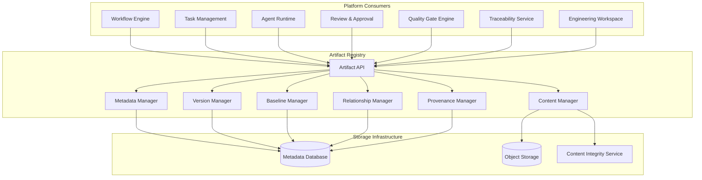
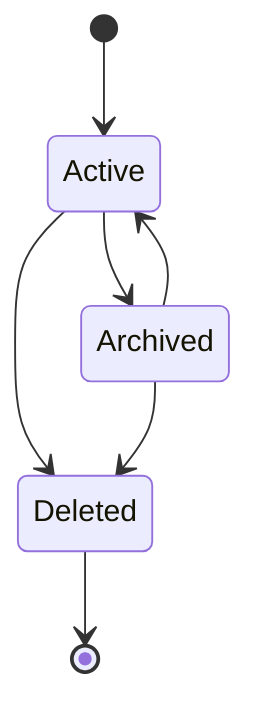
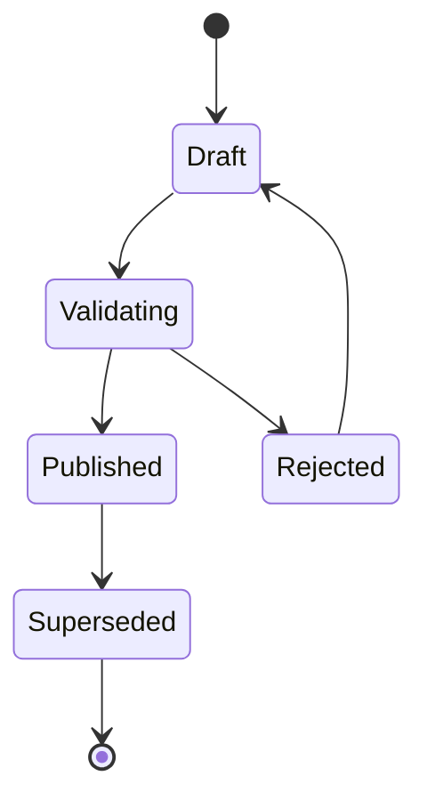
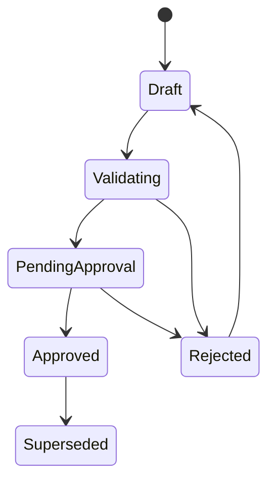
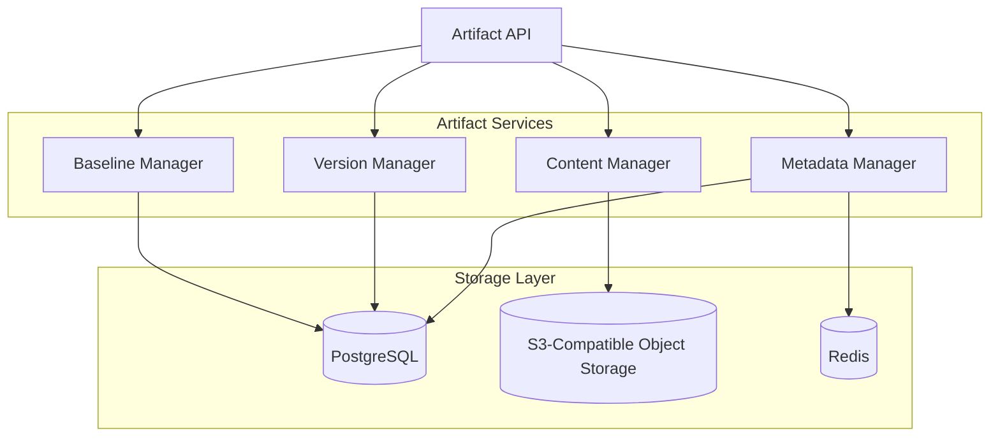

# Artifact Registry & Versioning
# Software Requirements Specification (SRS)

| Document Attribute | Value |
|---|---|
| Document ID | AI-ENG-SPEC-010 |
| Document Title | Artifact Registry & Versioning — Software Requirements Specification |
| Version | 1.0.0 |
| Status | Baseline Draft |
| Document Type | Software Requirements Specification |
| System | AI Engineering Orchestration Platform |
| Subsystem ID | SYS-010 |
| Subsystem Name | Artifact Registry |
| Language | English |
| Parent Document | AI Engineering Orchestration Platform — System Architecture Specification |
| Related Specifications | Review & Approval SRS |
| Related Specifications | Requirement Traceability SRS |
| Related Specifications | Workflow Engine & Task Scheduler SRS |
| Related Specifications | Agent Execution Protocol Specification |
| Related Specifications | Event & Audit Service SRS |

---

# 1. Introduction

## 1.1 Purpose

This document defines the functional and non-functional requirements of the Artifact Registry & Versioning subsystem.

The subsystem provides centralized management of engineering artifacts throughout the software engineering lifecycle.

It is responsible for:

- Artifact registration and identification.
- Artifact metadata management.
- Artifact content storage and retrieval.
- Artifact version management.
- Artifact lifecycle management.
- Artifact classification.
- Artifact relationship management.
- Artifact provenance management.
- Artifact baseline management.
- Artifact integrity verification.
- Artifact access control.
- Artifact change history.
- Integration with review, approval, workflow, and traceability subsystems.

The subsystem MUST support both human-generated and AI-generated engineering artifacts.

## 1.2 Scope

The subsystem manages the lifecycle of engineering artifacts from initial creation through modification, review, approval, baselining, supersession, and archival.

Supported artifact categories include:

| Category | Examples |
|---|---|
| Product Documents | PRD, Product Vision, Product Roadmap |
| Requirements Documents | System Requirements Specification, SRS |
| Architecture Documents | System Architecture Specification, Deployment Architecture |
| Design Documents | Software Design Specification, Interface Design |
| API Specifications | OpenAPI, AsyncAPI, Protocol Specifications |
| Source Code | Rust, TypeScript, Python, Go |
| Configuration | YAML, JSON, TOML |
| Diagrams | Mermaid, SVG, PlantUML |
| Test Artifacts | Test Plan, Test Cases, Test Reports |
| Security Artifacts | Threat Model, Security Assessment |
| Deployment Artifacts | Deployment Manifest, Infrastructure Configuration |
| Release Artifacts | Release Notes, Release Packages |

The subsystem MUST support structured documents, unstructured files, source code references, and externally stored artifacts.

## 1.3 Out of Scope

The following functions are not owned by this subsystem:

- Engineering task scheduling.
- Agent execution management.
- Workflow orchestration.
- Human review decision-making.
- Approval policy definition.
- Requirement semantic analysis.
- Quality gate rule execution.
- Source code compilation.
- Git branch management.
- CI/CD pipeline execution.

These functions are provided by their respective subsystems.

The Artifact Registry MUST provide the interfaces and metadata required by these subsystems.

## 1.4 Design Principles

The subsystem MUST follow these principles:

1. Artifact identity MUST be independent of artifact versions.
2. Published artifact versions MUST be immutable.
3. Artifact content MUST be independently verifiable.
4. Artifact metadata MUST be separated from artifact content.
5. Artifact approval MUST be separated from artifact creation.
6. Artifact baselines MUST reference exact artifact versions.
7. Every AI-generated artifact MUST preserve provenance.
8. Artifact relationships MUST support traceability.
9. Artifact access MUST be governed by project-level and resource-level permissions.
10. Artifact storage MUST be independent of a specific storage provider.

---

# 2. System Context

## 2.1 Subsystem Overview

The Artifact Registry acts as the authoritative metadata and lifecycle management service for engineering artifacts.

It provides a unified interface for other platform subsystems.



## 2.2 External Dependencies

| Dependency | Responsibility |
|---|---|
| Identity & Access Management | Authentication and authorization. |
| Project Management | Project and workspace ownership. |
| Workflow Engine | Workflow runs and the tasks that produce artifacts. |
| Agent Runtime Manager | Agent execution provenance, including `agent_execution_id`. |
| Tool Gateway | Tool execution provenance, including `tool_execution_ids`. |
| Review & Approval | Review and approval records. |
| Quality Gate Engine | Quality-gate results. The registry stores references only. |
| Traceability Service | Requirement, design, implementation, and verification links. |
| Event & Audit Service | Domain event persistence and audit. |
| Object Storage | Artifact content persistence. |
| Relational Database | Artifact metadata and lifecycle state. |
| Git Provider | Source-controlled artifact storage and references. |

## 2.3 System Boundary

The Artifact Registry owns:

- Artifact identity.
- Artifact metadata.
- Artifact versions.
- Artifact content references.
- Artifact lifecycle state.
- Artifact provenance metadata.
- Artifact relationships.
- Artifact baseline records.

It does not own the approval decision itself.

The Review & Approval subsystem owns review and approval decisions.

The Artifact Registry records and references those decisions.

Similarly, the Artifact Registry can associate an artifact with a quality gate result, but the Quality Gate Engine owns the evaluation logic.

---

# 3. Terminology and Domain Model

## 3.1 Artifact

An Artifact is a logical engineering object that represents a specific engineering deliverable.

Examples:

- Project PRD.
- System Architecture Specification.
- Payment Subsystem SRS.
- Authentication API Specification.
- A software module.
- A test report.

An Artifact maintains a stable identity throughout its lifecycle.

## 3.2 Artifact Version

An Artifact Version represents a specific immutable revision of an Artifact.

Every published version MUST have:

- A unique version identifier.
- A content reference.
- A content digest.
- A creation timestamp.
- A creator identity.
- A provenance object stored on that version.

## 3.3 Artifact Baseline

An Artifact Baseline is an exact-version snapshot of multiple engineering artifacts. It may be created as a draft. Once approved, it is immutable.

A baseline provides a reproducible engineering reference point.

For example:

```text
System Architecture Baseline v1.0
 ├── Product PRD v1.2.0
 ├── System Architecture v1.0.0
 ├── Workflow Engine SRS v1.0.0
 ├── Agent Runtime SRS v1.0.0
 └── API Specification v1.0.0
```

The baseline MUST reference immutable artifact versions.

## 3.4 Artifact Content

Artifact Content is the actual binary or textual payload associated with an artifact version.

Content MAY be stored directly in object storage or referenced through an external storage provider.

## 3.5 Artifact Metadata

Artifact Metadata describes an artifact without containing its full content.

Examples:

- Name.
- Type.
- Description.
- Project ID.
- Owner.
- Status.
- Tags.
- Classification.
- Creation timestamp.

## 3.6 Artifact Provenance

Artifact Provenance records how an artifact version was produced.

It may include:

- Human creator.
- Agent identity.
- `agent_execution_id`. `execution_id` MUST NOT be stored. When a tool wrote the version, provenance also includes `tool_execution_ids`.
- Task ID.
- Workflow run ID.
- Input artifact versions.
- Model provider and model identifier.
- Tool invocation references.
- Generation timestamp.

## 3.7 Artifact Relationship

An Artifact Relationship represents a semantic or operational relationship between artifacts.

Examples:

- derived_from.
- references.
- implements.
- verifies.
- supersedes.
- depends_on.
- refines.
- generated_from.

## 3.8 Version Immutability

Once a version is published, its content and core version identity MUST NOT be modified.

A correction MUST create a new version.

Metadata that is explicitly classified as mutable administrative metadata MAY be updated without changing artifact content.

Any metadata change affecting the meaning or identity of the published content MUST produce a new artifact version or a separately versioned metadata revision.

---

# 4. Functional Requirements

# 4.1 Artifact Registration

## FR-ART-001 — Create Artifact

The system MUST allow authorized users and services to create an artifact.

The creation request MUST include:

- `tenant_id`, copied from the execution record when an execution creates the artifact.
- Project ID.
- Artifact name.
- Artifact type.
- Artifact format.
- Artifact owner or responsible identity.

The registry MUST reject a create request that omits `tenant_id`, persist that value, and isolate access by both `tenant_id` and `project_id`.

The system MUST generate a unique Artifact ID.

## FR-ART-002 — Artifact ID

Each artifact MUST have a globally unique and persistent identifier.

Recommended format:

```text
ART-{ULID}
```

Example:

```text
ART-01JXYZ123456789ABCDEFGHJK
```

Artifact IDs MUST NOT be reused.

## FR-ART-003 — Artifact Registration

The system MUST support registration of artifacts originating from:

- Human uploads.
- AI Agent executions.
- Git repositories.
- External integrations.
- Platform-generated reports.
- Automated engineering workflows.

## FR-ART-004 — Duplicate Detection

The system SHOULD detect potential duplicate artifact registrations.

Duplicate detection SHOULD consider:

- Project ID.
- Artifact type.
- Logical name.
- Repository path.
- External identifier.

Content equality alone MUST NOT imply logical artifact identity. Duplicate detection MUST NOT collapse two registrations that carry different `submission_id` values.

## FR-ART-005 — Artifact Search

The system MUST support artifact search by:

- Artifact ID.
- Project ID.
- Name.
- Type.
- Format.
- Status.
- Owner.
- Tags.
- Creation time.
- Version.
- Baseline membership.

The system SHOULD support full-text search through the Knowledge Management subsystem.

## FR-ART-006 — Artifact Metadata

The system MUST support metadata creation and retrieval.

The metadata schema MUST support standard fields and extensible custom attributes.

## FR-ART-007 — Artifact Classification

The system MUST support artifact classification.

Recommended classifications:

| Classification | Description |
|---|---|
| Public | Publicly accessible engineering information. |
| Internal | Internal project information. |
| Confidential | Restricted project information. |
| Restricted | Highly sensitive engineering information. |

Actual access permissions MUST be enforced by the authorization subsystem.

---

# 4.2 Artifact Content Management

## FR-ART-008 — Upload Content

The system MUST support artifact content upload.

Supported upload mechanisms SHOULD include:

- Direct upload.
- Multipart upload.
- Pre-signed upload URL.
- External storage registration.

## FR-ART-009 — Content Storage

The system MUST store artifact content in a durable storage backend or maintain a verified reference to externally managed content.

## FR-ART-010 — Content Retrieval

Authorized consumers MUST be able to retrieve artifact content by Artifact ID and Version ID.

## FR-ART-011 — Content Format

The system MUST support:

- Markdown.
- Plain text.
- JSON.
- YAML.
- XML.
- PDF.
- DOCX.
- XLSX.
- PPTX.
- SVG.
- PNG.
- JPEG.
- Source code files.
- ZIP archives.

The supported format list MUST be configurable.

## FR-ART-012 — Content Integrity

The system MUST calculate a cryptographic digest for each published content object.

SHA-256 MUST be supported.

The digest MUST be verified during content retrieval or integrity validation.

## FR-ART-013 — Content Deduplication

The system SHOULD support content-addressable storage and deduplication.

Identical content MAY share the same physical storage object.

However, different logical artifacts MUST retain separate identities.

## FR-ART-014 — Content Size Limits

The system MUST support configurable file-size limits.

The system MUST reject uploads that exceed the configured limits.

## FR-ART-015 — Content Validation

The system MUST validate:

- File format.
- Declared media type.
- File size.
- Content digest.
- Upload completion.
- File integrity.

The system SHOULD support malware scanning for uploaded binary content.

## FR-ART-016 — Partial Upload Recovery

The system SHOULD support recovery from interrupted multipart uploads.

Incomplete uploads MUST NOT be treated as published artifact versions.

---

# 4.3 Artifact Version Management

## FR-ART-017 — Create Version

The system MUST allow authorized users and services to create a new artifact version.

Each version MUST belong to exactly one logical artifact.

## FR-ART-018 — Version ID

Each artifact version MUST have a unique identifier.

Recommended format:

```text
ARV-{ULID}
```

Example:

```text
ARV-01JXYZ123456789ABCDEFGHJK
```

## FR-ART-019 — Version Number

The system MUST support human-readable version numbers.

The default document versioning policy SHOULD follow Semantic Versioning:

```text
MAJOR.MINOR.PATCH
```

Example:

```text
1.0.0
1.1.0
1.1.1
2.0.0
```

Version numbering policies MAY vary by artifact type.

## FR-ART-020 — Parent Version

A new version created by a caller other than the Runtime Manager or the Tool Gateway SHOULD reference its immediate parent version.

The first version MUST NOT require a parent.

A later version created by the Runtime Manager or the Tool Gateway MUST set `expected_parent_version_id` to the current version. Those callers MUST NOT create a branch. Branch creation is a separate registry operation.

## FR-ART-021 — Immutable Version

Published versions MUST be immutable.

The system MUST reject attempts to overwrite the content of an existing published version.

## FR-ART-022 — Version History

The system MUST provide the complete version history of an artifact.

The history MUST include:

- Version ID.
- Version number.
- Creator.
- Creation timestamp.
- Content digest.
- Change summary.
- Parent version.
- Provenance reference.
- Publication status.

## FR-ART-023 — Version Comparison

The system SHOULD support version comparison.

Comparison methods SHOULD include:

- Text diff.
- Structured JSON diff.
- YAML diff.
- Metadata diff.
- Binary content comparison.
- External repository diff references.

## FR-ART-024 — Current Version

The system MUST maintain a reference to the current version of an artifact.

The current version pointer MUST be updated atomically.

## FR-ART-025 — Concurrent Version Creation

The system MUST prevent conflicting concurrent updates from silently overwriting the current version.

It SHOULD support optimistic concurrency using an expected parent version or revision token.

## FR-ART-026 — Version Branching

The system SHOULD support parallel version branches for independent engineering changes.

A branch represents a logical development line and MUST NOT modify existing published versions. The Runtime Manager and the Tool Gateway MUST NOT create branches. Their later versions remain linear against the current version.

## FR-ART-027 — Version Merge

The system MAY support merging branches into a new artifact version.

The merged version MUST be a new immutable version.

## FR-ART-028 — Version Tagging

The system MUST support version tags such as:

- draft.
- candidate.
- approved.
- baseline.
- deprecated.
- release.

Tags MUST NOT alter the immutable content of a version.

## FR-ART-029 — Version Restoration

The system MUST support restoring an earlier version as the current version.

Archive restoration uses `POST /api/v1/artifacts/{artifact_id}/restore` and changes only `lifecycle_status` from `archived` to `active`. It does not create a version.

Historical content restoration uses `POST /api/v1/artifacts/{artifact_id}/versions/{version_id}/restore`. Restoration MUST create a new version referencing the restored content.

The system MUST NOT reactivate or modify the historical version itself, and this operation MUST NOT by itself change the artifact lifecycle.

## FR-ART-030 — Version Retention

The system MUST support configurable version retention policies.

Versions referenced by approved baselines MUST NOT be physically deleted through ordinary retention cleanup.

---

# 4.4 Artifact Lifecycle Management

## FR-ART-031 — Artifact Lifecycle

The system MUST manage artifact lifecycle state.

Recommended states:

- Active.
- Archived.
- Deleted.

The lifecycle state MUST be independent of review and approval status.

## FR-ART-032 — Artifact Archival

Authorized users MUST be able to archive an artifact.

Archived artifacts MUST remain retrievable by authorized users.

## FR-ART-033 — Artifact Deletion

The system MUST support controlled deletion.

Deletion MUST consider:

- Legal retention requirements.
- Baseline references.
- Traceability references.
- External repository references.
- Audit requirements.

The system SHOULD use soft deletion before permanent deletion.

## FR-ART-034 — Artifact Supersession

The system MUST support marking an artifact as superseded by another artifact.

Supersession MUST preserve historical references.

## FR-ART-035 — Artifact Status Separation

The system MUST maintain separate dimensions for:

1. Artifact lifecycle status.
2. Version publication status.
3. Review status.
4. Approval status.
5. Baseline status.

The system MUST NOT collapse these states into a single status field.

---

# 4.5 Artifact Baseline Management

## FR-ART-036 — Create Baseline

The system MUST allow authorized users or services to create a baseline.

A baseline MUST include:

- Baseline ID.
- Project ID.
- Baseline name.
- Description.
- Creation timestamp.
- Creator identity.
- Included artifact versions.
- Baseline status.

## FR-ART-037 — Exact Version References

Every baseline item MUST reference an exact Artifact ID and Version ID.

A baseline MUST NOT reference a floating current-version pointer.

## FR-ART-038 — Baseline Consistency

The system MUST validate all included artifact versions before creating a baseline.

Validation SHOULD include:

- Version existence.
- Content integrity.
- Required approval status.
- Project ownership.
- Required artifact completeness.
- Dependency consistency.

## FR-ART-039 — Baseline Immutability

Once approved, a baseline's membership and content MUST be immutable.

A new snapshot MUST create a new `baseline_id`. The original baseline MAY enter `superseded`. That transition changes only status.

## FR-ART-040 — Baseline Versioning

The system MUST support multiple baselines for the same project.

Example:

```text
Project Architecture Baselines
 ├── BASELINE-001
 │    ├── PRD v1.0.0
 │    └── Architecture v1.0.0
 │
 ├── BASELINE-002
 │    ├── PRD v1.1.0
 │    └── Architecture v1.1.0
 │
 └── BASELINE-003
      ├── PRD v1.1.0
      └── Architecture v2.0.0
```

## FR-ART-041 — Baseline Comparison

The system SHOULD support comparison between two baselines.

The comparison MUST identify:

- Added artifacts.
- Removed artifacts.
- Updated artifact versions.
- Unchanged artifacts.
- Changed relationships.

## FR-ART-042 — Baseline Approval

Baseline approval MUST be performed through the Review & Approval subsystem.

The Artifact Registry MUST record the resulting approval reference. Recording that reference publishes `artifact.baseline.approval_recorded`. The registry MUST NOT publish an event that presents the registry as the approval authority, including `artifact.baseline.approved`.

## FR-ART-043 — Baseline Release Association

The system SHOULD support associating baselines with software releases and deployment records.

## FR-ART-044 — Baseline Integrity

The system MUST provide integrity verification for every artifact version included in a baseline.

---

# 4.6 Artifact Relationship Management

## FR-ART-045 — Create Relationship

The system MUST support relationships between artifacts.

## FR-ART-046 — Relationship Types

The system MUST support extensible relationship types.

Initial relationship types:

| Relationship | Meaning |
|---|---|
| derived_from | Derived from another artifact. |
| references | References another artifact. |
| depends_on | Depends on another artifact. |
| implements | Implements a requirement or specification. |
| verifies | Verifies another artifact. |
| refines | Refines another artifact. |
| supersedes | Replaces another artifact. |
| generated_from | Generated using another artifact as input. The source is the new version. The target is the input version. Tool results and `execution.result` references MUST NOT carry `relationship_type`. When no input version is known, this relationship is not written. |
| related_to | General association. |

## FR-ART-047 — Version-Level Relationships

The system SHOULD support relationships at both artifact level and version level.

Version-level relationships MUST preserve the exact source and target versions.

## FR-ART-048 — Relationship Validation

The system MUST validate that relationship targets exist and are accessible.

## FR-ART-049 — Relationship Query

The system MUST support forward and reverse relationship queries.

## FR-ART-050 — Relationship History

The system MUST preserve relationship change history.

---

# 4.7 Artifact Provenance

## FR-ART-051 — Provenance Recording

The system MUST record provenance for every AI-generated artifact version.

## FR-ART-052 — Execution Association

AI-generated artifacts MUST be associated with:

- `tenant_id`.
- `project_id`.
- `task_id`.
- `workflow_run_id`.
- `agent_execution_id`.
- `agent_id`.
- `agent_version`.
- `runtime_version`.
- `context_package_id`.

Where a tool produced or modified the version, the provenance MUST also include `tool_execution_ids` as an array. The singular name `tool_execution_id` MUST NOT be stored as a second provenance field. An unqualified `execution_id` MUST NOT be stored.

The version reference exposed to other subsystems MUST be `version_id`. The version number is a display attribute. Provenance is stored once, on the version identified by `version_id`. The registry MUST NOT keep a second provenance record on the artifact. `runtime_version` is assigned by the Runtime Manager on the execution record and copied into this provenance. The registry MUST NOT invent it.

Where available, the system SHOULD also record model provider, model identifier, prompt-template version, and `invocation_id` values.

## FR-ART-053 — Input References

The system SHOULD record the exact versions of source artifacts used to generate a new artifact version.

## FR-ART-054 — Human Authorship

The system MUST distinguish:

- Human-created.
- AI-generated.
- AI-assisted.
- System-generated.
- Externally imported.

## FR-ART-055 — Provenance Integrity

Provenance records MUST NOT be silently modified after version publication.

Corrections MUST create auditable amendments.

---

# 4.8 Access Control

## FR-ART-056 — Authentication

All artifact management operations MUST require authenticated identities, except explicitly configured public-read operations.

## FR-ART-057 — Tenant and Project Isolation

The system MUST enforce access isolation by `tenant_id` and `project_id`. An artifact record MUST persist `tenant_id`.

## FR-ART-058 — Resource-Level Authorization

The system MUST support resource-level authorization.

## FR-ART-059 — Agent Permissions

Agent permissions MUST be scoped to their assigned project, task, and execution.

## FR-ART-060 — Read and Write Permissions

The system MUST distinguish:

- Artifact read.
- Artifact create.
- Artifact update through new version.
- Artifact archive.
- Artifact delete.
- Version publish.
- Baseline create.
- Baseline approve.
- Relationship management.

## FR-ART-061 — Baseline Protection

Approved baselines MUST be protected against unauthorized modification or deletion.

## FR-ART-062 — Access Audit

The system MUST record security-relevant artifact access and modification operations.

---

# 4.9 Search and Discovery

## FR-ART-063 — Metadata Search

The system MUST support filtering by artifact metadata.

## FR-ART-064 — Full-Text Search

The system SHOULD integrate with the Knowledge Management subsystem for full-text search.

## FR-ART-065 — Version Search

The system MUST support searching historical versions.

## FR-ART-066 — Baseline Search

The system MUST support searching baselines by project, name, status, creator, and date.

## FR-ART-067 — Relationship Search

The system SHOULD support searching artifacts by their relationships and dependency graph.

---

# 4.10 Events and Notifications

## FR-ART-068 — Artifact Events

The system MUST publish domain events for important lifecycle operations.

Initial event types, using the platform event-type form:

- artifact.artifact.created
- artifact.artifact.updated
- artifact.artifact.archived
- artifact.artifact.deleted
- artifact.artifact.superseded
- artifact.version.created
- artifact.version.published
- artifact.version.superseded
- artifact.relationship.created
- artifact.relationship.removed
- artifact.baseline.created
- artifact.baseline.validated
- artifact.baseline.submitted
- artifact.baseline.approval_recorded
- artifact.baseline.superseded

## FR-ART-069 — Event Envelope

All published events MUST use the platform event envelope defined by the System Architecture Specification: `event_id`, `event_type`, `event_version`, `occurred_at`, `source`, `tenant_id`, `correlation_id`, `causation_id` when caused by another event, `subject`, `sequence` when ordered, and `payload`. The subsystem MUST NOT define a second envelope.

## FR-ART-070 — Event Reliability

The system MUST support durable event publication.

It SHOULD implement the transactional outbox pattern.

## FR-ART-071 — Duplicate Event Handling

Consumers MUST be able to identify duplicate events using unique event identifiers.

## FR-ART-072 — Event Ordering

The system SHOULD preserve ordering for state-changing events belonging to the same artifact aggregate.

---

# 5. Artifact Domain Data Model

## 5.1 Logical Entity Model

The subsystem MUST implement the following core entities:

| Entity | Description |
|---|---|
| Artifact | Logical engineering artifact. |
| ArtifactVersion | Immutable content revision. |
| ArtifactContent | Physical content reference and integrity metadata. |
| ArtifactMetadata | Extensible artifact attributes. |
| ArtifactRelationship | Relationship between artifacts or versions. |
| ArtifactProvenance | The provenance object stored on one `version_id`. It has no separate identifier. |
| ArtifactBaseline | Exact-version snapshot. Immutable after approval. May be created as draft. |
| BaselineItem | Exact artifact version included in a baseline. |
| ArtifactTag | Classification and descriptive tags. |
| ArtifactBranch | Logical development branch. |

## 5.2 Artifact Entity

```json
{
  "artifact_id": "ART-01JXYZ",
  "tenant_id": "TEN-001",
  "project_id": "PROJ-001",

  "name": "Workflow Engine SRS",
  "type": "software_requirements_specification",
  "format": "markdown",

  "description": "Requirements for Workflow Engine",

  "owner": {
    "type": "user",
    "id": "USR-001"
  },

  "classification": "internal",
  "lifecycle_status": "active",

  "current_version_id": "ARV-001",

  "created_at": "2026-11-25T10:00:00Z",
  "created_by": "USR-001",

  "metadata": {
    "subsystem_id": "SYS-003",
    "document_id": "AI-ENG-SPEC-003"
  }
}
```

`owner` is an object with `type` and `id`. `type` is `user` or `agent`. An Agent execution output and a tool-produced engineering artifact use `agent` and the executing `agent_id`. A caller MUST NOT send the owner as a bare identifier string.

## 5.3 ArtifactVersion Entity

```json
{
  "version_id": "ARV-001",
  "artifact_id": "ART-01JXYZ",

  "version_number": "1.0.0",
  "parent_version_id": null,

  "content": {
    "storage_type": "object_storage",
    "object_key": "projects/PROJ-001/artifacts/ART-01JXYZ/ARV-001",
    "media_type": "text/markdown",
    "size_bytes": 25000,
    "digest_algorithm": "SHA-256",
    "content_digest": "<sha256-hex>"
  },

  "publication_status": "published",

  "change_summary": "Initial version",

  "provenance": {
    "source_type": "ai_generated",
    "tenant_id": "TEN-001",
    "project_id": "PROJ-001",
    "task_id": "TASK-001",
    "workflow_run_id": "WFR-001",
    "agent_execution_id": "AEX-001",
    "agent_id": "architecture-agent",
    "agent_version": "1.0.0",
    "runtime_version": "1.0.0",
    "context_package_id": "CTX-001",
    "tool_execution_ids": []
  },

  "created_at": "2026-11-25T10:00:00Z",
  "created_by": "USR-001"
}
```

Provenance is the object stored on this `version_id`. The version MUST NOT carry `provenance_id`. There is no second provenance record.

## 5.4 ArtifactRelationship Entity

```json
{
  "relationship_id": "REL-001",

  "source": {
    "artifact_id": "ART-001",
    "version_id": "ARV-001"
  },

  "target": {
    "artifact_id": "ART-002",
    "version_id": "ARV-005"
  },

  "relationship_type": "derived_from",

  "created_at": "2026-11-25T10:00:00Z",
  "created_by": "USR-001"
}
```

## 5.5 ArtifactBaseline Entity

```json
{
  "baseline_id": "BASE-001",
  "project_id": "PROJ-001",

  "name": "Architecture Baseline",
  "version": "1.0.0",

  "status": "approved",

  "items": [
    {
      "artifact_id": "ART-001",
      "version_id": "ARV-001",
      "content_digest": "<sha256-hex>"
    },
    {
      "artifact_id": "ART-002",
      "version_id": "ARV-005",
      "content_digest": "<sha256-hex>"
    }
  ],

  "approval_reference": {
    "review_id": "REV-001",
    "approval_id": "APR-001"
  },

  "created_at": "2026-11-25T10:00:00Z",
  "created_by": "USR-001"
}
```

## 5.6 Data Ownership Rules

The Artifact Registry MUST be the authoritative owner of artifact identity, version identity, content references, baseline membership, and content relationships between artifact versions.

The Review & Approval subsystem MUST remain authoritative for approval decisions.

The Quality Gate Engine MUST remain authoritative for quality-gate results.

The Traceability Service MUST remain authoritative for requirement, design, implementation, and verification links. The registry MUST NOT keep a second authoritative copy of those links. It MAY store the trace link identifier as a reference.

Content relationships such as `derived_from` and `generated_from` remain registry relationships. They are not a substitute for trace links.

---

# 6. State Models

## 6.1 Artifact Lifecycle State



Deleted indicates logical deletion. Physical deletion is governed by retention and reference policies.

Diagram labels use PascalCase logical names. The wire `lifecycle_status` values are `active`, `archived`, and `deleted`. The transition from `archived` to `active` is `POST /api/v1/artifacts/{artifact_id}/restore`. That call does not create a version. Historical content restoration is a different operation and is defined in FR-ART-029.

## 6.2 Artifact Version State



Published content is immutable.

A superseded version remains retrievable.

Diagram labels are logical names. The wire `publication_status` values are `draft`, `validating`, `published`, `rejected`, and `superseded`.

## 6.3 Baseline State



An approved baseline's membership and content cannot be modified in place. Replacing the snapshot creates a new `baseline_id`. The original baseline MAY enter `superseded`, which changes only status.

Diagram labels are logical names. The wire baseline status values are `draft`, `validating`, `pending_approval`, `approved`, `rejected`, and `superseded`. `approved` means an external approval reference has been recorded. The registry does not make the approval decision.

## 6.4 State Separation

The subsystem MUST maintain separate state machines for:

- Artifact lifecycle.
- Artifact version publication.
- Review and approval.
- Baseline lifecycle.

For example, an artifact can be active while its latest version is awaiting review and an earlier version is already included in an approved baseline.

---

# 7. External Interface Requirements

## 7.1 Interface Principles

The subsystem MUST expose versioned APIs.

Recommended interfaces:

- REST APIs for artifact operations.
- Pre-signed URLs for large content transfer.
- Events for asynchronous lifecycle notifications.
- Webhooks for external integrations where required.

## 7.2 Artifact APIs

| Method | Endpoint | Description |
|---|---|---|
| POST | /api/v1/projects/{project_id}/artifacts | Create artifact |
| GET | /api/v1/artifacts/{artifact_id} | Get artifact |
| PATCH | /api/v1/artifacts/{artifact_id} | Update mutable metadata |
| GET | /api/v1/artifacts | Search artifacts |
| POST | /api/v1/artifacts/{artifact_id}/archive | Archive artifact |
| POST | /api/v1/artifacts/{artifact_id}/restore | Restore artifact |

## 7.3 Version APIs

| Method | Endpoint | Description |
|---|---|---|
| POST | /api/v1/artifacts/{artifact_id}/versions | Create version |
| GET | /api/v1/artifacts/{artifact_id}/versions | List versions |
| GET | /api/v1/artifacts/{artifact_id}/versions/{version_id} | Get version |
| GET | /api/v1/artifacts/{artifact_id}/versions/{version_id}/content | Retrieve content |
| POST | /api/v1/artifacts/{artifact_id}/versions/{version_id}/publish | Publish version |
| GET | /api/v1/artifacts/{artifact_id}/diff | Compare versions |
| POST | /api/v1/artifacts/{artifact_id}/versions/{version_id}/restore | Restore historical content as a new version |

## 7.4 Baseline APIs

| Method | Endpoint | Description |
|---|---|---|
| POST | /api/v1/projects/{project_id}/baselines | Create baseline |
| GET | /api/v1/baselines/{baseline_id} | Get baseline |
| GET | /api/v1/projects/{project_id}/baselines | List baselines |
| POST | /api/v1/baselines/{baseline_id}/validate | Validate baseline |
| POST | /api/v1/baselines/{baseline_id}/submit-review | Submit for approval |
| GET | /api/v1/baselines/{baseline_id}/diff/{other_baseline_id} | Compare baselines |

Approval MUST be performed through the Review & Approval subsystem, not by directly changing baseline status through an unrestricted API.

## 7.5 Relationship APIs

| Method | Endpoint | Description |
|---|---|---|
| POST | /api/v1/artifact-relationships | Create relationship |
| GET | /api/v1/artifacts/{artifact_id}/relationships | List relationships |
| GET | /api/v1/artifacts/{artifact_id}/dependencies | Get dependencies |
| DELETE | /api/v1/artifact-relationships/{relationship_id} | Remove relationship |

## 7.6 Provenance APIs

| Method | Endpoint | Description |
|---|---|---|
| GET | /api/v1/artifacts/{artifact_id}/versions/{version_id}/provenance | Get the provenance object stored on this version |

Provenance is written only in the version-creation request. The registry MUST NOT expose a separate registration endpoint. After publication, the object is read-only except for an auditable amendment.

## 7.7 Version Creation Request

The caller supplies one content form. `content_digest` is the SHA-256 digest and uses that field name for every form. The Agent Execution Protocol maps each `delivery_type` onto this request: `inline` sends `inline`, `platform_managed_upload` sends `upload_reference`, `object_reference` sends `uri`, and `repository_reference` sends `repository_ref`. The first version of a new artifact omits `expected_parent_version_id`. Every later version created by the Runtime Manager or the Tool Gateway MUST include `expected_parent_version_id` and MUST set it to the current version. Those callers MUST NOT open a branch. Every request that creates a version MUST include `submission_id`. A retry of that registration MUST send the same `submission_id`. The registry deduplicates only on `submission_id`, MUST reject a request that omits it, and MUST NOT create a second version for that submission. `tool_execution_id` is not a deduplication key. It is stored only in version provenance when a tool wrote the version. The example below is a later version.

```json
{
  "submission_id": "sub_001",
  "expected_parent_version_id": "ARV-001",

  "version_number": "1.1.0",

  "content": {
    "upload_reference": "UPLOAD-001",
    "content_digest": "<sha256-hex>"
  },

  "change_summary": "Updated workflow requirements",

  "provenance": {
    "source_type": "ai_generated",
    "tenant_id": "TEN-001",
    "task_id": "TASK-001",
    "workflow_run_id": "WFR-001",
    "agent_execution_id": "AEX-001",
    "tool_execution_ids": [],
    "agent_id": "architecture-agent",
    "agent_version": "1.0.0",
    "runtime_version": "1.0.0",
    "context_package_id": "CTX-001",
    "project_id": "PROJ-001"
  }
}
```

## 7.8 Version Creation Response

```json
{
  "artifact_id": "ART-001",
  "version_id": "ARV-002",
  "version_number": "1.1.0",

  "publication_status": "draft",

  "content_digest": "<sha256-hex>",

  "created_at": "2026-11-25T10:00:00Z"
}
```

## 7.9 Error Responses

All APIs MUST use a consistent error response structure.

```json
{
  "error": {
    "code": "ARTIFACT_VERSION_CONFLICT",
    "category": "artifact",
    "message": "The expected parent version does not match the current version.",
    "retryable": false,
    "details": {
      "expected_parent_version_id": "ARV-001",
      "actual_current_version_id": "ARV-003"
    },
    "correlation_id": "CORR-001"
  }
}
```

Initial error codes SHOULD include:

| Code | Meaning |
|---|---|
| ARTIFACT_NOT_FOUND | Artifact does not exist. |
| ARTIFACT_VERSION_NOT_FOUND | Version does not exist. |
| ARTIFACT_ACCESS_DENIED | Access denied. |
| ARTIFACT_VERSION_CONFLICT | Concurrent version conflict. |
| ARTIFACT_CONTENT_INVALID | Invalid content. |
| ARTIFACT_DIGEST_MISMATCH | Integrity verification failed. |
| ARTIFACT_BASELINE_INVALID | Baseline validation failed. |
| ARTIFACT_VERSION_IMMUTABLE | Attempt to modify immutable version. |
| ARTIFACT_REFERENCE_CONFLICT | Conflicting references. |
| ARTIFACT_STORAGE_UNAVAILABLE | Storage service unavailable. Retry only the same `submission_id`. |

`ARTIFACT_VERSION_CONFLICT` is not retryable. A retry of an accepted submission MUST reuse `submission_id`. Content equality alone MUST NOT imply logical artifact identity.

---

# 8. Event Architecture

## 8.1 Event Types

The subsystem MUST publish the event types in FR-ART-068. This section uses those names. A second spelling, including PascalCase names, is not an event type.

| Event type | Trigger |
|---|---|
| artifact.artifact.created | Artifact created. |
| artifact.artifact.updated | Mutable metadata updated. |
| artifact.artifact.archived | Artifact archived. |
| artifact.artifact.deleted | Artifact logically deleted. |
| artifact.artifact.superseded | Artifact superseded. |
| artifact.version.created | New version created. |
| artifact.version.published | Version published. |
| artifact.version.superseded | Version superseded. |
| artifact.relationship.created | Relationship created. |
| artifact.relationship.removed | Relationship removed. |
| artifact.baseline.created | Baseline created. |
| artifact.baseline.validated | Baseline validation completed. |
| artifact.baseline.submitted | Baseline submitted for approval. |
| artifact.baseline.approval_recorded | Approval reference stored. The registry did not make the approval decision. |
| artifact.baseline.superseded | Baseline superseded. |

## 8.2 Event Payload Example

```json
{
  "event_id": "EVT-001",
  "event_type": "artifact.version.published",
  "event_version": "1.0.0",
  "occurred_at": "2026-11-25T10:00:00Z",
  "source": "artifact-registry",
  "tenant_id": "TEN-001",
  "correlation_id": "CORR-001",
  "causation_id": "EVT-000",
  "subject": {
    "project_id": "PROJ-001",
    "artifact_id": "ART-001",
    "version_id": "ARV-002"
  },
  "sequence": 2,
  "payload": {
    "version_number": "1.1.0",
    "content_digest": "<sha256-hex>"
  }
}
```

`event_type` uses lowercase `domain.aggregate.action`. Time is `occurred_at`. `source` is the service identifier string. This is the platform envelope required by FR-ART-069.

## 8.3 Event Consumers

| Consumer | Relevant Events | Purpose |
|---|---|---|
| Workflow Engine | artifact.version.published | Continue dependent workflow tasks. |
| Review & Approval | artifact.version.published | Create or activate review requests. |
| Quality Gate Engine | artifact.version.published | Trigger artifact validation. |
| Traceability Service | artifact.version.published | Update traceability projections. |
| Knowledge Management | artifact.version.published | Index approved or eligible content. |
| Monitoring Service | All lifecycle events | Operational monitoring. |
| Audit Service | All security-relevant events | Audit history. |

Consumers MUST NOT assume that an artifact is approved merely because its version was published.

---

# 9. Security Requirements

## 9.1 Authentication

All write operations MUST require authenticated users or service identities.

## 9.2 Authorization

The subsystem MUST enforce:

- Tenant and project access, using both `tenant_id` and `project_id`.
- Artifact-level access.
- Version-level access.
- Baseline-level access.
- Operation-level access.

## 9.3 Agent Isolation

Agent identities MUST be scoped to their assigned execution context.

An Agent MUST NOT gain access to unrelated project artifacts.

## 9.4 Content Security

Uploaded content MUST be treated as untrusted data.

The system SHOULD implement:

- Malware scanning.
- File type validation.
- Content size validation.
- Archive extraction limits.
- Safe preview generation.
- Restricted execution of uploaded files.

The Artifact Registry MUST NOT execute uploaded content as part of ordinary artifact ingestion.

## 9.5 Encryption

The system MUST support:

- Encryption in transit.
- Encryption at rest.
- Secure storage credentials.
- Access-controlled download URLs.

## 9.6 Audit

The system MUST record:

- Artifact creation.
- Artifact metadata modification.
- Version creation.
- Version publication.
- Content access where required by policy.
- Baseline creation.
- Baseline approval references.
- Archival and deletion.
- Permission changes.

---

# 10. Non-Functional Requirements

## 10.1 Performance Requirements

Initial performance objectives:

| ID | Requirement | Target |
|---|---|---|
| NFR-ART-001 | Artifact metadata retrieval | P95 ≤ 300 ms |
| NFR-ART-002 | Artifact search | P95 ≤ 1 second |
| NFR-ART-003 | Version history retrieval | P95 ≤ 500 ms |
| NFR-ART-004 | Relationship query | P95 ≤ 1 second |
| NFR-ART-005 | Baseline metadata retrieval | P95 ≤ 500 ms |
| NFR-ART-006 | Content integrity calculation | Asynchronous for large objects |
| NFR-ART-007 | Metadata API availability | 99.9% |

Performance objectives exclude external network latency and large content transfer time.

## 10.2 Scalability

The subsystem MUST support:

- Multiple projects.
- Multiple artifacts per project.
- Multiple versions per artifact.
- Concurrent uploads.
- Concurrent version creation attempts.
- Large artifact collections.
- Independently scalable content storage.

## 10.3 Reliability

The subsystem MUST ensure:

- Durable artifact metadata.
- Durable published content.
- Consistent version references.
- Atomic baseline creation.
- Recoverable incomplete uploads.
- Integrity verification.

## 10.4 Availability

The subsystem SHOULD support highly available metadata and storage services.

Storage failures MUST NOT result in silent loss of artifact metadata or published versions.

## 10.5 Maintainability

The implementation MUST separate:

- Artifact metadata management.
- Version management.
- Content storage.
- Baseline management.
- Provenance management.
- Relationship management.

## 10.6 Portability

The subsystem MUST avoid hard dependencies on a single object storage vendor.

The storage abstraction SHOULD support S3-compatible storage and equivalent object storage providers.

## 10.7 Data Retention

The system MUST support configurable retention policies.

Approved baselines and their referenced versions MUST be retained according to project governance policies.

Audit and provenance records MUST follow platform-wide retention policies.

---

# 11. Storage Architecture Requirements

## 11.1 Storage Separation

The subsystem MUST separate metadata storage from content storage.

Recommended architecture:



PostgreSQL, S3-compatible object storage, and Redis are recommended implementation choices, not mandatory technology dependencies.

## 11.2 Content Addressing

The system SHOULD use content digests as integrity identifiers.

A content object MAY be addressed by:

```text
sha256:{digest}
```

Logical artifact identity MUST remain independent of the content digest.

## 11.3 Storage Lifecycle

The system SHOULD support:

- Hot storage.
- Cold storage.
- Archival storage.
- Retention policies.
- Garbage collection.
- Replication.
- Backup and restoration.

## 11.4 Garbage Collection

The system MUST NOT physically delete content referenced by:

- Published artifact versions.
- Approved baselines.
- Active retention policies.
- Legal holds.
- Required audit records.

Garbage collection MUST use reference-aware checks.

---

# 12. Integration Requirements

## 12.1 Workflow Engine Integration

The Workflow Engine calls the Artifact Registry API when a person or a workflow step must create a logical artifact that is not the output of an Agent execution or a tool execution. It MUST NOT write registry storage directly.

The Workflow Engine MUST be able to:

- Create those logical artifact records through the registry API.
- Retrieve artifact versions.
- Associate artifacts with tasks.
- Detect publication events.
- Reference artifacts as workflow outputs.

Agent outputs are registered by the Agent Runtime Manager after `artifact.submit`. Tool outputs that are engineering artifacts are registered by the Tool Gateway after the tool execution succeeds. For either caller, `owner` is `{ "type": "agent", "id": "<agent_id>" }` using the executing `agent_id`. The first version of a new artifact omits `expected_parent_version_id`. Every later version, from either caller, MUST set `expected_parent_version_id` to the current version and MUST NOT open a branch. None of them updates the content of a published version.

## 12.2 Agent Runtime Integration

The Agent Runtime Manager MUST be able to:

- Provide authorized artifact references to Agents.
- Receive Agent-generated outputs.
- Register new artifact versions for Agent outputs. When the submission has no `artifact_id`, the Runtime Manager creates the artifact first, using `tenant_id` copied from the execution record, plus `name`, `type`, and `format`. The caller MUST NOT omit `tenant_id`. `owner` is `{ "type": "agent", "id": "<agent_id>" }` using the executing `agent_id`. The first version omits `expected_parent_version_id`. A submission that names an existing artifact creates only the version and sets `expected_parent_version_id` to the current version. This path does not open a branch and does not replace workflow-owned artifact creation. Tool-output registration uses the same owner object and the same parent rule.
- Record execution provenance.
- Validate output format and integrity.

Agents MUST NOT directly write to internal Artifact Registry database tables or object storage namespaces.

## 12.3 Review & Approval Integration

The subsystem MUST support:

- Review requests against exact artifact versions.
- Recording review references.
- Recording approval references.
- Baseline approval integration.

An approval decision MUST reference the exact artifact version or baseline being approved.

## 12.4 Traceability Integration

The subsystem MUST expose stable artifact and version identifiers to the Traceability Service.

Version changes SHOULD trigger impact-analysis notifications.

## 12.5 Git Integration

The subsystem SHOULD support external repository references.

A Git-backed artifact SHOULD record:

- Repository ID.
- Branch.
- Commit SHA.
- File path.
- Repository provider.
- Repository URL.

A Git commit and an Artifact Version are separate identities.

The platform MUST maintain their explicit mapping.

## 12.6 Knowledge Management Integration

The Artifact Registry MUST provide artifact content references and metadata to the Knowledge Management subsystem.

The Knowledge Management subsystem SHOULD index content asynchronously.

Only content eligible under project policies SHOULD be indexed.

---

# 13. Operational Requirements

## 13.1 Monitoring

The subsystem MUST expose operational metrics.

Recommended metrics:

- artifact_creation_total.
- artifact_version_creation_total.
- artifact_upload_total.
- artifact_upload_failure_total.
- artifact_content_bytes.
- artifact_integrity_failure_total.
- artifact_baseline_creation_total.
- artifact_storage_error_total.
- artifact_metadata_query_latency.
- artifact_version_conflict_total.

## 13.2 Logging

Logs MUST include:

- Request ID.
- Correlation ID.
- Artifact ID where applicable.
- Version ID where applicable.
- Project ID.
- Actor identity.
- Operation.
- Result.
- Error code.

Logs MUST NOT expose sensitive content or secrets.

## 13.3 Backup

The subsystem MUST support:

- Metadata database backup.
- Object storage backup or replication.
- Baseline metadata backup.
- Provenance backup.
- Integrity verification after restoration.

## 13.4 Disaster Recovery

The implementation SHOULD define:

- Recovery Point Objective.
- Recovery Time Objective.
- Backup frequency.
- Cross-region replication policy where required.
- Restore verification procedures.

Initial production targets SHOULD be:

| Metric | Target |
|---|---|
| RPO | ≤ 15 minutes |
| RTO | ≤ 4 hours |

These targets are subject to infrastructure and deployment tier.

---

# 14. Acceptance Criteria

The subsystem MUST pass the following acceptance tests before production release.

| ID | Test Scenario | Expected Result |
|---|---|---|
| AC-001 | Create a new artifact | Unique Artifact ID generated. |
| AC-002 | Upload artifact content | Content stored successfully. |
| AC-003 | Calculate content digest | SHA-256 digest generated. |
| AC-004 | Create first artifact version | Version created successfully. |
| AC-005 | Create subsequent version | New version references parent version. |
| AC-006 | Modify published version | Operation rejected. |
| AC-007 | Create concurrent versions | Conflict detected and resolved safely. |
| AC-008 | Retrieve historical version | Exact historical content returned. |
| AC-009 | Restore historical content | New version created. |
| AC-010 | Create baseline | Exact version references recorded. |
| AC-011 | Modify approved baseline | Operation rejected. |
| AC-012 | Compare two baselines | Differences correctly identified. |
| AC-013 | Create artifact relationship | Relationship persisted. |
| AC-014 | Query reverse relationships | Correct dependencies returned. |
| AC-015 | Register AI-generated artifact | Provenance associated with execution. |
| AC-016 | Access unauthorized artifact | Access denied. |
| AC-017 | Archive artifact | Artifact remains historically retrievable. |
| AC-018 | Delete referenced artifact | Deletion protection enforced. |
| AC-019 | Publish artifact event | Durable event generated. |
| AC-020 | Restore storage backup | Artifact content and metadata integrity verified. |

---

# 15. Implementation Constraints and Design Decisions

## 15.1 Architecture Pattern

The subsystem SHOULD initially be implemented as a modular service.

Its internal modules MUST have explicit responsibilities.

The implementation MAY evolve into independently deployed services when scalability or operational requirements justify separation.

## 15.2 Recommended Internal Modules

```text
artifact-registry/
├── api/
│   ├── artifact_controller
│   ├── version_controller
│   ├── baseline_controller
│   └── relationship_controller
│
├── domain/
│   ├── artifact
│   ├── artifact_version
│   ├── artifact_baseline
│   ├── artifact_relationship
│   └── artifact_provenance
│
├── application/
│   ├── artifact_service
│   ├── version_service
│   ├── content_service
│   ├── baseline_service
│   └── provenance_service
│
├── infrastructure/
│   ├── database/
│   ├── object_storage/
│   ├── message_broker/
│   └── cache/
│
├── integrations/
│   ├── workflow/
│   ├── review/
│   ├── traceability/
│   ├── git/
│   └── knowledge/
│
└── tests/
    ├── unit/
    ├── integration/
    ├── contract/
    └── acceptance/
```

## 15.3 Technology Independence

This SRS defines required behavior, not mandatory implementation technology.

Recommended initial technology stack:

| Component | Suggested Technology |
|---|---|
| Backend | Rust or TypeScript |
| Metadata Database | PostgreSQL |
| Object Storage | S3-compatible storage |
| Cache | Redis |
| Message Broker | NATS JetStream or RabbitMQ |
| API | REST / OpenAPI |
| Content Digest | SHA-256 |
| Search | PostgreSQL Full-Text Search or dedicated search service |

The final technology selection MUST be documented in the subsystem Software Design Specification.

---

# 16. Traceability to System Architecture

| Architecture Requirement | Corresponding SRS Requirement |
|---|---|
| Artifact identity management | FR-ART-001 to FR-ART-007 |
| Artifact content management | FR-ART-008 to FR-ART-016 |
| Artifact versioning | FR-ART-017 to FR-ART-030 |
| Artifact lifecycle | FR-ART-031 to FR-ART-035 |
| Baseline management | FR-ART-036 to FR-ART-044 |
| Artifact relationships | FR-ART-045 to FR-ART-050 |
| Provenance management | FR-ART-051 to FR-ART-055 |
| Access control | FR-ART-056 to FR-ART-062 |
| Search | FR-ART-063 to FR-ART-067 |
| Events | FR-ART-068 to FR-ART-072 |

---

# 17. Future Extensions

The following capabilities MAY be introduced in future releases:

- Advanced document semantic diff.
- AI-assisted change summaries.
- Automated artifact consistency analysis.
- Artifact dependency graph visualization.
- Multi-project artifact sharing.
- Cross-project artifact reuse.
- Artifact signing and attestations.
- Software Bill of Materials integration.
- Provenance verification.
- Reproducible engineering baselines.
- Collaborative document editing.
- Advanced document merging.
- Digital signatures for critical baselines.

These capabilities MUST NOT compromise version immutability, provenance integrity, or baseline consistency.

---

# 18. Final Requirements Summary

The Artifact Registry & Versioning subsystem MUST provide a unified, secure, and auditable management mechanism for engineering artifacts.

Its fundamental domain model consists of:

```text
Project
  |
  +-- Artifact
  |     |
  |     +-- Artifact Version 1
  |     |
  |     +-- Artifact Version 2
  |     |
  |     +-- Artifact Version N
  |
  +-- Artifact Baseline
        |
        +-- Artifact Version References
        |
        +-- Approval Reference
        |
        +-- Integrity Records
```

The subsystem MUST guarantee:

1. Stable artifact identity.
2. Immutable published versions.
3. Verifiable content integrity.
4. Exact version references.
5. Reproducible engineering baselines.
6. Traceable artifact relationships.
7. AI execution provenance.
8. Controlled access and authorization.
9. Durable artifact storage.
10. Auditable lifecycle transitions.

The Artifact Registry is the authoritative foundation for engineering artifact management within the AI Engineering Orchestration Platform.

It ensures that every engineering deliverable can be identified, retrieved, compared, verified, traced, and reproduced throughout the complete engineering lifecycle.