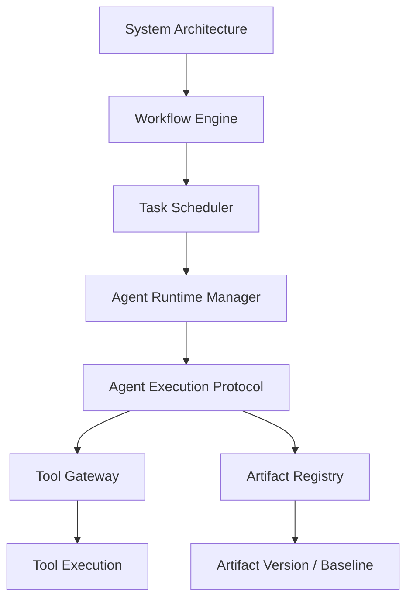

# AI Engineering Orchestration Platform

This directory holds the specification set for the AI Engineering Orchestration Platform. The platform is the executable system for the [Engineering Workflow & AI Agent Orchestration Standard](<../Engineering Workflow & AI Agent Orchestration Standard.md>). It runs engineering work according to the [Product-to-Engineering Development Methodology & Documentation Standard](<../Product-to-Engineering Development Methodology & Documentation Standard.md>), using the document reviews in [Engineering Document Templates & Standards](<../Engineering Document Templates & Standards.md>) §26.

The six specifications below are the Phase 1 core: the platform architecture and the execution path. They are the core baseline. A complete platform specification still includes the integration, governance, and remaining subsystem documents described in the analysis.

| Document | Role |
|---|---|
| [AI Engineering Orchestration Platform — System Architecture Specification](<AI Engineering Orchestration Platform-System Architecture Specification.md>) | Platform architecture, subsystem boundaries, and deployment architecture |
| [Agent Execution Protocol Specification](<Agent Execution Protocol Specification.md>) | How an Agent is tasked, given context, and how it reports results |
| [Tool Gateway & Tool Execution Protocol](<Tool Gateway & Tool Execution Protocol.md>) | Tool discovery, authorization, invocation, and execution |
| [Workflow Engine & Task Scheduler SRS](<Workflow Engine & Task Scheduler  Software-Requirements Specification (SRS).md>) | Workflows, tasks, scheduling, and dependencies |
| [Agent Runtime Manager SRS](<Agent Runtime Manager-Software Requirements Specification.md>) | Lifecycle of an Agent Execution Session |
| [Artifact Registry & Versioning SRS](<Artifact Registry & Versioning-Software Requirements Specification.md>) | Engineering outputs, versions, baselines, and provenance |

## Where to read next

| Need | Document |
|---|---|
| What these six documents cover, what is still missing, and the recommended document set | [ai-documents-analysis.md](ai-documents-analysis.md) |
| The same analysis in Chinese | [ai-documents-analysis_zh.md](ai-documents-analysis_zh.md) |

The analysis organizes the eventual set in three levels: platform architecture and core protocols, core subsystem SRS documents, and platform integration and governance specifications. Its recommended next step is an Architecture & Protocol Consistency Review of these six documents, before writing the remaining specifications.
