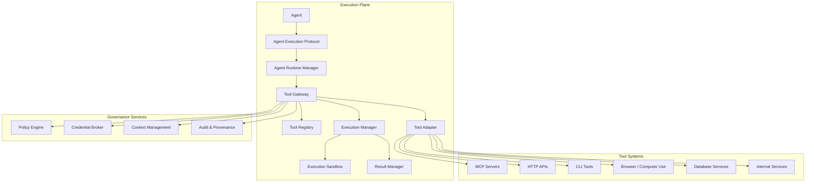
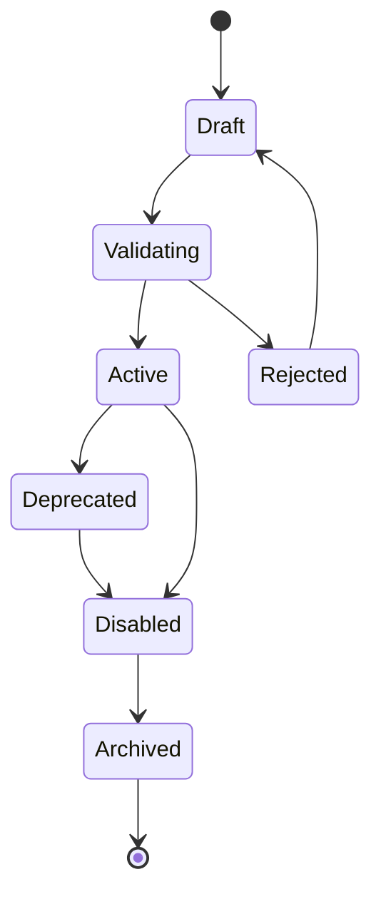
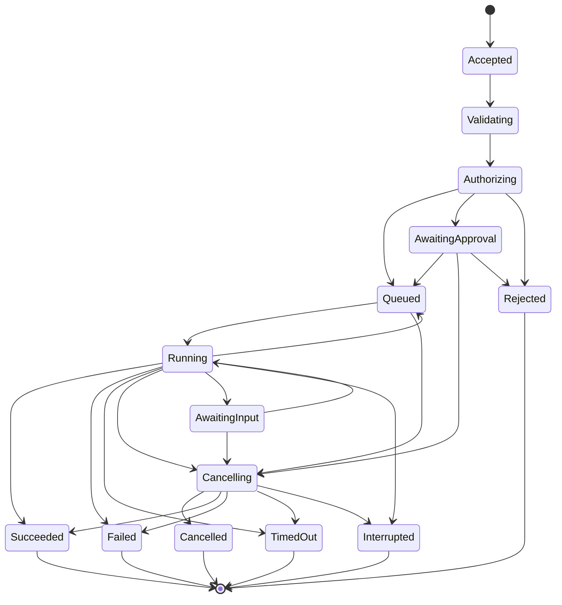
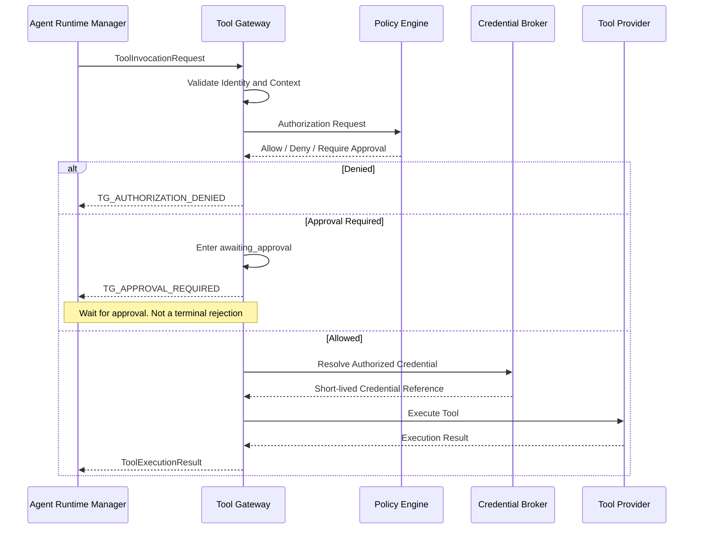
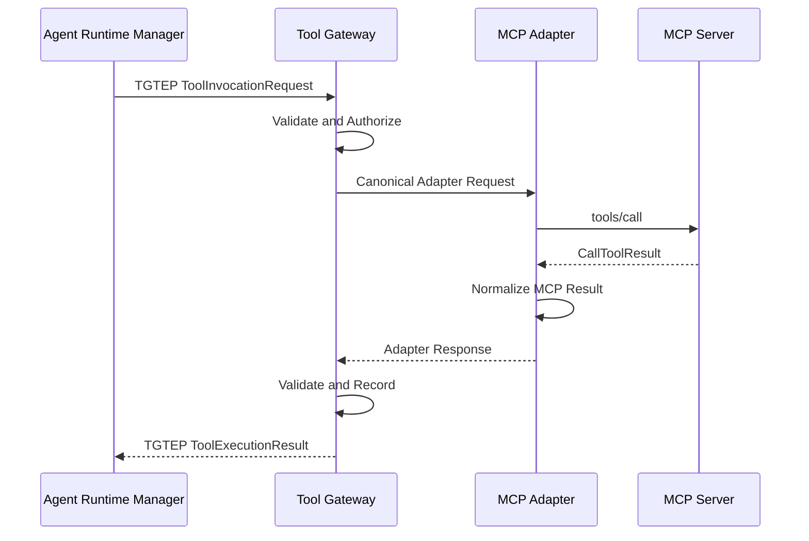
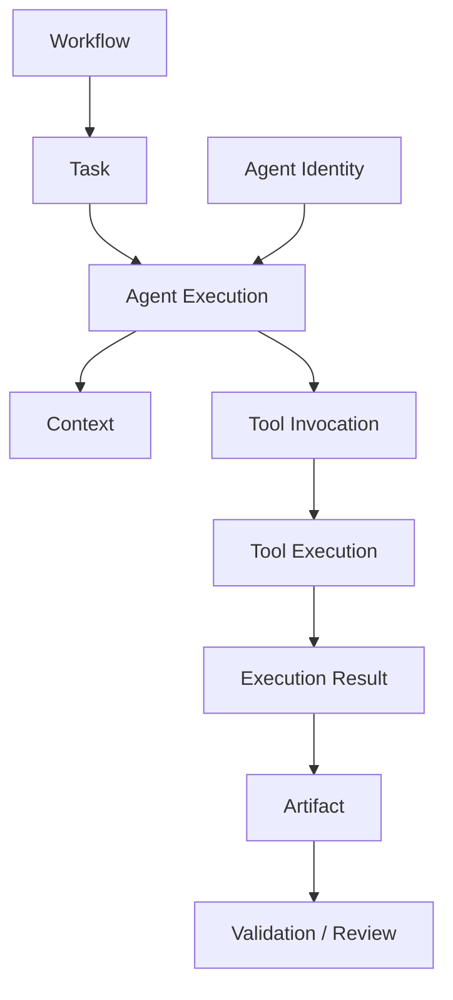
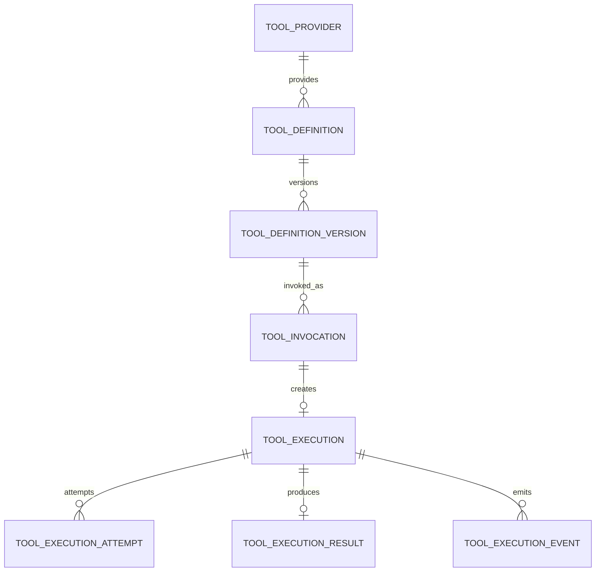
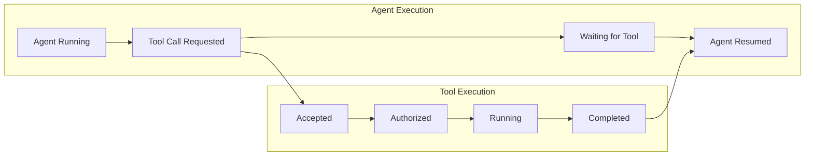

# Tool Gateway & Tool Execution Protocol

| Field | Value |
|---|---|
| Document ID | AI-ENG-PROTO-002 |
| Document Version | 1.0.0 |
| Status | Baseline Draft |
| Document Type | Protocol Specification |
| System | AI Engineering Orchestration Platform |
| Subsystem | Execution Plane / Tool Gateway |
| Related Protocol | Agent Execution Protocol (AI-ENG-PROTO-001) |
| Intended Audience | Platform Architects, Runtime Engineers, Tool Developers, Security Engineers |
| Normative Language | RFC 2119 / RFC 8174 |

---

## 1. Introduction

### 1.1 Purpose

This document defines the **Tool Gateway & Tool Execution Protocol (TGTEP)** for the AI Engineering Orchestration Platform.

TGTEP establishes a unified protocol for registering, discovering, authorizing, invoking, executing, monitoring, and auditing tools used by AI Agents.

The protocol provides a standardized execution boundary between Agent Runtime and external or internal capabilities.

It enables Agents to interact with:

- HTTP APIs and REST services.
- Model Context Protocol (MCP) servers.
- Command-line tools and local processes.
- Browser automation and computer-use systems.
- Database services.
- Cloud infrastructure and development tools.
- Internal platform services.
- Third-party service providers.
- Other execution-capable systems.

TGTEP separates the Agent's decision-making process from the actual execution of tools.

An Agent determines **what action should be performed**. The Tool Gateway determines **whether and how that action may be executed**.

### 1.2 Design Objectives

The protocol MUST provide:

1. **Unified Tool Interface** — a consistent invocation interface regardless of the underlying tool protocol.
2. **Tool Discovery** — standardized registration, metadata, capability discovery, and schema retrieval.
3. **Authorization Enforcement** — permission and policy validation before execution.
4. **Credential Isolation** — secure access to credentials without exposing secrets to Agents.
5. **Execution Isolation** — controlled execution environments and resource boundaries.
6. **Execution Lifecycle Management** — invocation, monitoring, cancellation, timeout, and result delivery.
7. **Reliability** — idempotency, retry controls, concurrency management, and failure handling.
8. **Observability** — structured execution events, logs, metrics, and audit records.
9. **Provenance** — traceable relationships between Agent executions, tool calls, and resulting artifacts.
10. **Protocol Interoperability** — support for MCP, HTTP APIs, CLI tools, and future tool protocols.

### 1.3 Scope

TGTEP covers the following functional domains:

| Domain | Responsibility |
|---|---|
| Tool Registry | Tool registration and metadata management |
| Tool Discovery | Search and capability discovery |
| Tool Schema | Input/output schema management |
| Tool Adapter | Protocol translation |
| Tool Gateway | Unified invocation entry point |
| Authorization | Permission and policy enforcement |
| Credential Integration | Secure credential retrieval |
| Execution Manager | Execution lifecycle management |
| Execution Sandbox | Runtime isolation and resource control |
| Result Manager | Result normalization and delivery |
| Event Manager | Execution events and notifications |
| Audit Manager | Submits security and execution audit events. It does not own the platform audit record |
| Provenance Manager | Copies execution facts into the version provenance at registration. It does not store a second provenance record |

### 1.4 Out of Scope

The following responsibilities belong to other platform components:

| Component | Responsibility |
|---|---|
| Agent Runtime | Agent reasoning, planning, tool selection, and Agent Loop |
| Workflow Engine | Workflow, phase, task dependencies, and progression |
| Scheduler | Runnable task scheduling and execution resource allocation |
| Agent Runtime Manager (ARM) | Agent Execution Session lifecycle |
| Policy Engine | Policy evaluation and authorization decisions |
| Credential Broker | Credential storage, issuance, rotation, and retrieval |
| Artifact Registry | Artifact identity, versioning, and baseline management |
| Context Management | Agent context construction and lifecycle |
| Review & Approval | Human or automated approval workflows |

TGTEP MUST NOT become a replacement for these subsystems.

---

## 2. Architectural Positioning

### 2.1 Platform Architecture

Tool Gateway belongs to the Execution Plane, together with the Agent Runtime Manager. Tool execution records remain owned by the Tool Gateway. The orchestration control plane owns task, workflow, and approval state.



### 2.2 Architectural Responsibilities

#### Agent

The Agent:

- Receives the tool definitions made available for its execution.
- Selects tools based on task requirements.
- Constructs tool arguments.
- Sends `tool.request` to the Agent Runtime Manager.
- Receives execution results from the Runtime Manager.
- Interprets results and updates Agent context.
- Decides whether another tool call or final response is required.

An Agent MUST NOT call the Tool Gateway directly, and MUST NOT bypass it by calling a tool provider directly.

#### Agent Runtime Manager

The Agent Runtime Manager:

- Translates an accepted `tool.request` into the canonical tool invocation.
- Submits that invocation to the Tool Gateway.
- Returns the normalized result to the Agent.

The Runtime Manager MUST NOT bypass the Tool Gateway when a governed tool is required.

#### Tool Gateway

Tool Gateway:

- Validates invocation requests.
- Resolves tool identities and versions.
- Validates input schemas.
- Requests authorization decisions.
- Obtains authorized credential references.
- Selects the appropriate Tool Adapter.
- Creates and manages Tool Executions.
- Enforces execution constraints.
- Returns execution results.
- Emits execution events.
- Records audit and provenance information.

#### Tool Adapter

Tool Adapter translates the platform's canonical tool invocation model into the protocol required by the underlying tool provider.

For example:

```text
Canonical Invocation
        |
        v
    Tool Adapter
        |
        +---- MCP Client
        |
        +---- HTTP Client
        |
        +---- CLI Executor
        |
        +---- Browser Automation Client
        |
        +---- Internal Service Client
```

An adapter MUST NOT independently bypass gateway authorization or security controls.

### 2.3 Relationship with Other Protocols

TGTEP is an orchestration and governance protocol. It does not attempt to replace existing tool communication standards.

| Standard / Protocol | Role | TGTEP Relationship |
|---|---|---|
| MCP | Agent-to-tool interaction protocol | Supported through MCP Adapter |
| OpenAPI | HTTP API description | Tool schema and adapter generation source |
| JSON-RPC | Request/response message protocol | May be used by adapters |
| HTTP | Transport protocol | Supported execution transport |
| gRPC | RPC communication | Optional adapter transport |
| AEP | Agent execution protocol | The Agent sends `tool.request` to the Agent Runtime Manager. The Runtime Manager translates it into this protocol. |
| TGTEP | Tool governance and execution protocol | Platform-level canonical contract |

**Important distinction:** MCP defines how MCP clients and servers communicate. TGTEP defines how the platform governs and manages tool execution across multiple tool technologies.

The Integration Service owns provider connection configuration. This protocol owns tool definitions and each invocation. A governed model call MUST be registered as a tool. This protocol MUST NOT store long-lived provider secrets; it resolves a short-lived credential from the Credential Broker after the Policy Engine allows the call.

---

## 3. Core Concepts

### 3.1 Tool

A Tool is a registered executable capability that can be invoked by an authorized Agent or platform component.

Examples:

- `filesystem.read_file`
- `github.create_pull_request`
- `browser.navigate`
- `postgres.query`
- `shell.execute`
- `artifact_registry.publish`

A Tool is a logical identity independent of its execution provider.

### 3.2 Tool Provider

A Tool Provider is the service, process, or execution environment that implements one or more tools.

Examples:

- An MCP Server.
- An HTTP API service.
- A local CLI installation.
- A browser automation service.
- An internal platform subsystem.

One provider MAY expose multiple tools.

### 3.3 Tool Definition

A Tool Definition describes the interface and execution characteristics of a tool.

It includes:

- Tool identity.
- Name and description.
- Provider identity.
- Input schema.
- Output schema.
- Protocol binding.
- Capability requirements.
- Permission requirements.
- Execution constraints.
- Version information.

### 3.4 Tool Invocation

A Tool Invocation represents an Agent's request to execute a particular tool.

An invocation is a request object. It is not itself an execution.

### 3.5 Tool Execution

A Tool Execution represents the actual execution instance created by the Tool Gateway after accepting an invocation request.

An execution has its own lifecycle, status, timestamps, result, and audit records.

### 3.6 Execution Context

Execution Context contains the information required to establish the security and operational boundaries of an execution.

It includes:

- Tenant ID.
- Project ID.
- `workflow_definition_id`.
- `workflow_run_id`.
- Task ID.
- Agent identity.
- Agent execution ID.
- Context reference.
- Authorization context.
- Trace context.
- Execution constraints.

Execution Context MUST NOT contain provider credential secrets or tool credential secrets of any lifetime.

### 3.7 Tool Capability, Permission, and Authority

These concepts MUST remain distinct.

| Concept | Meaning | Example |
|---|---|---|
| Capability | What an Agent or tool can technically do | Read repository files |
| Permission | What an identity is allowed to do under a policy | Read repository A |
| Authority | The source or delegation of the right to perform an action | User-granted repository access |

A capability does not automatically imply permission.

A permission does not automatically establish authority.

A Tool Gateway MUST enforce authorization based on the applicable authority and permission context, rather than relying solely on tool capability metadata.

---

## 4. Tool Identity and Registration

### 4.1 Tool Identity

Every registered tool MUST have a globally unique `tool_id`.

Recommended identifier:

```text
TOL-{ULID}
```

A Tool Definition MUST also have:

- `tool_name`
- `provider_id`
- `version`
- `status`

Example:

```json
{
  "tool_id": "TOL-01JABCDEF123456789",
  "tool_name": "github.create_pull_request",
  "provider_id": "PRV-01JABCDEF123456789",
  "version": "1.2.0",
  "status": "active"
}
```

`tool_id` identifies the logical tool.

`version` identifies a particular tool interface definition.

The two MUST NOT be treated as interchangeable.

### 4.2 Tool Registration

A tool provider MUST register its tools before they can be discovered and invoked through the governed gateway.

Registration MUST include:

| Field | Required | Description |
|---|---|---|
| tool_name | Yes | Unique name within its namespace |
| description | Yes | Human-readable description |
| provider_id | Yes | Provider identity |
| version | Yes | Tool definition version |
| protocol_type | Yes | MCP, HTTP, CLI, etc. |
| input_schema | Yes | Input JSON Schema |
| output_schema | Recommended | Output JSON Schema |
| permission_requirements | Yes | Required permissions |
| execution_constraints | Yes | Execution limits |
| endpoint_reference | Yes | Provider endpoint or adapter reference |
| metadata | Optional | Additional descriptive metadata |

Registration MUST validate the definition before publishing it.

### 4.3 Tool Definition Example

```json
{
  "tool_id": "TOL-01JABCDEF123456789",
  "tool_name": "github.create_pull_request",
  "version": "1.0.0",
  "description": "Create a pull request in a GitHub repository.",
  "provider": {
    "provider_id": "PRV-GITHUB",
    "protocol_type": "http",
    "adapter": "github_adapter"
  },
  "input_schema": {
    "type": "object",
    "required": [
      "repository",
      "title",
      "head",
      "base"
    ],
    "properties": {
      "repository": {
        "type": "string"
      },
      "title": {
        "type": "string"
      },
      "head": {
        "type": "string"
      },
      "base": {
        "type": "string"
      },
      "body": {
        "type": "string"
      }
    },
    "additionalProperties": false
  },
  "output_schema": {
    "type": "object",
    "properties": {
      "pull_request_number": {
        "type": "integer"
      },
      "html_url": {
        "type": "string"
      },
      "state": {
        "type": "string"
      }
    }
  },
  "permission_requirements": [
    "github.pull_request.create"
  ],
  "default_invocation_mode": "sync",
  "supported_invocation_modes": ["sync", "async"],
  "execution_constraints": {
    "timeout_ms": 30000,
    "max_retries": 0,
    "execution_mode": "remote"
  }
}
```

### 4.4 Tool Versioning

Tool definitions MUST be versioned independently from provider implementations.

The platform SHOULD use semantic versioning for tool interface definitions.

`default_invocation_mode` is one of `sync`, `async`, or `stream`, and it MUST be one of `supported_invocation_modes`. `execution_constraints.execution_mode` names provider placement, such as `remote` or `isolated_process`. It is not the invocation mode.

| Change | Version Impact |
|---|---|
| Description correction | Patch |
| Optional input field added | Minor |
| Optional output field added | Minor |
| Required input field added | Major |
| Existing field type changed incompatibly | Major |
| Tool semantics changed incompatibly | Major |

An execution MUST reference the exact tool definition version used when the invocation was accepted.

The platform MUST NOT silently replace the version of an already accepted invocation.

### 4.5 Tool Lifecycle



Definitions:

- `Draft`: Tool definition is being created.
- `Validating`: Schema, provider, and security validation is in progress.
- `Active`: Tool is available for authorized invocation.
- `Rejected`: Registration validation failed.
- `Deprecated`: Tool remains available but is scheduled for retirement.
- `Disabled`: New invocations are prohibited.
- `Archived`: Tool definition is retained for historical records.

Disabling a tool MUST NOT erase historical execution records.

---

## 5. Tool Discovery Protocol

### 5.1 Discovery Requirements

Tool Discovery allows the Agent Runtime Manager to identify tools available within the current execution scope. The only caller of `POST /api/v1/tools/discover` is the Agent Runtime Manager. An Agent MUST NOT call that endpoint. The Runtime Manager MAY include a filtered tool list in the execution command.

Discovery MUST consider:

- Tenant scope.
- Project scope.
- Agent identity.
- Agent capability.
- Tool status.
- Permission requirements.
- Tool version compatibility.

Discovery results MUST NOT be interpreted as authorization grants.

A tool appearing in a discovery result does not guarantee that a later invocation will be authorized. Authorization MUST be evaluated again at invocation time.

### 5.2 Discovery Request

```http
POST /api/v1/tools/discover
Content-Type: application/json
```

```json
{
  "execution_context": {
    "tenant_id": "TEN-001",
    "project_id": "PRJ-001",
    "agent_id": "AGT-001",
    "agent_execution_id": "AEX-001"
  },
  "query": {
    "keywords": [
      "github",
      "pull request"
    ],
    "capabilities": [
      "repository.write"
    ],
    "protocol_types": [
      "http",
      "mcp"
    ]
  },
  "pagination": {
    "limit": 50,
    "cursor": null
  }
}
```

### 5.3 Discovery Response

```json
{
  "tools": [
    {
      "tool_id": "TOL-001",
      "tool_name": "github.create_pull_request",
      "version": "1.0.0",
      "description": "Create a pull request.",
      "input_schema_ref": "schema://TOL-001/1.0.0",
      "permission_requirements": [
        "github.pull_request.create"
      ],
      "availability": "available"
    }
  ],
  "pagination": {
    "next_cursor": null,
    "has_more": false
  }
}
```

The `availability` field describes discoverability or operational availability, not authorization.

### 5.4 Schema Retrieval

The Agent Runtime Manager retrieves a tool schema when the execution command does not already contain it. An Agent MUST NOT call this endpoint. The Agent uses only the tool definitions delivered in the execution command.

```http
GET /api/v1/tools/{tool_id}/versions/{version}
```

The only caller of this endpoint is the Agent Runtime Manager.

The returned definition MUST be immutable for that published version.

---

## 6. Canonical Tool Invocation Protocol

### 6.1 Invocation Model

TGTEP defines a canonical invocation model independent of the underlying provider protocol.

```text
Agent Runtime Manager
     |
     | ToolInvocationRequest
     v
Tool Gateway
     |
     +--> Request Validation
     |
     +--> Tool Resolution
     |
     +--> Authorization
     |
     +--> Credential Resolution
     |
     +--> Execution Creation
     |
     +--> Adapter Dispatch
     |
     +--> Execution Monitoring
     |
     +--> Result Normalization
     |
     v
Agent Runtime Manager
```

The only caller of tool invocation is the Agent Runtime Manager, translating an Agent Execution Protocol `tool.request`. An Agent MUST NOT call the Gateway directly. The path below is an illustrative example. It is not the interoperability contract until the Platform Internal API specification defines paths. `POST /api/v1/tool-executions` and `POST /aep/v1/tool-invocations` MUST NOT be read as competing endpoints. `tool_execution_id` identifies the tool execution. It MUST NOT be used as `agent_execution_id`. `tool_attempt` is the retry ordinal inside one tool execution and is not the workflow task attempt.

### 6.2 Invocation Request

Endpoint:

```http
POST /api/v1/tool-executions
Content-Type: application/json
```

Request schema:

```json
{
  "protocol_version": "1.0",
  "invocation_id": "INV-01JABCDEF123456789",
  "idempotency_key": "idem-8f72a4",
  "execution_context": {
    "tenant_id": "TEN-001",
    "project_id": "PRJ-001",
    "workflow_definition_id": "WFD-001",
    "workflow_run_id": "WFR-001",
    "task_id": "TSK-001",
    "agent_id": "AGT-001",
    "agent_execution_id": "AEX-001",
    "context_package_id": "CTX-001"
  },
  "tool": {
    "tool_id": "TOL-001",
    "version": "1.0.0"
  },
  "arguments": {
    "repository": "example/project",
    "title": "Add authentication module",
    "head": "feature/auth",
    "base": "main"
  },
  "execution_options": {
    "mode": "sync",
    "timeout_ms": 30000,
    "priority": "normal"
  },
  "correlation_id": "CORR-001",
  "authorization_context": {
    "authorization_decision_id": "DEC-001"
  },
  "trace_context": {
    "trace_id": "TRACE-001",
    "span_id": "SPAN-001"
  }
}
```

### 6.3 Required Fields

| Field | Required | Description |
|---|---|---|
| protocol_version | Yes | TGTEP protocol version |
| invocation_id | Yes | Unique invocation request ID. The Runtime Manager assigns a new value for each accepted `tool.request`. A Gateway retry MUST NOT allocate another one |
| idempotency_key | Conditional | Required for a side-effecting operation. The Agent supplies it. The Runtime Manager forwards it unchanged and MUST NOT derive it from `invocation_id`. The Gateway reuses it for a `tool_attempt` of the same invocation |
| execution_context | Yes | Execution identity and scope |
| tool.tool_id | Yes | Target tool identity. The Runtime Manager resolves the Agent's `tool.name`, which is the registry `tool_name`, to this identifier before the request. The Gateway MUST NOT accept a tool name as the primary key. |
| tool.version | Yes | Exact tool definition version |
| arguments | Yes | Tool input arguments |
| execution_options | Yes | Execution preferences and constraints |
| correlation_id | Yes | End-to-end correlation from the Agent execution. It is not a field of `trace_context`. |
| authorization_context | Conditional | `authorization_decision_id` when a Policy Engine decision already exists |
| trace_context | Recommended | Distributed trace information |

The `authorization_context` carries `authorization_decision_id`, the Policy Engine decision identifier. It MUST NOT be accepted as proof of authorization merely because an Agent supplied it. The Runtime Manager forwards the execution context and MUST NOT request or attach a new `authorization_decision_id` for the tool invocation. An invocation that has not yet been decided omits the identifier; the Gateway then obtains the decision from the Policy Engine.

When `authorization_decision_id` is present, the Gateway MUST validate it with the Policy Engine. When it is absent, the Gateway MUST request the decision from the Policy Engine and then record the identifier it receives. The decision object uses `authorization_decision_id`. It MUST NOT use `decision_id`.

`tool.version` is the version of the tool definition the Runtime Manager resolved. The Gateway MUST NOT select a version when the caller omits it. `execution_options.mode` is `sync`, `async`, or `stream`. The Runtime Manager sets it from the tool definition's `default_invocation_mode`. A request MAY narrow it to a mode listed in `supported_invocation_modes`. The Gateway MUST reject any other mode and MUST NOT choose a mode on its own. Responses, status, and the execution record echo `execution_options.mode` and `tool.version`. They MUST NOT use `execution_mode` or `tool_version` for these two values. `execution_constraints.execution_mode` remains the provider-placement field.

### 6.4 Invocation Response

For synchronous execution:

```json
{
  "invocation_id": "INV-01JABCDEF123456789",
  "tool_execution_id": "TEX-01JABCDEF123456789",
  "status": "succeeded",
  "tool": {
    "tool_id": "TOL-001",
    "version": "1.0.0"
  },
  "execution_options": {
    "mode": "sync"
  },
  "result": {
    "pull_request_number": 123,
    "html_url": "https://github.com/example/project/pull/123",
    "state": "open"
  },
  "error": null,
  "timestamps": {
    "accepted_at": "2026-11-25T09:00:00Z",
    "started_at": "2026-11-25T09:00:01Z",
    "completed_at": "2026-11-25T09:00:03Z"
  }
}
```

For asynchronous execution:

```json
{
  "invocation_id": "INV-001",
  "tool_execution_id": "TEX-001",
  "status": "accepted",
  "tool": {
    "tool_id": "TOL-001",
    "version": "1.0.0"
  },
  "execution_options": {
    "mode": "async"
  },
  "result": null,
  "error": null,
  "links": {
    "status": "/api/v1/tool-executions/TEX-001",
    "cancel": "/api/v1/tool-executions/TEX-001/cancel"
  }
}
```

An accepted asynchronous request MUST NOT be reported as successfully completed.

---

## 7. Execution Lifecycle Protocol

### 7.1 Execution States

The Tool Execution lifecycle is independent from the Workflow, Task, and Agent Execution Session lifecycles.



Diagram labels use PascalCase logical names. The wire `status` values are the lowercase tokens in section 7.2, including `awaiting_approval`, `awaiting_input`, and `timed_out`. A transition from `running` to `failed`, `timed_out`, or `interrupted` is taken only when no further `tool_attempt` will be made. Cancellation accepted from `queued`, `awaiting_approval`, `running`, or `awaiting_input` enters `cancelling` and publishes `tool.execution.cancelling` once. The execution enters `cancelled` only after the stop is confirmed, and that transition publishes `tool.execution.cancelled` once. If the underlying operation cannot be stopped, the execution leaves `cancelling` for the actual terminal state: `succeeded`, `failed`, `timed_out`, or `interrupted`. That transition publishes the matching terminal event once and MUST NOT also publish `tool.execution.cancelled`. A failure of the cancellation operation itself uses category `runtime`, leaves `cancelling` for `failed` or `interrupted`, and MUST NOT enter `cancelled`. A direct transition from `queued` or `awaiting_approval` to `cancelled` is illegal. While retry budget remains, `running` MAY return to `queued` on the same `tool_execution_id`. A cancellation in progress MUST NOT return to `queued`.

### 7.2 State Definitions

| State | Meaning |
|---|---|
| accepted | Gateway accepted the invocation request |
| validating | Request and tool definition are being validated |
| authorizing | Authorization checks are being performed |
| awaiting_approval | An approval decision is required |
| queued | Execution is waiting for dispatch |
| running | Tool is actively executing |
| awaiting_input | Execution requires external input |
| cancelling | Cancellation has been requested |
| succeeded | Execution completed successfully |
| failed | Execution failed |
| timed_out | The tool execution exceeded its effective tool timeout |
| cancelled | Execution was cancelled |
| rejected | Invocation was rejected before execution |
| interrupted | Execution was interrupted without confirmed completion |

### 7.3 State Transition Requirements

1. Every execution MUST have exactly one current state.
2. Every state transition MUST be recorded.
3. State transitions MUST be validated against the lifecycle model.
4. Terminal states MUST NOT transition back to active states.
5. While retry budget remains and cancellation has not been accepted, a provider failure appends `tool_attempt` and the state stays `running` or returns to `queued`. It MUST NOT enter a terminal state for that attempt. The retry uses the same `tool_execution_id` and `invocation_id`. It MUST NOT create another `tool_execution_id`, `invocation_id`, `attempt_id`, `agent_execution_id`, or `session_id`. After cancellation has been accepted, the execution MUST NOT return to `running` or `queued`.
6. A terminal state is recorded only when no further `tool_attempt` will be made. `failed`, `timed_out`, `cancelled`, `rejected`, `interrupted`, and `succeeded` have no outgoing transition.
7. An execution MUST NOT be marked `succeeded` until the adapter has received a successful completion result and the result has passed required validation.
8. An execution MUST NOT be marked `cancelled` solely because a cancellation request was accepted. Acceptance of cancellation from `queued`, `awaiting_approval`, `running`, or `awaiting_input` enters `cancelling` and publishes `tool.execution.cancelling` once. `cancelled` follows only after the stop is confirmed. If the underlying operation cannot be stopped, the execution leaves `cancelling` for `succeeded`, `failed`, `timed_out`, or `interrupted` and publishes that terminal event once. A failure of the cancellation operation itself uses category `runtime` and leaves `cancelling` for `failed` or `interrupted`. Neither case enters `cancelled` or publishes `tool.execution.cancelled`.

### 7.4 Execution Status API

```http
GET /api/v1/tool-executions/{tool_execution_id}
```

Example:

```json
{
  "tool_execution_id": "TEX-001",
  "invocation_id": "INV-001",
  "tool": {
    "tool_id": "TOL-001",
    "version": "1.0.0"
  },
  "execution_options": {
    "mode": "async"
  },
  "status": "running",
  "result": null,
  "tool_attempt": 1,
  "timestamps": {
    "accepted_at": "2026-11-25T09:00:00Z",
    "started_at": "2026-11-25T09:00:01Z",
    "completed_at": null
  }
}
```

### 7.5 Execution Cancellation

```http
POST /api/v1/tool-executions/{tool_execution_id}/cancel
```

Request:

```json
{
  "reason": "Agent execution cancelled",
  "requested_by": "AGT-001"
}
```

Response:

```json
{
  "tool_execution_id": "TEX-001",
  "status": "cancelling",
  "accepted": true
}
```

Cancellation semantics:

- Cancellation is a request to stop execution, not a guarantee of immediate termination.
- The adapter MUST propagate cancellation when the underlying protocol supports it.
- The execution environment SHOULD terminate the underlying process or request when safe and technically possible.
- If the underlying operation cannot be stopped, the Gateway MUST leave `cancelling` for the actual terminal state: `succeeded`, `failed`, `timed_out`, or `interrupted`. It publishes that terminal event once and MUST NOT publish `tool.execution.cancelled`.
- A failure of the cancellation operation itself uses category `runtime`, leaves `cancelling` for `failed` or `interrupted`, and MUST NOT set the tool status to `cancelled`.
- The Gateway MUST NOT claim that a side effect was rolled back unless the provider confirms it.

### 7.6 Timeout

Every execution MUST have an effective tool timeout.

The effective tool timeout is the minimum of:

- Tool definition maximum timeout.
- Invocation-request timeout.
- Platform policy limit.

The Agent `deadline` is not an input to this timeout. An Agent MUST NOT increase a timeout beyond the limits imposed by the tool definition or platform policy.

When the Agent `deadline` is reached, an in-flight tool execution in `queued`, `awaiting_approval`, `running`, or `awaiting_input` enters `cancelling` and MUST NOT return to `running` or `queued`. The Gateway MUST NOT mark that execution `timed_out` because of the Agent deadline, and MUST NOT start another `tool_attempt`. A tool timeout MUST NOT by itself change the Agent execution state.

---

## 8. Execution Modes

### 8.1 Synchronous Execution

Synchronous execution returns the result within the original invocation request.

Suitable for:

- Fast API calls.
- Small database queries.
- Lightweight file operations.
- Short computational tasks.

The Gateway MUST enforce a bounded synchronous request duration.

If the execution cannot complete within the synchronous response window, the Gateway SHOULD transition it to asynchronous execution when supported, or return a timeout/continuation response with a valid execution reference.

### 8.2 Asynchronous Execution

Asynchronous execution returns an execution reference immediately.

Suitable for:

- Long-running CLI operations.
- Browser automation.
- Build and test pipelines.
- Large data processing.
- Deployment operations.
- External tasks with variable completion time.

The Agent Runtime retrieves the result through polling or event subscription.

### 8.3 Streaming Execution

Streaming execution allows incremental output delivery.

Suitable for:

- Terminal output.
- Browser progress.
- Large query results.
- Incremental computation.
- Long-running task logs.

A streaming execution MUST distinguish between:

- Progress events.
- Partial output.
- Final result.
- Error events.

Partial output MUST NOT be mistaken for a final result.

### 8.4 Execution Mode Selection

| Mode | Initial Response | Result Delivery | Typical Use |
|---|---|---|---|
| sync | Final or immediate response | Same request | Short operations |
| async | Execution reference | Polling or event | Long-running operations |
| stream | Stream reference or open stream | Incremental events | Continuous output |

The underlying provider protocol does not determine the platform execution mode by itself. The adapter MUST map provider behavior into the canonical execution model.

---

## 9. Execution Result Protocol

### 9.1 Result Envelope

Every completed execution MUST produce a normalized result envelope.

```json
{
  "tool_execution_id": "TEX-001",
  "status": "succeeded",
  "result": {
    "message": "Pull request created successfully",
    "data": {
      "pull_request_number": 123,
      "html_url": "https://github.com/example/project/pull/123"
    }
  },
  "artifacts": [],
  "metadata": {
    "provider_id": "PRV-GITHUB",
    "adapter": "github_adapter",
    "duration_ms": 1200
  },
  "error": null
}
```

The tool return value is `result`. `artifacts` stays beside it and is not nested inside `result`. `output_schema` validates `result`. The field name `output` MUST NOT carry the return value. The invocation response, a completed status, this envelope, and the Agent Execution Protocol `tool.response` all use `result`.

### 9.2 Output Types

The protocol SHOULD support the following output types:

| Type | Description |
|---|---|
| json | Structured JSON data |
| text | Plain text |
| binary | Binary data reference |
| file | File or artifact reference |
| stream | Stream reference |
| resource | External resource reference |
| multimodal | Image, audio, video, or other supported content |

Large binary outputs SHOULD be stored in object storage or Artifact Registry rather than embedded directly in the response envelope.

### 9.3 Artifact References

When a tool produces a persistent engineering artifact, the Gateway MUST register it with Artifact Registry. It MUST NOT leave registration to a later `artifact.submit`. The Agent references the returned `artifact_id` and `version_id` and MUST NOT submit a second copy.

Example:

```json
{
  "artifacts": [
    {
      "artifact_id": "ART-001",
      "version_id": "ARV-001",
      "type": "system_architecture_specification",
      "media_type": "text/markdown"
    }
  ]
}
```

The Tool Gateway MUST NOT become the authoritative owner of artifact versioning. An artifact reference in a tool result carries `artifact_id`, `version_id`, and `type`. It MUST NOT carry `relationship_type`. `generated_from` is an Artifact Registry relationship whose source is the new version and whose target is the input version. When no input version is known, the Gateway MUST NOT write that relationship.

### 9.4 Result Validation

The Gateway MUST:

1. Validate structured outputs against the declared output schema when available.
2. Enforce output size limits.
3. Preserve the provider's original error information where permitted.
4. Normalize provider-specific output structures.
5. Record the adapter and tool definition versions used.
6. Distinguish an empty successful result from a missing or failed result.

---

## 10. Error Handling Protocol

### 10.1 Error Envelope

```json
{
  "tool_execution_id": "TEX-001",
  "status": "failed",
  "error": {
    "code": "TG_PROVIDER_UNAVAILABLE",
    "category": "provider",
    "message": "The tool provider is temporarily unavailable.",
    "retryable": true,
    "correlation_id": "CORR-001",
    "details": {
      "provider_id": "PRV-001"
    }
  }
}
```

Sensitive provider information MUST be removed or redacted before being returned to an Agent.

### 10.2 Error Categories

| Category | Description | Example |
|---|---|---|
| protocol | Invalid message or schema | Missing required argument; a provider response that cannot be parsed |
| tool | Tool definition or tool state error | Tool disabled |
| authorization | Authorization failure | Permission denied |
| approval | Approval was rejected | Approval rejected. A pending wait is `awaiting_approval`, not this category |
| credential | Credential retrieval or validity failure | Token expired |
| provider | Provider failure whose message is valid | Service unavailable; rate limit |
| execution | Execution environment failure | Process crash. This is the platform category `execution` |
| timeout | Effective tool clock exceeded | The minimum of the tool-definition maximum, the invocation `timeout_ms`, and the platform limit was exceeded. The Agent `deadline` is not this clock |
| cancellation | The operation was cancelled | User requested cancellation. A failure of the cancellation operation itself uses `runtime`, enters `failed` or `interrupted`, and MUST NOT set the tool status to `cancelled` |
| resource | Resource quota exceeded | Memory limit exceeded |
| internal | Gateway internal failure | Unexpected exception |

### 10.3 Standard Error Codes

| Error Code | Meaning | Retryable |
|---|---|---|
| TG_INVALID_INVOCATION | Invalid invocation structure | No |
| TG_TOOL_NOT_FOUND | Tool does not exist | No |
| TG_TOOL_VERSION_NOT_FOUND | Tool version unavailable | No |
| TG_TOOL_DISABLED | Tool is disabled | No |
| TG_INPUT_SCHEMA_INVALID | Input validation failed | No |
| TG_AUTHORIZATION_DENIED | Permission denied | No |
| TG_APPROVAL_REQUIRED | Approval wait accepted. Tool status becomes `awaiting_approval`. This is not a terminal rejection and does not change the Agent execution state | No automatic retry |
| TG_APPROVAL_REJECTED | Approval rejected | No |
| TG_CREDENTIAL_UNAVAILABLE | Credential cannot be obtained | Conditional |
| TG_PROVIDER_UNAVAILABLE | Provider unavailable | Conditional |
| TG_PROVIDER_RATE_LIMITED | Provider rate limit reached | Yes, subject to policy |
| TG_EXECUTION_TIMEOUT | Effective tool clock exceeded. The Agent `deadline` MUST NOT select this code | Conditional, only for this tool clock. A non-idempotent write without a reliable idempotency key or reconciliation MUST NOT auto-retry |
| TG_EXECUTION_CANCELLED | Execution cancelled | No |
| TG_RESOURCE_LIMIT_EXCEEDED | Resource limit exceeded | No |
| TG_PROTOCOL_ERROR | Invalid protocol message or schema, including a provider response that cannot be parsed. A provider outage, rate limit, or failure carried in a valid message uses a `TG_PROVIDER_*` code and category `provider` | No |
| TG_RESULT_VALIDATION_FAILED | Output failed schema validation | No |
| TG_IDEMPOTENCY_CONFLICT | Idempotency key reused with different request | No |
| TG_INTERNAL_ERROR | Internal gateway failure | Conditional |

Every `code` MUST use the `TG_` prefix. Every `category` MUST be one of the platform categories defined by the System Architecture Specification. An invalid invocation, or a provider response that cannot be parsed as a protocol message, uses `protocol`. A provider outage, rate limit, or failure carried in a valid message uses `provider`. This protocol does not define a `request` category. `timeout` and `TG_EXECUTION_TIMEOUT` mean only that the effective tool clock expired. When the Agent `deadline` is reached, an in-flight tool enters `cancelling`. The Gateway MUST NOT mark it `timed_out` and MUST NOT start another `tool_attempt`.

### 10.4 Retry Rules

Retry in this section is a `tool_attempt` inside one `tool_execution_id` and the same `invocation_id`. While retry budget remains and cancellation has not been accepted, the tool state stays `running` or returns to `queued`. It MUST NOT create a task `attempt_id`, an `agent_execution_id`, a `session_id`, or another `invocation_id`. After cancellation has been accepted, the execution MUST NOT return to `running` or `queued`.

Retry MUST be controlled by the Gateway and applicable policy.

An Agent MUST NOT assume that every failed tool execution can be safely repeated.

The Gateway MUST consider:

- Tool idempotency classification.
- Idempotency key.
- Provider response.
- Whether a side effect may already have occurred.
- Retry budget.
- Deadline.
- Rate limits.
- Authorization validity.

Tools SHOULD declare `execution_classification` for retry safety:

| execution_classification | Meaning |
|---|---|
| read_only | Does not intentionally mutate external state |
| idempotent_write | Repeated identical operation has the same intended effect |
| non_idempotent_write | Repeated execution may create additional effects |
| irreversible | Operation cannot reliably be rolled back |

`execution_classification` is not the Policy Engine operation class. Operation classes remain `read`, `write`, `modify`, `approve`, `deploy`, and `destroy`. A tool definition MUST carry both when both apply. The Gateway MUST NOT send `execution_classification` to the Policy Engine as an operation class.

Automatic retries of `non_idempotent_write` and `irreversible` operations MUST NOT occur unless the provider supplies a reliable idempotency mechanism or the operation has been independently reconciled.

---

## 11. Idempotency and Concurrency

### 11.1 Idempotency

A side-effecting invocation MUST include an `idempotency_key` supplied by the Agent. If the Agent omits it, the Runtime Manager rejects the `tool.request`. The Gateway MUST NOT execute that invocation and MUST NOT derive a key.

The Gateway MUST bind an idempotency key to:

- Tenant.
- Calling identity.
- Tool identity.
- Tool version.
- Request payload digest.
- Applicable execution scope.

For the same idempotency key and equivalent request:

- The Gateway MUST NOT create duplicate side effects when it can enforce idempotency.
- It SHOULD return the existing execution reference or result.

For the same key with a different request payload, the Gateway MUST return `TG_IDEMPOTENCY_CONFLICT`.

Idempotency retention MUST be defined by platform policy and tool characteristics.

### 11.2 Concurrency Control

The Gateway MUST support concurrency limits at applicable scopes:

- Global platform.
- Tenant.
- Project.
- Agent identity.
- Tool.
- Provider.
- Execution environment.

Concurrency policies MAY include:

- Maximum concurrent executions.
- Per-provider rate limits.
- Queue capacity.
- Execution priority.
- Fair scheduling.
- Resource quotas.

The Gateway MUST NOT assume that a tool is safe for concurrent execution merely because it supports multiple requests.

### 11.3 Parallel Tool Calls

Agent Runtime MAY submit multiple independent tool invocations in parallel.

The Gateway MUST create an independent execution record for each invocation.

If multiple operations have dependencies, the Agent Runtime or Workflow Engine MUST manage those dependencies.

The Gateway MUST NOT infer business-level dependencies from the order in which requests arrive.

---

## 12. Authorization and Approval Protocol

### 12.1 Authorization Flow



When the Policy Engine requires approval, the Gateway enters `awaiting_approval`, publishes `tool.execution.awaiting_approval` once, and returns `TG_APPROVAL_REQUIRED`. That response accepts the wait. It is not `TG_AUTHORIZATION_DENIED`, it is not a terminal tool status, and it does not change the Agent execution state.

### 12.2 Authorization Decision

The Policy Engine decides authorization from the operation class and the risk level. Those two attributes are defined by the System Architecture Specification. This protocol MUST NOT define a separate approval matrix.

The Policy Engine SHOULD evaluate:

- Subject identity.
- Tenant and project scope.
- Tool identity and version.
- Requested operation.
- Input arguments.
- Data classification.
- Resource scope.
- Execution environment.
- Approval requirements.
- Risk classification.
- Applicable delegation or authority.

Authorization decisions SHOULD be represented as:

```json
{
  "authorization_decision_id": "DEC-001",
  "decision": "allow",
  "subject": "AGT-001",
  "resource": "TOL-001",
  "action": "invoke",
  "scope": {
    "repository": "example/project"
  },
  "expires_at": "2026-11-25T09:05:00Z"
}
```

### 12.3 Approval

Some tools require explicit human or automated approval before execution.

Examples:

- Deploying production infrastructure.
- Deleting a repository.
- Publishing a release.
- Transferring funds.
- Modifying production databases.
- Performing irreversible operations.

The Gateway MUST enter `awaiting_approval` and publish `tool.execution.awaiting_approval` once when approval is required. That wait does not change the Agent execution state and is not error category `approval`. Category `approval` is used only after the approval is rejected. When the Agent `deadline` is reached during the wait, the execution enters `cancelling` and MUST NOT be queued after the Agent execution is terminal.

Approval MUST be handled by the Review & Approval subsystem.

The Gateway MUST verify the approval result before leaving `awaiting_approval`.

Approval records MUST bind to the relevant invocation or execution context, action, scope, and relevant input digest. A material change to the operation MUST require a new authorization and, where applicable, a new approval.

### 12.4 Credential Isolation

The Gateway MUST integrate with Credential Broker.

Credential rules:

1. Agents MUST NOT receive provider credentials or tool credentials, of any lifetime.
2. Tool definitions MUST NOT contain secrets.
3. Credentials MUST be resolved only after authorization.
4. Credentials SHOULD be short-lived and scoped.
5. Credentials MUST be delivered only to the tool adapter through a protected channel. The execution environment in this rule is the tool sandbox, not the Agent process.
6. Credentials MUST NOT be included in logs, results, or provenance records.
7. Credential access MUST be auditable.

---

## 13. Execution Isolation and Security

### 13.1 Isolation Requirements

Tool execution MUST take place within a security boundary appropriate to its risk.

The platform SHOULD support:

- Process isolation.
- Container isolation.
- Network isolation.
- Filesystem restrictions.
- CPU and memory limits.
- Execution time limits.
- Temporary workspace isolation.
- Restricted environment variables.
- Controlled outbound network access.

### 13.2 Execution Profiles

A tool definition MAY specify an execution profile.

| Profile | Description | Example |
|---|---|---|
| managed_api | Gateway-managed remote API call | GitHub API |
| isolated_process | Isolated process execution | CLI utility |
| isolated_container | Container-based execution | Build and test |
| browser_session | Dedicated browser environment | Web automation |
| restricted_internal | Restricted internal service access | Artifact Registry |

### 13.3 Untrusted Inputs

Tool arguments MUST be treated as untrusted input.

The Gateway or execution adapter MUST validate:

- Argument types.
- Required fields.
- Input size.
- Path traversal risks.
- Command injection risks.
- URL and network destination policies.
- Resource identifiers.
- Output handling.

For CLI execution, the platform MUST prefer argument-array execution over shell-string interpolation.

### 13.4 Network Security

Network-enabled tools SHOULD use egress controls.

The platform MUST define policies for:

- Allowed destinations.
- Private IP access.
- DNS resolution.
- Redirect handling.
- TLS validation.
- Metadata service protection.
- Internal service access.

Tools exposed to untrusted Agent input MUST be protected against SSRF and related network pivoting attacks.

### 13.5 Prompt Injection and Tool Output

Tool output MUST be treated as external data, not trusted instructions.

A tool provider MAY return text containing instructions, but those instructions MUST NOT override:

- System policies.
- Agent execution policies.
- Tool authorization.
- User permissions.
- Platform security boundaries.

Agent Runtime is responsible for interpreting tool output within its trusted instruction hierarchy.

The Gateway is responsible for preserving source and trust metadata where available.

---

## 14. Tool Adapter Protocol

### 14.1 Adapter Responsibilities

Each adapter MUST implement the canonical Tool Adapter interface.

The adapter is responsible for:

- Protocol translation.
- Provider connection management.
- Request serialization.
- Response parsing.
- Error normalization.
- Timeout propagation.
- Cancellation propagation where supported.
- Credential injection.
- Provider-specific metadata extraction.

Adapters MUST NOT independently authorize an Agent's action.

### 14.2 Canonical Adapter Interface

Language-neutral interface:

```typescript
interface ToolAdapter {
  initialize(
    provider: ToolProviderDefinition
  ): Promise<AdapterCapabilities>;

  invoke(
    request: AdapterInvocationRequest
  ): Promise<AdapterInvocationResponse>;

  cancel(
    executionId: string
  ): Promise<CancelResponse>;

  getStatus(
    executionId: string
  ): Promise<AdapterExecutionStatus>;

  healthCheck(): Promise<AdapterHealth>;

  shutdown(): Promise<void>;
}
```

### 14.3 Adapter Invocation Request

```typescript
interface AdapterInvocationRequest {
  executionId: string;
  invocationId: string;

  tool: {
    toolId: string;
    version: string;
    providerToolName: string;
  };

  arguments: Record<string, unknown>;

  credentialReference?: string;

  execution: {
    timeoutMs: number;
    cancellationToken?: string;
    resourceProfile?: string;
  };

  traceContext?: {
    traceId: string;
    spanId: string;
  };
}
```

`credentialReference` is a reference to a protected credential handle, not the credential itself.

An adapter MAY receive a resolved secret through a protected execution channel when necessary, but MUST NOT expose it to Agent Runtime or ordinary logs.

### 14.4 Adapter Capability Negotiation

Adapters MUST declare their supported features.

```json
{
  "adapter_id": "mcp_adapter",
  "capabilities": {
    "sync": true,
    "async": true,
    "streaming": true,
    "cancellation": true,
    "binary_output": true,
    "progress_events": true,
    "structured_output": true
  }
}
```

The Gateway MUST NOT advertise an execution feature that the selected adapter cannot provide.

---

## 15. MCP Integration

### 15.1 Integration Principle

MCP is an external tool communication protocol supported by TGTEP through an MCP Adapter.

The platform MUST distinguish:

- TGTEP Tool Identity.
- MCP Server Identity.
- MCP Tool Name.
- TGTEP Execution Identity.
- MCP request identity.

An MCP tool MUST be registered in the platform Tool Registry before it becomes available as a governed platform tool.

### 15.2 MCP Mapping

| TGTEP Concept | MCP Concept |
|---|---|
| Tool Provider | MCP Server |
| Tool Definition | MCP Tool |
| Tool Discovery | `tools/list` |
| Tool Invocation | `tools/call` |
| Input Schema | MCP Tool Input Schema |
| Provider Result | MCP CallToolResult |
| Provider Error | MCP Protocol Error / Tool Error |
| Adapter | MCP Client |

### 15.3 MCP Invocation Flow



### 15.4 MCP Compatibility

The MCP Adapter MUST implement the MCP specification version supported by the platform.

The adapter MUST respect MCP capability negotiation, transport requirements, authorization requirements, and server-advertised tool capabilities.

MCP-specific session or connection semantics MUST NOT be assumed to be equivalent to TGTEP execution identity.

The platform MUST NOT assume that an MCP connection represents a single Agent conversation or execution session.

For remote MCP servers, the platform MUST apply the applicable MCP HTTP authorization requirements and its own gateway-level authorization controls.

The platform SHOULD support MCP protocol version negotiation and explicit compatibility testing.

---

## 16. HTTP and OpenAPI Integration

### 16.1 HTTP Tool Provider

An HTTP Tool Provider exposes operations through HTTP endpoints.

The Gateway MAY use an OpenAPI description to generate or validate tool definitions.

### 16.2 HTTP Mapping

| TGTEP Field | HTTP Mapping |
|---|---|
| tool_name | Operation ID or registered tool name |
| input_schema | Request parameters and request body schema |
| output_schema | Response schema |
| provider endpoint | Server URL and path |
| credential reference | HTTP authorization configuration |
| invocation | HTTP request |
| execution result | HTTP response |

### 16.3 HTTP Execution Rules

The HTTP Adapter MUST:

- Validate the target endpoint.
- Apply TLS verification.
- Enforce outbound network policies.
- Apply configured authentication.
- Enforce timeouts.
- Limit response size.
- Normalize HTTP errors.
- Handle rate limiting.
- Prevent credential leakage through redirects.

HTTP status codes alone MUST NOT determine whether a business operation succeeded. Where required, the adapter MUST inspect the provider's response body and documented operation semantics.

---

## 17. CLI and Process Execution Integration

### 17.1 CLI Tool Definition

A CLI tool MUST declare:

- Executable identity.
- Allowed command arguments.
- Execution environment.
- Working directory policy.
- Environment variable policy.
- Filesystem access policy.
- Network access policy.
- Timeout.
- Resource limits.
- Output limits.

### 17.2 Execution Interface

```json
{
  "tool_name": "shell.execute",
  "provider": {
    "protocol_type": "cli"
  },
  "execution_constraints": {
    "execution_mode": "isolated_process",
    "timeout_ms": 60000,
    "max_memory_mb": 512,
    "network_access": "restricted",
    "filesystem_access": "workspace_only"
  }
}
```

### 17.3 Process Execution Requirements

The CLI Adapter MUST:

1. Execute processes without unsafe shell interpolation.
2. Use an isolated working directory.
3. Enforce resource limits.
4. Capture stdout and stderr separately.
5. Propagate cancellation where possible.
6. Record exit codes.
7. Limit output size.
8. Sanitize sensitive output before returning it.

An exit code of zero is not necessarily sufficient to establish successful business completion. The tool's declared semantics and output validation MUST also be considered.

---

## 18. Execution Events and Notifications

### 18.1 Event Model

The Gateway MUST emit execution lifecycle events.

Standard event types:

| Event | Description |
|---|---|
| tool.execution.accepted | Invocation accepted |
| tool.execution.validating | Request and tool definition are being validated. `tool.execution.validated` is an alias of this event. The Gateway publishes it once. |
| tool.execution.authorizing | Authorization checks are being performed |
| tool.execution.rejected | Invocation rejected before execution. Authorization denial uses this event with reason `authorization_denied`. `authorization_denied` is not a state and MUST NOT be published as its own event type. |
| tool.execution.awaiting_approval | An approval decision is required. `tool.execution.approval_required` is an alias of this event. The Gateway publishes it once. |
| tool.execution.queued | Execution queued |
| tool.execution.running | Tool is actively executing. `tool.execution.started` is an alias of this event. The Gateway publishes it once. |
| tool.execution.progress | Incremental progress. This event does not change the execution state. |
| tool.execution.output | Incremental output. This event does not change the execution state. |
| tool.execution.awaiting_input | External input required |
| tool.execution.cancelling | Cancellation has been requested. `tool.execution.cancellation_requested` is an alias of this event. The Gateway publishes it once. |
| tool.execution.succeeded | Execution succeeded |
| tool.execution.failed | Execution failed |
| tool.execution.timed_out | Execution timed out |
| tool.execution.cancelled | Execution cancelled. Published only after the stop is confirmed. An unconfirmed stop or a failed cancellation operation publishes the actual terminal event instead |
| tool.execution.interrupted | Execution interrupted without confirmed completion |

A state transition publishes the event whose name is the wire state. `progress` and `output` do not change state. An alias is another name for that one publication, not a second event.

### 18.2 Event Envelope

```json
{
  "event_id": "EVT-001",
  "event_type": "tool.execution.succeeded",
  "event_version": "1.0.0",
  "occurred_at": "2026-11-25T09:00:03Z",
  "source": "tool-gateway",
  "tenant_id": "TEN-001",
  "correlation_id": "CORR-001",
  "causation_id": "EVT-000",
  "subject": {
    "project_id": "PRJ-001",
    "workflow_run_id": "WFR-001",
    "task_id": "TSK-001",
    "agent_execution_id": "AEX-001",
    "invocation_id": "INV-001",
    "tool_execution_id": "TEX-001"
  },
  "sequence": 4,
  "payload": {
    "status": "succeeded",
    "duration_ms": 1200
  }
}
```

This is the platform event envelope. Tool events MUST NOT use a different envelope. Ordering applies per `tool_execution_id` and `sequence`.

### 18.3 Event Delivery

The event system SHOULD provide:

- At-least-once delivery.
- Stable event IDs.
- Consumer-side deduplication.
- Per-execution ordering.
- Replay support where retention permits.
- Dead-letter handling.

Consumers MUST NOT assume globally ordered delivery.

Events SHOULD be ordered by `tool_execution_id` and `sequence`.

Event publication SHOULD use a transactional outbox or equivalent reliable publication mechanism.

### 18.4 Agent Runtime Notification

Agent Runtime MAY receive execution updates through:

- Polling.
- Server-Sent Events.
- WebSocket.
- Internal event bus subscription.

The delivery mechanism is an implementation choice and MUST NOT change the canonical event semantics.

---

## 19. Audit and Provenance Protocol

### 19.1 Audit Requirements

Every invocation MUST submit an audit event to the Event and Audit Service, including rejected invocations where they reach the Gateway. The Gateway MUST NOT keep a second authoritative audit record.

Audit records SHOULD include:

- Invocation ID.
- `tool_execution_id`, when a tool execution exists. An unqualified `execution_id` MUST NOT be stored.
- Tenant and project.
- Agent identity.
- Agent Execution ID.
- Tool identity and version.
- Provider identity.
- Authorization decision reference.
- Approval reference, if applicable.
- Execution state transitions.
- Execution timestamps.
- Result digest or reference.
- Error classification.
- Adapter version.
- Trace ID.

Sensitive arguments and outputs MUST be redacted or excluded according to data classification policy.

### 19.2 Provenance Chain

Tool execution provenance MUST preserve the relationship between Agent activity and resulting engineering artifacts.



The provenance chain MUST make it possible to answer:

- Which Agent invoked the tool?
- Under which task and workflow?
- Which tool definition version was used?
- Which provider and adapter executed it?
- Which authorization decision permitted it?
- What result was returned?
- Which artifacts were produced or modified?
- Which validation or review processes followed?

### 19.3 Artifact Integration

When a tool generates or modifies an engineering artifact:

1. The Gateway records the execution result.
2. When the tool output is an engineering artifact and the call has no `artifact_id`, the Gateway creates the artifact first. The create request includes `tenant_id` copied from the execution context. `owner` is `{ "type": "agent", "id": "<agent_id>" }` using the executing `agent_id`. The first version omits `expected_parent_version_id`.
3. A later version of an existing artifact sets `expected_parent_version_id` to the current version. The Gateway MUST NOT open a branch and MUST NOT update the content of a published version.
4. Artifact Registry assigns `artifact_id` and `version_id`. Provenance on the version MUST include `agent_execution_id` and, when this tool wrote the version, `tool_execution_ids` as an array. It also includes `tenant_id`, `project_id`, `workflow_run_id`, `task_id`, `agent_id`, `agent_version`, `runtime_version`, and `context_package_id`. An artifact reference copied toward `execution.result` uses `artifact_id`, `version_id`, and `type`. `media_type` MAY appear beside `type`. The reference MUST NOT carry `relationship_type`. When an input version is known, the Gateway creates an Artifact Registry relationship: `generated_from` has the new version as source and the input version as target. `runtime_version` in that version's provenance is copied from the execution record. The Gateway MUST NOT invent it.
5. Validation and review are performed by their respective subsystems.

The Gateway assigns `submission_id` when it starts the registration and reuses that value on retry. Every version-creating registration, including this Gateway path, MUST include a `submission_id` that stays the same when that registration is retried. The registry deduplicates only on `submission_id` and MUST reject a request that omits it. `tool_execution_id` is written only into that version's provenance. A version conflict is not retried.

The Gateway MUST NOT directly mutate Artifact Registry's authoritative version records outside its published interface.

---

## 20. Data Model

### 20.1 Core Entities

TGTEP defines the following logical entities:

| Entity | Description |
|---|---|
| ToolProvider | Tool provider identity and configuration |
| ToolDefinition | Logical tool metadata and interface |
| ToolDefinitionVersion | Immutable tool interface version |
| ToolInvocation | Invocation request |
| ToolExecution | Execution lifecycle instance |
| ToolExecutionAttempt | Internal record of one `tool_attempt`. It is not a cross-service identifier. |
| ToolExecutionResult | Normalized execution result |
| ToolExecutionEvent | Lifecycle and progress event |
| ToolAuthorizationRecord | Authorization decision reference |
| ToolAuditRecord | Not a stored entity. The Gateway submits this content as an audit event to the Event and Audit Service |
| ToolProvenanceRecord | Not a stored entity. Tool-call lineage stays on the tool execution record. Artifact provenance is only the object stored on `version_id` |

### 20.2 Entity Relationship



### 20.3 Tool Execution Record

```json
{
  "tool_execution_id": "TEX-001",
  "invocation_id": "INV-001",
  "tenant_id": "TEN-001",
  "project_id": "PRJ-001",
  "workflow_definition_id": "WFD-001",
  "workflow_run_id": "WFR-001",
  "task_id": "TSK-001",
  "agent_id": "AGT-001",
  "agent_execution_id": "AEX-001",
  "tool": {
    "tool_id": "TOL-001",
    "version": "1.0.0"
  },
  "execution_options": {
    "mode": "sync"
  },
  "provider_id": "PRV-001",
  "adapter_id": "http_adapter",
  "status": "succeeded",
  "tool_attempt": 1,
  "idempotency_key": "idem-8f72a4",
  "authorization_decision_id": "DEC-001",
  "trace_id": "TRACE-001",
  "created_at": "2026-11-25T09:00:00Z",
  "started_at": "2026-11-25T09:00:01Z",
  "completed_at": "2026-11-25T09:00:03Z"
}
```

### 20.4 Data Integrity

The platform MUST enforce:

- Unique execution IDs.
- Unique invocation IDs within their defined scope.
- Idempotency key uniqueness within the configured scope.
- Exact tool definition version references.
- Valid lifecycle transitions.
- Referential integrity for provider and tool references.
- Immutable historical execution records, subject to applicable retention and privacy policies.

---

## 21. API Interface Summary

### 21.1 Tool Registry APIs

| Method | Endpoint | Description |
|---|---|---|
| POST | `/api/v1/tools` | Register tool |
| GET | `/api/v1/tools` | List tools |
| GET | `/api/v1/tools/{tool_id}` | Get tool |
| POST | `/api/v1/tools/discover` | Discover tools |
| GET | `/api/v1/tools/{tool_id}/versions` | List tool versions |
| GET | `/api/v1/tools/{tool_id}/versions/{version}` | Get tool definition version |
| POST | `/api/v1/tools/{tool_id}/validate` | Validate tool definition |
| POST | `/api/v1/tools/{tool_id}/disable` | Disable tool |

### 21.2 Execution APIs

| Method | Endpoint | Description |
|---|---|---|
| POST | `/api/v1/tool-executions` | Invoke tool |
| GET | `/api/v1/tool-executions/{tool_execution_id}` | Get execution |
| GET | `/api/v1/tool-executions/{tool_execution_id}/result` | Get execution result |
| POST | `/api/v1/tool-executions/{tool_execution_id}/cancel` | Cancel execution |
| GET | `/api/v1/tool-executions/{tool_execution_id}/events` | Retrieve execution events |
| GET | `/api/v1/tool-executions` | Query executions |

### 21.3 Provider APIs

| Method | Endpoint | Description |
|---|---|---|
| POST | `/api/v1/tool-providers` | Register provider |
| GET | `/api/v1/tool-providers` | List providers |
| GET | `/api/v1/tool-providers/{provider_id}` | Get provider |
| GET | `/api/v1/tool-providers/{provider_id}/health` | Provider health |
| POST | `/api/v1/tool-providers/{provider_id}/validate` | Validate provider |

### 21.4 API Conventions

The API SHOULD use:

- HTTPS for external communication.
- JSON request and response bodies.
- RFC 3339 timestamps.
- Cursor-based pagination.
- Stable resource identifiers.
- Explicit API versioning.
- Standard HTTP status codes.
- Structured error envelopes.

Mutating APIs SHOULD support idempotency where appropriate.

Execution status updates SHOULD expose an ETag or equivalent version indicator to support conditional polling.

---

## 22. Reliability and Failure Recovery

### 22.1 Gateway Availability

The Gateway SHOULD support horizontal scaling.

Execution state MUST be stored in a durable system rather than relying exclusively on in-memory process state.

### 22.2 Provider Failure

If a provider becomes unavailable:

- New invocations MAY be rejected or queued according to policy.
- Running executions MUST be reconciled where possible.
- The Gateway MUST NOT assume that a failed connection means the provider did not execute the request.
- Ambiguous side-effecting executions stay in `running` until reconciled. They MUST NOT enter `interrupted` or `rejected` before reconciliation completes.

### 22.3 Gateway Restart

After a Gateway restart, the platform MUST be able to recover:

- Accepted executions.
- Queued executions.
- Running execution references.
- Pending cancellation requests.
- Unpublished events.
- Incomplete audit records.

Recovery MUST NOT automatically repeat an operation whose side effects are uncertain.

### 22.4 Execution Reconciliation

For providers supporting operation-status queries, the adapter SHOULD reconcile uncertain executions.

A reconciliation result MAY establish:

- Operation completed successfully.
- Operation failed.
- Operation is still running.
- Operation was never accepted.
- Operation outcome remains unknown.

An unknown outcome MUST NOT be converted into success, failure, `timed_out`, `interrupted`, or `rejected` without evidence. Before that evidence exists, the execution stays in `running`. `rejected` is used only when the execution never entered `running` and the provider never accepted it. With evidence, the execution may enter `succeeded`, `failed`, or `timed_out`.

---

## 23. Non-Functional Requirements

### 23.1 Performance

Initial targets for platform engineering:

| Metric | Target |
|---|---|
| Gateway internal overhead, p95 | ≤ 100 ms |
| Tool discovery, p95 | ≤ 300 ms |
| Request validation, p95 | ≤ 50 ms |
| Authorization decision overhead, p95 | ≤ 200 ms |
| Execution status retrieval, p95 | ≤ 200 ms |

These targets exclude external provider execution latency and are subject to infrastructure capacity testing.

### 23.2 Scalability

The implementation SHOULD support:

- Horizontal scaling of gateway instances.
- Independent adapter scaling.
- Distributed execution workers.
- Per-provider concurrency control.
- Tenant-level isolation.
- Durable event delivery.

### 23.3 Availability

The Gateway SHOULD provide an availability target of 99.9% or higher for the control and invocation APIs, subject to the platform's service-level objectives.

Provider availability is an independent dependency and MUST be measured separately.

### 23.4 Observability

The platform MUST expose:

- Invocation count.
- Execution success rate.
- Execution failure rate.
- Authorization denial count.
- Provider error rate.
- Execution latency.
- Queue wait time.
- Timeout count.
- Cancellation count.
- Retry count.
- Resource consumption.

Distributed tracing SHOULD follow OpenTelemetry-compatible conventions.

---

## 24. Implementation Architecture

### 24.1 Logical Modules

```text
tool-gateway/
├── api/
│   ├── tool_registry_api
│   ├── tool_discovery_api
│   ├── tool_execution_api
│   └── provider_api
│
├── registry/
│   ├── provider_registry
│   ├── tool_registry
│   ├── definition_version_manager
│   └── schema_registry
│
├── gateway/
│   ├── request_validator
│   ├── tool_resolver
│   ├── authorization_client
│   ├── credential_client
│   └── invocation_router
│
├── execution/
│   ├── execution_manager
│   ├── execution_state_machine
│   ├── execution_scheduler
│   ├── execution_monitor
│   ├── cancellation_manager
│   └── retry_controller
│
├── adapters/
│   ├── adapter_interface
│   ├── mcp_adapter
│   ├── http_adapter
│   ├── cli_adapter
│   ├── browser_adapter
│   └── internal_service_adapter
│
├── sandbox/
│   ├── process_sandbox
│   ├── container_sandbox
│   ├── network_policy
│   └── resource_controller
│
├── results/
│   ├── result_normalizer
│   ├── output_validator
│   └── artifact_integration
│
├── events/
│   ├── event_publisher
│   ├── event_outbox
│   └── event_consumer
│
├── audit/
│   ├── audit_manager
│   └── provenance_manager
│
└── infrastructure/
    ├── persistence
    ├── cache
    ├── telemetry
    └── configuration
```

### 24.2 Module Boundaries

| Module | Owns | Must Not Own |
|---|---|---|
| Registry | Tool definitions and provider metadata | Provider business data |
| Gateway | Invocation admission and routing | Agent planning |
| Execution Manager | Tool execution lifecycle | Workflow progression |
| Adapter | Provider protocol translation | Platform authorization decisions |
| Sandbox | Execution isolation | Tool discovery |
| Result Manager | Normalized execution output | Artifact version authority |
| Event Manager | Execution event delivery | Workflow state |
| Audit Manager | Submission of tool execution audit events | The platform `AuditRecord`, and Agent reasoning history |

### 24.3 Recommended Technology Options

The following are implementation recommendations, not protocol requirements.

| Concern | Possible Technology |
|---|---|
| API layer | REST / gRPC |
| Internal messaging | NATS JetStream / Kafka / RabbitMQ |
| Metadata storage | PostgreSQL |
| Execution cache | Redis |
| Binary output storage | S3-compatible object storage |
| Process isolation | Containers / OS sandbox |
| Distributed tracing | OpenTelemetry |
| MCP integration | Official MCP SDKs |
| API schema | OpenAPI |
| Structured data validation | JSON Schema |

Technology selection SHOULD consider deployment environment, operational complexity, latency, and security requirements.

---

## 25. Conformance Requirements

An implementation claiming TGTEP 1.0 conformance MUST satisfy the following requirements.

### 25.1 Gateway Conformance

- MUST provide a canonical invocation interface.
- MUST validate tool identity and exact tool version.
- MUST validate input arguments.
- MUST perform authorization before execution.
- MUST integrate with Credential Broker for protected credentials.
- MUST maintain execution lifecycle records.
- MUST support execution status retrieval.
- MUST provide normalized execution results.
- MUST submit audit events to the Event and Audit Service and MUST NOT keep a second authoritative audit record.
- MUST NOT store a `ToolProvenanceRecord`. Artifact provenance is written only on `version_id` at version creation. Tool-call lineage stays on the tool execution record.

### 25.2 Adapter Conformance

- MUST implement the canonical adapter interface.
- MUST support declared execution modes accurately.
- MUST normalize provider errors.
- MUST propagate timeouts.
- MUST implement cancellation where supported.
- MUST protect credentials.
- MUST preserve provider execution identity where available.
- MUST report unsupported capabilities.

### 25.3 Tool Provider Conformance

- MUST publish a valid tool definition.
- MUST provide input schemas.
- MUST declare required permissions.
- MUST declare execution constraints.
- MUST provide provider health information where applicable.
- SHOULD provide reliable idempotency mechanisms for side-effecting operations.

### 25.4 Agent Runtime Conformance

- The only caller of tool execution creation MUST be the Agent Runtime Manager, translating an Agent Execution Protocol `tool.request`.
- An Agent MUST NOT call the Tool Gateway directly.
- MUST provide the required execution context.
- MUST respect tool schemas.
- MUST handle asynchronous execution.
- MUST distinguish partial results from final results.
- MUST handle cancellation and timeout outcomes.
- MUST NOT treat discovery as authorization.
- MUST NOT assume retry safety without checking tool semantics.

---

## 26. Security and Acceptance Test Requirements

The following test groups are REQUIRED before production deployment.

| Test ID | Test | Expected Result |
|---|---|---|
| TG-001 | Invoke an active authorized tool | Execution succeeds |
| TG-002 | Invoke an unknown tool | Rejected |
| TG-003 | Invoke a disabled tool | Rejected |
| TG-004 | Invoke with invalid arguments | Schema validation failure |
| TG-005 | Invoke without permission | Authorization denied |
| TG-006 | Invoke with expired authorization | Rejected |
| TG-007 | Invoke requiring approval | Execution paused |
| TG-008 | Invoke with unavailable credentials | Controlled failure |
| TG-009 | Invoke a long-running tool asynchronously | Execution reference returned |
| TG-010 | Retrieve execution status | Correct lifecycle state returned |
| TG-011 | Cancel a running execution | Cancellation propagated where supported |
| TG-012 | Execute a timed-out tool | Timeout recorded |
| TG-013 | Repeat an idempotent invocation | No duplicate side effect |
| TG-014 | Reuse idempotency key with different payload | Conflict returned |
| TG-015 | Provider becomes unavailable | Failure handled safely |
| TG-016 | Gateway restarts during execution | State recovered or reconciled |
| TG-017 | Provider returns malformed output | Protocol or validation error |
| TG-018 | Provider output contains malicious instructions | Output remains untrusted data |
| TG-019 | Tool generates an artifact | Artifact provenance recorded |
| TG-020 | Inspect execution audit | Complete traceability available |

---

## 27. Relationship with Platform Engineering Standards

TGTEP MUST integrate with the following platform standards.

| Related Document | Relationship |
|---|---|
| Engineering Workflow & AI Agent Orchestration Standard | Defines workflow/task governance and progression |
| Agent Execution Protocol (AI-ENG-PROTO-001) | Defines Agent execution identity and lifecycle communication |
| Workflow Engine & Task Scheduler SRS | Defines task execution scheduling and dependencies |
| System Architecture Specification | Defines subsystem boundaries and deployment topology |
| Artifact Registry & Versioning SRS | Defines artifact registration, immutable versions, and provenance references |
| Credential Broker Specification | Defines secure credential lifecycle and access |
| Policy Engine Specification | Defines authorization and policy evaluation |
| Review & Approval Specification | Defines approval workflows and approval records |

### 27.1 Agent Execution Protocol Integration

The Agent Execution Protocol defines the Agent-side execution lifecycle.

TGTEP defines the tool-side execution lifecycle.

These are separate state machines.



An Agent Execution MAY remain active while a Tool Execution is queued or running.

A Tool Execution MUST NOT automatically change the state of the Workflow or Task.

### 27.2 Workflow Integration

The Workflow Engine manages business and engineering process progression.

The Scheduler determines which tasks are runnable and allocates execution resources.

The Tool Gateway executes a tool invocation only after the Agent Runtime Manager submits it. The Agent requests that invocation with `tool.request`. An Agent MUST NOT call the Gateway directly.

The Gateway MUST NOT independently advance workflow phases or mark tasks complete.

---

## 28. Open Design Decisions

The following decisions require resolution during detailed design and implementation. ADR-TG-010 is already resolved and is listed only to record that closure.

| ID | Topic | Recommended Direction |
|---|---|---|
| ADR-TG-001 | Gateway deployment topology | Separate logical service; deployment may be co-located initially |
| ADR-TG-002 | Execution persistence | Durable relational records |
| ADR-TG-003 | Async execution dispatch | Durable message queue |
| ADR-TG-004 | Sandbox implementation | Isolated workers with container/process profiles |
| ADR-TG-005 | Event delivery | Transactional outbox and at-least-once delivery |
| ADR-TG-006 | Authorization cache | Short-lived cache with policy-defined invalidation |
| ADR-TG-007 | Tool schema format | JSON Schema |
| ADR-TG-008 | MCP support | MCP Adapter with explicit version compatibility |
| ADR-TG-009 | Execution result storage | Inline small results; object storage or Artifact Registry for large outputs |
| ADR-TG-010 | Retry ownership | Resolved. Each accepted `tool.request` receives its own `invocation_id`. The Gateway retries by adding `tool_attempt` on the same `tool_execution_id` and the same `invocation_id`. The Runtime Manager MUST NOT request a new invocation for that retry. |

These are recommendations rather than already-approved implementation decisions. ADR-TG-010 is closed by the retry rule in sections 7.3 and 10.4.

---

## 29. Protocol Design Principles

The following principles are normative architectural constraints:

1. **One Canonical Invocation Model** — every supported tool protocol MUST map into the TGTEP invocation model.
2. **No Authorization Bypass** — tool execution MUST pass through applicable gateway authorization controls.
3. **Explicit Execution Identity** — invocation and execution MUST have independent identities.
4. **Immutable Tool Version Reference** — every execution MUST bind to an exact tool definition version.
5. **Independent Lifecycle** — tool execution state MUST remain separate from Agent, Task, and Workflow state.
6. **Credential Isolation** — Agent Runtime MUST NOT receive provider credentials or tool credentials, of any lifetime. Those credentials are injected only into the tool adapter.
7. **Safe Retry** — retries MUST account for idempotency and uncertain side effects.
8. **Honest Cancellation** — cancellation acceptance MUST NOT be misreported as confirmed termination. An unconfirmed stop reports the actual terminal state.
9. **Untrusted Tool Output** — tool output MUST NOT override trusted platform instructions or policies.
10. **Complete Provenance** — tool calls MUST be traceable to Agent executions and resulting artifacts.
11. **Adapter Isolation** — protocol-specific implementation details MUST remain behind adapters.
12. **Governance Before Execution** — authorization and required approval MUST be resolved before dispatch.

---

## 30. Conclusion

Tool Gateway is the unified execution boundary between Agent Runtime and the platform's available tools.

It provides a consistent governance model across heterogeneous tool providers while preserving the independence of their underlying protocols.

TGTEP establishes the foundation for:

- Secure Agent-to-Tool interaction.
- MCP and API interoperability.
- Governed CLI and browser execution.
- Long-running and asynchronous tool operations.
- Controlled execution environments.
- Reliable execution state management.
- Tool-level audit and provenance.
- Integration with platform-wide engineering governance.

The central architectural rule is:

**Agents decide what to do. Tool Gateway governs and executes how tools are invoked. External providers perform the underlying operations.**

This separation allows the platform to support different Agent implementations, tool technologies, execution environments, and infrastructure providers without coupling Agent reasoning to individual tool protocols.

---

## Appendix A. Terminology

| Term | Definition |
|---|---|
| Tool | A registered executable capability |
| Tool Provider | System implementing one or more tools |
| Tool Definition | Metadata and interface contract for a tool |
| Tool Invocation | Request to execute a tool |
| Tool Execution | Actual execution instance |
| Tool Adapter | Protocol translation component |
| Execution Context | Security and operational context |
| Execution Sandbox | Isolated environment for tool execution |
| Execution Result | Normalized output of an execution |
| Idempotency Key | Key used to prevent duplicate side effects |
| Provenance | Traceable lineage of execution and resulting artifacts |

## Appendix B. Recommended Identifier Prefixes

| Entity | Prefix | Example |
|---|---|---|
| Tool Provider | PRV | PRV-01J... |
| Tool | TOL | TOL-01J... |
| Tool Invocation | INV | INV-01J... |
| Tool Execution | TEX | TEX-01J... |
| Tool execution attempt | none | ordinal `tool_attempt` on one `tool_execution_id` |
| Tool Event | TEV | TEV-01J... |
| Authorization Decision | DEC | DEC-01J... |

Prefixes in this appendix are illustrative. Cross-service payloads use the identifier names in the System Architecture Specification. `PRV` denotes a tool provider and MUST NOT be used for an artifact provenance record. `tool_attempt` is an ordinal inside one `tool_execution_id`, not a separate cross-service identifier.

## Appendix C. External References

1. Model Context Protocol Specification — protocol and transport definitions, including tool discovery, tool invocation, capability negotiation, and authorization.
   - https://modelcontextprotocol.io/specification/2026-07-28

2. OpenAPI Specification 3.2.1 — HTTP API interface description and schema definitions.
   - https://spec.openapis.org/oas/v3.2.1

3. JSON Schema — structured input and output validation.
   - https://json-schema.org/

4. RFC 2119 — Key words for use in RFCs to Indicate Requirement Levels.
   - https://www.rfc-editor.org/rfc/rfc2119

5. RFC 8174 — Ambiguity of Uppercase vs Lowercase in RFC 2119 Key Words.
   - https://www.rfc-editor.org/rfc/rfc8174

6. OpenTelemetry — distributed tracing and observability.
   - https://opentelemetry.io/docs/

**Reference policy:** External specifications define their own normative requirements. TGTEP defines the platform's integration and governance requirements and MUST NOT claim that an external standard provides functionality that it does not specify.