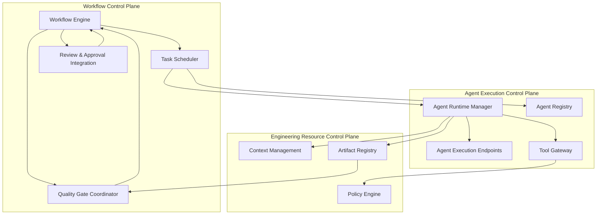
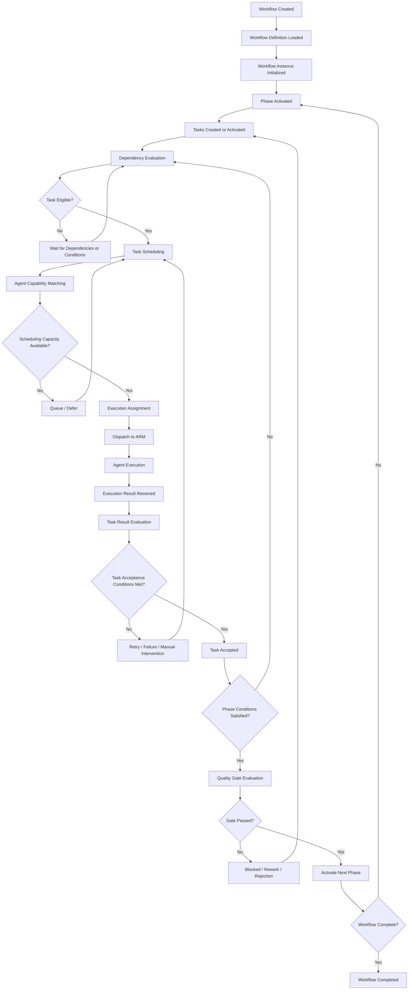
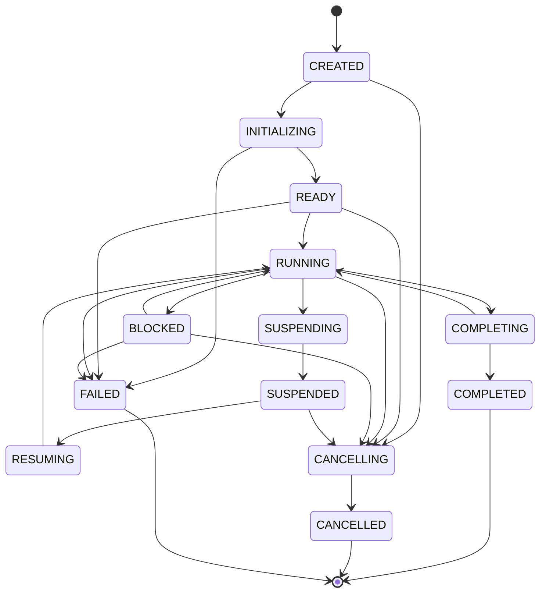
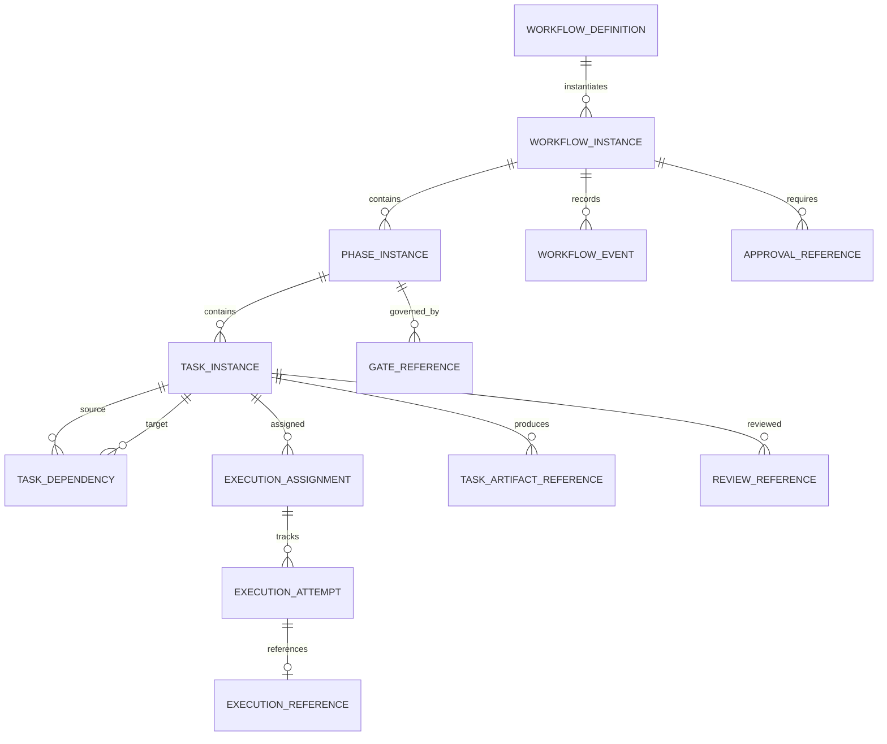
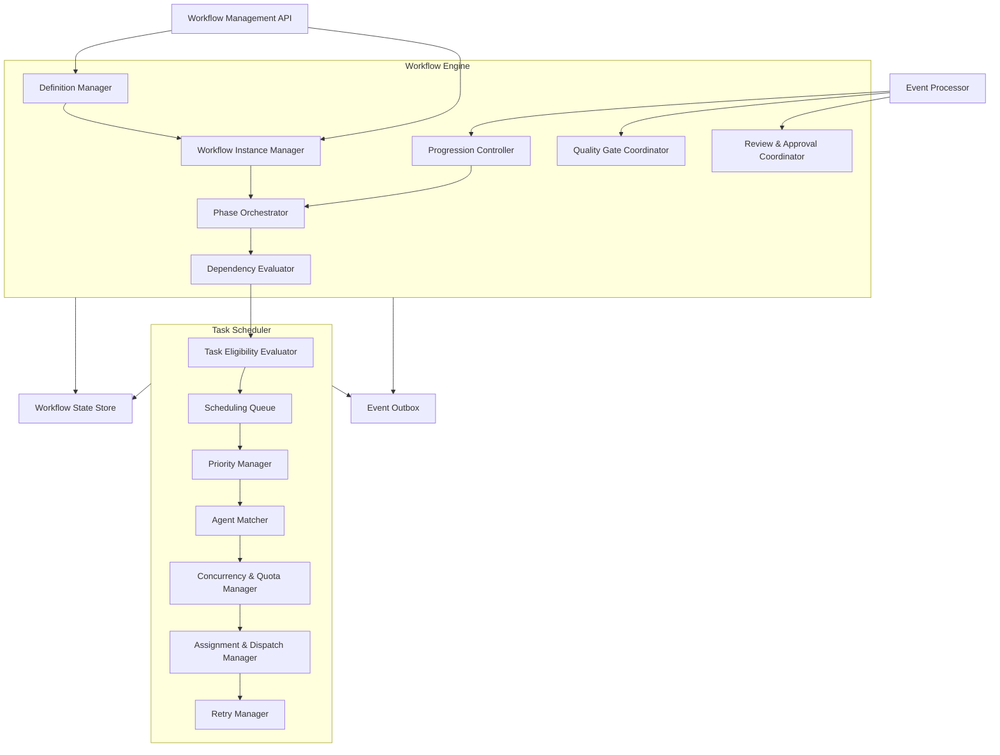

# Workflow Engine & Task Scheduler
# Software Requirements Specification (SRS)

| Field | Value |
|---|---|
| Document ID | AI-ENG-SRS-WE-001 |
| Document Title | Workflow Engine & Task Scheduler — Software Requirements Specification |
| Version | 1.0.0 |
| Status | Baseline |
| Document Type | Software Requirements Specification |
| Language | English |
| System | AI Engineering Orchestration Platform |
| Subsystem | Workflow Engine & Task Scheduler |
| Parent Document | AI Engineering Orchestration Platform — System Architecture Specification |
| Related Standard | Engineering Workflow & AI Agent Orchestration Standard (`ENG-WF-STD-001`) |
| Related Protocol | Agent Execution Protocol Specification (`AI-ENG-PROTO-001`) |
| Related Subsystem SRS | Agent Runtime Manager — Software Requirements Specification (`AI-ENG-SRS-ARM-001`) |

---

## 1. Introduction

### 1.1 Purpose

This document specifies the functional and non-functional requirements for the Workflow Engine & Task Scheduler subsystem of the AI Engineering Orchestration Platform.

The subsystem is responsible for orchestrating engineering workflows, managing workflow progression, evaluating task dependencies, scheduling eligible engineering tasks, coordinating Agent execution assignments, and controlling quality-gate progression.

It provides the workflow control capabilities required to transform engineering processes defined by the platform's engineering governance standards into executable, observable, and auditable workflows.

This SRS establishes:

- Functional requirements.
- Workflow and task lifecycle requirements.
- Workflow definition and execution requirements.
- Task dependency and DAG orchestration requirements.
- Task scheduling and Agent assignment requirements.
- Quality-gate and approval coordination requirements.
- Cross-subsystem interface requirements.
- Data management requirements.
- Security and authorization requirements.
- Reliability, scalability, and performance requirements.
- Verification and acceptance criteria.

This document defines what the subsystem MUST provide. Internal component design, database implementation, algorithms, and deployment topology are specified in subsequent design documents.

### 1.2 Scope

The Workflow Engine & Task Scheduler subsystem SHALL provide the following capabilities:

1. Workflow definition management.
2. Workflow instance creation and lifecycle management.
3. Engineering phase management.
4. Task creation and lifecycle management.
5. Task dependency management.
6. DAG validation and execution orchestration.
7. Task eligibility evaluation.
8. Agent capability matching.
9. Task scheduling and prioritization.
10. Execution assignment and dispatch coordination.
11. Concurrency and resource quota management.
12. Retry and rescheduling management.
13. Quality-gate coordination.
14. Review and approval coordination.
15. Workflow progression and completion evaluation.
16. Workflow event processing.
17. Execution and workflow monitoring.
18. Workflow persistence and recovery.
19. Audit and execution provenance.
20. Workflow configuration and version management.

The subsystem SHALL support configurable engineering workflows rather than embedding a fixed engineering process in its implementation.

### 1.3 Out of Scope

The following capabilities are outside the direct responsibility of this subsystem.

| Capability | Responsible Subsystem |
|---|---|
| Agent reasoning and task execution | Agent |
| Agent registration and capability catalog | Agent Registry |
| Agent execution sessions and lifecycle | Agent Runtime Manager |
| Agent communication and execution protocol | Agent Execution Protocol |
| External tool execution | Tool Gateway |
| Tool authorization policy evaluation | Policy Engine |
| Credential issuance and secret management | Credential Broker |
| Artifact storage and versioning | Artifact Registry |
| Authoritative engineering context assembly | Context Management |
| Engineering document content generation | Agent |
| Engineering output review execution | Review & Approval |
| Formal approval decision record | Review and Approval. The authorized approver is the identity on that record |
| Quality-gate definitions, evaluations, and QualityResult records | Quality Gate Engine. The Workflow Engine stores references only |
| Infrastructure deployment and runtime orchestration | Platform Infrastructure |

The Workflow Engine MAY coordinate these capabilities through defined interfaces, but MUST NOT independently implement or assume ownership of them.

### 1.4 Normative Language

The keywords MUST, MUST NOT, REQUIRED, SHALL, SHALL NOT, SHOULD, SHOULD NOT, MAY, and OPTIONAL are used as normative requirements.

- MUST / SHALL: Mandatory requirement.
- MUST NOT / SHALL NOT: Prohibited behavior.
- SHOULD: Recommended behavior.
- MAY: Optional behavior.

### 1.5 Design Principles

The subsystem SHALL follow these principles:

1. **Workflow-driven orchestration**: Engineering execution SHALL be controlled by explicit workflow definitions.
2. **Dependency-aware scheduling**: Tasks SHALL only become eligible when their required dependencies and conditions are satisfied.
3. **Separation of concerns**: Workflow progression, task scheduling, Agent execution, review, and approval SHALL remain separate responsibilities.
4. **Configuration over hardcoding**: Engineering phases, task templates, dependency rules, and quality gates SHOULD be configurable.
5. **Deterministic state transitions**: State changes SHALL follow explicitly defined transition rules.
6. **Event-driven coordination**: Cross-subsystem state changes SHALL be communicated through defined commands and events.
7. **Auditable orchestration**: Scheduling decisions and workflow transitions SHALL be traceable.
8. **Recoverable execution**: Workflow state SHALL survive subsystem restarts and recover without uncontrolled duplicate assignments.
9. **Versioned definitions**: Running workflows SHALL retain the definition version under which they were instantiated.
10. **Human governance preservation**: Automated orchestration SHALL NOT bypass mandatory human approval requirements.

---

## 2. System Context and Architecture

### 2.1 Subsystem Position

The Workflow Engine & Task Scheduler belongs to the Workflow Control Plane of the AI Engineering Orchestration Platform.

It coordinates engineering work and determines when tasks, phases, and workflows are allowed to progress.



The diagram describes logical responsibilities and interactions. Tool Gateway is in the execution plane with the Agent Runtime Manager. Tool execution records remain owned by the Tool Gateway. The Quality Gate Coordinator is a module of the Workflow Engine. The external subsystem that owns gate evaluation is the Quality Gate Engine. This module stores result references and is not the owner of gate results. The diagram does not mandate that each component be deployed as an independent service.

### 2.2 Logical Responsibilities

The subsystem consists of two primary logical responsibilities.

#### 2.2.1 Workflow Engine

The Workflow Engine SHALL be responsible for:

- Workflow definition interpretation.
- Workflow instance management.
- Engineering phase progression.
- Task dependency orchestration.
- Workflow-level state management.
- Quality-gate coordination.
- Review and approval coordination.
- Workflow completion and termination evaluation.
- Workflow event processing.

The Workflow Engine determines:

- What engineering work belongs to a workflow.
- Which phase is currently active.
- Which tasks must be completed before other tasks can proceed.
- Whether workflow progression conditions are satisfied.
- Whether a workflow can enter its next phase.
- Whether a workflow is completed, blocked, failed, or cancelled.

#### 2.2.2 Task Scheduler

The Task Scheduler SHALL be responsible for:

- Identifying schedulable tasks.
- Evaluating task eligibility.
- Selecting suitable Agent candidates.
- Matching task requirements against Agent capabilities.
- Evaluating scheduling priorities.
- Enforcing concurrency limits and quotas.
- Creating execution assignments.
- Coordinating dispatch with ARM.
- Managing retry scheduling.
- Tracking scheduling outcomes.

The Task Scheduler determines:

- Which eligible task should be scheduled next.
- Which Agent is eligible to receive the task.
- Whether scheduling capacity is available.
- When a task should be dispatched.
- Whether a failed or expired assignment should be retried.

### 2.3 Responsibility Boundary

| Responsibility | Owner |
|---|---|
| Define workflow structure | Workflow Engine |
| Create workflow instances | Workflow Engine |
| Manage phase progression | Workflow Engine |
| Create and manage workflow tasks | Workflow Engine |
| Validate task dependencies | Workflow Engine |
| Determine task eligibility | Workflow Engine |
| Select the next schedulable task | Task Scheduler |
| Match task requirements to Agents | Task Scheduler |
| Evaluate scheduling priority | Task Scheduler |
| Enforce scheduling concurrency | Task Scheduler |
| Assign execution to an Agent | Task Scheduler |
| Create execution sessions | Agent Runtime Manager |
| Execute Agent work | Agent |
| Execute external tools | Tool Gateway |
| Store and version artifacts | Artifact Registry |
| Review engineering outputs | Review & Approval |
| Authorize formal approval | Authorized approver, recorded by Review and Approval |
| Evaluate workflow progression | Workflow Engine |

### 2.4 Core Execution Model

The subsystem SHALL implement the following orchestration model:



The diagram describes the logical orchestration sequence. Specific review and approval states SHALL be represented independently from execution and task states.

---

## 3. Terminology and Data Concepts

### 3.1 Workflow

A Workflow is a versioned definition of an engineering process consisting of phases, tasks, dependencies, conditions, and quality gates.

A Workflow Definition describes the process.

A Workflow Instance represents an actual execution of that process.

### 3.2 Workflow Definition

A Workflow Definition SHALL contain:

- Workflow identity.
- Definition version.
- Workflow metadata.
- Phase definitions.
- Task templates.
- Dependency relationships.
- Scheduling policies.
- Quality-gate definitions or references.
- Review and approval requirements.
- Completion conditions.
- Failure and recovery policies.

### 3.3 Workflow Instance

A Workflow Instance SHALL represent one execution of a specific Workflow Definition version. The external name of this object is Workflow Run, and its identifier is `workflow_run_id`. "Workflow Instance" in this document means that same object.

It SHALL maintain its own:

- Workflow state.
- Active phase.
- Task instances.
- Execution references.
- Gate evaluation references.
- Review and approval references.
- Execution history.
- Audit records.

### 3.4 Phase

A Phase represents a logical stage in an engineering workflow.

A phase may contain:

- Sequential tasks.
- Parallel tasks.
- Conditional tasks.
- Sub-workflows.
- Quality gates.
- Review requirements.
- Approval requirements.

Phases SHALL NOT be required to execute strictly sequentially if the workflow definition permits parallel or conditional progression.

### 3.5 Task

A Task is the smallest independently schedulable unit of engineering work managed by the Workflow Engine.

A Task SHALL define:

- Task identity.
- Task type.
- Description.
- Input requirements.
- Expected outputs.
- Required capabilities.
- Dependencies.
- Execution constraints.
- Acceptance criteria.
- Retry policy.
- Priority.
- Timeout policy.

A Task MAY have multiple execution attempts.

### 3.6 Task Dependency

A Task Dependency describes a prerequisite relationship between two tasks.

A task MUST NOT become eligible until all mandatory dependencies and associated conditions are satisfied.

### 3.7 Execution Assignment

An Execution Assignment represents the scheduler's decision to allocate a Task to a selected Agent through ARM.

An assignment is not itself an Agent Execution Session.

The assignment SHALL reference the corresponding ARM execution identifier when one becomes available.

### 3.8 Execution Attempt

An Execution Attempt represents one attempt to execute a Task.

A Task MAY have multiple attempts because of:

- Execution failure.
- Timeout.
- Explicit retry.
- Agent unavailability.
- Recoverable infrastructure failure.
- Rework requested after result evaluation.

Each attempt SHALL have a unique identifier.

### 3.9 Quality Gate

A Quality Gate represents a workflow progression condition that must be satisfied before a workflow or phase can advance.

A gate MAY require:

- Task completion.
- Artifact availability.
- Automated validation.
- Review completion.
- Formal approval.
- Security validation.
- Test results.
- Other configurable conditions.

### 3.10 Review and Approval

Review and Approval represent independent engineering governance activities.

Review evaluates the quality and correctness of engineering outputs.

Approval represents an authorized decision to accept a governed artifact, phase, or baseline.

The Workflow Engine coordinates these activities but does not replace the Review & Approval subsystem or the authorized approval authority.

### 3.11 State Domain Separation

The subsystem MUST maintain distinct state domains.

| State Domain | Represents | Owner |
|---|---|---|
| Workflow State | Overall workflow lifecycle | Workflow Engine |
| Phase State | Engineering phase lifecycle | Workflow Engine |
| Task State | Engineering task lifecycle and acceptance | Workflow Engine |
| Scheduling State | Queueing and assignment lifecycle | Task Scheduler |
| Execution State | Agent execution lifecycle | ARM |
| Review State | Engineering review lifecycle | Review & Approval |
| Approval State | Formal approval decision | Review and Approval. The authorized approver is the identity on that record. The Workflow Engine stores a reference only |
| Gate State | Quality-gate evaluation lifecycle | Quality Gate Engine. The Workflow Engine stores a reference only. |

These states MUST NOT be collapsed into a single generic status field.

The following conditions are particularly important:

- Execution completed does not imply Task accepted.
- Task accepted does not imply Review passed.
- Review passed does not imply Approval granted.
- Approval granted does not automatically imply Workflow completed.
- Workflow progression requires all applicable progression conditions to be satisfied.

---

## 4. System Actors and External Interfaces

### 4.1 External Actors

| Actor | Description |
|---|---|
| Platform Administrator | Configures workflow policies and platform-level settings |
| Workflow Designer | Creates and maintains workflow definitions |
| Project Manager | Creates and monitors project workflows |
| Engineering Agent | Executes assigned engineering tasks |
| Authorized Reviewer | Reviews engineering outputs |
| Approval Authority | Approves governed engineering deliverables |
| Platform Operator | Monitors subsystem health and handles operational incidents |
| External Integration | Initiates workflows or receives workflow events |

### 4.2 External Subsystems

| Subsystem | Interaction |
|---|---|
| Project Management | Creates workflows and supplies project metadata |
| Agent Registry | Supplies Agent identity, capability, availability, and eligibility information |
| Agent Runtime Manager | Receives execution assignments and reports execution lifecycle events |
| Context Management | Supplies authoritative execution context references |
| Artifact Registry | Supplies artifact references and version metadata |
| Review & Approval | Receives review requests and returns review decisions |
| Quality Gate Engine | Evaluates gate conditions and returns gate results. The coordinator inside this subsystem stores result references only. |
| Policy Engine | Evaluates applicable authorization policies |
| Event and Messaging Infrastructure | Delivers asynchronous commands and events |
| Identity and Access Management | Supplies user and service identities |

### 4.3 Interface Principles

The subsystem SHALL support:

- Synchronous APIs for queries and immediate command validation.
- Asynchronous messages for long-running operations and lifecycle events.
- Idempotent command handling.
- Correlation identifiers.
- Versioned message schemas.
- Explicit error responses.
- Event ordering and duplicate delivery handling.

Detailed transport bindings and API schemas SHALL be defined in the Platform Internal API & Interface Control Specification.

---

## 5. Functional Requirements

### 5.1 Workflow Definition Management

**FR-WE-001 — Workflow Definition Registration**

The subsystem MUST support registration of workflow definitions.

**FR-WE-002 — Workflow Definition Versioning**

The subsystem MUST support immutable workflow definition versions.

A published definition version MUST NOT be modified in place.

**FR-WE-003 — Workflow Definition Validation**

The subsystem MUST validate a workflow definition before publication.

Validation MUST include:

- Required metadata.
- Valid phase references.
- Valid task definitions.
- Dependency references.
- Dependency cycle detection.
- Gate references.
- Completion conditions.
- Scheduling policy references.
- Schema compatibility.

**FR-WE-004 — Workflow Definition Retrieval**

The subsystem MUST support retrieval of workflow definitions by identifier and version.

**FR-WE-005 — Workflow Definition Lifecycle**

The subsystem MUST support the following definition lifecycle:

- DRAFT
- VALIDATED
- PUBLISHED
- DEPRECATED
- RETIRED

**FR-WE-006 — Definition Compatibility**

The subsystem MUST ensure that an existing Workflow Instance continues to reference the exact definition version under which it was created.

**FR-WE-007 — Workflow Template Support**

The subsystem SHOULD support reusable workflow templates and task templates.

**FR-WE-008 — Workflow Configuration**

The subsystem MUST support configurable workflow parameters, policies, and conditions.

The implementation MUST NOT require engineering phases or gates to be hardcoded into the orchestration engine.

### 5.2 Workflow Instance Management

**FR-WE-009 — Workflow Creation**

The subsystem MUST support creation of Workflow Instances from published Workflow Definitions.

**FR-WE-010 — Workflow Identity**

Each Workflow Instance MUST have a globally unique identifier within the platform.

**FR-WE-011 — Workflow Initialization**

The subsystem MUST initialize the workflow instance using the selected definition version and supplied project parameters.

**FR-WE-012 — Workflow State Persistence**

The subsystem MUST persist workflow state and execution references.

**FR-WE-013 — Workflow Query**

The subsystem MUST support querying workflow instances by:

- `workflow_run_id`.
- Project ID.
- Definition ID.
- Workflow state.
- Creation time.
- Owner.
- Execution status.

**FR-WE-014 — Workflow Cancellation**

The subsystem MUST support workflow cancellation subject to authorization and configured cancellation policies.

**FR-WE-015 — Workflow Suspension**

The subsystem MUST support workflow suspension.

Suspension MUST prevent new scheduling assignments for the affected workflow unless an explicitly authorized exception policy applies.

The handling of already-running executions MUST follow the configured suspension policy.

**FR-WE-016 — Workflow Resumption**

The subsystem MUST support resumption of suspended workflows.

**FR-WE-017 — Workflow Completion Evaluation**

The subsystem MUST evaluate workflow completion conditions before marking a workflow as completed.

**FR-WE-018 — Workflow History**

The subsystem MUST maintain workflow lifecycle history.

### 5.3 Phase Management

**FR-WE-019 — Phase Initialization**

The subsystem MUST initialize phases according to the workflow definition.

**FR-WE-020 — Phase Activation**

The subsystem MUST activate a phase only when its entry conditions are satisfied.

**FR-WE-021 — Phase Task Management**

The subsystem MUST create or activate task instances associated with an active phase.

**FR-WE-022 — Phase Progress Evaluation**

The subsystem MUST evaluate phase progression conditions.

**FR-WE-023 — Phase Completion**

A phase MUST NOT be marked as completed until all required tasks, gates, reviews, and approvals defined by its completion policy are satisfied.

**FR-WE-024 — Conditional Phase Progression**

The subsystem MUST support conditional phase progression.

**FR-WE-025 — Parallel Phase Execution**

The subsystem SHOULD support parallel phase execution where explicitly allowed by the workflow definition.

**FR-WE-026 — Phase Reopening**

The subsystem SHOULD support rework after a completed phase through an authorized change procedure.

The completed phase remains `COMPLETED`. Rework creates new task instances and preserves the previous completion history by reference. The same phase MUST NOT return to an active state.

### 5.4 Task Management

**FR-WE-027 — Task Creation**

The subsystem MUST create Task Instances from task definitions or templates.

**FR-WE-028 — Task Identity**

Each Task Instance MUST have a unique identifier.

**FR-WE-029 — Task Specification**

Each Task MUST contain the information required for scheduling and execution.

At minimum:

- Task ID.
- `workflow_run_id`.
- Phase ID.
- Task type.
- Task description.
- Input references.
- Expected outputs.
- Required capabilities.
- Acceptance criteria.
- Dependency references.
- Scheduling priority.
- Execution constraints.
- Retry policy.

**FR-WE-030 — Task State Persistence**

The subsystem MUST persist task states and associated metadata.

**FR-WE-031 — Task Query**

The subsystem MUST support querying tasks by workflow, phase, state, priority, type, and assigned Agent.

**FR-WE-032 — Task Modification**

The subsystem MUST support controlled task modification before execution.

Modification of an already-running task MUST follow an explicit cancellation, supersession, or change-management procedure.

**FR-WE-033 — Task Cancellation**

The subsystem MUST support task cancellation.

When a task has an active execution, the subsystem MUST coordinate cancellation with ARM.

**FR-WE-034 — Task Supersession**

The subsystem SHOULD support task supersession while preserving historical task and execution references.

**FR-WE-035 — Task Acceptance Criteria**

The subsystem MUST evaluate task acceptance criteria independently of Agent execution completion.

**FR-WE-036 — Task Output References**

The subsystem MUST maintain references to submitted artifacts and execution results associated with each task.

### 5.5 Task Dependency Management

**FR-WE-037 — Dependency Definition**

The subsystem MUST support explicit dependencies between tasks.

**FR-WE-038 — Dependency Types**

The subsystem MUST support at least the following dependency types:

| Dependency Type | Description |
|---|---|
| FINISH_TO_START | Dependent task can start after prerequisite completion |
| START_TO_START | Dependent task can start after prerequisite execution begins |
| FINISH_TO_FINISH | Dependent task can finish only after prerequisite completion |
| CONDITIONAL | Dependency is satisfied when a configured condition evaluates to true |

The precise semantics of each dependency type MUST be defined in the workflow definition schema.

**FR-WE-039 — Dependency Validation**

The subsystem MUST validate dependency references before publishing a workflow definition.

**FR-WE-040 — Cycle Detection**

The subsystem MUST detect circular dependencies in task dependency graphs.

A workflow definition containing an unsupported dependency cycle MUST NOT be published.

**FR-WE-041 — Dependency Evaluation**

The subsystem MUST evaluate dependencies before making a task eligible for scheduling.

**FR-WE-042 — Dependency Failure Handling**

The subsystem MUST support configurable behavior when a prerequisite task fails.

Supported behaviors SHOULD include:

- Block dependent tasks.
- Skip dependent tasks.
- Mark dependent tasks as failed.
- Trigger an alternative workflow path.
- Request manual intervention.

**FR-WE-043 — Conditional Dependencies**

The subsystem MUST support condition-based dependency evaluation.

**FR-WE-044 — Dynamic Task Dependencies**

The subsystem MAY support dynamic task creation and dependency updates during workflow execution.

Dynamic modifications MUST be validated and audited.

### 5.6 DAG Orchestration

**FR-WE-045 — DAG Representation**

The subsystem MUST represent task dependencies as a directed graph.

**FR-WE-046 — DAG Validation**

For workflows requiring acyclic task execution, the subsystem MUST validate that the dependency graph is a directed acyclic graph.

**FR-WE-047 — Parallel Execution**

The subsystem MUST support concurrent scheduling of independent tasks.

**FR-WE-048 — Dependency-Based Activation**

The subsystem MUST activate dependent tasks when all mandatory prerequisites are satisfied.

**FR-WE-049 — DAG Progress Tracking**

The subsystem MUST track the state of each task and the overall progress of the task graph.

**FR-WE-050 — Conditional Branching**

The subsystem MUST support conditional execution paths.

**FR-WE-051 — Fan-Out and Fan-In**

The subsystem MUST support fan-out and fan-in task patterns.

**FR-WE-052 — Sub-Workflow Support**

The subsystem SHOULD support invocation of reusable sub-workflows.

**FR-WE-053 — Graph Modification Control**

The subsystem MUST validate any runtime graph modification before applying it.

### 5.7 Task Eligibility Evaluation

**FR-WE-054 — Eligibility Evaluation**

The subsystem MUST determine whether a task is eligible for scheduling.

Eligibility evaluation MUST consider:

- Task state.
- Dependency satisfaction.
- Workflow state.
- Phase state.
- Scheduling policy.
- Required execution constraints.
- Applicable gate and authorization restrictions.

**FR-WE-055 — Workflow Suspension Check**

The subsystem MUST prevent normal task scheduling for suspended workflows.

**FR-WE-056 — Phase Entry Check**

The subsystem MUST prevent task scheduling before the associated phase is activated, unless the workflow explicitly permits pre-activation scheduling.

**FR-WE-057 — Dependency Check**

The subsystem MUST prevent task scheduling when mandatory dependencies are unresolved.

**FR-WE-058 — Duplicate Scheduling Prevention**

The subsystem MUST prevent multiple active assignments for the same task unless parallel attempts are explicitly permitted.

**FR-WE-059 — Eligibility Explanation**

The subsystem SHOULD provide machine-readable reasons when a task is not eligible for scheduling.

### 5.8 Agent Capability Matching

**FR-WE-060 — Agent Discovery**

The Task Scheduler MUST obtain eligible Agent information from the Agent Registry or an equivalent authoritative interface.

**FR-WE-061 — Capability Matching**

The Task Scheduler MUST match task requirements against Agent capability definitions.

**FR-WE-062 — Execution Constraint Matching**

The Task Scheduler MUST evaluate applicable Agent execution constraints, including:

- Supported task types.
- Supported tools.
- Required model capabilities.
- Execution environment.
- Required security level.
- Supported protocol version.
- Resource availability.
- Geographic or residency constraints where applicable.

**FR-WE-063 — Agent Availability**

The Task Scheduler MUST consider Agent availability before assignment.

**FR-WE-064 — Agent Eligibility**

The Task Scheduler MUST NOT assign tasks to Agents that fail mandatory eligibility or authorization requirements.

**FR-WE-065 — Agent Selection Policy**

The Task Scheduler MUST support configurable Agent selection policies.

**FR-WE-066 — Agent Selection Transparency**

The Task Scheduler SHOULD record the relevant matching criteria and selection outcome.

**FR-WE-067 — Agent Fallback**

The Task Scheduler SHOULD support fallback to another eligible Agent when the preferred Agent becomes unavailable. That fallback selects the Agent before an assignment is accepted. After a dispatch acknowledgement of `unavailable`, a different Agent requires a new `attempt_id` authorized by the Workflow Engine.

**FR-WE-068 — External Agent Support**

The Task Scheduler MUST support Agent execution endpoints that conform to the Agent Execution Protocol, regardless of whether the Agent is embedded, locally hosted, remotely hosted, or externally provided.

### 5.9 Scheduling and Prioritization

**FR-WE-069 — Scheduling Queue**

The Task Scheduler MUST maintain a scheduling queue for eligible tasks awaiting assignment.

**FR-WE-070 — Scheduling Priority**

The Task Scheduler MUST support configurable scheduling priorities.

**FR-WE-071 — Priority Policy**

The subsystem SHOULD support priority calculation based on:

- Explicit task priority.
- Workflow priority.
- Deadline.
- Task criticality.
- Dependency impact.
- Resource availability.
- Scheduling policy.

**FR-WE-072 — Priority Ordering**

The Task Scheduler MUST apply the configured priority ordering policy consistently.

**FR-WE-073 — Starvation Prevention**

The Task Scheduler SHOULD provide mechanisms to prevent indefinite starvation of eligible lower-priority tasks.

**FR-WE-074 — Scheduling Fairness**

The Task Scheduler SHOULD support fairness policies across projects, workflows, and tenants.

**FR-WE-075 — Scheduling Delay**

The Task Scheduler MUST support delayed scheduling and scheduled execution windows.

**FR-WE-076 — Scheduling Decision Record**

Each scheduling decision MUST be auditable.

The record SHOULD include:

- Task ID.
- `workflow_run_id`.
- Scheduling timestamp.
- Candidate Agent set or a reference to it.
- Selected Agent.
- Matching result.
- Scheduling policy version.
- Assignment result.
- Rejection or deferral reason.

### 5.10 Concurrency and Quota Management

**FR-WE-077 — Global Concurrency Limit**

The Task Scheduler MUST support configurable global concurrency limits.

**FR-WE-078 — Project-Level Concurrency**

The Task Scheduler SHOULD support project-level concurrency limits.

**FR-WE-079 — Workflow-Level Concurrency**

The Task Scheduler MUST support workflow-level concurrency limits.

**FR-WE-080 — Agent-Level Concurrency**

The Task Scheduler MUST consider Agent execution capacity and concurrency limits.

**FR-WE-081 — Resource Quotas**

The subsystem SHOULD support configurable resource quotas.

**FR-WE-082 — Quota Enforcement**

The Task Scheduler MUST prevent scheduling assignments that exceed applicable hard quotas.

**FR-WE-083 — Capacity Release**

Scheduling capacity MUST be released or reconciled when an assignment reaches a terminal scheduling state.

**FR-WE-084 — Capacity Reconciliation**

The subsystem MUST support reconciliation of scheduling capacity against authoritative execution state reported by ARM.

### 5.11 Execution Assignment and Dispatch

**FR-WE-085 — Assignment Creation**

The Task Scheduler MUST create a unique Execution Assignment for each scheduling attempt.

**FR-WE-086 — Assignment Reference**

Each Execution Assignment MUST reference:

- `workflow_run_id`.
- `workflow_definition_id`.
- Phase ID, carried cross-service as `phase_id`.
- Task ID.
- Attempt ID.
- Selected Agent ID.
- Assignment ID. This identifier is the cross-service scheduling decision. A separate `scheduling_decision_id` MUST NOT appear on cross-service payloads.
- Assignment timestamp.

**FR-WE-087 — Dispatch Coordination**

The Task Scheduler MUST submit execution assignments to ARM through a defined interface.

**FR-WE-088 — Execution Protocol Compliance**

The subsystem MUST ensure that execution requests conform to the Agent Execution Protocol.

**FR-WE-089 — Dispatch Acknowledgment**

The subsystem MUST process dispatch acknowledgements whose `status` is `accepted`, `rejected`, `unavailable`, or `unconfirmed`. `rejected` is the only one of these that records an explicit Agent refusal.

**FR-WE-090 — Execution Reference Association**

The subsystem MUST associate the ARM execution identifier with the corresponding assignment and task attempt.

**FR-WE-091 — Dispatch Idempotency**

Dispatch commands MUST support idempotent processing.

Repeated dispatch requests with the same idempotency key MUST NOT create uncontrolled duplicate execution assignments.

**FR-WE-092 — Dispatch Timeout**

The subsystem MUST support a timeout for delivery of an assignment to the Runtime Manager, before an execution record exists. That clock is the Runtime Manager Dispatch Timeout. It is not the Agent acceptance window, and it does not measure delivery of the execution command to the Agent. The Runtime Manager creates the execution record before sending that command. An explicit rejection on this hop, before an execution record exists, is `invalid` and creates no execution state. Failure to deliver the command after the record exists uses `unavailable` and execution state `released`, or the Acceptance Timeout. That failure MUST NOT be reported as `invalid`.

**FR-WE-093 — Dispatch Failure**

The subsystem MUST handle dispatch failures through configured retry, fallback, or manual intervention policies.

**FR-WE-094 — Assignment Expiration**

`expires_at` ends an assignment offer only before that offer is submitted to the Runtime Manager. Expiry then uses scheduling state `EXPIRED` and creates no execution. After submission, the Agent acceptance window is the Runtime Manager Acceptance Timeout. Its expiry is `unconfirmed`, scheduling state `DISPATCH_UNCONFIRMED`, and execution state `unknown`, with the same `attempt_id`. An assignment that already has an execution record MUST NOT enter `EXPIRED` and MUST NOT receive a new `attempt_id` because the Agent has not yet accepted.

**FR-WE-095 — Assignment Reconciliation**

The subsystem MUST reconcile ambiguous dispatch outcomes with ARM before creating a potentially duplicate execution.

### 5.12 Execution Result Coordination

**FR-WE-096 — Execution Event Reception**

The subsystem MUST receive execution lifecycle events from ARM.

**FR-WE-097 — Execution State Separation**

The subsystem MUST preserve execution state as a distinct state domain owned by ARM.

**FR-WE-098 — Execution Result Association**

The subsystem MUST associate execution results with the correct workflow, task, assignment, and attempt.

**FR-WE-099 — Execution Completion Processing**

The subsystem MUST process execution completion events and initiate task result evaluation.

**FR-WE-100 — Execution Failure Processing**

The subsystem MUST process execution failure events and evaluate the applicable failure policy.

**FR-WE-101 — Execution Timeout Processing**

The subsystem MUST process execution timeout events and evaluate retry or failure behavior. `payload.timeout_reason` selects that behavior. `initialization_timeout` and `heartbeat_timeout` may receive a new `attempt_id` only when the task retry policy authorizes it. `deadline` and `result_submission_timeout` are not retryable and MUST NOT receive a new `attempt_id`.

**FR-WE-102 — Late Event Handling**

The subsystem MUST handle delayed or out-of-order execution events without incorrectly regressing task state.

**FR-WE-103 — Execution Result Validation**

The subsystem MUST validate that an execution result contains the required task outputs and references before accepting it for task evaluation.

The subsystem SHALL NOT independently assume ownership of artifact content validation or artifact registration.

### 5.13 Task Acceptance and Retry

**FR-WE-104 — Task Result Evaluation**

The subsystem MUST evaluate execution results against configured task acceptance criteria.

**FR-WE-105 — Task Acceptance**

The subsystem MUST mark a task as accepted only when all mandatory acceptance conditions are satisfied.

**FR-WE-106 — Retry Policy**

The subsystem MUST support configurable retry policies.

**FR-WE-107 — Retry Limits**

The subsystem MUST enforce configured maximum retry limits.

**FR-WE-108 — Retry Delay**

The subsystem SHOULD support fixed delay and exponential backoff retry strategies.

**FR-WE-109 — Retry Classification**

The subsystem MUST distinguish retryable and non-retryable failures.

**FR-WE-110 — Retry Attempt Identity**

Each task retry MUST preserve `task_id` and MUST receive a new `attempt_id` issued by the Task Scheduler.

The Runtime Manager creates a new `agent_execution_id` and a new `session_id` only after it accepts the new assignment. This subsystem MUST NOT treat an Agent execution identifier as the scheduling attempt identifier.

A tool retry inside one tool execution MUST NOT be recorded as a task retry.

**FR-WE-111 — Retry History**

The subsystem MUST preserve execution attempt history.

**FR-WE-112 — Rework**

The subsystem MUST support rework requests following a human review decision. That rework creates a new task only after the Agent execution has ended. A missing mandatory artifact or an output-contract rejection leaves the execution in `COMPLETING` and MUST NOT receive a new `attempt_id`.

**FR-WE-113 — Retry Exhaustion**

When retry limits are exhausted, the subsystem MUST apply the configured terminal or escalation policy.

**FR-WE-114 — Retry Safety**

The subsystem MUST NOT automatically retry operations classified as non-idempotent unless the associated execution policy explicitly permits it.

### 5.14 Quality Gate Coordination

**FR-WE-115 — Gate Definition Reference**

The subsystem MUST support quality-gate definitions or references associated with workflow phases and transitions.

**FR-WE-116 — Gate Evaluation Trigger**

The subsystem MUST initiate gate evaluation when the associated gate-entry conditions are satisfied.

**FR-WE-117 — Gate Condition Support**

The subsystem MUST support gate conditions based on:

- Task completion.
- Artifact availability.
- Automated validation.
- Review outcomes.
- Approval outcomes.
- Security checks.
- Test results.
- Configured custom conditions.

**FR-WE-118 — Gate State Tracking**

The subsystem MUST maintain a reference to the authoritative gate evaluation result and its state.

**FR-WE-119 — Gate Failure Handling**

The subsystem MUST support configurable behavior when a gate fails.

Possible outcomes include:

- Block progression.
- Request rework.
- Trigger a remediation task.
- Reject the current phase.
- Escalate for manual intervention.

**FR-WE-120 — Gate Progression Control**

The subsystem MUST prevent phase progression when a mandatory gate has not passed.

**FR-WE-121 — Gate Evaluation History**

The subsystem MUST preserve gate evaluation history.

**FR-WE-122 — Gate Configuration Versioning**

The subsystem SHOULD associate gate evaluations with the applicable gate policy version.

### 5.15 Review and Approval Coordination

**FR-WE-123 — Review Request**

The subsystem MUST support creating review requests through the Review & Approval subsystem.

**FR-WE-124 — Review State Tracking**

The subsystem MUST track review references and their authoritative states.

**FR-WE-125 — Review Result Processing**

The subsystem MUST process review completion and rejection events.

**FR-WE-126 — Approval Request**

The subsystem MUST support initiating formal approval requests when required by workflow policy.

**FR-WE-127 — Approval State Tracking**

The subsystem MUST track approval references and authoritative approval states.

**FR-WE-128 — Approval Authority**

The subsystem MUST NOT independently grant formal approval on behalf of an authorized approval authority.

**FR-WE-129 — Approval Requirement Enforcement**

The subsystem MUST prevent progression when mandatory approval has not been granted.

**FR-WE-130 — Review and Approval Separation**

The subsystem MUST distinguish review completion, review acceptance, approval request, approval grant, and approval rejection.

### 5.16 Workflow Progression

**FR-WE-131 — Progression Evaluation**

The Workflow Engine MUST evaluate workflow progression conditions after relevant task, phase, gate, review, and approval events.

**FR-WE-132 — Phase Transition**

The Workflow Engine MUST perform phase transitions only when the corresponding transition conditions are satisfied.

**FR-WE-133 — Transition Validation**

The subsystem MUST validate the legality of a requested workflow or phase state transition.

**FR-WE-134 — Workflow Completion**

The Workflow Engine MUST mark a workflow as completed only when all required completion conditions are satisfied.

**FR-WE-135 — Workflow Blocking**

The subsystem MUST support blocked workflow states when progression cannot continue.

**FR-WE-136 — Workflow Failure**

The subsystem MUST support terminal workflow failure when a configured unrecoverable condition is reached.

**FR-WE-137 — Workflow Reopening**

The subsystem SHOULD support a controlled follow-up to a completed workflow through an authorized change procedure. That follow-up creates a new `workflow_run_id`. The completed run remains `COMPLETED` and MUST NOT leave that terminal state.

**FR-WE-138 — Progression Audit**

Every workflow progression decision MUST be recorded with its triggering event and evaluation result.

### 5.17 Workflow Event Management

**FR-WE-139 — Event Publication**

The subsystem MUST publish workflow lifecycle events.

**FR-WE-140 — Task Event Publication**

The subsystem MUST publish task lifecycle events.

**FR-WE-141 — Scheduling Event Publication**

The Task Scheduler MUST publish scheduling and assignment events.

**FR-WE-142 — Event Correlation**

All workflow-related events MUST carry correlation identifiers.

**FR-WE-143 — Event Idempotency**

The subsystem MUST handle duplicate events idempotently.

**FR-WE-144 — Event Ordering**

The subsystem MUST use versioning or sequence information to identify stale or out-of-order events.

**FR-WE-145 — Event Durability**

Important lifecycle events MUST be durably recorded before or as part of the associated state transition.

**FR-WE-146 — Event Replay**

The subsystem SHOULD support event replay or equivalent recovery mechanisms.

### 5.18 Monitoring and Observability

**FR-WE-147 — Workflow Monitoring**

The subsystem MUST expose workflow state and progress information.

**FR-WE-148 — Task Monitoring**

The subsystem MUST expose task state, scheduling state, and execution references.

**FR-WE-149 — Scheduling Monitoring**

The subsystem MUST expose scheduling queue depth, assignment outcomes, scheduling delays, and capacity utilization.

**FR-WE-150 — Execution Monitoring**

The subsystem MUST expose execution status through authoritative ARM-reported information.

**FR-WE-151 — Failure Monitoring**

The subsystem MUST expose workflow, task, scheduling, and dependency failure information.

**FR-WE-152 — Audit Logging**

The subsystem MUST submit audit events for significant workflow and scheduling operations to the Event and Audit Service. It MUST NOT keep a second authoritative audit record.

**FR-WE-153 — Metrics**

The subsystem MUST expose operational metrics.

**FR-WE-154 — Distributed Tracing**

The subsystem SHOULD support distributed tracing across Workflow Engine, Task Scheduler, ARM, and dependent services.

### 5.19 Recovery and Reconciliation

**FR-WE-155 — Persistent State Recovery**

The subsystem MUST restore workflow and task state after an unexpected restart.

**FR-WE-156 — Scheduling Queue Recovery**

The Task Scheduler MUST reconstruct pending scheduling work after recovery.

**FR-WE-157 — Assignment Reconciliation**

The subsystem MUST reconcile persisted assignments against authoritative ARM execution records.

**FR-WE-158 — Event Reconciliation**

The subsystem SHOULD reconcile missed lifecycle events using authoritative subsystem state.

**FR-WE-159 — Duplicate Assignment Prevention**

Recovery procedures MUST prevent uncontrolled duplicate execution assignments.

**FR-WE-160 — Recovery Audit**

Recovery operations and reconciliation outcomes MUST be auditable.

**FR-WE-161 — Partial Failure Recovery**

The subsystem MUST support recovery when one dependent subsystem is temporarily unavailable.

---

## 6. Workflow and Task State Models

### 6.1 Workflow State Model

The Workflow Engine SHALL maintain the following workflow states.

| State | Description | Terminal |
|---|---|---|
| CREATED | Workflow instance created | No |
| INITIALIZING | Workflow initialization in progress | No |
| READY | Workflow is initialized and ready to progress | No |
| RUNNING | Workflow is actively progressing | No |
| SUSPENDING | Suspension is being coordinated | No |
| SUSPENDED | Workflow progression is suspended | No |
| RESUMING | Workflow resumption is in progress | No |
| BLOCKED | Workflow cannot progress due to an unresolved condition | No |
| COMPLETING | Completion conditions are being evaluated | No |
| COMPLETED | All required workflow completion conditions are satisfied | Yes |
| CANCELLING | Cancellation is being coordinated | No |
| CANCELLED | Workflow cancellation is complete | Yes |
| FAILED | Workflow has reached an unrecoverable failure state | Yes |

`BLOCKED` is a non-terminal state. A workflow MAY return to `RUNNING` after the blocking condition is resolved.

### 6.2 Workflow State Transitions



The exact transition policy SHALL be configurable where appropriate, but illegal state transitions MUST be rejected.

### 6.3 Phase State Model

| State | Description |
|---|---|
| PENDING | Phase has not been activated |
| READY | Phase entry conditions are satisfied |
| RUNNING | Phase is executing |
| BLOCKED | Phase cannot currently progress |
| GATE_PENDING | Required gate evaluation is pending |
| REVIEW_PENDING | Required review is pending |
| APPROVAL_PENDING | Required approval is pending |
| COMPLETED | Phase completion conditions are satisfied |
| SKIPPED | Phase was skipped through a permitted workflow branch |
| FAILED | Phase has failed |
| CANCELLED | Phase has been cancelled |

A phase MAY enter `COMPLETED` only after all required phase-level conditions have been satisfied.

### 6.4 Task State Model

The Task State represents engineering task progress and acceptance, not Agent execution.

| State | Description | Terminal |
|---|---|---|
| DRAFT | Task is being defined | No |
| PENDING | Task is waiting for prerequisites | No |
| READY | Task is eligible for scheduling evaluation | No |
| SCHEDULED | Task has an active scheduling assignment | No |
| IN_PROGRESS | At least one accepted execution has started | No |
| RESULT_PENDING | Execution result has been received and awaits evaluation | No |
| UNDER_REVIEW | Task output is undergoing required review | No |
| REWORK_REQUIRED | Output requires correction or re-execution | No |
| ACCEPTED | Task acceptance criteria are satisfied | Yes |
| BLOCKED | Task cannot progress | No |
| FAILED | Task has reached an unrecoverable failure state | Yes |
| CANCELLED | Task has been cancelled | Yes |
| SKIPPED | Task has been skipped through a permitted workflow branch | Yes |
| SUPERSEDED | Task has been replaced by a newer task | Yes |

A task MUST NOT be marked `ACCEPTED` solely because its Agent execution completed successfully.

`execution.agent.started` moves a task from `SCHEDULED` to `IN_PROGRESS`. That transition is not a task result. Review, quality-gate, and blocked conditions use `UNDER_REVIEW`, `REWORK_REQUIRED`, and `BLOCKED`. The statuses `completed`, `partially_completed`, `failed`, `timed_out`, and `cancelled` decide the task result and move the task to `RESULT_PENDING` or a later result state. They are not the only events that change task state.

### 6.5 Scheduling State Model

Scheduling State SHALL be maintained independently of Task State and Execution State.

| State | Description |
|---|---|
| NOT_QUEUED | Task has not entered the scheduling queue |
| QUEUED | Task is waiting for scheduling |
| EVALUATING | Eligibility and Agent matching are in progress |
| DEFERRED | Scheduling is postponed |
| ASSIGNED | An execution assignment has been created |
| DISPATCHING | Assignment is being dispatched to ARM |
| DISPATCH_ACCEPTED | ARM has acknowledged the dispatch with status `accepted` |
| DISPATCH_REJECTED | ARM has acknowledged the dispatch with status `rejected`. The acknowledgement includes `agent_execution_id` and `session_id`. The execution state is `rejected`. This is not an execution result |
| DISPATCH_UNAVAILABLE | ARM has acknowledged the dispatch with status `unavailable`. The execution state is `released`. The same attempt, `agent_execution_id`, and `session_id` return to `QUEUED` |
| DISPATCH_UNCONFIRMED | ARM reported status `unconfirmed`. The execution state is `unknown`. The same attempt stays here until reconciliation completes |
| DISPATCH_INVALID | ARM has acknowledged the dispatch with status `invalid`. No execution was created. This is not an execution state |
| EXPIRED | The offer expired before submission to the Runtime Manager. No execution record exists |
| CAPACITY_RELEASED | Scheduling capacity has been released. The wire token is `capacity_released`. It is not the execution state `released` |
| FAILED | Scheduling operation has failed |

A task MAY return to `QUEUED` after a scheduling failure, or after an `EXPIRED` offer that never created an execution, when its retry and scheduling policies permit it. That new submission receives a new `attempt_id`. An assignment that already has an execution record MUST NOT enter `EXPIRED`. `DISPATCH_UNAVAILABLE` returns the same attempt to `QUEUED` and MUST NOT issue a new `attempt_id`. A later dispatch of that attempt MUST include the existing `agent_execution_id` and `session_id`. `DISPATCH_UNCONFIRMED` MUST be reconciled before a replacement assignment is created and MUST NOT issue a new `attempt_id`. `DISPATCH_REJECTED` records an Agent refusal and MUST NOT be applied as an execution result. `DISPATCH_INVALID` records a rejection before execution creation and has no execution state. An acknowledgement with status `rejected` that omits `agent_execution_id` is not a valid message. Selecting a different Agent requires a new `attempt_id` authorized by the Workflow Engine. `capacity_released` does not enter the execution state machine.

### 6.6 Execution State Model

Execution State SHALL remain authoritative within ARM.

The Workflow Engine SHALL consume execution lifecycle information as platform events whose `event_type` values are `execution.agent.*`, as listed in section 9.7. It SHALL NOT consume Agent Execution Protocol messages as those events, and SHALL NOT independently redefine the ARM execution state machine.

The subsystem MUST be capable of handling these execution results:

- `completed`
- `partially_completed`
- `failed`
- `timed_out`
- `cancelled`

`terminated` records runtime cleanup and MUST NOT be applied as an execution result. `rejected` and `released` are dispatch states and MUST NOT be applied as execution results. `unknown` records an unreconciled observation and MUST trigger reconciliation. The subsystem MUST NOT choose retry or task failure while the observation remains `unknown`. Heartbeat timeout from `INITIALIZING` or `READY`, and initialization timeout, are `timed_out` results. They are not an `unknown` observation. Lost contact from `RUNNING` or `COMPLETING` before `deadline` remains `unknown`. Reaching `deadline` while the execution is still in `RUNNING` or `COMPLETING` is a `timed_out` result whether or not a heartbeat is still arriving.

Runtime termination and cleanup status MUST NOT overwrite the original execution result.

### 6.7 Review State Model

The subsystem SHALL track authoritative review states through references to the Review & Approval subsystem.

At minimum, the integration SHALL distinguish:

- NOT_REQUESTED
- REQUESTED
- IN_PROGRESS
- PASSED
- REJECTED
- CANCELLED
- FAILED

The authoritative review state model MAY contain additional states.

### 6.8 Approval State Model

The subsystem SHALL track approval states through references to the authorized approval subsystem.

At minimum, the integration SHALL distinguish:

- NOT_REQUIRED
- NOT_REQUESTED
- PENDING
- APPROVED
- REJECTED
- REVOKED
- CANCELLED

The Workflow Engine MUST NOT modify the authoritative approval decision.

### 6.9 State Domain Invariants

The following invariants are mandatory:

1. A Task MUST have exactly one authoritative Task State at any given time.
2. A Task MAY have multiple historical Execution Attempts.
3. An Execution Attempt MUST have exactly one authoritative execution identifier once ARM has created it.
4. A Task MUST NOT become `ACCEPTED` while mandatory acceptance criteria remain unsatisfied.
5. A Phase MUST NOT become `COMPLETED` while mandatory tasks remain incomplete.
6. A Phase MUST NOT progress beyond a mandatory gate that has not passed.
7. A Workflow MUST NOT become `COMPLETED` while mandatory phases or approvals remain unresolved.
8. A scheduling assignment MUST NOT be treated as proof that an Agent has started execution.
9. An execution result MUST NOT automatically imply engineering approval.
10. A terminal Task state MUST NOT be silently overwritten by a delayed execution event.
11. State transitions MUST be auditable.
12. Repeated delivery of the same event MUST NOT cause repeated state transitions or duplicate assignments.

---

## 7. Workflow Definition and Configuration Requirements

### 7.1 Workflow Definition Structure

The subsystem MUST support a structured workflow definition.

The following YAML is an illustrative configuration model, not a mandatory implementation schema. A task definition that produces an Agent execution MUST store `output_contract` and `constraints`. The Task Scheduler copies `output_contract`, `constraints`, `required_capabilities`, `priority`, and `timeout_seconds` onto the assignment. The Workflow Engine writes `deadline`, the execution deadline instant, onto every assignment that produces an Agent execution. `timeout_seconds` is the duration used to write that instant. Both are required. Expiry is evaluated only against `deadline`. The Runtime Manager MUST NOT start a second clock from `timeout_seconds`.

```yaml
workflow:
  id: engineering-development
  version: "1.0.0"
  name: Engineering Development Workflow

  metadata:
    description: Standard engineering development process
    category: software-engineering

  execution_policy:
    max_parallel_tasks: 8
    failure_strategy: configurable

  phases:
    - id: P0
      name: Product Requirements
      tasks:
        - id: P0-T01
          type: document_creation
          priority: high
          timeout_seconds: 3600
          required_capabilities:
            - product_analysis
            - technical_writing
          output_contract:
            required_artifacts:
              - type: product_requirements
                format: markdown
                required: true
            result_schema: aep.execution-result.v1
          constraints:
            network_access: restricted

        - id: P0-T02
          type: document_review
          depends_on:
            - P0-T01

      gates:
        - id: G0
          required: true
          conditions:
            - all_tasks_accepted
            - review_passed

    - id: P1
      name: System Requirements
      depends_on:
        - P0

      tasks:
        - id: P1-T01
          type: requirements_analysis

      gates:
        - id: G1
          required: true
          conditions:
            - all_tasks_accepted
            - approval_granted

  completion:
    required_phases:
      - P0
      - P1
```

### 7.2 Workflow Definition Requirements

**FR-WE-162 — Structured Definition**

The subsystem MUST support structured workflow definitions using a machine-readable format.

**FR-WE-163 — Schema Validation**

The subsystem MUST validate workflow definitions against a versioned schema.

**FR-WE-164 — Parameterization**

The subsystem MUST support runtime workflow parameters.

**FR-WE-165 — Policy References**

The subsystem SHOULD support references to separately managed scheduling, retry, gate, and approval policies.

**FR-WE-166 — Conditional Branches**

The subsystem MUST support conditional branches in workflow definitions.

**FR-WE-167 — Reusable Definitions**

The subsystem SHOULD support reusable phase and task templates.

**FR-WE-168 — Definition Snapshot**

A Workflow Instance MUST retain a snapshot or immutable reference to the exact published definition version used for initialization.

### 7.3 Engineering Workflow Compatibility

The subsystem MUST support the engineering phases and quality gates defined by `ENG-WF-STD-001`.

The baseline engineering workflow includes:

| Phase | Engineering Stage |
|---|---|
| P0 | Product Requirements |
| P1 | System Requirements |
| P2 | System Architecture |
| P3 | Infrastructure and Deployment Architecture |
| P4 | Subsystem Decomposition and Allocation |
| P5 | Subsystem Architecture |
| P6 | Software Requirements |
| P7 | Software Design and Interface Specifications |
| P8 | Implementation and Integration |
| P9 | Verification, Validation, and Delivery |

The baseline quality gates are:

| Gate | Associated Stage |
|---|---|
| G0 | Product Requirements |
| G1 | System Requirements |
| G2 | System Architecture |
| G3 | Infrastructure and Deployment Architecture |
| G4 | Subsystem Decomposition and Allocation |
| G5 | Subsystem Architecture |
| G6 | Software Requirements |
| G7 | Software Design and Interface Specifications |
| G8 | Implementation and Integration |
| G9 | Verification, Validation, and Delivery |

These phases and gates SHALL be represented through configurable workflow definitions.

The orchestration engine MUST NOT assume that every project uses all phases or that every project follows one strictly sequential path.

---

## 8. Scheduling Policy Requirements

### 8.1 Scheduling Policy Model

The Task Scheduler MUST support configurable scheduling policies.

A scheduling policy SHOULD contain:

- Priority rules.
- Agent matching rules.
- Concurrency limits.
- Quota limits.
- Fairness rules.
- Retry policies.
- Timeout policies.
- Scheduling windows.
- Fallback behavior.

### 8.2 Scheduling Algorithm Requirements

The Task Scheduler MUST implement a scheduling strategy that considers:

1. Task eligibility.
2. Task priority.
3. Workflow and project constraints.
4. Agent capability compatibility.
5. Agent availability.
6. Execution concurrency.
7. Resource quotas.
8. Scheduling fairness.
9. Applicable authorization constraints.

The actual scheduling algorithm is an implementation decision and SHALL be defined in the Software Design Specification.

### 8.3 Agent Selection

The scheduler SHOULD support configurable selection strategies, including:

- Best capability match.
- Least loaded eligible Agent.
- Priority-based selection.
- Cost-aware selection.
- Latency-aware selection.
- Affinity-based selection.
- Round-robin selection.

A selection strategy MUST NOT override mandatory security, capability, or authorization requirements.

### 8.4 Scheduling Decision Output

A successful scheduling decision MUST produce an Execution Assignment.

A failed scheduling decision MUST produce a machine-readable result indicating whether the task is:

- Not eligible.
- Waiting for capacity.
- Waiting for an eligible Agent.
- Blocked by policy.
- Deferred.
- Failed.

### 8.5 Scheduling Idempotency

Scheduling operations MUST be idempotent with respect to their logical scheduling request.

The subsystem MUST ensure that recovery, message redelivery, and concurrent scheduler workers do not create uncontrolled duplicate assignments.

---

## 9. External Interface Requirements

### 9.1 Interface Overview

The subsystem SHALL expose interfaces to the following external systems.

| Interface | Direction | Purpose |
|---|---|---|
| Workflow Management API | Inbound | Create, query, suspend, resume, and cancel workflows |
| Workflow Definition API | Inbound | Register and retrieve workflow definitions |
| Task Management API | Inbound | Query and manage task instances |
| Scheduling API | Internal / Inbound | Trigger and inspect scheduling operations |
| Agent Registry API | Outbound | Discover Agent capabilities and availability |
| ARM Dispatch Interface | Outbound | Submit execution assignments |
| ARM Event Interface | Inbound | Receive execution lifecycle events |
| Artifact Registry API | Outbound / Inbound | Resolve artifact references and registration status |
| Review & Approval Interface | Outbound / Inbound | Initiate reviews and process decisions |
| Quality Gate Interface | Outbound / Inbound | Request and receive gate evaluations |
| Policy Engine Interface | Outbound | Obtain policy decisions where required |
| Event Bus Interface | Bidirectional | Publish and consume lifecycle events |

### 9.2 Workflow Management API

The subsystem MUST provide logical operations equivalent to:

```text
createWorkflow()
getWorkflow()
listWorkflows()
suspendWorkflow()
resumeWorkflow()
cancelWorkflow()
getWorkflowHistory()
```

### 9.3 Workflow Definition API

The subsystem MUST provide logical operations equivalent to:

```text
registerWorkflowDefinition()
validateWorkflowDefinition()
publishWorkflowDefinition()
getWorkflowDefinition()
listWorkflowDefinitions()
deprecateWorkflowDefinition()
```

### 9.4 Task Management API

The subsystem MUST provide logical operations equivalent to:

```text
getTask()
listTasks()
getTaskDependencies()
getTaskAttempts()
cancelTask()
retryTask()
getTaskHistory()
```

### 9.5 Scheduling Interface

The subsystem MUST provide logical operations equivalent to:

```text
scheduleEligibleTasks()
getSchedulingQueue()
getSchedulingDecision()
getExecutionAssignment()
retryAssignment()
reconcileAssignment()
```

### 9.6 ARM Dispatch Interface

The Task Scheduler SHALL submit execution assignments to ARM.

The logical dispatch request SHALL include:

```json
{
  "assignment_id": "assignment-001",
  "tenant_id": "ten-001",
  "project_id": "prj-001",
  "workflow_definition_id": "wfd-001",
  "workflow_run_id": "wfr-001",
  "phase_id": "ph-001",
  "task_id": "task-001",
  "attempt_id": "attempt-001",
  "attempt_number": 1,
  "agent_id": "agent-001",
  "task_definition": {
    "type": "architecture_design",
    "description": "Produce the subsystem architecture specification"
  },
  "priority": "high",
  "required_capabilities": ["architecture_design"],
  "output_contract": {
    "required_artifacts": [
      {
        "type": "system_architecture_specification",
        "format": "markdown",
        "required": true
      }
    ],
    "result_schema": "aep.execution-result.v1"
  },
  "constraints": {
    "network_access": "restricted",
    "allowed_tools": [
      "artifact.read",
      "artifact.write"
    ]
  },
  "context_package_id": "ctx-001",
  "deadline": "2026-11-25T12:00:00Z",
  "timeout_seconds": 3600,
  "input_refs": [],
  "acceptance_criteria": [],
  "correlation_id": "correlation-001",
  "idempotency_key": "dispatch-001"
}
```

The first submission of an attempt MUST NOT contain `agent_execution_id` or `session_id`. The Runtime Manager creates both before sending the execution command and returns them on the dispatch acknowledgement together with `status`. A later submission of the same `attempt_id` MUST contain those existing identifiers. The Runtime Manager matches it on `attempt_id` and MUST NOT allocate replacements for a new `assignment_id` or `idempotency_key`. `status` is `accepted`, `rejected`, `unavailable`, `unconfirmed`, or `invalid`. `invalid` omits `agent_execution_id` and `session_id` and means the Runtime Manager rejected the assignment before creating an execution. It has no execution state. `unavailable` and `unconfirmed` return the existing identifiers for reuse and MUST NOT cause this subsystem to issue a new `attempt_id`. `rejected` includes those identifiers, records an explicit Agent refusal, and is not an execution result. `deadline` on this assignment is the execution deadline instant. `timeout_seconds` is the duration used to write that instant. Both are required. Expiry is evaluated only against `deadline`. The Runtime Manager MUST NOT start a second clock from `timeout_seconds`. The Runtime Manager copies `output_contract`, `constraints`, `deadline`, and `timeout_seconds` onto the execution command and MUST NOT invent them. `constraints.allowed_tools` is an array of `tool_name` values and is required on the task definition. `required_capabilities` names Agent capabilities and MUST NOT be copied into `allowed_tools`. An empty `allowed_tools` array causes the Runtime Manager to reject every `tool.request`. `expires_at` on the assignment record is the offer expiration and MUST NOT be copied into `deadline`. It applies only before the assignment is submitted to the Runtime Manager.

This example describes logical information requirements. The command subsequently sent to the Agent SHALL follow the Agent Execution Protocol and SHALL carry `agent_execution_id`.

### 9.7 ARM Event Interface

The subsystem SHALL consume relevant events from ARM, including:

- Execution accepted.
- Execution started.
- Execution progress updated.
- Execution checkpoint recorded.
- Execution completing.
- Execution completed.
- Execution partially completed.
- Execution failed.
- Execution timed out.
- Execution cancelled.
- Execution suspended.
- Execution resumed.
- Execution terminated.

These notifications are platform events published by the Agent Runtime Manager. They use the platform event envelope. `event_type` values are `execution.agent.accepted`, `execution.agent.started`, `execution.agent.progress`, `execution.agent.checkpointed`, `execution.agent.completing`, `execution.agent.completed`, `execution.agent.partially_completed`, `execution.agent.failed`, `execution.agent.timed_out`, `execution.agent.cancelled`, `execution.agent.suspended`, `execution.agent.resumed`, and `execution.agent.terminated`. The mapping from Agent Execution Protocol messages to these event types is defined by that protocol. `execution.agent.checkpointed`, `execution.agent.completing`, `execution.agent.suspended`, and `execution.agent.resumed` MUST NOT change the task result. `execution.agent.terminated` records runtime cleanup and MUST NOT be applied as a new task result. `execution.agent.started` moves the task from `SCHEDULED` to `IN_PROGRESS` and is not a task result. The task result advances only from `completed`, `partially_completed`, `failed`, `timed_out`, and `cancelled`, into `RESULT_PENDING` or a later result state. A cancelled task result comes from `execution.result` `status` `cancelled`, including the `execution.cancelled` alias. A failed task result comes from `execution.agent.failed`. The Runtime Manager publishes that event once when the execution enters `FAILED`, whether or not an `execution.result` exists. The Workflow Engine treats that event as the task failure result. A new `attempt_id` is still issued only by this subsystem. The Runtime Manager publishes each of those events once.

### 9.8 Artifact Registry Interface

The subsystem SHALL coordinate artifact-related operations through the Artifact Registry.

It MUST:

- Maintain artifact references associated with tasks.
- Resolve required artifact metadata.
- Verify registration status when required by task acceptance policies.
- Prevent task acceptance when mandatory artifact registration requirements remain unsatisfied.

It MUST NOT become the authoritative owner of artifact storage, identity, or versioning.

### 9.9 Review and Approval Interface

The subsystem SHALL:

- Submit review requests.
- Receive review results.
- Submit approval requests.
- Receive approval decisions.
- Associate review and approval records with workflows, phases, tasks, and artifacts.

The authoritative review and approval records SHALL remain owned by their responsible subsystem.

### 9.10 Interface Reliability

All asynchronous interfaces MUST support:

- Unique message identifiers.
- Correlation identifiers.
- Schema versions.
- Idempotency.
- Explicit event timestamps.
- Retry handling.
- Duplicate detection.
- Failure reporting.

The detailed interface contracts SHALL be specified in the Platform Internal API & Interface Control Specification.

---

## 10. Event Model

### 10.1 Event Categories

The subsystem MUST support the following event categories.

| Category | Example Events |
|---|---|
| Workflow | workflow.run.created, workflow.run.started, workflow.run.suspended, workflow.run.completed |
| Phase | workflow.phase.activated, workflow.phase.completed, workflow.phase.blocked |
| Task | workflow.task.created, workflow.task.ready, workflow.task.accepted, workflow.task.failed |
| Scheduling | workflow.assignment.queued, workflow.assignment.agent_selected, workflow.assignment.created, workflow.assignment.expired |
| Execution | execution.agent.accepted, execution.agent.started, execution.agent.progress, execution.agent.checkpointed, execution.agent.completing, execution.agent.completed, execution.agent.partially_completed, execution.agent.failed, execution.agent.timed_out, execution.agent.cancelled, execution.agent.suspended, execution.agent.resumed, execution.agent.terminated |
| Review | review.review.requested, review.review.passed, review.review.rejected |
| Approval | approval.decision.requested, approval.decision.granted, approval.decision.rejected |
| Gate | gate.evaluation.started, gate.evaluation.passed, gate.evaluation.failed |
| Recovery | workflow.recovery.assignment_reconciled, workflow.recovery.resumed, workflow.recovery.scheduling_resumed |

### 10.2 Common Event Envelope

All subsystem events MUST use the platform event envelope.

```json
{
  "event_id": "event-001",
  "event_type": "workflow.task.accepted",
  "event_version": "1.0.0",
  "source": "workflow-engine",
  "occurred_at": "2026-11-24T10:00:00Z",
  "tenant_id": "ten-001",
  "correlation_id": "correlation-001",
  "causation_id": "event-previous",
  "subject": {
    "project_id": "prj-001",
    "workflow_definition_id": "wfd-001",
    "workflow_run_id": "wfr-001",
    "phase_id": "ph-001",
    "task_id": "task-001",
    "attempt_id": "attempt-001"
  },
  "sequence": 12,
  "payload": {}
}
```

This envelope is the platform event contract defined by the System Architecture Specification. The subsystem MUST NOT publish a different envelope. Events published by this subsystem use `workflow.<aggregate>.<action>`. Events consumed from other subsystems keep the publisher's `event_type`, including `execution.agent.*`.

### 10.3 Event Processing Requirements

**FR-WE-169 — Event Envelope**

The subsystem MUST use a consistent event envelope for its published events.

**FR-WE-170 — Event Identification**

Every event MUST have a unique event identifier.

**FR-WE-171 — Event Correlation**

Every event MUST include a correlation identifier.

**FR-WE-172 — Causation Tracking**

The subsystem MUST include `causation_id` when an event was caused by another event or command. It MAY omit `causation_id` only when the event has no cause.

**FR-WE-173 — Sequence Tracking**

The subsystem MUST include `sequence` when the event belongs to an ordered aggregate. It MAY omit `sequence` only when the event is not part of an ordered aggregate.

**FR-WE-174 — Duplicate Event Handling**

Duplicate events MUST NOT result in duplicate business operations.

**FR-WE-175 — Stale Event Handling**

Stale events MUST NOT regress an authoritative state.

**FR-WE-176 — Event Failure Handling**

Failed event processing MUST be retried or routed to an operational failure-handling mechanism.

**FR-WE-177 — Event Audit**

Important inbound and outbound events MUST be auditable.

---

## 11. Data Requirements

### 11.1 Data Ownership

The subsystem SHALL own workflow orchestration data and scheduling decisions.

It SHALL NOT become the authoritative owner of Agent execution sessions, artifact content, credential records, or formal approval decisions.

| Data Entity | Authoritative Owner |
|---|---|
| Workflow Definition | Workflow Engine |
| Workflow Instance | Workflow Engine |
| Phase Instance | Workflow Engine |
| Task Instance | Workflow Engine |
| Task Dependency | Workflow Engine |
| Scheduling Policy | Task Scheduler / Policy Configuration |
| Scheduling Decision | Task Scheduler |
| Execution Assignment | Task Scheduler |
| Execution Attempt Reference | Workflow Engine |
| Execution Session | Agent Runtime Manager |
| Agent Capability | Agent Registry |
| Artifact Metadata and Version | Artifact Registry |
| Review Record | Review & Approval |
| Approval Decision | Review and Approval. The authorized approver is the identity on that record |
| Gate Evaluation Result | Quality Gate Engine |
| Workflow Audit Record | Event and Audit Service. This subsystem submits the audit event and MUST NOT keep a second authoritative audit record |

### 11.2 Logical Data Model



The diagram is a logical relationship model. Physical database structures and normalization decisions SHALL be defined in the Data Model & Database Specification.

### 11.3 Core Entities

#### 11.3.1 WorkflowDefinition

| Attribute | Description |
|---|---|
| workflow_definition_id | Unique definition identifier |
| version | Immutable definition version |
| name | Definition name |
| description | Definition description |
| schema_version | Definition schema version |
| status | Definition lifecycle state |
| definition_content | Structured workflow definition |
| created_by | Creator identity |
| created_at | Creation timestamp |
| published_at | Publication timestamp |

#### 11.3.2 WorkflowInstance

| Attribute | Description |
|---|---|
| workflow_run_id | Unique workflow run identifier |
| tenant_id | Tenant isolation key. Required on the run and copied onto cross-service commands and events |
| workflow_definition_id | Source definition identifier |
| workflow_definition_version | Definition version |
| project_id | Associated project |
| status | Workflow state |
| active_phase_id | Current active phase |
| priority | Workflow priority |
| owner_id | Workflow owner |
| created_at | Creation timestamp |
| started_at | Start timestamp |
| completed_at | Completion timestamp |
| version | Concurrency version |

#### 11.3.3 PhaseInstance

| Attribute | Description |
|---|---|
| phase_instance_id | Phase instance identifier. Cross-service payloads MUST send this same value as `phase_id`. |
| workflow_run_id | Parent workflow run |
| phase_definition_id | Phase definition identifier |
| status | Phase state |
| sequence | Phase ordering |
| activated_at | Activation timestamp |
| completed_at | Completion timestamp |
| version | Concurrency version |

#### 11.3.4 TaskInstance

| Attribute | Description |
|---|---|
| task_id | Unique task identifier |
| tenant_id | Tenant isolation key copied from the workflow run |
| workflow_run_id | Parent workflow run |
| phase_instance_id | Parent phase instance. The cross-service name of this value is `phase_id`. |
| task_definition_id | Source task definition |
| task_type | Task classification |
| status | Task state |
| priority | Task priority. Copied onto the dispatch request |
| required_capabilities | Required Agent capabilities. Copied onto the dispatch request |
| output_contract | Output contract stored by the task definition and copied onto the dispatch request. The Runtime Manager does not invent it |
| constraints | Execution constraints stored by the task definition and copied onto the dispatch request |
| input_refs | Input references |
| acceptance_criteria | Acceptance criteria |
| retry_policy_id | Retry policy |
| created_at | Creation timestamp |
| updated_at | Last update timestamp |
| version | Concurrency version |

#### 11.3.5 TaskDependency

| Attribute | Description |
|---|---|
| dependency_id | Unique dependency identifier |
| predecessor_task_id | Prerequisite task |
| successor_task_id | Dependent task |
| dependency_type | Dependency semantics |
| condition | Optional dependency condition |
| required | Whether dependency is mandatory |

#### 11.3.6 ExecutionAssignment

| Attribute | Description |
|---|---|
| assignment_id | Unique assignment identifier |
| tenant_id | Tenant isolation key copied from the workflow run |
| workflow_run_id | Workflow run reference |
| task_id | Task reference |
| attempt_id | Attempt reference |
| agent_id | Selected Agent |
| assignment_status | Scheduling state |
| agent_execution_id | Absent on the first submission of an attempt. Present on a later submission of the same `attempt_id`. ARM reuses this value |
| session_id | Absent on the first submission. Present on a later submission of the same `attempt_id`, together with `agent_execution_id` |
| deadline | Required execution deadline instant on every assignment that produces an Agent execution. Copied onto the execution command. The cross-service name is `deadline` |
| timeout_seconds | Duration used to write `deadline`. Copied onto the execution command. Expiry is evaluated only against `deadline` |
| output_contract | Output contract copied from the task definition onto the dispatch request |
| constraints | Execution constraints copied from the task definition onto the dispatch request |
| idempotency_key | Dispatch idempotency key |
| assigned_at | Assignment timestamp |
| expires_at | Assignment offer expiration. It is not the execution deadline |

#### 11.3.7 ExecutionAttempt

| Attribute | Description |
|---|---|
| attempt_id | Unique attempt identifier |
| task_id | Parent task |
| assignment_id | Assignment reference |
| agent_execution_id | Agent execution identifier issued by ARM |
| attempt_number | Attempt sequence |
| outcome | Execution outcome reference |
| started_at | Start timestamp |
| completed_at | Completion timestamp |

Execution outcome details SHALL be based on authoritative ARM information.

#### 11.3.8 WorkflowEvent

| Attribute | Description |
|---|---|
| event_id | Unique event identifier |
| workflow_run_id | Workflow run reference |
| event_type | Event type |
| event_version | Event schema version |
| correlation_id | Correlation identifier |
| causation_id | Causation reference |
| sequence | Event sequence |
| payload | Event payload |
| occurred_at | Event timestamp |

### 11.4 Data Integrity Requirements

**FR-WE-178 — Referential Integrity**

The subsystem MUST maintain valid references between workflow definitions, workflow instances, phases, tasks, dependencies, assignments, and attempts.

**FR-WE-179 — Immutable Historical Records**

Historical scheduling decisions and execution attempts MUST NOT be silently overwritten.

**FR-WE-180 — Optimistic Concurrency**

The subsystem MUST support concurrency control for mutable workflow and task records.

**FR-WE-181 — Transactional State Changes**

State transitions and their associated durable records MUST be committed atomically or through an equivalent consistency mechanism.

**FR-WE-182 — Data Retention**

The subsystem MUST support configurable retention policies for workflow, task, scheduling, and audit records.

**FR-WE-183 — Referential Consistency**

References to externally owned records MUST be validated through the authoritative subsystem where required.

---

## 12. Security Requirements

### 12.1 Authentication

**SR-WE-001**

All external API requests MUST be authenticated.

**SR-WE-002**

Service-to-service communication MUST use authenticated service identities.

### 12.2 Authorization

**SR-WE-003**

The subsystem MUST enforce authorization for workflow creation, modification, cancellation, suspension, resumption, and administrative operations.

**SR-WE-004**

Workflow definitions MUST support access-control restrictions.

**SR-WE-005**

Task scheduling MUST respect applicable Agent eligibility and authorization policies.

**SR-WE-006**

Only authorized principals MAY publish or modify workflow definitions.

**SR-WE-007**

Formal approval operations MUST remain restricted to authorized approval authorities.

### 12.3 Tenant Isolation

**SR-WE-008**

The subsystem MUST enforce tenant and project isolation. Every workflow run, task, and assignment record MUST persist `tenant_id`. Queries isolate by `tenant_id` and `project_id`.

**SR-WE-009**

Workflow, task, and scheduling queries MUST NOT disclose data belonging to unauthorized tenants or projects.

### 12.4 Data Protection

**SR-WE-010**

Sensitive workflow metadata MUST be protected in transit and at rest.

**SR-WE-011**

The subsystem MUST NOT store raw credentials or secrets in workflow definitions or task payloads.

**SR-WE-012**

Sensitive references MUST be handled through approved credential and secret-management mechanisms.

### 12.5 Audit and Governance

**SR-WE-013**

The subsystem MUST record security-relevant administrative operations.

**SR-WE-014**

The subsystem MUST record changes to published workflow definitions through a controlled versioning process.

**SR-WE-015**

The subsystem MUST preserve auditability of scheduling decisions and workflow progression.

**SR-WE-016**

The subsystem MUST prevent unauthorized bypass of mandatory quality gates and approval requirements.

---

## 13. Non-Functional Requirements

### 13.1 Performance

The following are baseline engineering targets. They SHALL be validated against the deployment profile and workload model.

| ID | Requirement | Target |
|---|---|---|
| NFR-WE-001 | Workflow query latency | P95 ≤ 500 ms |
| NFR-WE-002 | Task query latency | P95 ≤ 500 ms |
| NFR-WE-003 | Scheduling decision latency | P95 ≤ 2 seconds under normal load |
| NFR-WE-004 | Workflow state transition processing | P95 ≤ 1 second excluding external dependencies |
| NFR-WE-005 | Event processing latency | P95 ≤ 2 seconds under normal load |
| NFR-WE-006 | Workflow definition validation | P95 ≤ 5 seconds for the agreed baseline graph size |

These targets exclude the execution time of Agents and external review or approval operations.

### 13.2 Scalability

**NFR-WE-007**

The subsystem MUST support horizontal scaling of scheduling and event-processing workloads.

**NFR-WE-008**

The subsystem SHOULD support multiple independent workflows executing concurrently.

**NFR-WE-009**

The subsystem SHOULD support large task graphs without requiring synchronous processing of the entire graph.

**NFR-WE-010**

The subsystem MUST support configurable concurrency limits at global, tenant, project, workflow, and Agent levels where applicable.

### 13.3 Reliability

**NFR-WE-011**

The subsystem MUST persist critical workflow and scheduling state.

**NFR-WE-012**

The subsystem MUST recover from process restarts without losing committed workflow state.

**NFR-WE-013**

The subsystem MUST support safe handling of duplicate event delivery.

**NFR-WE-014**

The subsystem MUST prevent uncontrolled duplicate execution dispatches.

**NFR-WE-015**

The subsystem MUST support recovery from temporary unavailability of dependent subsystems.

### 13.4 Availability

**NFR-WE-016**

The subsystem SHOULD target 99.9% monthly availability for production deployments, excluding agreed maintenance windows.

**NFR-WE-017**

The subsystem MUST support health checks and readiness checks.

**NFR-WE-018**

The subsystem SHOULD support redundant deployment of critical orchestration components.

### 13.5 Consistency

**NFR-WE-019**

Workflow and task state transitions MUST preserve authoritative state consistency.

**NFR-WE-020**

The subsystem MUST use explicit consistency mechanisms when coordinating state changes across independent subsystems.

**NFR-WE-021**

The subsystem SHOULD use eventual consistency for cross-subsystem read models where immediate consistency is not required.

**NFR-WE-022**

The subsystem MUST NOT assume that successful event publication proves successful execution by a downstream subsystem.

### 13.6 Maintainability

**NFR-WE-023**

Workflow definitions and scheduling policies SHOULD be configurable without modifying orchestration engine source code.

**NFR-WE-024**

The subsystem MUST support versioned APIs and event schemas.

**NFR-WE-025**

The subsystem SHOULD support automated regression testing of workflow definitions.

### 13.7 Observability

**NFR-WE-026**

The subsystem MUST expose structured operational logs.

**NFR-WE-027**

The subsystem MUST expose metrics for workflow execution and scheduling performance.

**NFR-WE-028**

The subsystem SHOULD support distributed tracing across dependent subsystems.

**NFR-WE-029**

The subsystem MUST provide enough information to diagnose blocked workflows and tasks.

### 13.8 Portability

**NFR-WE-030**

The subsystem SHOULD avoid dependencies on a single Agent runtime implementation.

**NFR-WE-031**

The subsystem MUST interact with ARM through defined interfaces rather than directly depending on Agent-specific internal implementations.

---

## 14. Failure Handling Requirements

Cross-service errors returned by this subsystem MUST use the platform error object defined by the System Architecture Specification. `code` MUST use the `WE_` prefix. `category` MUST be one of the platform categories. The local classes below describe how this subsystem handles a failure. They are not extra cross-service categories.

| Local class | Platform category |
|---|---|
| Definition Failure | protocol |
| Dependency Failure | not emitted |
| Scheduling Failure | capability or resource |
| Dispatch Failure | dispatch |
| Execution Failure | execution |
| Result Failure | artifact |
| Gate Failure | not emitted |
| Review Failure | not emitted |
| Approval Failure | approval |
| Infrastructure Failure | internal |
| Authorization Failure | authorization |
| State Conflict | not emitted |

`not emitted` is not a platform category. Dependency failure, quality-gate failure, and review rejection stay in this subsystem's local handling. They MUST NOT be returned as a cross-service error with `category` `execution`. A review rejection MUST NOT use `category` `approval`. `approval` means an approval was rejected and blocks progression. `execution` is reserved for a confirmed execution-environment failure, which is the Execution Failure row. A missing required Agent capability uses `capability`. Exhausted quota or capacity uses `resource`. "No eligible Agent" is not by itself `resource`. A concurrent modification is rejected locally and MUST NOT be published as `category` `protocol`. `protocol` means an invalid message or schema. A provider failure whose message is valid uses `provider`.

### 14.1 Failure Categories

The subsystem MUST distinguish at least the following failure categories.

| Category | Example | Expected Handling |
|---|---|---|
| Definition Failure | Invalid workflow definition | Reject publication |
| Dependency Failure | Required task failed | Block or apply configured branch |
| Scheduling Failure | No eligible Agent | Defer or escalate |
| Dispatch Failure | ARM unavailable | Retry or reconcile |
| Execution Failure | Agent execution failed | Retry, rework, or fail |
| Result Failure | Required output missing | Reject the result and leave the execution in `COMPLETING` for resubmission on the same `attempt_id` |
| Gate Failure | Quality gate rejected | Block progression |
| Review Failure | Review rejected | Rework or escalation |
| Approval Failure | Approval rejected | Block progression |
| Infrastructure Failure | Database or message broker unavailable | Recover and reconcile |
| Authorization Failure | Unauthorized operation | Reject and audit |
| State Conflict | Concurrent state modification | Reject or retry safely |

### 14.2 Failure Handling Requirements

**FR-WE-184 — Failure Classification**

The subsystem MUST classify failures into machine-readable categories.

**FR-WE-185 — Retry Eligibility**

The subsystem MUST determine whether a failure is eligible for retry.

**FR-WE-186 — Failure Escalation**

The subsystem MUST support configurable escalation policies.

**FR-WE-187 — Dead-Letter Handling**

The subsystem SHOULD support dead-letter handling for events that repeatedly fail processing.

**FR-WE-188 — Failure Provenance**

The subsystem MUST preserve failure source, reason, timestamp, and related identifiers.

**FR-WE-189 — Dependency Failure Isolation**

A failure in one workflow MUST NOT automatically corrupt unrelated workflows.

**FR-WE-190 — Manual Intervention**

The subsystem MUST support workflows that require authorized manual intervention.

**FR-WE-191 — Failure Recovery**

The subsystem MUST support resumption after a recoverable failure has been resolved.

### 14.3 External Dependency Unavailability

When ARM is unavailable:

- The scheduler MUST stop or defer new dispatches according to policy.
- Existing assignments MUST remain identifiable.
- The scheduler MUST reconcile uncertain dispatch outcomes before creating replacements.
- Workflow state MUST remain recoverable.

When the Artifact Registry is unavailable:

- Artifact-dependent acceptance conditions MUST remain unresolved.
- The subsystem MUST NOT assume that an artifact is registered merely because an Agent reported successful submission.

When Review & Approval is unavailable:

- Mandatory review or approval conditions MUST remain pending.
- The workflow MUST NOT bypass these conditions.

When the event infrastructure is unavailable:

- Critical state transitions MUST remain durable.
- Event publication MUST be retried or reconciled.
- The subsystem MUST avoid acknowledging an operation as fully propagated when its required event delivery has not been durably recorded.

---

## 15. Transaction and Consistency Requirements

### 15.1 Local Transaction Boundaries

The subsystem MUST ensure atomicity for local state changes that logically belong to one operation.

Examples include:

- Creating a task and its initial state record.
- Creating an assignment and recording its scheduling decision.
- Applying a valid workflow state transition and recording its audit entry.

### 15.2 Cross-Subsystem Coordination

The subsystem MUST NOT assume that independent subsystem operations participate in one distributed database transaction.

Cross-subsystem operations SHOULD use an asynchronous coordination pattern such as a saga or equivalent durable orchestration mechanism.

### 15.3 Dispatch Consistency

The scheduler MUST handle the following uncertainty:

1. An assignment is created.
2. A dispatch request is sent to ARM.
3. ARM accepts the request.
4. The acknowledgment is lost.
5. The scheduler cannot immediately determine whether execution exists.

The scheduler MUST reconcile the assignment using its idempotency key or authoritative ARM execution records before issuing a replacement dispatch. Redelivery of the same `attempt_id` after `unavailable`, or while `unconfirmed` is being reconciled, is not a replacement dispatch. It carries the existing `agent_execution_id` and `session_id`.

### 15.4 Event Publication Consistency

The subsystem SHOULD use a transactional outbox or an equivalent mechanism to ensure that committed state changes and required events are not silently separated.

### 15.5 State Reconciliation

The subsystem MUST support reconciliation between:

- Local assignment records.
- ARM execution records.
- Task attempt records.
- Artifact registration references.
- Review references.
- Approval references.
- Gate evaluation references.

Reconciliation MUST NOT overwrite authoritative external records.

---

## 16. API and Message Versioning

### 16.1 API Versioning

All externally exposed APIs MUST be versioned.

### 16.2 Event Schema Versioning

All event schemas MUST include a version identifier.

### 16.3 Backward Compatibility

The subsystem SHOULD preserve backward compatibility for non-breaking schema changes.

### 16.4 Definition Version Compatibility

A workflow instance MUST continue to use its original workflow definition version unless an explicit migration procedure is authorized.

### 16.5 Protocol Compatibility

The subsystem MUST support compatible versions of the Agent Execution Protocol and ARM interfaces.

Unsupported protocol versions MUST result in explicit rejection rather than silent degradation.

---

## 17. Configuration Requirements

The subsystem MUST support configuration of:

| Configuration Category | Examples |
|---|---|
| Workflow Policies | Phase transitions, completion conditions |
| Dependency Policies | Dependency semantics, failure propagation |
| Scheduling Policies | Priority, fairness, selection strategy |
| Concurrency Policies | Global and per-workflow limits |
| Quota Policies | Resource and execution quotas |
| Retry Policies | Maximum attempts, retry delay, backoff |
| Timeout Policies | Dispatch timeout, scheduling timeout |
| Agent Matching Policies | Required capabilities, selection constraints |
| Gate Policies | Required validation conditions |
| Approval Policies | Required approval roles and conditions |
| Event Policies | Retry, delivery, and retention |
| Recovery Policies | Reconciliation and recovery behavior |

Configuration changes MUST be versioned and auditable.

Changes to policies affecting active workflows SHOULD take effect according to an explicit policy-version adoption rule.

---

## 18. Verification and Acceptance Requirements

### 18.1 Verification Approach

All mandatory requirements in this document MUST be verifiable through one or more of the following methods:

- Inspection.
- Analysis.
- Demonstration.
- Test.

### 18.2 Functional Acceptance Tests

| Test ID | Test Scenario | Expected Result |
|---|---|---|
| AT-WE-001 | Register a valid workflow definition | Definition is validated and registered |
| AT-WE-002 | Register a workflow with a dependency cycle | Publication is rejected |
| AT-WE-003 | Create a workflow instance | Instance is initialized with the correct definition version |
| AT-WE-004 | Activate a phase with satisfied entry conditions | Phase becomes active |
| AT-WE-005 | Evaluate a task with unresolved dependencies | Task is not schedulable |
| AT-WE-006 | Evaluate a task with all dependencies satisfied | Task becomes eligible |
| AT-WE-007 | Schedule independent tasks | Tasks can be assigned concurrently within limits |
| AT-WE-008 | Schedule a task without an eligible Agent | Task remains queued or deferred |
| AT-WE-009 | Schedule beyond a hard concurrency limit | Additional assignment is rejected or deferred |
| AT-WE-010 | Dispatch an assignment to ARM | Assignment acknowledgment is processed |
| AT-WE-011 | Dispatch the same idempotent request twice | No uncontrolled duplicate execution is created |
| AT-WE-012 | Receive an execution completion event | Task result evaluation is initiated |
| AT-WE-013 | Receive an execution failure event | Configured retry or failure policy is applied |
| AT-WE-014 | Receive a duplicate execution event | No duplicate state transition occurs |
| AT-WE-015 | Receive a stale execution event | Current authoritative state is preserved |
| AT-WE-016 | Evaluate missing mandatory output | Task is not accepted |
| AT-WE-017 | Evaluate valid task output | Task is accepted when all criteria are met |
| AT-WE-018 | Reach retry limit | Configured exhaustion behavior is applied |
| AT-WE-019 | Fail a mandatory quality gate | Workflow progression is blocked |
| AT-WE-020 | Pass a mandatory quality gate | Workflow may proceed if all other conditions are satisfied |
| AT-WE-021 | Request approval | Approval request is submitted to the authoritative subsystem |
| AT-WE-022 | Attempt progression without mandatory approval | Progression is rejected |
| AT-WE-023 | Suspend an active workflow | New scheduling assignments are prevented |
| AT-WE-024 | Resume a suspended workflow | Eligible workflow processing resumes |
| AT-WE-025 | Cancel a workflow with active executions | Cancellation is coordinated with ARM |
| AT-WE-026 | Restart the subsystem | Workflow and scheduling state are recovered |
| AT-WE-027 | Lose an ARM dispatch acknowledgment | Assignment is reconciled before replacement dispatch |
| AT-WE-028 | Make the Artifact Registry unavailable | Artifact-dependent acceptance remains unresolved |
| AT-WE-029 | Execute parallel tasks with independent dependencies | Independent tasks can progress concurrently |
| AT-WE-030 | Execute a conditional workflow branch | Only the applicable branch is activated |

### 18.3 Performance Acceptance

Performance testing MUST validate the targets specified in Section 13 under an agreed workload profile.

The workload profile SHOULD define:

- Number of concurrent workflows.
- Number of tasks per workflow.
- Maximum dependency graph size.
- Number of registered Agents.
- Scheduling queue depth.
- Event throughput.
- Concurrent execution assignments.
- Failure and retry rates.

### 18.4 Security Acceptance

Security testing MUST verify:

- Authentication enforcement.
- Authorization enforcement.
- Tenant isolation.
- Workflow definition access control.
- Scheduling policy enforcement.
- Approval boundary enforcement.
- Audit record integrity.
- Protection of sensitive information.

### 18.5 Recovery Acceptance

Recovery testing MUST verify:

- Restart recovery.
- Scheduling queue reconstruction.
- Assignment reconciliation.
- Duplicate event handling.
- Lost acknowledgment handling.
- Temporary external dependency failure.
- Recovery from partially completed cross-subsystem operations.

---

## 19. Requirement Traceability

### 19.1 Parent Document Traceability

| Parent Requirement / Governance Area | Derived Requirements |
|---|---|
| Engineering Workflow & AI Agent Orchestration Standard | Workflow definitions, phases, tasks, gates |
| P0–P9 Engineering Lifecycle | Configurable engineering phases |
| G0–G9 Quality Gates | Gate coordination and progression control |
| Agent Execution Protocol | Execution assignment and event integration |
| Agent Runtime Manager SRS | Dispatch, lifecycle events, execution reconciliation |
| Platform System Architecture | Workflow Control Plane responsibility |
| Platform Security Architecture | Authentication, authorization, tenant isolation |
| Platform Observability Requirements | Workflow metrics, events, audit, tracing |

### 19.2 Downstream Traceability

| Downstream Specification | Requirements to Be Derived |
|---|---|
| Workflow Engine & Task Scheduler — Software Design Specification | Components, orchestration algorithms, scheduler architecture |
| Workflow Engine Data Model & Database Specification | Workflow, phase, task, assignment, event entities |
| Workflow Definition Schema Specification | Workflow definition structure and validation rules |
| Scheduling Policy Specification | Priority, matching, fairness, quota, retry policies |
| Platform Internal API & Interface Control Specification | Cross-subsystem API and message contracts |
| Platform Event & Messaging Specification | Event envelope, delivery semantics, ordering |
| Platform Data Ownership & Consistency Specification | Data authority, consistency, reconciliation |
| Workflow Engine Security Specification | RBAC, tenant isolation, administrative controls |
| Workflow Engine Test Specification | Functional, integration, performance, security, recovery tests |

### 19.3 Traceability Requirements

The subsystem implementation MUST maintain traceability between:

- Parent system requirements.
- This SRS requirements.
- Software design elements.
- API and event contracts.
- Implementation components.
- Test cases.
- Verification results.

---

## 20. Assumptions, Constraints, and Dependencies

### 20.1 Assumptions

1. The platform provides an Agent Registry or equivalent authoritative Agent discovery mechanism.
2. The platform provides an Agent Runtime Manager implementing the Agent Execution Protocol.
3. The platform provides an Artifact Registry for artifact identity and versioning.
4. The platform provides an authoritative Review & Approval mechanism.
5. The platform provides an authorization and identity infrastructure.
6. The platform provides durable persistence and event-delivery capabilities.
7. Workflow definitions are managed as versioned engineering artifacts.

### 20.2 Constraints

1. The subsystem MUST NOT execute Agent reasoning directly.
2. The subsystem MUST NOT directly control Agent process internals.
3. The subsystem MUST NOT store raw credentials.
4. The subsystem MUST NOT independently authorize formal approvals.
5. The subsystem MUST NOT own artifact content or versioning.
6. The subsystem MUST NOT assume synchronous execution of Agent tasks.
7. The subsystem MUST support asynchronous and potentially long-running workflows.
8. The subsystem MUST preserve the distinction between execution completion and engineering acceptance.

### 20.3 External Dependencies

| Dependency | Dependency Purpose | Failure Impact |
|---|---|---|
| Agent Registry | Agent discovery and matching | Scheduling may be deferred |
| Agent Runtime Manager | Execution dispatch and lifecycle | Execution dispatch may be blocked |
| Artifact Registry | Artifact registration and metadata | Artifact-dependent acceptance may be blocked |
| Review & Approval | Review and approval coordination | Governance progression may be blocked |
| Policy Engine | Authorization decisions | Restricted operations may be rejected |
| Event Infrastructure | Asynchronous coordination | Event propagation may be delayed |
| Persistence Layer | Workflow and scheduling state | State transitions may be unavailable |

---

## 21. Implementation Constraints and Design Guidance

This section provides architectural guidance for the subsequent Software Design Specification. It does not mandate a particular implementation technology.

### 21.1 Logical Component Decomposition

The implementation SHOULD consider the following logical components:



The final component boundaries SHALL be established in the Software Design Specification.

### 21.2 Scheduling Architecture

The Task Scheduler SHOULD support asynchronous scheduling workers.

The design SHOULD consider:

- Queue partitioning.
- Scheduling fairness.
- Concurrent worker coordination.
- Atomic assignment creation.
- Idempotent dispatch.
- Retry scheduling.
- Capacity reservation and release.
- Assignment reconciliation.

### 21.3 Workflow Execution Architecture

The Workflow Engine SHOULD separate:

- Workflow definition interpretation.
- Workflow instance state management.
- Dependency evaluation.
- Phase progression.
- Gate coordination.
- Event processing.

This separation SHOULD prevent long-running Agent execution from blocking workflow orchestration operations.

### 21.4 State Management

The implementation SHOULD use explicit state transition handlers rather than unrestricted status updates.

Every state transition SHOULD validate:

- Current state.
- Requested transition.
- Transition authority.
- Triggering event.
- Applicable policy.
- Concurrency version.

### 21.5 Long-Running Operations

The implementation MUST support long-running workflow operations without relying on a single continuously active request or process.

Workflow state MUST be durable and resumable independently of individual worker lifetimes.

---

## 22. Subsystem Boundary and Ownership Summary

The following responsibility boundaries are normative.

| Operation | Responsible Component |
|---|---|
| Define engineering workflow | Workflow Engine |
| Instantiate workflow | Workflow Engine |
| Create phase and task instances | Workflow Engine |
| Evaluate task dependencies | Workflow Engine |
| Determine task eligibility | Workflow Engine |
| Select next eligible task | Task Scheduler |
| Select suitable Agent | Task Scheduler |
| Enforce scheduling limits | Task Scheduler |
| Create execution assignment | Task Scheduler |
| Dispatch assignment | Task Scheduler → ARM |
| Create execution session | ARM |
| Execute Agent work | Agent |
| Authorize tool operations | Policy Engine decides. The Tool Gateway requests and enforces that decision |
| Execute tools | Tool Gateway |
| Register and version artifacts | Artifact Registry |
| Evaluate task acceptance | Workflow Engine, using authoritative evidence |
| Conduct engineering review | Review & Approval |
| Grant formal approval | Authorized approver, recorded by Review and Approval |
| Evaluate quality gates | Quality Gate Engine. The coordinator inside this subsystem only stores the result reference. |
| Advance workflow | Workflow Engine |
| Recover execution sessions | ARM |
| Recover workflow orchestration state | Workflow Engine & Task Scheduler |

The subsystem SHALL NOT assume responsibilities assigned to other platform subsystems.

---

## 23. Normative Requirements Summary

The following requirements are fundamental to the subsystem architecture.

1. The subsystem MUST implement configurable workflow definitions.
2. Workflow instances MUST reference immutable workflow definition versions.
3. Workflow, phase, task, scheduling, execution, review, approval, and gate states MUST remain distinct.
4. Task dependencies MUST be validated before workflow publication.
5. Unsupported dependency cycles MUST be rejected.
6. Independent tasks MUST be eligible for parallel execution.
7. Task eligibility MUST be evaluated before scheduling.
8. Agent capability matching MUST use authoritative Agent Registry information.
9. Scheduling MUST respect mandatory capability, security, quota, and concurrency constraints.
10. Every execution assignment MUST have a unique identity.
11. Execution dispatch MUST be idempotent.
12. Uncertain dispatch outcomes MUST be reconciled before replacement dispatch.
13. ARM MUST remain the authoritative owner of execution sessions and execution lifecycle.
14. Agent execution completion MUST NOT automatically imply task acceptance.
15. Task acceptance MUST be based on explicit acceptance criteria.
16. Mandatory quality gates MUST NOT be bypassed.
17. Formal approval MUST remain under the control of authorized approval authorities.
18. Workflow progression MUST be based on explicit conditions.
19. Important state transitions MUST be durable and auditable.
20. Duplicate and stale events MUST NOT corrupt authoritative state.
21. The subsystem MUST recover persisted workflow and scheduling state after restart.
22. Cross-subsystem coordination MUST account for partial failure and eventual consistency.
23. The subsystem MUST support configurable retry and failure-handling policies.
24. The subsystem MUST support long-running asynchronous engineering workflows.
25. Workflow phases and gates MUST NOT be hardcoded as an inflexible execution sequence.
26. Scheduling decisions MUST be explainable and auditable.
27. Workflow and task data MUST be isolated according to tenant and project authorization.
28. Workflow execution MUST preserve the engineering governance requirements defined by `ENG-WF-STD-001`.

---

## 24. Open Design Decisions

The following items require resolution during detailed design or cross-subsystem interface definition. They are not assumed to be settled by this SRS.

| ID | Design Decision | Required Resolution |
|---|---|---|
| OD-WE-001 | Workflow Engine and Task Scheduler deployment boundary | Determine whether they share a process, service, or deployment unit |
| OD-WE-002 | Workflow definition schema | Define canonical schema and validation rules |
| OD-WE-003 | Dynamic workflow modification | Define supported runtime graph mutation semantics |
| OD-WE-004 | Scheduling queue architecture | Select queue partitioning and persistence strategy |
| OD-WE-005 | Agent matching algorithm | Define scoring and selection policies |
| OD-WE-006 | Concurrency reservation | Define reservation, expiration, and release semantics |
| OD-WE-007 | Task acceptance evaluator | Define evaluation engine and evidence requirements |
| OD-WE-008 | Quality Gate ownership | Resolved: the Quality Gate Engine owns evaluation. This subsystem stores result references only. |
| OD-WE-009 | Review & Approval ownership | Confirm the authoritative interface and state model |
| OD-WE-010 | Cross-subsystem event delivery | Define delivery guarantees and reconciliation contracts |
| OD-WE-011 | Workflow migration | Define whether active instances can migrate between definition versions |
| OD-WE-012 | Multi-tenant scheduling fairness | Define tenant-level fairness and priority isolation |
| OD-WE-013 | Nested workflow semantics | Resolved: this subsystem creates the child task and its assignment. The Runtime Manager creates the child execution only after accepting that assignment and records `parent_agent_execution_id`. Cancellation and completion follow that task relationship. A child execution without a task is forbidden |
| OD-WE-014 | Execution attempt concurrency | Define whether speculative or parallel attempts are permitted |
| OD-WE-015 | Workflow compensation | Define compensation semantics for partially completed workflows |

These decisions SHALL be resolved before the relevant implementation contracts are baselined.

---

## 25. Relationship to Other Platform Specifications

### 25.1 Parent System Architecture Specification

This SRS derives the Workflow Engine & Task Scheduler subsystem requirements from the platform-level architecture.

The System Architecture Specification remains authoritative for platform-wide component boundaries and deployment architecture.

### 25.2 Engineering Workflow & AI Agent Orchestration Standard

`ENG-WF-STD-001` defines the engineering process and governance rules.

This SRS defines the software capabilities required to execute and enforce those rules.

The workflow engine SHALL support the standard's P0–P9 phases and G0–G9 gates through configurable definitions.

### 25.3 Agent Execution Protocol Specification

`AI-ENG-PROTO-001` defines the protocol for Agent registration, task dispatch, execution sessions, lifecycle events, and result submission.

The Task Scheduler SHALL use the protocol through ARM rather than implementing a separate Agent execution protocol.

### 25.4 Agent Runtime Manager SRS

`AI-ENG-SRS-ARM-001` defines the software requirements for Agent execution session management.

The Workflow Engine & Task Scheduler SHALL coordinate with ARM through explicit dispatch and event interfaces.

The Workflow Engine SHALL NOT assume ownership of ARM execution lifecycle state.

### 25.5 Downstream Specifications

The following documents SHALL be derived from this SRS:

1. Workflow Engine & Task Scheduler — Software Design Specification.
2. Workflow Definition Schema Specification.
3. Workflow Engine Data Model & Database Specification.
4. Task Scheduling Policy Specification.
5. Platform Internal API & Interface Control Specification.
6. Platform Event & Messaging Specification.
7. Platform Data Ownership & Consistency Specification.
8. Workflow Engine Security Specification.
9. Workflow Engine Test Specification.

---

## 26. Final Specification Statement

The Workflow Engine & Task Scheduler subsystem is the orchestration authority for engineering workflow progression and task scheduling within the AI Engineering Orchestration Platform.

Its primary responsibility is to determine what engineering work is eligible to proceed, when that work may be scheduled, which Agent may execute it, and whether the resulting engineering outputs satisfy the conditions required for workflow progression.

The subsystem MUST preserve the separation between:

- Workflow orchestration and Agent execution.
- Task scheduling and execution session management.
- Execution completion and engineering acceptance.
- Engineering review and formal approval.
- Quality-gate evaluation and workflow progression.
- Workflow state ownership and external subsystem state ownership.

The governing architectural principle is:

**The Workflow Engine governs engineering process progression; the Task Scheduler allocates eligible work; the Agent Runtime Manager controls Agent execution; and engineering governance determines whether the resulting work can be accepted and approved.**

This specification establishes the requirements baseline for the subsequent Software Design Specification and cross-subsystem interface contracts.