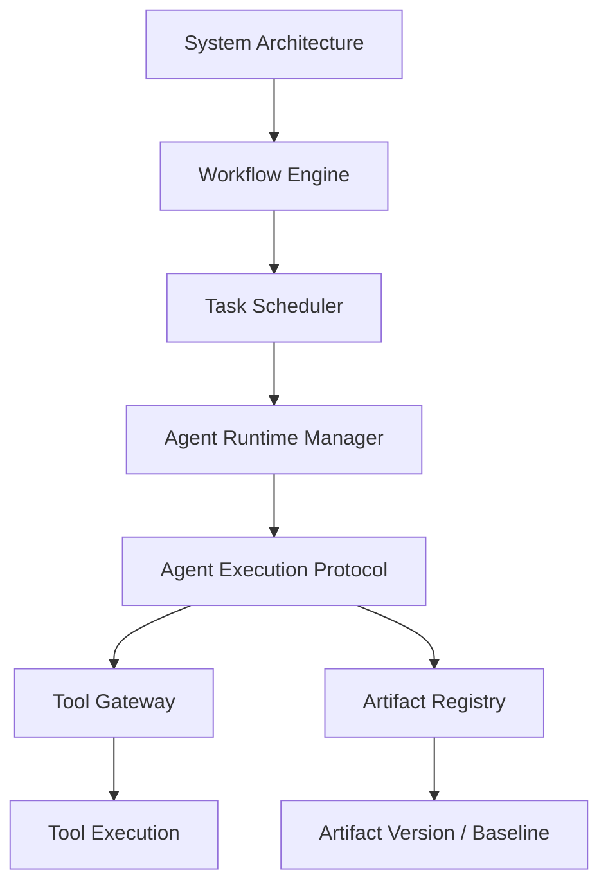

My judgment is: **these six documents are sufficient to form the Phase 1 core architecture and protocol baseline of the AI Engineering Orchestration Platform, but they are not sufficient to form a complete platform engineering specification, and they are not sufficient to guide every subsystem directly into production-grade implementation.**

I do not recommend adding documents without limit because of that. What matters is to distinguish three layers:

1. Platform core architecture documents.
2. Platform shared infrastructure and interface specifications.
3. Detailed design and implementation specifications for each subsystem.

Once these three layers are distinct, the number of documents can be kept under control.

## **I. What Do the Existing Six Documents Cover?**

Start with the current coverage.

| # | Document                                   | Primary responsibility                                      | Completion status |
| - | ------------------------------------------ | ----------------------------------------------------------- | ----------------- |
| 1 | System Architecture Specification          | Platform architecture, subsystem boundaries, and deployment architecture | Core architecture |
| 2 | Agent Execution Protocol Specification     | Agent execution protocol, execution context, and interaction | Core protocol     |
| 3 | Workflow Engine & Task Scheduler SRS       | Workflow, task management, scheduling, and dependencies     | Core subsystem    |
| 4 | Artifact Registry & Versioning SRS         | Engineering outputs, versions, baselines, and provenance    | Core subsystem    |
| 5 | Tool Gateway & Tool Execution Protocol     | Tool discovery, authorization, invocation, and execution    | Core protocol     |
| 6 | Agent Runtime Manager SRS                  | Lifecycle management of an Agent Execution Session          | Core subsystem    |

These six documents cover the six mechanisms that matter most to the platform:

## **AI Engineering Orchestration Core**

**Workflow**

Process and task orchestration

**Agent**

Agent execution and lifecycle

**Tool**

Tool invocation and execution

**Artifact**

Engineering outputs and versions

**Architecture**

Overall system structure

**Execution Protocol**

Cross-component execution contracts

Together they cover the platform's main execution path:



These six documents are the platform's core architecture and execution specifications. The set is deliberate.

## **II. Which Key Specifications Are Still Missing?**

I see at least four gaps that still need to be closed.

### **1. Platform Internal API & Interface Control Specification**

Highest priority

This is the specification I consider most necessary to add now.

The six documents each define their own responsibilities. Interfaces across subsystems still need to be unified.

For example:

- How does the Workflow Engine ask the Agent Runtime Manager to create an Agent Execution?
- How does the Agent Runtime Manager start an Agent Runtime?
- How does an Agent Runtime invoke the Tool Gateway?
- How does the Tool Gateway reach the Policy Engine?
- How does the Tool Gateway request the Credential Broker?
- How does an Agent Runtime hand a result to the Artifact Registry?
- How does the Artifact Registry notify the Workflow Engine that an Artifact Version has been created?

If each document defines its own API, the interfaces will diverge.

For example:

```
Workflow Engine
    |
    | CreateAgentExecution
    v
Agent Runtime Manager
    |
    | StartExecution
    v
Agent Runtime
    |
    | InvokeTool
    v
Tool Gateway
```

These interfaces need one definition for:

| Topic              | What it covers                          |
| ------------------ | --------------------------------------- |
| Service Identity   | Service identity                        |
| API Contract       | Request and response structure          |
| Authentication     | Authentication between services         |
| Authorization      | Access control between services         |
| Error Model        | A common error model                    |
| Idempotency        | Idempotency                             |
| Correlation ID     | Correlation across services             |
| Versioning         | Interface version compatibility         |
| Timeout            | Call timeout                            |
| Retry              | Retry semantics                         |

Recommended filename:

**Platform Internal API & Interface Control Specification**

It owns the interface contracts among all subsystems.

### **2. Platform Event & Messaging Specification**

Highest priority

The AI Engineering Orchestration Platform is a highly asynchronous system.

Examples:

- Task Created
- Task Scheduled
- Agent Execution Started
- Agent Execution Completed
- Tool Execution Started
- Tool Execution Completed
- Artifact Version Created
- Validation Completed
- Approval Rejected
- Workflow Completed

Each subsystem should use one message format for these events.

The following need to be unified:

| Topic                | What it covers                    |
| -------------------- | --------------------------------- |
| Event Envelope       | A common event structure          |
| Event Naming         | Event naming rules                |
| Event Versioning     | Event versions                    |
| Event Publisher      | Event publication rules           |
| Event Consumer       | Event consumption rules           |
| Delivery Semantics   | Message delivery semantics        |
| Ordering             | Event order                       |
| Idempotency          | Idempotent consumption            |
| Replay               | Event replay                      |
| Dead Letter          | Dead-letter handling              |
| Outbox / Inbox       | Reliable messaging                |

Recommended filename:

**Platform Event & Messaging Protocol Specification**

This specification and the Execution Events in the Tool Execution Protocol have different jobs.

The Tool Execution Protocol defines the business meaning of tool-execution events. The Platform Event & Messaging Specification defines the transport, delivery, and consumption rules used by the whole system.

### **3. Platform Data Ownership & Consistency Specification**

Important

This is the part most often left out of a microservice or distributed platform.

Each subsystem must have an explicit set of data it owns, and the other subsystems must have an explicit way to reference that data.

For example:

| Data object                 | Sole authoritative owner                     |
| --------------------------- | -------------------------------------------- |
| Workflow Definition         | Workflow Engine                              |
| Task                        | Workflow Engine                              |
| Agent Execution Session     | Agent Runtime Manager                        |
| Agent Contract              | Agent Registry / Contract Management         |
| Tool Definition             | Tool Registry                                |
| Tool Execution              | Tool Gateway                                 |
| Artifact                    | Artifact Registry                            |
| Artifact Version            | Artifact Registry                            |
| Baseline                    | Artifact Registry                            |

It also needs to define:

- Which data may be read across services?
- Which data may be modified only through the owning service's API?
- Which data may be cached?
- How does a cache expire?
- How are cross-service transactions handled?
- How is eventual consistency handled?
- How are duplicate creation and inconsistent state avoided?
- How is state recovered after a service crash?

Recommended filename:

**Platform Data Ownership & Consistency Specification**

This document keeps multiple subsystems from maintaining the same business state.

### **4. Platform Security & Governance Specification**

Important

The existing documents already touch authorization, credentials, sandboxing, and approval. They do not yet form one security-governance specification.

I recommend defining, in one place:

- Platform Identity Model
- Tenant Isolation
- Service-to-Service Authentication
- Agent Identity
- Delegated Authority
- Capability & Permission Model
- Policy Evaluation
- Credential Management
- Secret Injection
- Human Approval
- Audit Logging
- Security Boundary
- Trust Model

Some of these capabilities belong to separate subsystems. They should stay out of a single Security Service.

For example:

| Capability        | Recommended owner                |
| ----------------- | -------------------------------- |
| Identity          | Identity & Access Management     |
| Policy decision   | Policy Engine                    |
| Credential management | Credential Broker            |
| Execution isolation | Execution Sandbox              |
| Human approval    | Review & Approval                |
| Audit             | Audit Service                    |

Recommended filename:

**Platform Security & Governance Architecture Specification**

## **III. Are Other Independent Subsystems Still Required?**

Yes. Each capability still has to be explicit in the system architecture. Each capability does not need its own top-level specification.

I see six further capabilities that the system architecture must name.

| Capability                               | Required | Recommendation                                      |
| ---------------------------------------- | -------- | --------------------------------------------------- |
| Agent Registry & Contract Management     | Yes      | Manage Agent identity, versions, and input/output contracts |
| Context Management                       | Yes      | Manage Agent execution context and context references |
| Policy Engine                            | Yes      | One place for policy decisions                      |
| Credential Broker                        | Yes      | Manage credential access for tools and Agents       |
| Review & Approval                        | Yes      | Manage engineering approvals and human gates        |
| Quality Gate & Validation                | Yes      | Manage automated verification and quality gates     |

Two distinctions are easy to lose.

**First, the Agent Registry and the Agent Runtime Manager are different.**

The Agent Registry owns Agent definitions, capabilities, versions, and contracts.

The Agent Runtime Manager owns creation, running, suspension, resumption, and termination of an Agent Execution Session.

**Second, the Quality Gate and the Artifact Registry are different.**

The Artifact Registry manages engineering outputs.

The Quality Gate decides whether an engineering output has passed verification, for example:

- Whether the PRD is complete.
- Whether the architecture satisfies its constraints.
- Whether the SRS satisfies the requirements.
- Whether API contracts are consistent.
- Whether the code has passed its tests.
- Whether the security scan has passed.

This is a capability that separates an AI engineering platform from a general agent-workflow platform.

## **IV. The Document System I Recommend**

I recommend organizing the documents in three levels, with every specification kept inside its level.

## **Level 1 — Platform Architecture & Core Protocols**

Defines the overall platform structure and the core execution contracts.

1. AI Engineering Orchestration Platform — System Architecture Specification
2. Agent Execution Protocol Specification
3. Tool Gateway & Tool Execution Protocol

## **Level 2 — Core Subsystem SRS**

Defines the functional requirements of each core subsystem.

4. Workflow Engine & Task Scheduler SRS
5. Artifact Registry & Versioning SRS
6. Agent Runtime Manager SRS
7. Agent Registry & Contract Management SRS
8. Context Management SRS
9. Policy Engine & Credential Broker SRS
10. Review & Approval & Quality Gate SRS

## **Level 3 — Platform Integration & Governance**

Defines the shared rules that cross services.

11. Platform Internal API & Interface Control Specification
12. Platform Event & Messaging Protocol Specification
13. Platform Data Ownership & Consistency Specification
14. Platform Security & Governance Architecture Specification

Items 7–10 may be merged or split according to the actual deployment. The Policy Engine and the Credential Broker, for example, can be two services, and in an early deployment they can be two modules of one security-infrastructure domain.

**Services should be split because the deployment needs the split. Document count is not a reason to split them.**

## **V. How Should the Work Proceed?**

I do not recommend writing the remaining eight documents immediately.

A sounder sequence is:

| Stage | Work                                          | Purpose                                                          |
| ----- | --------------------------------------------- | ---------------------------------------------------------------- |
| 1     | Consistency review of the six core documents  | Remove conflicts in interfaces, identity, state, and responsibility |
| 2     | Platform Internal API & Interface Control     | Unify subsystem interfaces                                       |
| 3     | Platform Event & Messaging                    | Unify asynchronous communication                                 |
| 4     | Platform Data Ownership & Consistency         | Unify data boundaries                                            |
| 5     | Platform Security & Governance                | Unify security governance                                        |
| 6     | The remaining subsystem SRS documents         | Complete Agent, Context, Quality Gate, and related capabilities  |
| 7     | Subsystem SDS documents                       | Move into database, module, API, state-machine, and implementation design |
| 8     | Integration & Conformance Testing             | Verify cross-system integration                                  |

Stage 1 in particular cannot be done by placing the six documents side by side. It requires an Architecture & Protocol Consistency Review.

For example, unify these identifiers:

- `workflow_id`
- `task_id`
- `agent_id`
- `agent_execution_id`
- `tool_id`
- `invocation_id`
- `execution_id`
- `artifact_id`
- `artifact_version_id`
- `context_id`
- `authorization_decision_id`

And unify the references among them, their lifecycles, and their data ownership.

## **VI. My Conclusion**

I would define this engineering specification as follows:

**The six documents are the platform core. A complete platform specification still includes the documents listed above.**

The platform also does not need dozens of mutually independent services and documents.

I recommend this final set:

- 1 System Architecture.
- 2 core Protocols.
- 6–8 core Subsystem SRS documents.
- 4 Platform Integration & Governance Specifications.
- An SDS, a test specification, and a deployment specification for each subsystem.

This is an engineering document system that is complete enough, and that stops short of over-design.

**The right next step is the AI Engineering Orchestration Platform — Architecture & Protocol Consistency Review.** Use the existing six documents as input. Check responsibility boundaries, interface contracts, execution state machines, data ownership, and security boundaries. After the conflicts are resolved, write the three cross-system foundation specifications.

The later SDS documents then have a reliable architecture baseline.
