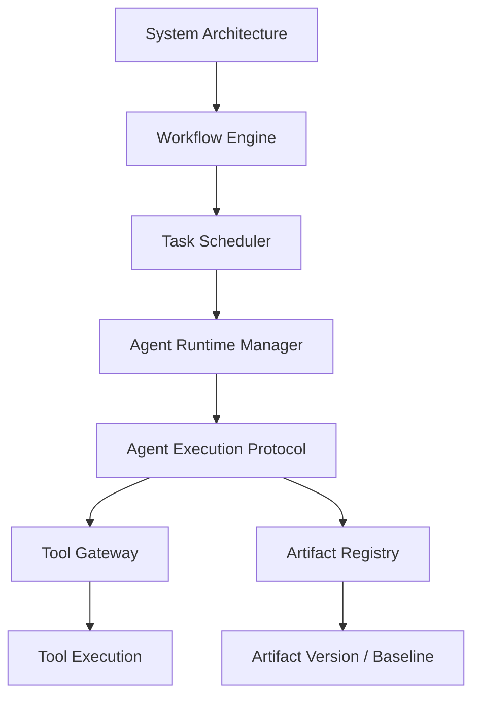

我的判断是：**这六份文档足以构成 AI Engineering Orchestration Platform 的第一阶段核心架构与协议基线，但不足以构成完整的平台工程规范，也不足以直接指导所有子系统进入生产级实现。**

不过，我不建议因此无限增加文档。真正重要的是区分：

1. 平台核心架构文档。
2. 平台公共基础设施与接口规范。
3. 各子系统的详细设计与实现规范。

如果把这三层区分清楚，文档数量可以控制得很好。

## **一、现有六份文档覆盖了什么？**

先看目前的覆盖情况。

| # | 文档                                     | 主要职责                               | 完成情况  |
| - | -------------------------------------- | ---------------------------------- | ----- |
| 1 | System Architecture Specification      | 定义平台整体架构、子系统边界、部署架构                | 核心架构  |
| 2 | Agent Execution Protocol Specification | 定义 Agent 的执行协议、执行上下文与交互            | 核心协议  |
| 3 | Workflow Engine & Task Scheduler SRS   | 定义工作流、任务管理、调度和依赖                   | 核心子系统 |
| 4 | Artifact Registry & Versioning SRS     | 定义工程成果、版本、Baseline 和溯源             | 核心子系统 |
| 5 | Tool Gateway & Tool Execution Protocol | 定义工具发现、授权、调用和执行                    | 核心协议  |
| 6 | Agent Runtime Manager SRS              | 定义 Agent Execution Session 的生命周期管理 | 核心子系统 |

这六份实际上覆盖了平台最重要的六个机制：

## **AI Engineering Orchestration Core**

**Workflow**

流程与任务编排

**Agent**

Agent 执行与生命周期

**Tool**

工具调用与执行

**Artifact**

工程成果与版本

**Architecture**

整体系统结构

**Execution Protocol**

跨组件执行契约

这已经覆盖了平台的主要执行主干：



因此，这六份不是随意选择的六份文档，而是平台的核心架构和执行规范。

## **二、还缺少哪些关键规范？**

我认为至少还有四类问题需要解决。

### **1. Platform Internal API & Interface Control Specification**

优先级最高

这是我认为当前最需要补充的一份规范。

目前六份文档分别定义了自己的职责，但是跨子系统之间的接口还需要统一。

例如：

- Workflow Engine 如何请求 Agent Runtime Manager 创建 Agent Execution？
- Agent Runtime Manager 如何启动 Agent Runtime？
- Agent Runtime 如何向 Tool Gateway 发起调用？
- Tool Gateway 如何访问 Policy Engine？
- Tool Gateway 如何请求 Credential Broker？
- Agent Runtime 如何将结果交给 Artifact Registry？
- Artifact Registry 如何通知 Workflow Engine 某个 Artifact Version 已经产生？

如果每份文档独立定义 API，最终很容易出现接口不一致。

例如：

```
Workflow Engine
    |
    | CreateAgentExecution
    v
Agent Runtime Manager
    |
    | StartExecution
    v
Agent Runtime
    |
    | InvokeTool
    v
Tool Gateway
```

这些接口需要统一定义：

| 内容               | 说明      |
| ---------------- | ------- |
| Service Identity | 服务身份    |
| API Contract     | 请求与响应结构 |
| Authentication   | 服务间身份认证 |
| Authorization    | 服务间访问控制 |
| Error Model      | 统一错误模型  |
| Idempotency      | 幂等机制    |
| Correlation ID   | 跨服务关联   |
| Versioning       | 接口版本兼容  |
| Timeout          | 调用超时    |
| Retry            | 重试语义    |

建议文件名：

**Platform Internal API & Interface Control Specification**

它负责统一所有子系统之间的接口契约。

### **2. Platform Event & Messaging Specification**

优先级最高

AI Engineering Orchestration Platform 是一个高度异步的系统。

例如：

- Task Created
- Task Scheduled
- Agent Execution Started
- Agent Execution Completed
- Tool Execution Started
- Tool Execution Completed
- Artifact Version Created
- Validation Completed
- Approval Rejected
- Workflow Completed

这些事件不应该由每个子系统自行发明一套消息格式。

需要统一：

| 内容                 | 说明     |
| ------------------ | ------ |
| Event Envelope     | 统一事件结构 |
| Event Naming       | 事件命名规则 |
| Event Versioning   | 事件版本   |
| Event Publisher    | 事件发布规范 |
| Event Consumer     | 事件消费规范 |
| Delivery Semantics | 消息投递语义 |
| Ordering           | 事件顺序   |
| Idempotency        | 消费幂等   |
| Replay             | 事件重放   |
| Dead Letter        | 死信处理   |
| Outbox / Inbox     | 可靠消息机制 |

建议文件名：

**Platform Event & Messaging Protocol Specification**

注意，它与 Tool Execution Protocol 中的 Execution Events 不重复。

Tool Execution Protocol 定义工具执行事件的业务语义；Platform Event & Messaging Specification 定义整个系统通用的事件传输、投递和消费规则。

### **3. Platform Data Ownership & Consistency Specification**

重要

这是微服务或分布式平台非常容易遗漏的部分。

需要明确每个子系统拥有哪些数据，以及其他子系统如何引用这些数据。

例如：

| 数据对象                    | 唯一权威所有者                              |
| ----------------------- | ------------------------------------ |
| Workflow Definition     | Workflow Engine                      |
| Task                    | Workflow Engine                      |
| Agent Execution Session | Agent Runtime Manager                |
| Agent Contract          | Agent Registry / Contract Management |
| Tool Definition         | Tool Registry                        |
| Tool Execution          | Tool Gateway                         |
| Artifact                | Artifact Registry                    |
| Artifact Version        | Artifact Registry                    |
| Baseline                | Artifact Registry                    |

还需要定义：

- 哪些数据允许跨服务读取？
- 哪些数据只能通过所属服务 API 修改？
- 哪些数据可以缓存？
- 缓存如何失效？
- 跨服务事务如何处理？
- 如何处理最终一致性？
- 如何避免重复创建和状态不一致？
- 如何处理服务崩溃后的状态恢复？

建议文件名：

**Platform Data Ownership & Consistency Specification**

这份文档能防止多个子系统同时维护同一份业务状态。

### **4. Platform Security & Governance Specification**

重要

现有文档已经涉及授权、凭证、Sandbox 和审批，但尚未形成统一的安全治理规范。

我建议统一定义：

- Platform Identity Model
- Tenant Isolation
- Service-to-Service Authentication
- Agent Identity
- Delegated Authority
- Capability & Permission Model
- Policy Evaluation
- Credential Management
- Secret Injection
- Human Approval
- Audit Logging
- Security Boundary
- Trust Model

其中有些能力应该由独立子系统负责，而不是全部塞进一个 Security Service。

例如：

| 能力   | 建议归属                         |
| ---- | ---------------------------- |
| 身份管理 | Identity & Access Management |
| 策略决策 | Policy Engine                |
| 凭证管理 | Credential Broker            |
| 执行隔离 | Execution Sandbox            |
| 人工审批 | Review & Approval            |
| 审计   | Audit Service                |

建议文件名：

**Platform Security & Governance Architecture Specification**

## **三、是否还需要其他独立子系统？**

需要，但并不代表每个能力都必须单独写一份顶层规范。

我认为还有六个需要在系统架构中明确的能力。

| 能力                                   | 是否需要 | 建议                    |
| ------------------------------------ | ---- | --------------------- |
| Agent Registry & Contract Management | 是    | 管理 Agent 身份、版本、输入输出契约 |
| Context Management                   | 是    | 管理 Agent 执行上下文及上下文引用  |
| Policy Engine                        | 是    | 统一策略决策                |
| Credential Broker                    | 是    | 管理工具与 Agent 的凭证访问     |
| Review & Approval                    | 是    | 管理工程审批和人工门禁           |
| Quality Gate & Validation            | 是    | 管理自动化验证与质量门禁          |

这里特别强调两个容易遗漏的部分。

**第一，Agent Registry 不等于 Agent Runtime Manager。**

Agent Registry 负责 Agent 的定义、能力、版本和契约。

Agent Runtime Manager 负责 Agent Execution Session 的创建、运行、暂停、恢复和终止。

两者不能混为一谈。

**第二，Quality Gate 不等于 Artifact Registry。**

Artifact Registry 管理工程成果。

Quality Gate 管理工程成果是否通过验证，例如：

- PRD 是否完整。
- Architecture 是否符合约束。
- SRS 是否满足需求。
- API Contract 是否一致。
- Code 是否通过测试。
- Security Scan 是否通过。

这是 AI Engineering 平台区别于普通 Agent Workflow 平台的一个关键能力。

## **四、我建议的最终文档体系**

我建议把文档组织为三个层级，而不是把所有规范都放在同一层。

## **Level 1 — Platform Architecture & Core Protocols**

定义平台整体结构和核心执行契约

1. AI Engineering Orchestration Platform — System Architecture Specification
2. Agent Execution Protocol Specification
3. Tool Gateway & Tool Execution Protocol

## **Level 2 — Core Subsystem SRS**

定义各核心子系统的功能需求

4. Workflow Engine & Task Scheduler SRS
5. Artifact Registry & Versioning SRS
6. Agent Runtime Manager SRS
7. Agent Registry & Contract Management SRS
8. Context Management SRS
9. Policy Engine & Credential Broker SRS
10. Review & Approval & Quality Gate SRS

## **Level 3 — Platform Integration & Governance**

定义跨服务的公共规则

11. Platform Internal API & Interface Control Specification
12. Platform Event & Messaging Protocol Specification
13. Platform Data Ownership & Consistency Specification
14. Platform Security & Governance Architecture Specification

这里的 7–10 可以根据实际部署方式合并或拆分。例如，Policy Engine 和 Credential Broker 可以作为两个独立服务，也可以在早期部署中作为同一个安全基础设施域的两个模块。

**不需要为了文档数量而人为拆分微服务。**

## **五、接下来应该怎么推进？**

我不建议现在立即开始编写剩余八份文档。

更合理的推进顺序是：

| 阶段 | 工作                                        | 目的                                |
| -- | ----------------------------------------- | --------------------------------- |
| 1  | 六份核心文档一致性审查                               | 消除接口、身份、状态和职责冲突                   |
| 2  | Platform Internal API & Interface Control | 统一子系统接口                           |
| 3  | Platform Event & Messaging                | 统一异步通信                            |
| 4  | Platform Data Ownership & Consistency     | 统一数据边界                            |
| 5  | Platform Security & Governance            | 统一安全治理                            |
| 6  | 补齐必要的子系统 SRS                              | 完善 Agent、Context、Quality Gate 等能力 |
| 7  | 各子系统 SDS                                  | 进入数据库、模块、API、状态机和实现设计             |
| 8  | Integration & Conformance Testing         | 验证跨系统集成                           |

尤其是第一阶段，不能简单地把六份文档拼在一起。需要进行一次真正的 Architecture & Protocol Consistency Review。

例如，统一以下关键对象：

- `workflow_id`
- `task_id`
- `agent_id`
- `agent_execution_id`
- `tool_id`
- `invocation_id`
- `execution_id`
- `artifact_id`
- `artifact_version_id`
- `context_id`
- `authorization_decision_id`

并统一它们之间的引用关系、生命周期和数据所有权。

## **六、我的最终结论**

我会这样定义这套工程规范：

**六份文档是平台核心，不是完整平台规范。**

但也不需要把平台设计成几十个互相独立的服务和文档。

我建议最终采用：

- 1 份 System Architecture。
- 2 份核心 Protocol。
- 6–8 份核心 Subsystem SRS。
- 4 份 Platform Integration & Governance Specifications。
- 各子系统对应的 SDS、测试规范和部署规范。

这是一套比较完整、同时又不会过度设计的工程文档体系。

**我认为现在最正确的下一步不是继续增加 SRS，而是先做《AI Engineering Orchestration Platform — Architecture & Protocol Consistency Review》。** 把现有六份文档作为输入，检查职责边界、接口契约、执行状态机、数据所有权和安全边界。确认没有冲突后，再制定三份跨系统基础规范。

这样后续的 SDS 才有可靠的架构基线。